## 用途与边界

本文件定义一次采集任务的**生命周期状态、操作语义、计数口径和结果字段**。这里的“任务”指采集任务，不是开发任务 D01～D09。

状态和计数是对外契约；数据库、队列、进程模型和内部枚举名可以不同，但必须能无损映射到本文件。任务状态、系统结果、业务验收是三件事，不能用一个字段互相覆盖。

构建 Agent 会话不是采集任务，不套用本文件的生命周期；其用户可见控制、暂停／取消和恢复语义见[界面与任务管理](06-界面与任务管理.md)，状态与 harness 契约见[构建 Agent Harness 契约](adr/0005-构建Agent与Harness契约.md)。

质量反馈（`quality_feedback`）、规则版本状态和修复构建状态也不是任务状态；它们的字段与生命周期见[规则修复与异常工作流](34-规则修复与异常工作流.md)。不得把它们写进 `tasks.state`、任务 `outcome` 或本文件的计数口径。

## 任务边界与跨任务资源

- 默认一个采集任务对应一个站点、一个方案版本和一个市场；`task_id` 不跨站点，任务计数不跨任务合并。
- 同一站点的多个任务只在复采、方案版本切换、不同市场或不同深度时出现；它们各自维护状态和计数，但同一 worker 进程内共享站点级限速、会话和资源配额；不同 worker 进程的限速不合并。
- 站点分组、批次视图只做展示，不是任务状态或计数单位。批次可以作为组织和筛选字段（如 `batch_id`）用于导入、筛选和交付，但批次状态和汇总由成员任务派生，不新增任务状态，也不把不同任务的商品数简单相加。
- 全局任务槽位、浏览器实例和出口配额属于调度层，不是任务状态；任务槽位不足时任务保持 `QUEUED` 并记录原因。批次启动只把可采站点任务置为 `QUEUED`，不提高槽位；浏览器槽位不足时当前实现可能在任务已领取后等待槽位，界面不能只凭 `RUNNING` 判断是否实际在抓取。
- 一个任务暂停或取消，不改变同站其他任务的状态、计数和结果接纳。

## 操作定义与恢复语义

状态和操作术语的用户速查见[术语表](术语表.md)；本节只定义契约行为。

| 操作 | 语义 | 状态 | 在途工作 | 能否恢复 |
| --- | --- | --- | --- | --- |
| 暂停 | 先停下，之后继续；停止派发新工作 | `QUEUED` → `PAUSED`；`RUNNING` → `PAUSING` → `PAUSED` | 排队任务没有在途；运行中任务等在途结清，不强行中断 | 能，从检查点或原排队位置继续 |
| 恢复 | 继续暂停或崩溃中断的任务 | `PAUSED` → `QUEUED`／`RUNNING` | 从账本重新派发 | 有条件，见下 |
| 续采 | 预算耗尽或发现截断后沿用已采结果继续 | `FINISHED` → `QUEUED` | 保留已采结果；按需重置导航／发现项 | 能，仅限 `FINISHED` 且仍有剩余工作或发现截断 |
| 取消 | 不打算继续；阻止后续写入并回收资源 | `RUNNING` → `CANCELLING` → `CANCELLED` | 按策略中止或等待，迟到结果拒收 | 不能；只能新建任务 |
| 归档 | 从列表收起 | 终态任务移到回收区 | 无 | 还原只恢复显示 |
| 永久移除 | 删除记录、结果和产物 | 独立操作 | 无 | 不能 |
| 重跑／再采 | 用新时点、新范围或新版本重新采 | 新 `task_id` | 全新执行 | 不是恢复 |

强制中止在途是单独的高级操作：把未完成项回到 `PENDING` 或按尝试上限标 `FAILED`，不改变暂停的可恢复语义；界面必须与默认暂停区分。

### 恢复条件

- 同一 `task_id`，且 `plan_id`、`plan_version`、市场、语言和执行环境仍兼容。
- 配额和资源可用；不可用时回到 `QUEUED` 并说明原因，不先启动再争抢。
- 输出目录和检查点存在且可读；缺失时从账本重建，不重新抓已接纳的结果。
- 浏览器内存、Cookie、页面状态和挑战通过状态不承诺恢复；恢复后按方案重新建立会话。
- `plan_version` 已变化时不做原地恢复；新建任务，旧任务结果和失败历史保留。

### 重跑与再采

- 重跑不是恢复：必须新建 `task_id`，重新执行发现和获取；旧任务保持终态和原计数。
- 预算续采是唯一例外：`FINISHED` 且仍有待采工作或发现截断时，可沿用同一 `task_id`、已采结果和账本继续；必须显式请求并记录 `continued_at`，`CANCELLED` 仍不可续采。
- 同一方案版本、同一范围、同一时点的重复提交按幂等键去重，不创建第二次执行。
- 修复方案后重新采集，先递增 `plan_version`，再建新任务；不热改正在跑的任务。

## 任务状态

| 状态 | 含义 | 进入条件 | 终态 |
| --- | --- | --- | --- |
| `DRAFT` | 已保存，尚未提交执行 | 创建 | 否 |
| `QUEUED` | 已提交，等待执行资源 | 启动 | 否 |
| `RUNNING` | 正在发现、获取、提取或校验 | 执行器接纳、恢复 | 否 |
| `PAUSING` | 已请求暂停，停止派发新工作，在途尚未结清 | 暂停 | 否 |
| `PAUSED` | 已暂停，在途已结清，不再派发新工作 | 在途结清，或从排队直接暂停 | 否 |
| `CANCELLING` | 已请求取消，停止派发并处理在途 | 取消 | 否 |
| `CANCELLED` | 已取消，迟到结果不再接纳，资源已回收或已报告残留 | 取消且无在途，或取消后在途结清 | 是 |
| `FINISHED` | 已结束，不再接纳新工作；结果见 `outcome` 和 `stop_reason` | 自然结束、保护性停止、失败 | 是 |

`ARCHIVED` 不是生命周期状态，是“回收区”可见性标记；只有终态任务可归档，还原只恢复显示，不重新采集。`DELETED` 是独立操作，不是状态；永久移除前单独确认，不删除共享方案、配置或其他任务数据。

### 状态转移

| 从 | 动作 | 到 | 条件 |
| --- | --- | --- | --- |
| `DRAFT` | 启动 | `QUEUED` | 入口、范围、市场／语言和方案版本有效 |
| `DRAFT` | 取消 | `CANCELLED` | 尚未提交执行，可直接终止 |
| `QUEUED` | 执行器接纳 | `RUNNING` | 资源可用；重复启动不创建第二次执行 |
| `QUEUED` | 取消 | `CANCELLED` | 尚未开始工作，可直接终止 |
| `QUEUED` | 暂停 | `PAUSED` | 尚未开始工作；恢复后重新排队 |
| `RUNNING` | 暂停 | `PAUSING` | 停止派发新工作；在途继续 |
| `PAUSING` | 在途结清 | `PAUSED` | 没有在途商品或导航；在途结果已结清 |
| `PAUSING` | 取消 | `CANCELLING` | 暂停请求转为取消 |
| `PAUSED` | 恢复 | `QUEUED` 或 `RUNNING` | 方案、环境和市场仍兼容；否则解释，不静默换方案 |
| `PAUSED` | 取消 | `CANCELLED` | 没有在途；释放自建资源后终止 |
| `RUNNING` | 取消 | `CANCELLING` | 停止派发；在途按取消策略处理 |
| `CANCELLING` | 在途结清 | `CANCELLED` | 迟到结果已拒绝；自建资源已回收或残留已报告 |
| `RUNNING` | 自然结束 | `FINISHED` | 队列结清，没有已知后续导航；不要求先证明全站总量 |
| `RUNNING` | 预算／访问／质量阻塞 | `FINISHED` | 保存已接纳结果和剩余工作；`outcome` 按结果判定 |
| `FINISHED` | 预算续采 | `QUEUED` | 仅预算耗尽／部分完成且仍有待采项或发现截断；保留已采结果，清除停止状态 |
| `FINISHED`／`CANCELLED` | 归档 | 可见性变更 | 在途已结清；只改显示，不重新采集 |
| 终态 | 永久移除 | 独立操作 | 单独确认；不影响共享方案、配置和其他任务 |

`PAUSING` 和 `CANCELLING` 是过渡态，不能长期停留。进程崩溃或重启后必须对账：`RUNNING` 从检查点恢复；`PAUSING` 在在途结清后进入 `PAUSED`；`CANCELLING` 完成取消并进入 `CANCELLED`。无法确认在途状态时，先停止接纳新结果并报告，不把未知状态改成成功。

`FINISHED` 仍然是运行历史意义上的终态：正常查看、导出和归档不改写原计数。预算续采不创建新 `task_id`，但会用同一账本继续处理剩余项并在结束时重写完整 CSV 和 `task-result.json`；上一段结果保留为 `task-result.previous.json`。这不是对任意 `FINISHED` 任务的“恢复”，只有预算耗尽／部分完成且存在剩余工作或发现截断时才允许。

排队任务暂停不经过 `PAUSING`；恢复沿用任务原有创建时间，不改变排队位置。`PAUSING` 只由 `RUNNING` 进入，排队任务不会停在 `PAUSING`。

下图只画生命周期主转移，完整条件以本节的状态转移表为准；归档／还原只改可见性，永久移除是独立操作，均不属于任务状态机。

```mermaid
stateDiagram-v2
    [*] --> DRAFT
    DRAFT --> QUEUED: 启动
    DRAFT --> CANCELLED: 取消
    QUEUED --> RUNNING: 执行器接纳
    QUEUED --> PAUSED: 暂停
    QUEUED --> CANCELLED: 取消
    RUNNING --> PAUSING: 暂停
    PAUSING --> PAUSED: 结清
    PAUSING --> CANCELLING: 取消
    PAUSED --> QUEUED: 恢复
    PAUSED --> RUNNING: 恢复
    PAUSED --> CANCELLED: 取消
    RUNNING --> CANCELLING: 取消
    CANCELLING --> CANCELLED: 结清
    RUNNING --> FINISHED: 结束或止损
    CANCELLED --> [*]
    FINISHED --> [*]
```



## 操作与幂等

| 操作 | 语义 | 重复请求 |
| --- | --- | --- |
| 创建 | 生成任务和任务标识，不自动开始 | 同一 `request_id` 返回同一任务，不重复创建 |
| 启动 | 将 `DRAFT` 推进到 `QUEUED`，由执行器接纳 | 已在排队／运行／结束则返回当前状态，不重复执行 |
| 暂停 | 排队任务直接进入 `PAUSED`；运行中进入 `PAUSING`，停止派发，在途结清后才是 `PAUSED` | 重复暂停不改变结果 |
| 恢复 | 从原进度继续；不承诺恢复浏览器内存 | 已恢复或已结束则返回当前状态 |
| 取消 | 按当前状态进入 `CANCELLING`（有在途）或直接 `CANCELLED`（无在途），阻止后续写入，回收自建资源 | 重复取消不改变结果；不把取消当暂停 |
| 归档／还原 | 只改变列表可见性 | 归档不停止后台；还原不重新采集 |
| 永久移除 | 删除任务记录、结果和产物，单独确认 | 不删除共享方案、配置或其他任务数据；文件占用时异步回收并报告残留 |

客户端应为创建、启动、取消等请求提供稳定的 `request_id`，服务端按它去重。任务结果写入至少按 `(task_id, product_key)` 或 `(task_id, normalized_source_url, plan_version)` 幂等；重试、重复提交和崩溃恢复不能产生重复商品或重复计数。

“停止”在界面上是歧义词，接口和状态必须明确是暂停还是取消；不能用一个“停止”按钮同时暗示两种结果。

## 计数口径

计数是任务边界内的事实，不是全站总量，也不把 HTTP 请求数、重试数或网址数直接当商品产量。

| 计数键 | 定义 | 关系／注意 |
| --- | --- | --- |
| `discovered_urls` | 规范化后在任务范围内的唯一业务网址数；含商品、目录、分页等 | 不等于商品数；诊断探针另记，重复网址、重试和请求次数不重复计 |
| `pending_navigation_entries` | 已发现但尚未访问的目录／分页／入口等导航网址数 | 与商品计数分开；预算停止后可以大于零 |
| `product_candidates` | 按商品身份去重后的候选商品数；一个商品的多个网址只算一个 | `= pending_products + in_flight_products + processed_products` |
| `pending_products` | 已识别为商品、尚未开始的候选数 | 预算／访问停止后可以大于零 |
| `in_flight_products` | 正在获取、提取或校验的候选数 | `PAUSED`、`CANCELLED`、`FINISHED` 时必须为零 |
| `processed_products` | 已得到终局商品级结论的候选数 | `= valid_products + excluded_products + failed_products` |
| `valid_products` | 满足[数据标准](02-数据标准与导出.md)、进入有效商品集的候选数 | 有效 CSV 的依据；部分描述可进入但必须标记 |
| `excluded_products` | 已处理但不进入有效集的候选数，如零价、范围外、重复或业务排除 | 必须保留原因；不要与技术失败合并 |
| `failed_products` | 已处理但因访问、提取、环境或方案错误失败的候选数 | 与业务排除分开；重试中的候选不算已失败 |
| `partial_description_products` | 有效商品中正文为部分提取的数量 | `<= valid_products`；是质量子集，不与有效数相加 |

不变量：

- `product_candidates = pending_products + in_flight_products + processed_products`；
- `processed_products = valid_products + excluded_products + failed_products`；
- `partial_description_products <= valid_products`；
- `PAUSED`、`CANCELLED`、`FINISHED` 时 `in_flight_products = 0`；
- `pending_products` 或 `pending_navigation_entries` 大于零时，不能把任务称为“全站完成”。

Web API 的任务读模型在任务运行中从 `task_items` 计算同一组规范计数；任务结束后优先使用 `task-result.json` 的 `counts`。运行中同时保留旧 Vue 控制台使用的 `pending`／`in_flight`／`excluded`／`failed` 短键作为兼容别名，v2 只读取规范键。暂停、继续、取消等控制接口只返回受理状态；需要完整任务对象的前端应在控制成功后重新读取 `/api/tasks/{task_id}`。

商品身份与去重策略由实现定义并在交付说明中写明；同一商品的多网址、多变体和多次请求不直接等于多个商品。重复网址在候选层合并，不单独计入候选；只有已进入候选后才发现重复的，才作为排除并保留原因。候选从导航改判为商品或反向改判时，调整对应计数，不重复计入两个集合。

### 发现任务的计数

只做网址发现、不提取商品数据的任务（`task_type=discovery`），不使用商品计数，改用 URL 计数：

| 计数键 | 定义 |
| --- | --- |
| `navigation_urls` | 已处理的导航工作项数，如入口、分类、分页、sitemap |
| `discovered_urls` | 发现并规范化后的唯一业务 URL 数，含导航和商品 URL |
| `url_candidates` | 命中商品 URL 判型的候选 URL 数 |
| `pending_urls` | 已识别为候选、尚未得到终局结论的 URL 数 |
| `valid_urls` | 通过范围和必要校验、进入 URL 清单的候选数 |
| `excluded_urls` | 已处理但不进入清单的候选数，如范围外、重复 |
| `failed_urls` | 因访问、解析、环境或规则错误没有结论的候选数 |

robots 不参与放行，也不计入 `valid_urls`／`excluded_urls`；所有阶段都机会式探测一次 `robots.txt`，只保留 `Sitemap:` 行并自动并入 sitemap 来源；见[网址发现与分页策略](22-网址发现与分页策略.md)。

不变量：

- `url_candidates = pending_urls + valid_urls + excluded_urls + failed_urls`；
- `valid_urls <= url_candidates <= discovered_urls`；
- discovery 任务的 `product_candidates`、`valid_products` 等商品计数不适用，不能拿 URL 数冒充商品数；
- 发现结果不等于全站总量；`coverage` 仍按本文件标 `KNOWN`／`PARTIAL`／`UNKNOWN`。

sitemap／分页实现前，`navigation_pages_fetched`、`new_product_urls`、`duplicate_product_urls`、`stop_signal`、`last_page_verified` 等扩展计数先在 `22` 讨论；落定后写回本表，不先写进任务结果。

product 任务继续使用上表的商品计数；如果 product 任务同时输出 URL 清单，URL 计数作为附加指标，不改变商品计数和不变量。

## 结果、覆盖与业务验收

| 字段 | 取值 | 约束 |
| --- | --- | --- |
| `task_type` | `product`、`discovery` | 决定使用商品计数还是 URL 计数；缺省按 `product` 解释 |
| `state` | `DRAFT`、`QUEUED`、`RUNNING`、`PAUSING`、`PAUSED`、`CANCELLING`、`CANCELLED`、`FINISHED` | 生命周期状态，不是业务结论 |
| `outcome` | `COMPLETED`、`PARTIAL`、`FAILED`、`CANCELLED` | `FINISHED` 时必填；`CANCELLED` 与状态一致 |
| `stop_reason` | `NATURAL_END`、`BUDGET_EXHAUSTED`、`ACCESS_DENIED`、`QUALITY_BLOCKED`、`ENVIRONMENT_ERROR`、`PLAN_ERROR`、`USER_CANCELLED`、`OTHER` | 说明为什么停，不替代计数 |
| `coverage` | 对象，见下表 | 没有可靠总量时不得编造百分比 |
| `business_acceptance` | 对象 | 用户业务结论，不覆盖 `outcome`、`stop_reason` 或未完成事实 |
| `quality_exceptions` | 数组，条件必填 | 存在正文非完整或非可选字段缺失的有效商品时必填；仅列这些商品，元素至少含 `source_url`、`description_status`、`partial_reason`、`missing_reasons`；正文完整且无非可选缺失的商品不重复列出。`brand`、`category`、`availability`、`options`、`sales_unit` 等可空字段缺失不计入该数组 |
| `content_audit` | 对象，可选 | 规则声明描述块审计时记录 `products_checked`、`description_gaps` 和最多 10 个 `samples`（`source_url`、`missing_blocks`）；缺口商品同时进入 `quality_exceptions`，不改变有效商品数 |

`quality_exceptions` 是导出侧的异常索引，不替代内部完整记录；正文完整且没有非可选缺失原因的商品不进入该数组。可空字段（如品牌）缺失仍保留在内部记录，但不作为质量异常；最终业务CSV固定为 `02` 定义的9列，不逐行携带这些质量字段。

`outcome` 的判定：

- `COMPLETED`：没有已知待处理商品或导航，且没有影响承诺范围的失败；部分描述已标记并不自动使任务变成未完成。
- `PARTIAL`：仍有已知待处理工作，或存在影响范围的商品失败，但已有有效结果。
- `FAILED`：没有可交付的有效结果，且失败来自环境、方案或访问边界，而不是用户主动取消。
- `CANCELLED`：用户取消；已接纳结果保留，未完成事实保留。

`valid_products = 0` 不自动等于 `FAILED`：如果范围已处理完、没有技术失败，只是商品全部被业务排除（例如原站零价），可以是 `COMPLETED`，但报告必须说明零有效的原因。反过来，有少量有效结果也不能掩盖仍在待处理的范围或技术失败。

### coverage

| `coverage.status` | 含义 | 要求 |
| --- | --- | --- |
| `KNOWN` | 有可靠分母，例如站点地图计数、目录计数或公开接口总数 | 记录分母来源、数值和观测时间；分母本身可能不完整，不能自动称为全站真值 |
| `PARTIAL` | 只有部分范围有分母，例如单个分类 | 标明适用范围；不能把局部比例写成全站比例 |
| `UNKNOWN` | 没有可靠分母 | 只展示阶段、增长计数和剩余入口；不显示伪百分比或剩余时间 |

`coverage` 至少包含 `status`、`denominator_source`、`denominator`、`covered` 和 `notes`；未知时 `denominator_source`、`denominator`、`covered` 可为空，`notes` 说明原因。用户验收可以接受 `UNKNOWN`，但不能把它改成 `KNOWN`。

多层目录的分母要写明层级（品牌／型号／零件或列表／详情）；不同层级不能相加成一个总量，也不能把型号数当零件数。覆盖比例只在同一层级、同一范围和同一观测时点内比较。

覆盖是进阶审计项。结构清晰、入口和身份稳定的常规任务可以返回 `UNKNOWN`，只保留已发现、已处理和停止原因，不强制构造全站分母；需要全站审计时再按上面的分母口径计算。

### business_acceptance

`business_acceptance` 至少包含 `status`、`accepted_by`、`accepted_at`、`reason` 和 `scope`。`status` 至少区分 `NOT_REVIEWED`、`ACCEPTED_BY_USER` 和 `REJECTED_BY_USER`。它表示用户认为本次业务范围是否够用，不改变系统实际停止原因、待处理数量和覆盖未知事实。`accepted_by` 记录验收人身份；如与任务创建者或执行者同一人，应在任务证据中注明自审，不能写成独立验收。角色定义见[用户角色与职责](31-用户角色与职责.md)。

## 最小结果示例

以下为合成示例，字段值不是线上采集结果。

```json
{
  "synthetic_example": true,
  "task_id": "example-task-01",
  "plan_id": "example-plan",
  "plan_version": "example-plan-v1",
  "market": "GB",
  "locale": "en-GB",
  "state": "FINISHED",
  "outcome": "PARTIAL",
  "stop_reason": "BUDGET_EXHAUSTED",
  "started_at": "2026-10-27T14:00:00Z",
  "finished_at": "2026-10-27T14:10:00Z",
  "counts": {
    "discovered_urls": 5,
    "pending_navigation_entries": 2,
    "product_candidates": 3,
    "pending_products": 0,
    "in_flight_products": 0,
    "processed_products": 3,
    "valid_products": 2,
    "excluded_products": 1,
    "failed_products": 0,
    "partial_description_products": 1
  },
  "coverage": {
    "status": "UNKNOWN",
    "denominator_source": null,
    "denominator": null,
    "covered": null,
    "notes": "没有可靠的全站总量；保留已发现和已处理事实"
  },
  "business_acceptance": {
    "status": "ACCEPTED_BY_USER",
    "accepted_by": "示例验收人",
    "accepted_at": "2026-10-27T14:10:00Z",
    "reason": "已取得业务所需商品，认可本次范围；知悉两个目录待访问、覆盖未知及一条部分描述。",
    "scope": "本次任务已发现的范围"
  },
  "quality_exceptions": [
    {
      "source_url": "https://shop.example/products/filter",
      "description_status": "PARTIAL",
      "partial_reason": "复杂车型适配表经有界观察仍无法可靠取得；现保留已验证的产品说明。",
      "missing_reasons": {}
    }
  ],
  "runtime": {
    "llm_calls": 0,
    "raw_pages_retained": false
  }
}
```

浏览器任务可在 `runtime` 下附带 `http_engine`、`fetch_engines` 和 `browser`（launched／headless／binary／version／pid／profile），在 `resources` 下附带 `browser_pid` 和 `browser_profile`。这些是诊断字段，不改变计数、状态或 `outcome`；PID 只在任务运行期有意义，任务结束后不能当作可复用的进程号。页面存档任务可在 `runtime.archive` 附带 `mode`、`pages`、`bytes`、`hits`、`misses`、`writes`、`limit_reached` 和 `errors`；它同样只作诊断，不改变业务计数。

## 崩溃恢复与迟到结果

崩溃不是生命周期状态；进程或断电后，账本可能仍显示 `RUNNING`，以心跳过期和对账结果为准。

### 启动对账

1. 扫描心跳过期的 `RUNNING`、`PAUSING`、`CANCELLING` 任务。
2. 把 `IN_FLIGHT` 工作项改为 `PENDING`；`attempts` 在领取时已计入，不重复加一；达到上限的改 `FAILED`。不能假设“开始过等于完成”。
3. 从账本重建计数，校验不变量；`PAUSED`、`CANCELLED`、`FINISHED` 时 `in_flight_products` 必须为零。
4. 修复输出：隔离或删除临时文件；未完成的 CSV／JSON 重新生成；不把半成品当结果。
5. 回收自建资源：浏览器进程、profile、临时目录、文件锁。
6. 校验恢复条件；兼容则恢复（`RUNNING`）或停在 `PAUSED`，不兼容则 `FINISHED` 并写 `stop_reason`。
7. 写恢复事件，保留对账证据。

`app` 的任务租约把“心跳过期”落成可执行条件：租约缺失或过期才进入上述对账；活租约不重排。旧持有者在接管后写入会按 `lease_token` 被拒绝，不能把迟到结果写回账本。

### 检查点

- 至少按商品候选保存：商品键、来源网址、当前状态、尝试次数、方案版本和更新时间。
- 已接纳结果不可被重试覆盖；重试按幂等键 `(task_id, product_key)` 或 `(task_id, normalized_source_url, plan_version)` 接纳。
- 结果先持久化，再标记完成；不允许“先标记完成、后补结果”。

### 迟到结果

- 取消后到达的结果按 `task_id`、方案版本和取消时间拒绝，记录拒收原因，不进入有效集或计数。
- 取消必须实际结束自建执行和资源；观察超时只表示本次查看结束，不表示后台已停止。
- 归档只改变可见性；永久移除不删除共享方案、配置或其他任务数据。

## 验收映射

| 任务或场景 | 应检查 |
| --- | --- |
| D07／A13 | 重复提交、进程异常、执行中取消；结果不重复、进度可解释、迟到结果不接纳、资源实际结清 |
| D08／A16 | 创建、查看、暂停、恢复、取消、归档、导出；按钮反馈与实际状态一致，页面关闭不停止后台 |
| A17 | 用户验收与系统停止原因并存；`UNKNOWN` 覆盖不被改成百分比，剩余入口保留 |
| D09 | 报告同时列出有效、排除、失败、待处理和覆盖状态，不以单一“完成率”概括 |

## 常见错误

- 把 HTTP 请求数、重试数或网址数直接相加当商品产量。
- 把暂停当取消，或在在途未结清时显示“已暂停／已取消”。
- 取消后仍接纳迟到结果，或把已接纳结果回滚成未完成。
- 没有可靠分母却显示“100%”或剩余时间。
- 用业务验收覆盖系统停止原因、待处理数量或覆盖未知。
- 用同一个任务承载新时点／新范围；修复或再采应新建任务并保留旧历史。
- 把临时失败第一次就写成终态 `FAILED`，或把 `IN_FLIGHT` 当完成；重启时重复增加尝试次数。
