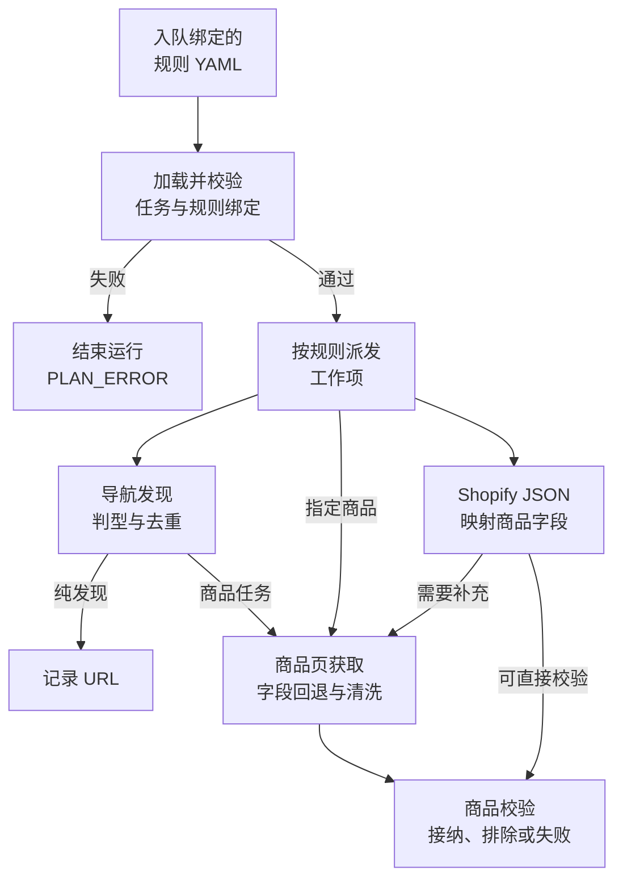

## 用途与边界

本文定义 v1 的**采集规则包**和**采集任务运行时**：规则怎么表达网址发现、有效请求、产品提取；任务怎么启动、暂停、取消、恢复和并行。

本文是运行设计，不替代业务口径：

- 数据字段、价格、描述和 9 列 CSV 以[数据标准与导出](02-数据标准与导出.md)为准。
- 方案包外壳和 manifest 字段以[采集方案与兼容契约](08-采集方案与兼容契约.md)为准。
- 任务生命周期、计数和结果字段以[任务状态与计数契约](09-任务状态与计数契约.md)为准；本文只补 discovery 任务的计数口径。
- 状态、操作和失败分类的用户速查见[术语表](术语表.md)。
- 基础字段回退和清洗默认以[通用采集模板](18-通用采集模板.md)为准。

当前应用实现在 `app/src/ecom_crawler/`，使用单机 worker 与 SQLite 任务账本。`experiments/r06/runtime/` 留作原型和历史验证。Web、CLI 与构建流程的连接见[任务服务架构](26-D08任务服务与界面设计.md#目标架构)，版本安装与生效见[规则版本生命周期](34-规则修复与异常工作流.md#规则版本生命周期)。

## 设计原则

- **早期简单，但不堵死后续**：v1 单进程、SQLite、线程池即可；任务、阶段、工作项的契约先定，后续换进程、换队列不重写规则。
- **并行单位是工作项**：同一任务内并行处理 URL／商品；任务之间由调度层并行。不是把整条规则当一个不可分割的黑盒。
- **方案版本化，运行锁定规则**。入队记录规则路径、版本和 YAML 文件哈希。激活切换站点指针，已有运行继续按入队绑定读取和校验。各入口选版方式见[新建运行的规则绑定](49-任务树与最近任务工作台设计.md#新建运行的规则绑定)。
- **任务隔离**：每个任务独立状态、计数、输出目录和会话；全局只共享限速、并发上限等调度资源。
- **声明式优先，复杂发现走适配器**。当前应用运行 `declarative` 和 `hybrid`。`hybrid` 的包内适配器负责发现 URL，商品字段和任务控制由应用执行。
- **运行期不逐页调用 LLM**：AI 只在构建期分析站点、生成和修订规则。

## 三层模型

| 层 | 是什么 | 生命周期 | 谁负责 |
| --- | --- | --- | --- |
| 采集规则 | 可保存、可版本化的站点规则包：发现、获取、提取、输出 | 长期，跨任务复用 | AI 构建、人复核 |
| 采集任务 | 一次运行实例：方案版本＋输入＋限制＋输出＋状态 | 一次任务 | 任务运行时 |
| 工作项 | 任务内可检查点、可重试、可并行的最小单位 | 任务内 | 阶段处理器 |

任务不是规则的一部分；规则也不保存任务进度、结果或审批状态。

## 规则解析与执行

建任务时，`execution.build_task()` 读取选中的规则并锁定本次运行的版本。worker 领取后用同一个加载器重新读文件，核对任务类型、入口范围、版本、市场和已记录的 YAML 哈希。锁定条件不满足时以 `PLAN_ERROR` 结束，已入队运行不会改用站点的其他版本。



| 职责 | 实现与边界 |
| --- | --- |
| 加载与静态校验 | `runtime/rule.py` 的 `load_rule()` 安全读取 YAML，检查 schema 版本、字段、组合约束和 `hybrid` 入口。商品规则的提取配置通过 `RulePackage.product_plan()` 转给共享校验器。方案包 JSON Schema 用于通用结构校验，应用加载以 Python 校验器判断可执行性。 |
| 构建验证 | `builds.py` 复用加载器，增加选择器预检、样本试跑和内容审计。修复另核对问题样本及字段回归。验证结果供[激活决策](34-规则修复与异常工作流.md#规则版本生命周期)使用。 |
| 工作项与获取 | `runtime/runner.py` 从规则的发现源或定点入口建立工作项。导航负责产出 URL，商品任务可直接接收定点商品。`runtime/worker.py` 根据 `fetch` 的默认配置和网址类型覆盖选择获取引擎。 |
| 提取与接纳 | `executor/extract.py` 解释商品字段回退和清洗配置。符合条件的 Shopify JSON 商品走字段映射与校验，需补充时转商品页。有效商品经账本接纳，后续生成导出。暂停、取消、预算与重试由运行时按[状态契约](09-任务状态与计数契约.md)执行。 |

Shopify JSON 来源不可用时，runner 记录该来源失败，继续处理规则中已建立的其他发现工作项。[商品来源与回退](#product_sourceshopify-json-优先)

## 规则引擎能力清单

清单以当前 `app` 的加载器和执行路径为准。写规则时可据此选择来源、推进方式、获取引擎和字段提取方式。字段用法见下文，未闭合项见[待补缺口与验收](#待补缺口与验收)。

### 发现和获取

| 能力 | 当前执行行为 | 适用条件与限制 |
| --- | --- | --- |
| 任务类型与范围 | `discovery` 只产出商品 URL。`product` 可发现后提取，也可按指定商品或样本直接提取。 | 规则声明 `capabilities`。工作台在入队时校验指定入口，商品页和分类入口写入 `target_entry`。 |
| HTML 发现 | `entry_links` 从入口页取链接。`html_index` 按选择器和分类正则递归枚举。`listing` 支持单列表、`page_param` 和 `next_link`。 | 多入口用多个 `sources` 表达。`entry_links` 优先用来源的 `link_selector`，省略时继承 `discovery.link_selector`。相对链接以实际获取页为基准。 |
| Sitemap | 支持 `urlset`、索引、gzip 子图、子图筛选和数量上限。可并入机会式探测得到的 `Sitemap:` URL。 | 发现覆盖取决于子图范围和停止原因。具体案例见[网址发现验证](22-网址发现与分页策略.md#验证计划)。 |
| 公开 JSON 发现 | `public_json` 用 GET 读取列表，通过 `items_path` 和 `url_field` 或 `url_template` 产出 URL。支持单页、页码、offset 和 cursor。 | 用于导航。通用商品字段映射、POST 和 GraphQL 未实现。page／offset 已有有界实测，cursor 的真实站点证据待补。[公开 JSON 分页](22-网址发现与分页策略.md#数据型公开-jsonapi) |
| 浏览器列表推进 | `load_more`、`infinite_scroll` 支持追加型列表，可指定滚动容器、步数及连续无新增上限。 | 使用 `schema_version: "1.2"` 或 `"1.3"`，导航引擎为 `browser`。替换式虚拟列表需要单独适配。[发现字段](#discovery) |
| 包内发现适配器 | `kind: hybrid` 启动包内子进程，按协议返回候选 URL，由应用执行后续范围检查和商品提取。 | 需声明 `runtime` 和 `adapter` 来源。`program` 是通用方案契约预留类型。运行绑定的哈希目前覆盖 YAML。[适配器契约](#hybrid-adapter-子进程契约草案) |
| 请求引擎 | `static`、`browser`、`stealth`，由 `fetch.default_engine` 和 `fetch.per_url_type` 按导航／商品选择。 | `http_json` 映射到静态 GET。浏览器的等待和资源选项见[获取设置](#fetch)。 |
| URL 判型与去重 | 按 origin、路径前缀和正则筛选候选，按归一化 URL 去重。接纳商品时再检查来源 URL 和重复 canonical。 | 表达粒度为 URL 和商品记录。跨多个页面合并型号、SKU 或 offer 需要额外的业务身份契约。[URL 匹配语义](#url-匹配语义) |

### 提取、校验和产物

| 能力 | 当前执行行为 | 适用条件与限制 |
| --- | --- | --- |
| 页面字段回退 | 支持 `json_ld`、`css_text`、`css_attr`、`css_html`、`title`、`canonical`、`constant`、`breadcrumb`、`option_groups`、`price_pair`、`compose`。按字段配置的顺序查找有效值。 | CSS 提取使用 `lxml/cssselect`。字段集合和输出口径见[数据标准与导出](02-数据标准与导出.md)。 |
| Shopify 商品 JSON | `product_source: shopify_json` 枚举并映射商品字段。描述达到阈值时直接接纳，缺少内容时可用商品页补充。支持选定变体价格口径。 | 要求 `schema_version: "1.3"`。单商品 `.js`／`.json` 和多币种换算未实现。已有本地回退 fixture 和实站 10 件记录，跨店铺与真实回退仍待补。[Target10 复验](38-未见站构建试点计划.md#target10-复验2026-11-26) |
| 规范化和业务校验 | 处理正价、币种、HTML 描述及选项。按必填和断言判断结果，记录接纳、业务排除或失败。 | `price_pair` 可区分展示价与税前价。`description_html.audit` 可核对指定描述块，JSON 直接提交走长度阈值。[字段与校验](#extract--normalize--validate) |
| 验证与可追溯 | 构建时做选择器预检与样本验证，定向修复检查问题和字段回归。运行记录字段命中的来源标签、质量异常和任务计数。 | 构建记录绑定验证证据。任务产物使用 URL 清单、固定列商品 CSV 和结果摘要，可从已接纳明细追溯。[验证与激活](34-规则修复与异常工作流.md#规则版本生命周期) |

## 规则包 v0

运行字段用 `rule_id`／`rule_version`；对外契约对应 `plan_id`／`plan_version`（`08`）。任务记录和 `task-result.json` 必须输出 `plan_*`，不能同时暴露两套字段。

### 顶层字段

```yaml
schema_version: "1.0"
rule_id: "familidoo-fr"
rule_version: "2026.11.20-1"
kind: declarative          # declarative | hybrid（app 支持的类型）
status: candidate          # candidate | verified | deprecated
site: {...}
scope: {...}
capabilities:
  discovery: true
  product: true
discovery: {...}
fetch: {...}
extract: {...}             # product 能力需要；纯发现规则可省略
normalize: {...}
validate: {...}
output: {...}
task_defaults: {...}
product_source: {...}     # optional, schema 1.3, Shopify public JSON source
compatibility: {...}
evidence: {...}
notes: "..."
```

- `schema_version` 是运行契约版本；执行端不认识的版本直接拒绝。`1.0` 是旧 `entry_links`；`1.1` 增加 `sources` 的 sitemap／listing／html_index／public_json 和 `advance` 的 `page_param`／`next_link`；`1.2` 增加浏览器型 `advance` 的 `load_more`／`infinite_scroll`；`1.3` 增加可选的 Shopify `product_source`。`kind: hybrid` 复用 `1.1`／`1.2`／`1.3`，额外要求 `runtime` 和 `discovery.sources[].type=adapter`，不新增 `schema_version`。
- [通用方案契约](08-采集方案与兼容契约.md#最小-manifest-字段)预留 `kind: program`，当前应用加载器会拒绝这个类型。
- `rule_version` 是站点方案版本；入口、范围、字段来源或输出实质变化时递增。
- `capabilities` 声明规则能支持的任务类型。`product: true` 时必须有 `extract`。
- `site`、`scope`、`fetch`、`discovery` 复用 `08` 的语义；本文只补运行字段。

### discovery

```yaml
discovery:
  strategies: ["entry_links"]       # 旧形态；新来源用 discovery.sources，完整模型见 22
  entry_url: "https://example.test/"
  link_selector: "a.product-link"
  product_url_patterns: ['/products/[^/]+$']
  url_identity: "canonical"
  limits:
    max_navigation: 20
    max_products: 100
```

当前运行时支持 `entry_links`、`sitemap`（urlset／sitemap index／gzip，含 robots `Sitemap:` 行探测）、`listing` 的 `page_param`／`next_link`／`load_more`／`infinite_scroll`、`html_index` 的有限深度分类递归、`public_json` 的 page／offset／cursor 和 hybrid 的 `adapter` discovery；虚拟列表已通过 adapter 接入 `app run`（本地端到端 12／12），POST／GraphQL 尚未进入运行时。交互后先检查地址栏／`pushState` 是否给出可直接取页的页码，能取页就用 `page_param`／`next_link`，不要默认点击或滚动。完整模型（来源、推进、判型、停止与证据）见[网址发现与分页策略](22-网址发现与分页策略.md)。

| 发现能力 | 当前 | 目标 |
| --- | --- | --- |
| `entry_links` | 来源级 `link_selector` 优先，未声明的来源继承 `discovery.link_selector` | 每个来源都需要可用选择器，校验错误指出字段路径 |
| `sitemap` | 支持：urlset、index、gzip、`Sitemap:` 行、`sitemap_patterns`；S1 direct／index／robots 各 30 URL，Modellbahn gzip 30 URL | 全量／跨环境未验证 |
| `html_index` | 支持：单页 + 有限深度分类递归；S5 `/all-products` 30 URL，Familidoo 首页 31 URL（1 层分类） | 更多站点验证 |
| 分类／列表 frontier | 支持 `listing` 单种子和 `html_index` 分类递归；多种子用多个 sources，单 source `seeds` 列表未支持 | 后续 |
| `page_param`／`next_link` | 支持；`page_param` S5 62 URL，`next_link` Tognar 30 URL | 更多站点验证 |
| `public_json` | 支持：GET JSON，page／offset／cursor；S4 page 30 URL，DummyJSON offset 20 URL | cursor 真实站点、POST／GraphQL、认证接口 |
| `adapter` | 支持：`kind: hybrid` 的包内子进程 discovery，上下文 JSON + NDJSON；本地虚拟列表端到端 12／12，tissus.net 10／10；默认临时 context（`profile_mode=ephemeral`），`task` 模式才登记并清理 profile；browser_slot 跨进程协调 | 真实站点替换式虚拟列表（低优先级）、更多 C2 场景（跨机配额为 v1 外） |
| `load_more`／`infinite_scroll` | 支持追加型列表，使用 `schema_version: "1.2"` 或 `"1.3"` 且导航引擎为 `browser`。本地和公开练习页验证见[浏览器滚动](22-网址发现与分页策略.md#浏览器滚动)。 | 虚拟列表、真实基准站和更复杂的内部滚动待验证 |

`schema_version: "1.1"` 的 sitemap 来源示例：

```yaml
discovery:
  sources:
    - type: "sitemap"
      urls: ["https://example.test/sitemap.xml"]  # 与 robots 的 Sitemap 行合并；可留空
      max_sitemaps: 20
  product_url_patterns: ['/products/[^/]+$']
```

`next_link` 来源示例（下一页声明在 `<head>`，不在 `<body>` 的可见按钮上）：

```yaml
discovery:
  sources:
    - type: "listing"
      url: "https://www.example.com/category/"
      product_link_selector: ".productGrid .card-title a"
      advance:
        type: "next_link"
        selector: "link[rel=next]"
        max_pages: 3
  product_url_patterns: ['^/[a-z0-9][a-z0-9-]+/$']
```

浏览器交互推进示例（`schema_version: "1.2"`，navigation 必须走浏览器）：

```yaml
fetch:
  default_engine: "browser"

discovery:
  sources:
    - type: "listing"
      url: "https://www.example.com/category/"
      product_link_selector: ".productGrid .card-title a"
      advance:
        type: "load_more"
        button_selector: "#load-more"
        max_clicks: 3
        settle_ms: 1500
        no_new_stop: 2
    - type: "listing"
      url: "https://www.example.com/all/"
      product_link_selector: ".productGrid .card-title a"
      advance:
        type: "infinite_scroll"
        container: "#product-grid"
        mode: "scroll"          # auto | scroll | wheel
        max_scrolls: 5
        settle_ms: 1500
        no_new_stop: 2
```

`load_more`／`infinite_scroll` 在浏览器 adapter 内执行，不新增任意 JS 或点击序列；最终 DOM 交给现有链接发现。只支持追加型列表，内部滚动容器用 `container` 指定（本地 fixture 6／6）；虚拟列表只保留最后一批，不能直接采全量。`max_clicks`／`max_scrolls`、`settle_ms` 和 `no_new_stop` 是上限与停止信号；任务结果中的 listing 工作项会记录 `advance.type`、`steps`、`items`、`stop`、`start_url`、`final_url`、`url_changes` 和 `urls`。

如果交互后地址栏变成稳定的 `?page=N` 或 `/page/N`，且直接请求该 URL 返回对应页，优先改用 `page_param`／`next_link`，不要把点击或滚动作为常规路径；`load_more`／`infinite_scroll` 只用于 URL 不可寻址、直接打开回到首屏／空壳或虚拟列表的站点。判断步骤见[网址发现与分页策略](22-网址发现与分页策略.md) 的“先判断 next 状态是否 URL 可寻址”。

### hybrid adapter 子进程契约（草案）

声明式字段和复杂发现的边界见[规则层与爬虫框架边界](adr/0007-规则层与爬虫框架边界.md)。应用通过 `kind: hybrid` 和 `discovery.sources[].type=adapter` 接入包内适配器。适配器交回发现的 URL，商品页由声明式 `fetch` 和 `extract` 执行。任务的 `rule_sha256` 校验 YAML 文件，适配器由加载器检查入口存在且位于规则包内。

```yaml
kind: "hybrid"
discovery:
  sources:
    - type: adapter
      url: "https://example.test/catalogue"
      advance: {item_selector: "a.product", container: "#feed", settle_ms: 100, no_new_stop: 1}
      max_batches: 10
      max_seconds: 30
  product_url_patterns: ['^/product/[^/]+$']
runtime:
  adapter_id: "virtual-list-patchright"
  adapter_version: "2026.11.22-1"
  entrypoint: "adapter.py"
  protocol: "ndjson-stdio-v1"
  capabilities: ["discovery"]
```

- 调用：`python <entrypoint> --context <context.json>`，工作目录为方案包根目录；stdout 只输出 NDJSON，一行一个事件，stderr 放日志。
- 输入至少包含：`plan_id`／`plan_version`、`adapter_id`／`adapter_version`、`task_id`／`task_type`、`entry_url`、`scope`、`limits`（`max_items`／`max_batches`／`max_seconds`）、浏览器选项（含可选的 `browser.proxy`，仅接受 `http`／`https`／`socks5` URL，不接受内嵌凭据）和该 adapter 的 `advance` 配置。
- 输出事件：`start`、`batch`（当前批次 ID、当前 DOM 条目数 `rendered`、上一批消失的 ID 数 `recycled`、新增数）、`discovered`（唯一 URL 列表）、`done`（`stop`、批次、`rendered`／`recycled`、请求数、耗时、URL 变化）和 `error`（`failure_class`、`reason`、`detail`）。`recycled > 0` 是替换式 DOM 的候选信号；追加型列表的 `recycled` 保持 0。
- 退出码：`0` 成功且已输出 `done`；`2` 上下文无效；`3` 运行期或浏览器失败。失败不输出 `done`，调用方丢弃半成品。
- 边界：adapter 不拥有任务状态、计数、暂停／取消和最终验收；不绕过登录、付费、401／403 等明确拒绝、年龄门或地区限制；挑战页按 [ADR 0022](adr/0022-挑战页处理边界.md) 由运行时能力处理；超时、内存、浏览器实例和临时目录由调用方约束。
- 证据：批次、稳定 ID、唯一 URL、停止原因、请求数和资源回收结果；不保存整页 HTML、Cookie、密钥或浏览器 profile。

本地虚拟列表原型、上下文示例和 NDJSON 证据见 `experiments/d07/virtual-list-hybrid/`。`app run` 端到端任务 `virtual-list-app-001` 已跑通：adapter 4 次滚动返回 12 个 URL，app 静态抓取并导出 12／12 商品，`runtime.adapter` 记录 `discovered=12`、`added=12`、`stop=NO_NEW_ITEMS`、`rendered=3`、`recycled=9`；`tissus.net/cretonne` 的真实 JS 渲染列表也由 adapter 发现前 10 个并导出 10／10（`experiments/d07/tissus-adapter/`）；`mercerine.com/mercerie-578` 的 503 JS 壳分类页由 adapter 读取 44 个链接、取前 10 个，app 用浏览器抓取商品页并导出 10／10（`experiments/d07/mercerine-adapter/`）。adapter 默认 `browser.profile_mode=ephemeral`，不创建或清理 profile；显式 `task` 模式才把 profile 登记到 `task_resources`、正常退出后删除，删除失败时按 profile 路径做 best-effort 进程扫描。worker 启动时再扫描 `out_root/*/adapter-browser-profile`，默认只删除 24 小时前且没有 live lease 的目录，作为强杀后的自愈兜底。worker 的 `--max-browser-tasks` 限制单进程 browser／hybrid 槽位，SQLite `browser_slot` 把同一账本上的多个 worker 协调到同一上限；真实站点替换式虚拟列表仍未验证（`experiments/d07/virtual-list-scan/` 的候选扫描未观察到替换式 DOM；Nike 追加式列表作为 `recycled=0` 对照）；按当前业务判断这类站点预计较少，不主动寻找目标，遇到再补，不作为 v1 阻塞项；跨机配额为 v1 外。

在 `schema_version` 升级前，规则包不得写入未支持的来源或推进类型；执行端应拒绝，而不是静默降级。

### URL 匹配语义

`scope.include`、`scope.exclude` 和 `discovery.product_url_patterns` 统一使用 Python 正则，不再使用 glob：

- `scope.include` 对 URL 的 path 做 `search`；空列表表示不额外限制。
- `scope.exclude` 对完整 URL 做 `search`，因此可以匹配查询参数。
- `discovery.product_url_patterns` 对 URL 的 path 做 `search`。

执行端在加载规则时编译并校验正则，非法模式直接拒绝加载。规则包应在 `notes` 写明模式作用对象，避免把路径规则写成完整 URL 规则。机器可校验的顶层结构见 [方案 manifest JSON Schema](schema/manifest.schema.json)；跨字段约束仍由执行器校验。

### product_source（Shopify JSON 优先）

`schema_version: "1.3"` 增加可选的 `product_source`，当前只支持 Shopify 公开商品 JSON。它是商品任务的优先来源，不替代 `discovery`：`discovery` 仍是 JSON 被挡或需要 HTML 回退时的发现路径，`extract`／`normalize`／`validate` 仍是字段口径和回退提取器。

```yaml
product_source:
  type: "shopify_json"
  url: "https://www.example.com/products.json"
  product_url_template: "https://www.example.com/products/{handle}"
  page_size: 250
  max_pages: 1
  currency: "EUR"
  description:
    min_chars: 200
    fallback_concurrency: 1
  variants:
    price: "min_positive"
```

- `url` 省略时由入口 URL 的 origin 推导为 `/products.json`；支持 `page`／`limit` 翻页，`page_size` 上限 250。
- `product_url_template` 省略时为 `{origin}/products/{handle}`；至少包含 `{handle}`、`{id}` 或 `{product_id}`。
- `currency` 省略时取 `site.currency`；显式提供时必须一致，避免把店铺基础币种误写成市场展示币种。
- `description.min_chars` 是描述完整性阈值（默认 200）。达到阈值时商品直接按 JSON 提交，不抓商品页；不足时抓 HTML／浏览器并合并，JSON 的名称／价格／币种／主图优先，HTML 补描述或缺失字段。
- `description.fallback_concurrency` 只能为 1 或 2，运行时用它封顶商品工作项并发。
- `description.fallback_engine` 可选，只能与商品页实际引擎一致；它不是覆盖开关，避免声明 browser 却实际走 static。
- `variants.price` 支持 `min_positive`（默认）、`first`、`product_price`。
- `/products.json` 返回 401／403／429、挑战页或无效 JSON 时，运行时记录 `shopify_json_unavailable`，该导航项按 `blocked` 结束，继续走 `discovery`；不凭空声明第二个 JSON 端点。
- 导航引擎为 `browser` 时，Shopify JSON 工作项使用静态 GET 取得原始响应，浏览器列表仍按自身配置获取和推进。`1.3` 可以在同一规则包中声明两者。
- 商品页回退失败时不丢弃 JSON 商品：按部分描述提交，并记录 `shopify_description_fallback_failed`、`partial_reason` 和质量异常。
- JSON 直接提交的描述只做长度阈值检查，不做渲染页 block 审计；`content_audit.products_checked` 可能为 0，需要 block 覆盖时仍应走 HTML 回退或单独抽检。
- 任务结果 `runtime.shopify_json` 记录页数、商品数、直接提交数、回退数、跳过数和 blocked 数；`access.sources` 增加 `shopify_json`。
- 当前不支持单商品 `.js`／`.json` 的字段提取、GraphQL、认证接口、库存通过条件和多币种换算。`product_source` 目前只在 `app` runtime 的规则包生效，`product_plan()` 的 R06 投影不包含该字段。决策与边界见 [ADR 0020](adr/0020-shopify-json产品源.md)。

### fetch

```yaml
fetch:
  default_engine: "static"          # static | browser | stealth | http_json
  concurrency: 1                    # 任务默认并发，可被任务覆盖
  delay_ms: 1000
  rate_limit:
    per_domain_rps: 1
    burst: 1
  retry:
    max_attempts: 2
    backoff_ms: 1000
  timeout_ms: 45000
  # robots.txt 只做机会式 Sitemap 行探测；失败不阻塞，不在 fetch 阶段解析规则
  challenge: "stop_and_record"      # 登录、付费、年龄门、地区限制仍停止；挑战按 ADR 0022 尝试
```

`robots.txt` 在任何阶段都只做机会式 `Sitemap:` 行探测：任务开始时尝试一次，只保留匹配行，其他行立即丢弃；禁止直接读取完整文件做分析。探测失败不阻塞；不参与请求放行／拒绝，也不产生排除记录。旧 `fetch.robots`、`sitemap.robots` 和 `discovery.robots_sitemap` 字段仅兼容读取，运行时忽略；所有 sitemap 来源自动并入本次探测到的 Sitemap URL。见 [ADR 0013](adr/0013-robots只探测sitemap行.md)。

#### 站点速率策略（app 运行时 v0）

站点详情「站点资料 → 采集速率」可保存按域名的速率覆盖，写入账本 `app_settings.site_rate_policies`，不需要迁移表结构。字段：

- `per_domain_rps`：该域有效请求上限，0.1–10；未设置时使用 worker `--per-domain-rps`，默认 1。
- `concurrency`：单任务同时抓取的商品页数，1–8；未设置时使用任务默认值（当前规则 `fetch.concurrency`，缺省 1）。
- `delay_ms`：在按域限速之外额外等待的固定毫秒数，0–10000；未设置时为 0。规则里的 `fetch.delay_ms` 目前只作为构建建议，不自动套用。
- `max_attempts`、`backoff_ms`：单请求最大尝试次数和指数退避基数。

策略按任务创建时读取，只影响之后创建的任务；运行中或暂停中的任务保持原 limits。站点策略优先于规则／服务默认值；硬上限为 10 RPS 和 8 并发。API 为 `GET/PUT /api/batches/{batch_id}/sites/{site_key}/rate-policy`。

静态 fetcher 遇到 429 时读取 `Retry-After`（秒或 HTTP 日期，上限 60 秒），把该域有效 RPS 减半；连续 20 次成功后按 25% 向基线恢复；任务 engine 信息记录 `rate_limit_events`、`last_retry_after` 和当前 RPS。429／5xx 仍受 `max_attempts`、任务预算和进程安全超时约束。站点策略不替代访问授权、ToS／速率核对或挑战页边界；不要用它绕过明确拒绝。

系统设置页「采集计划与速率」保存全局默认：`formal_unlimited` 默认开启，正式采集默认不额外设服务层商品数、URL 数或时长上限；关闭后使用配置的商品／时长上限。`default_per_domain_rps`／`default_concurrency` 只在域名没有站点级策略时使用。配置存 `app_settings.collection_policy`，只影响之后创建的任务；显式启动 `limits` 仍优先于全局默认，站点策略优先于全局默认。见[系统设置页设计](42-系统设置页设计.md#采集计划与速率)。

#### 浏览器引擎（app 运行时 v0）

```yaml
fetch:
  default_engine: "browser"          # static | browser | stealth | http_json
  per_url_type:
    navigation: {engine: "static"}
    product:
      engine: "browser"
      wait_selector: "h1.product-name"
  browser:
    headless: true
    real_chrome: false               # true 时用系统 Chrome/Edge
    wait_until: "domcontentloaded"
    wait_selector: "main"
    wait_ms: 0
    network_idle: false
    disable_resources: true
    challenge_wait_ms: 0
    timeout_ms: 60000
```

- `static`／`http_json` 走 curl_cffi 静态请求；`browser` 走 Patchright CDP。`http_json` 只是语义别名，当前仍按静态 GET 执行。
- `per_url_type` 按 `navigation`／`product` 覆盖 `engine` 和页面等待参数；未覆盖的 URL 用 `default_engine`。
- 浏览器按任务懒启动，一个任务复用一个 Chromium/Chrome、一个 page；请求串行执行。浏览器 fetcher 是 thread-affine，浏览器任务的 item 在任务线程内逐条处理，不走线程池。
- 浏览器子进程 PID 和任务 profile 目录登记到 `task_resources`；正常结束、取消或租约过期接管会回收。任务结果记录 `runtime.browser`、`access.browser_launched` 和 `resources.browser_pid`。
- 首次响应可能仍是挑战壳（例如 503），页面由站点自己的 JS 重新导航后才出现正文；适配器在渲染完成后读取 navigation timing 的 `responseStatus`，有 `wait_selector` 作为就绪条件时接受最终状态。
- `challenge_wait_ms` 只在显式配置时等待页面标题不再是挑战文案，通常配合 `headless: false` 由人工观察；`browser` 引擎本身不点击、不代答验证码，需要求解时改用 `stealth` 或按 [ADR 0022](adr/0022-挑战页处理边界.md) 处理；登录、付费、年龄门和地区限制仍不支持。
- 挑战识别是基于标题文案的启发式，不是完整的访问控制判断；可能漏判或误判，最终以就绪信号、正文和任务结果为准。
- `browser: true` 与 `browser: {…}` 两种写法都接受；需要浏览器时先安装 Chromium：

```powershell
python -m patchright install chromium
```

浏览器模式仍以必要动态渲染和有界 `load_more`／`infinite_scroll` 为主，不是虚拟列表、任意点击序列或 POST／GraphQL 的实现；这些推进机制仍按本文后续章节作为目标。

#### Stealth 挑战引擎（app 运行时 v0）

```yaml
fetch:
  default_engine: "stealth"
  timeout_ms: 240000
  browser:
    headless: true
    wait_selector: "h1"
    challenge_wait_ms: 180000
```

- `stealth` 走 Scrapling `StealthySession` 和 `solve_cloudflare`，用于 Cloudflare 类挑战挡住 `static` 和 `browser` 的站点；普通 JS 页面仍优先 `browser`，不要默认使用 `stealth`。
- 复用 `fetch.browser` 的页面选项；单次请求实际至少 240 秒，挑战等待实际至少 180 秒，`profile_name` 自动加 `stealth-` 前缀。
- 一个任务复用一个会话和 profile；profile 登记到 `task_resources`，正常结束、取消和租约接管会清理。挑战未通过时写入 `challenge_suspected`，runner 按 `ACCESS` 停止。
- 不支持 `load_more`／`infinite_scroll`；挑战站优先用 sitemap／listing 的 URL 分页。sitemap 是索引时用 `sitemap_patterns` 选中商品子图，并给足 `max_sitemaps`。
- 浏览器进程由 Scrapling 启动，运行期只登记 profile，不登记 PID；强杀场景可能残留进程，当前依赖会话关闭和 orphan sweep 兜底。引擎决策见 [ADR 0021](adr/0021-stealth挑战引擎.md)，挑战页边界见 [ADR 0022](adr/0022-挑战页处理边界.md)。

### extract / normalize / validate

沿用 `02`、`08`、`18` 的字段回退、清洗和校验。运行时不新增字段语义；只要求每个字段来源可定位到方案版本和实际命中标签。`product_source` 存在时，`extract` 仍是商品页回退和 HTML 字段来源；JSON 直接提交的商品使用 `product_source` 的字段映射，不经过 `extract.fields`。

页面存在多个 Product JSON-LD 块时，`json_ld_product()` 优先带 `offers` 的块，其次 `sku`／`mpn`／`gtin`，最后才用带 `name` 的块；review widget 或 organisation 块不应覆盖真实商品。批量构建验证对 ≥3 个样本名称或主图全部相同判失败，避免字段存在但数据重复的假通过。

### output

```yaml
output:
  url_list:
    enabled: true
    columns: ["url", "source", "status", "title"]
    format: "csv"
  product_csv:
    enabled: true
    columns: 9
    format: "csv"
  task_result: true
```

- `url_list` 是 discovery 任务的产物：去重后的 URL、来源、状态和可选标题。
- `product_csv` 是 product 任务的 9 列产物。
- 一个 product 任务可以同时输出 URL 清单，作为发现侧证据；纯 discovery 任务不抓商品页。

### task_defaults

```yaml
task_defaults:
  max_urls: 100
  max_products: 20
  max_seconds: 180
  max_attempts: 2
  retry_backoff_ms: 1000
  concurrency:
    navigation: 1
    product: 2
```

任务可以收紧这些值，不能无记录地放宽。`max_attempts` 是工作项级重试上限；`retry_backoff_ms` 是临时失败重试的退避基数。

### 两个最小示例

纯发现规则不写 `extract`：

```yaml
schema_version: "1.0"
rule_id: "example-urls"
rule_version: "2026.11.20-1"
kind: declarative
status: candidate
site: {name: "Example", entry_urls: ["https://example.test/"], allowed_origins: ["https://example.test"], allowed_path_prefixes: ["/"], market: "US", locale: "en-US", currency: "USD"}
scope: {include: ['/products/[^/]+$'], exclude: ["/cart"], notes: "URL discovery only"}
capabilities: {discovery: true, product: false}
discovery: {strategies: ["entry_links"], entry_url: "https://example.test/", link_selector: "a.product-link", product_url_patterns: ['/products/[^/]+$'], url_identity: "canonical"}
fetch: {default_engine: "static", concurrency: 1, delay_ms: 1000, retry: {max_attempts: 2, backoff_ms: 1000}, timeout_ms: 45000}
output: {url_list: {enabled: true, columns: ["url", "source", "status", "title"]}, product_csv: {enabled: false}}
compatibility: {os: ["windows", "linux", "wsl2"], runtime: "python>=3.11"}
```

产品规则在纯发现规则上增加 `extract`、`normalize`、`validate` 和 `capabilities.product: true`。

## 任务 v0

### 任务字段

```yaml
task_id: "familidoo-discovery-001"
plan_id: "familidoo-fr"
plan_version: "2026.11.20-1"
task_type: discovery          # discovery | product
input:
  entry_urls: ["https://www.familidoo.fr/fr/"]
limits:
  max_urls: 100
  max_products: 20
  max_seconds: 180
  max_attempts: 2
  retry_backoff_ms: 1000
  concurrency: {navigation: 1, product: 2}
output:
  url_list: true
  product_csv: false
```

- `task_type` 决定停在哪：`discovery` 只处理导航和 URL 判型，不抓商品页；`product` 继续抓取、提取和校验。
- 任务不修改规则；需要站点差异时改方案版本，再建新任务。
- 任务输入、限制和输出都写入任务账本，便于复跑和审计。

### 状态与控制

状态机与完整转移条件见 [任务状态与计数契约](09-任务状态与计数契约.md#任务状态)；本页只保留任务边界内的控制语义。

- 暂停和取消在**工作项边界**生效：当前工作项落状态后不再派发新项。排队任务尚未领取工作项，暂停直接进入 `PAUSED`；运行中任务进入 `PAUSING`，结清在途后才是 `PAUSED`。
- 取消后到达的结果按 `task_id` 和取消时间拒收。
- 崩溃后 `RUNNING` 任务先对账；`in_flight` 工作项回到 `PENDING` 或标失败，不能重复计数。
- 预算停止保存已接纳结果和剩余工作，`outcome` 按 `09` 判定。

### 计数口径

任务结果增加 `task_type`，避免把 URL 数写成商品数。

| 计数 | discovery | product |
| --- | --- | --- |
| `discovered_urls` | 唯一业务 URL 总数 | 同左 |
| `navigation_urls` | 已处理的导航工作项 | 可选 |
| `url_candidates` | 命中商品 URL 判型的候选 | 可选 |
| `pending_urls` | 尚未得到终局结论的候选 | 可选 |
| `valid_urls` / `excluded_urls` / `failed_urls` | 发现结果分类 | 可选 |
| `product_candidates` 等 | 不适用 | 按 `09` |

discovery 不变量：

- `url_candidates = pending_urls + valid_urls + excluded_urls + failed_urls`；
- `valid_urls` 是输出去重 URL 的依据；
- 发现结果不等于全站总量；`coverage` 仍按 `09` 标 `KNOWN`／`PARTIAL`／`UNKNOWN`。

product 任务继续使用 `09` 的商品计数和不变量。

### 输出

```text
tasks/<task_id>/
  urls.csv
  products.csv
  task-result.json
  events.ndjson
  items.jsonl
```

- `urls.csv` 列：`url`、`source`、`status`、`title`（可选）。
- `products.csv` 固定 9 列。
- `task-result.json` 至少含 `task_type`、`state`、`outcome`、`stop_reason`、`counts`、`coverage`、`business_acceptance`。
- `events.ndjson` 记录阶段、工作项、HTTP 摘要和停止事件。
- `items.jsonl` 是工作项检查点，便于恢复和对账。

## 工作项与阶段

### 工作项

| 类型 | 作用 | 产出 |
| --- | --- | --- |
| `navigation` | sitemap、分类、分页、公开 JSON、入口页 | 更多 navigation 或 product 工作项 |
| `product` | 商品页 | 商品记录或 URL 清单条目 |

状态和终态语义：

| 状态 | 含义 | 终态 | 重启处理 |
| --- | --- | --- | --- |
| `PENDING` | 待领取，包含等待重试 | 否 | 保留 |
| `IN_FLIGHT` | 已领取，尚未得到结果 | 否 | 回 `PENDING`；领取时已计 `attempts`，不重复加一；耗尽则 `FAILED` |
| `DONE` | 结果已接纳 | 是 | 跳过 |
| `EXCLUDED` | 业务排除，如范围外、重复、零价；robots 不参与放行 | 是 | 跳过，保留原因 |
| `FAILED` | 终态失败，不再重试 | 是 | 跳过；需要时新建任务 |

`FAILED` 是终态，不表示“这次失败但还会自动重试”。临时失败在尝试次数未耗尽时回到 `PENDING`，不要另造 `FAILED_TRANSIENT` 状态。

工作项至少包含：

```json
{
  "item_id": "...",
  "task_id": "...",
  "item_type": "product",
  "url": "https://...",
  "normalized_url": "https://...",
  "stage": "discover|fetch|extract|validate",
  "state": "PENDING",
  "failure_class": null,
  "attempts": 0,
  "parent_url": "https://...",
  "discovered_from": "entry|category|sitemap",
  "result": {}
}
```

幂等键：`(task_id, item_type, normalized_url)`。重试、重复提交和恢复不产生重复 URL 或商品。

### 失败分类与重试

工作项失败时，结果至少写 `failure_class` 和 `reason`：

| `failure_class` | 含义 | 典型 | 处理 |
| --- | --- | --- | --- |
| `transient` | 临时故障 | 超时、连接重置、5xx、429 | 尝试次数未耗尽时回 `PENDING` 并退避；耗尽后 `FAILED` |
| `permanent` | 明确无重试价值 | 404、410、内容不存在 | 直接 `FAILED`，保留原因 |
| `blocked` | 访问边界或未解除的挑战 | 401、403、未解除的挑战页 | 任务级停止、等待人工或按 [ADR 0022](adr/0022-挑战页处理边界.md) 复核；不自动重试、不为规避明确拒绝静默换出口 |

- `attempts` 在领取工作项时加一；`max_attempts` 来自任务限制，默认 2。
- HTTP 层的 `fetch.retry.max_attempts` 与工作项级 `max_attempts` 分开：前者处理单次请求的瞬时失败，后者处理跨领取和崩溃恢复的重试上限。
- 业务排除用 `EXCLUDED`，例如范围外、重复、零价。robots 不参与放行，也不作为排除原因；旧 `fetch.robots` 仅兼容读取，运行时忽略；不要和 `FAILED` 混用。
- 404／410 是永久失败；429 是临时限流；401／403 和未解除的挑战页是阻塞。软 404 需要内容断言识别，不能只看状态码。
- 任何临时失败都不能在第一次失败时写成终态 `FAILED`。
- `blocked` 时工作项记 `FAILED`，任务按 `stop_reason=ACCESS_DENIED` 结束或等待人工；不自动重试、不为规避明确拒绝静默换出口。

### 阶段

| 阶段 | 做什么 | 控制 |
| --- | --- | --- |
| `discover` | 解析导航页，产出 URL | 最大导航数、URL 判型、去重 |
| `fetch` | 取得页面或公开数据 | 引擎、超时、重试、限速；robots 只探测 Sitemap 行、不参与放行；sitemap 探测在 discovery |
| `extract` | 按字段回退取值 | 字段来源、必填、部分内容 |
| `validate` | 正价、币种、主图、来源 URL | 断言、排除／失败分类 |
| `output` | 写 URL 清单、商品 CSV、任务结果 | 输出类型、去重、公式保护 |

v1 允许一个 product 工作项在同一个线程里完成 fetch→extract→validate，但工作项记录阶段和耗时；后续可以把阶段拆成独立 worker，任务契约不变。

discovery 任务在 `discover` 后把 product 工作项标为 `DONE`，只输出 URL，不进入 fetch。

### 阶段控制

运行时读取任务级预算和重试限制，同时处理发现源上限和导航／商品工作项并发。预算字段设为 `null` 时取消该业务上限，规则声明的范围、分页限制和适配器超时仍会生效。[运行配置与预算续采](53-运行配置与预算续采设计.md#预算刷新与硬上限)

CLI 使用 `run --task-type discovery` 验证网址发现，使用 `run --task-type product` 配合 `--max-products` 做有界商品试采。定向验证指定商品时，构建流程可以使用 `seed_urls` 配合 `discover=false`。

### 恢复与对账

崩溃不是状态。启动时对每个未结任务执行：

1. 把 `IN_FLIGHT` 工作项回 `PENDING`；`attempts` 在领取时已计入，不重复加一；达到 `max_attempts` 的改 `FAILED`，写 `failure_class=transient` 和 `reason=attempts_exhausted`。
2. 校验任务计数不变量；`in_flight` 归零。
3. 修复输出：临时文件隔离或删除；未完成 CSV／JSON 从账本重建；不把半成品当结果。
4. 回收自建资源：浏览器进程、profile、临时目录、文件锁；无法回收的登记残留。
5. 校验 `plan_version`、市场、环境和配额；兼容则恢复，不兼容则 `FINISHED` 并写 `stop_reason`，要求新建任务。
6. 写恢复事件，记录重置数量、失败数量和残留。

提交顺序：

- 结果先落盘（临时文件＋校验＋rename，或数据库事务／幂等 upsert），再标记 `DONE`。
- 不允许先标记 `DONE` 再补结果；崩溃后重试按幂等键覆盖，不重复计数。
- 追加式 JSONL 不能只靠 append 保证幂等；接纳或导出时按幂等键归并，重复记录以已接纳结果为准，计数只加一次。
- 取消后到达的结果拒收；不要用“结果已存在”反推任务未取消。

跳过规则：

- `DONE`、`EXCLUDED`、`FAILED` 是终态，重启跳过。
- `PENDING`、`IN_FLIGHT` 可重试。
- 跳过范围按 `task_id` 隔离；不要用全局“URL 已处理”缓存，否则复采任务会误跳。
- 跳过前校验 `plan_version`；版本变化不续跑，新建任务。

崩溃时点：

| 崩溃时点 | 账本状态 | 重启动作 | 风险 |
| --- | --- | --- | --- |
| 取页前 | `PENDING` | 原样重派 | 无 |
| 取页中 | `IN_FLIGHT` | 回 `PENDING`；`attempts` 已在领取时计入 | 可能重复请求一次 |
| 结果已写、未标记 | `IN_FLIGHT` | 重派并按幂等键覆盖 | 重复抓取，不重复计数 |
| 已标记、事件未写 | `DONE` | 从账本补事件 | 日志缺一条，状态正确 |
| 任务已完成、导出未完成 | `FINISHED` | 从账本重新导出 | 无 |
| 删除进行中 | 删除标记 | 继续异步回收，报告残留 | 文件可能暂时删不掉 |
| 取消进行中 | `CANCELLING` | 完成取消，拒收迟到结果 | 不能复活任务 |

## 并行模型

| 版本 | 形态 | 适用 | 当前状态 |
| --- | --- | --- | --- |
| v1 | 单进程 + 线程池 + SQLite WAL | 本地单用户；目标 2 个任务并行；每任务 2 个 product worker | 任务级并行已实现；`run` 固定 `max_tasks=1`，`worker`／`serve` 默认 1；每任务 product 并发当前默认 1；A20 同进程已通过，跨进程 A20 资源配额未闭合 |
| v2 | 每任务一个进程／worker 池 | 浏览器、适配器、故障隔离 | 未实现 |
| v3 | 外部队列 + 多 worker | 多机或大量任务 | 未实现 |

这张表是版本目标，不是当前默认。3 个站点同时采集属于任务级并行：代码路径支持显式 `--max-tasks 3`，但 3 个及以上没有单独验收；v1 的并行验收承诺仍是 A20 的两个任务。需要稳定多站并行、浏览器隔离或批次级配额时，按 v2 评估；多机或大量任务按 v3。v2 的每任务进程、worker 池、故障隔离、子进程、进程组、浏览器实例／profile、资源配额、IPC 和线程亲和等术语见 `27` 的“v2：每任务进程、worker 池与故障隔离”。

v1 的全局资源：

- `max_concurrent_tasks`：同时运行的任务数（CLI `--max-tasks`，当前默认 1）；
- `max_browser_tasks`：同时运行的 browser／hybrid 任务数（CLI `--max-browser-tasks`，当前默认 1；0 表示不限制）；
- 每域名限速器：同一 worker 进程内所有任务共享，避免两个任务同时打一个站；
- 每任务并发：navigation／product 分开；
- 全局最大请求数和内存上限。

### 任务粒度与资源配额

- 默认一个任务对应一个站点、一个方案版本和一个市场；范围、预算和输出是任务参数。
- 批次启动（`POST /api/batches/{id}/start`）只为可采站点创建任务并置 `QUEUED`，不提高 worker 槽位；实际同时运行数由 `max_tasks` 和 `max_browser_tasks` 决定。批次级配额未实现。
- 同站多任务只在复采、方案版本切换、不同市场或不同深度时出现；共享站点级限速（当前按主机名，eTLD+1 后续补）和会话资源。
- 并发分三层：`max_concurrent_tasks`、每任务 `concurrency.navigation`／`product`、每任务和全局浏览器实例上限。
- 任务槽位不足时任务保持 `QUEUED`；浏览器槽位不足时当前实现可能已领取任务并等待槽位，界面不能只凭 `RUNNING` 判断是否实际在抓取。
- 站点分组和批次视图只做展示，不产生跨任务计数；批次启动不等于并行执行。

决策和界面语义见[任务粒度、资源配额与 Web 界面 ADR](adr/0004-任务粒度、资源配额与Web界面.md)。

迁移时不推翻的契约：

- 工作项和任务状态可序列化；
- 执行核心不依赖全局可变状态；
- 存储走薄 `TaskStore` 接口；
- 每任务独立输出目录；
- 结果接纳按幂等键；
- 取消后拒收迟到结果。

## 存储

v1 用 SQLite WAL 保存任务和工作项，结果文件放任务目录：

- `tasks`：任务、方案版本、类型、状态、预算、计数、起止时间，以及单机跨进程租约字段；
- `task_items`：工作项、阶段、状态、尝试次数、结果摘要；
- `task_resources`：任务拥有的子进程 PID 和目录，按租约令牌回收；
- `task_events` 可后置；v1 先写每任务 `events.ndjson`。

约束：

- 短事务；不在事务里发 HTTP；
- 不把整页 HTML 或大字段写进任务库；
- 商品记录写 `products.jsonl`，结束时导出 CSV；
- 多任务并行时各写各的任务目录，SQLite 只做状态更新。

后续出现多 worker 写竞争、多用户或远程执行时迁 PostgreSQL；迁移前不引入第二套状态真源。

## 规则编写流程

- **分诊**：入口、sitemap（含 robots 的 `Sitemap:` 行）、平台线索、1 个样页；不先开浏览器。
- **发现规则**：先写 `discovery` 和 `output.url_list`，跑 discovery 任务，检查 URL 数量、判型、重复和范围。
- **提取规则**：确认要商品数据后，再加 `extract`／`normalize`／`validate`，用小样本跑 product 任务。
- **抽样**：随机 10～20 个商品；入口不足 10 个时做全量小样本并说明。
- **保存**：规则包和证据一起保存；任务只引用方案版本。
- **运行期**：不逐页调用 LLM；失败按阶段和工作项定位。

只做网址发现的站，停在 discovery，不被迫写商品字段。

## 验收场景

| 场景 | 通过条件 |
| --- | --- |
| D1 纯发现 | 输出 `urls.csv`；不请求商品页；`url_candidates` 不变量成立 |
| P1 产品提取 | 9 列 CSV；`task-result.json` 计数和停止原因可核对 |
| P2 两任务并行 | discovery 与 product 同时跑；输出和计数互不污染；同域请求受限速 |
| P3 暂停／恢复／取消 | 状态按 `09` 转移；恢复不重复；取消后拒收迟到结果 |
| P4 崩溃恢复 | 重启后 `in_flight` 对账；不重复 URL／商品 |
| R1 第二站复用 | 只改规则包，不改运行时；声明式覆盖足够或明确记录适配器 |

## 待补缺口与验收

2026-11-28 修复三处已复现的执行缺口。验证使用本地 HTTP fixture、临时账本和浏览器。

| 已补行为 | 回归覆盖 |
| --- | --- |
| 工作台按保存的入口入队，无法匹配所绑规则时在入队前说明原因。首页继续用规则默认范围。 | `test_workbench` 验证指定商品只取该页，带重复查询参数的分类沿原条件翻页，以及规则未覆盖的入口未创建运行。 |
| `entry_links` 来源级选择器生效，省略时用全局选择器。 | `test_execution` 对照不同来源的选择器、实际页面上的相对链接和全局回退，核对 URL 及其来源。 |
| `1.3` 允许 Shopify JSON 与浏览器列表推进组合，JSON Schema 和 Python 加载器都检查交互所需版本与浏览器引擎。 | `test_browser_actions` 核对可用 JSON 直接产出商品，JSON 返回 403 时浏览器列表仍能产出，`1.1` 仍拒绝交互推进。 |

以下两项继续按其验收条件推进。

| 优先级 | 已观察到的缺口 | 完成判据 |
| --- | --- | --- |
| 补规则包复现性 | **`hybrid` 运行只锁 YAML。** worker 校对 `rule_sha256`，适配器入口另做路径和存在检查。入口代码或随包文件变动可保持 YAML 哈希一致。 | 发布、激活和入队使用可验证的包摘要，覆盖实际执行的随包文件。用临时规则演练脚本变更后的拒绝或读取原快照，并验证旧账本兼容与回滚。 |
| 补共用预检和诊断 | 构建路径会额外编译 CSS 选择器，直接加载、工作台与 CLI 的静态校验没有统一汇总规则是否可执行及其警告。 | 提供一个离线预检入口，复用运行时校验，输出字段路径、规则版本、引擎要求和已知不兼容组合。用同一 fixture 比较构建与直接启动的诊断，分别验证 CSS 提取选择器和浏览器等待选择器。 |

跨入口默认交付选择和异常恢复仍按已有验收口径跟进。扩展规则能力前，先实测现有来源在目标市场上的价格、币种、覆盖范围和停止原因。[项目待办顺序](00-项目定位与可行性.md#后续待办与验收条件)

## 原型验证记录

早期最小切片在 `experiments/r06/runtime/`，演示输出在 `experiments/r06/runtime-demo/`。以下是原型验证及其后续补记，当前应用入口和证据见[任务服务架构](26-D08任务服务与界面设计.md#目标架构)与[交接页](15-交接.md)。

- `runtime_cli.py` 提供 `rule validate`、`task create/list/status/pause/resume/cancel`、`worker run`。
- SQLite 任务账本保存任务和工作项；`tasks/<task_id>/` 保存 `urls.csv`、`products.csv`、`task-result.json`、`events.ndjson` 和 `items.jsonl`。
- `demo-discovery` 在旧策略下请求 robots 和入口页（2 请求），输出 6 个 URL；`demo-product` 请求 robots、入口和 6 个商品页（8 请求），输出 6 个商品、9 列 CSV。两个任务同一秒启动，按 1 rps 同域限速并行运行。统一策略下 robots 只做机会式 Sitemap 行探测，失败不阻塞；robots 不再是必需请求。
- 无网络测试通过，覆盖规则校验、任务账本、discovery 不抓商品页、robots 不阻断与 `Sitemap:` 行探测、product 9 列、并行启动、暂停／恢复、取消迟到结果拒收、失败分类、重试上限、对账和 `plan_*` 输出。
- 真实站点控制已跑通：`experiments/r06/tognar-control-demo/` 的暂停任务在 12 个商品后进入 `PAUSED`，恢复后完成 30 个 URL；取消任务在第 1 页请求中取消，最终 `CANCELLED`，迟到结果按 FAILED 拒收。仍是同进程 `Worker`，不是跨进程。
- 真实崩溃恢复已跑通：`experiments/r06/tognar-crash-demo/` 强杀 worker 后任务保持 `RUNNING` 且有 1 个 `IN_FLIGHT`；新 worker 自动将 `RUNNING` 重排为 `QUEUED`，对账 `reset=1`，最终 30 个 URL／`COMPLETED`。`Worker` 启动时按 `RUNNING→QUEUED`、`PAUSING→PAUSED`、`CANCELLING→CANCELLED` 处理孤儿任务；单 worker 时代按整库假设处理，`app` 已改为只结算租约缺失或过期的任务，活租约不参与对账。
- 预算停止已跑通：`experiments/r06/tognar-budget-demo/` 的 6 秒任务取 2 页 24 URL 后 `PARTIAL`／`BUDGET_EXHAUSTED`，第 3 页仍在队列；12 秒任务取 3 页 30 URL，但预算在任务边界耗尽，仍标 `PARTIAL`。预算不强行中断已开始的请求。

第二站复用已跑通：`experiments/r06/shopthebulkstore-demo/` 只新增规则包，分类页入口跑出 10 URL／10 商品，运行时公共代码不变。`app` 已补单机跨进程租约、心跳续约、过期接管和进程／目录资源登记；尚未完成：单 source seeds 列表、POST／GraphQL 公开接口、真实站点虚拟列表（低优先级）、跨进程配额、完整 Web UI；跨机租约为 v1 外。发现与分页的策略模型见 `22`；sitemap（direct＋index＋gzip＋robots 行）、`page_param`、`next_link`、`html_index` 和 `public_json` 已在 S1／S4／S5／Tognar／Familidoo／Modellbahn 做有界真实站点验证，offset 另用 DummyJSON 公开 API 冒烟，当前仍是单机静态运行时，不是生产运行时。

与本文契约的已知差距：

| 契约项 | 原型状态 | 待补 |
| --- | --- | --- |
| 发现来源与分页 | `entry_links` + `sitemap`（含 gzip 和 robots `Sitemap:` 行） + `listing` 的 `page_param`／`next_link`／`load_more`／`infinite_scroll` + `html_index` 分类递归 + `public_json` page／offset／cursor + hybrid `adapter` discovery；Tognar 已跑通 `link[rel=next]`，Familidoo 已跑通 1 层分类，Modellbahn 已跑通 gzip，DummyJSON 已跑通 offset，`scrapingcourse.com` 练习页跑通 load_more／infinite_scroll 各 15／15，虚拟列表 adapter 本地端到端 12／12；多个 sources 可组合 | 单 source seeds 列表、POST／GraphQL、真实站点虚拟列表（低优先级）和更复杂的内部滚动（容器追加型已测）；见 `22` |
| Shopify JSON 产品源 | 有：`schema_version: "1.3"` 的 `product_source: shopify_json`，从 `/products.json` 枚举商品并映射名称／价格／币种／变体／描述；描述完整时直接提交，不足时回退 HTML／浏览器；JSON 被挡时记录 blocked 并继续 `discovery`；本地 fixture 覆盖直接提交、描述回退、403 回退和翻页 | 真实 Shopify 店铺验收、单商品 `.js`／`.json`、多币种换算和变体价格口径复核；见 `20` 与 ADR 0020 |
| `fetch.robots` | 已改为只探测 `Sitemap:` 行、不参与放行 | 旧值仅兼容；所有 sitemap 来源自动并入探测结果 |
| 5 个工作项状态 | 有 | — |
| `failure_class` | 有：`transient`／`permanent`／`blocked`，写入工作项和 `task-result` 汇总 | 未解除挑战页的 `blocked` 判定仍靠 HTTP 401／403、标题启发式和任务停止 |
| 尝试次数封顶 | 有：任务级 `max_attempts`，临时失败回 `PENDING` 并退避，耗尽转 `FAILED` | 跨进程重试计数和调度退避未验证 |
| 结果原子写 | JSON／CSV 走临时文件＋`os.replace`；JSONL 单次追加＋fsync，读取时修复残缺尾行 | 多进程并发写已有租约隔离和接管尾行过滤；真实浏览器输出未验证 |
| 启动对账 | 有：`IN_FLIGHT` 重置或耗尽失败、计数、临时文件清理、方案版本校验；租约心跳续约，过期任务可被其他 worker 接管 | 真实进程强杀接管未演练；跨机租约为 v1 外 |
| 孤儿资源回收 | 静态 v0 清理临时文件；`task_resources` 登记进程／目录，结束、取消和过期接管按租约令牌回收，已有进程／目录测试；浏览器 adapter 和 profile 真实回收已演练；adapter 默认临时 profile，task 模式才登记并清理；worker 启动时按 24 小时年龄和 live lease 扫描孤儿 profile；worker 有单进程和跨进程 browser／hybrid 槽位 | 其他资源配额未实现；adapter 的跨机回收为 v1 外 |
| `plan_*` 映射 | 有：任务记录、CLI status 和 `task-result.json` 输出 `plan_*` | 旧 DB 迁移已覆盖本机 demo；跨版本迁移未测 |
| 方案 manifest JSON Schema | `docs/schema/manifest.schema.json` 已提供，结构测试可选 | `rule validate` 尚未调用 schema；跨字段约束仍由 `rule.py` 校验 |

URL 匹配已统一为正则：`scope.include` 匹配 path，`scope.exclude` 匹配完整 URL，`product_url_patterns` 匹配 path。`robots.txt` 只探测 `Sitemap:` 行、不参与放行；当前原型已按此实现。补齐前不把原型行为当契约。

## 非目标

- 不在 v1 引入 Redis、RabbitMQ、Celery 或分布式队列；
- 不在 v1 做浏览器池、代理池和多租户；
- 不做规则继承／模板合并；先复制基础模板；
- 不做复杂 DAG 调度；先任务级并行 + 阶段内工作项并行；
- 不承诺 exactly-once；按幂等键做到不重复接纳即可；
- 不把规则 DSL 扩成通用浏览器自动化；复杂交互走 `hybrid` adapter，边界见 [ADR 0007](adr/0007-规则层与爬虫框架边界.md)。

## 与现有文档和 ADR 的关系

- [采集方案与兼容契约](08-采集方案与兼容契约.md)：manifest 外壳和 `kind`；本文补运行字段和 discovery 任务。
- [任务状态与计数契约](09-任务状态与计数契约.md)：状态机、商品计数和结果字段；本文补 discovery 计数。
- [数据标准与导出](02-数据标准与导出.md)：9 列 CSV 和字段语义。
- [通用采集模板](18-通用采集模板.md)：字段回退、清洗默认和首次接入流程。
- [技术栈与运行形态 ADR](adr/0001-技术栈与运行形态.md)：技术栈和实施分期。
- [采集规则形式与阶段模型 ADR](adr/0002-采集规则形式与阶段模型.md)：规则形式和阶段模型决策。
- [任务运行时与并行模型 ADR](adr/0003-任务运行时与并行模型.md)：任务账本、并行和控制决策。
- [任务粒度、资源配额与 Web 界面 ADR](adr/0004-任务粒度、资源配额与Web界面.md)：一站一任务、资源配额、Web UI 形态和计数优先的进度表达。
- [规则层与爬虫框架边界 ADR](adr/0007-规则层与爬虫框架边界.md)：C0～C3 能力分层、hybrid adapter 契约和 load-more 对照计划。
- [Shopify JSON 产品源 ADR](adr/0020-shopify-json产品源.md)：`product_source` 的字段、执行流程、回退边界、替代方案和验证计划。
- `experiments/r06/runtime/`：本文的最小运行时切片；不是生产应用。
