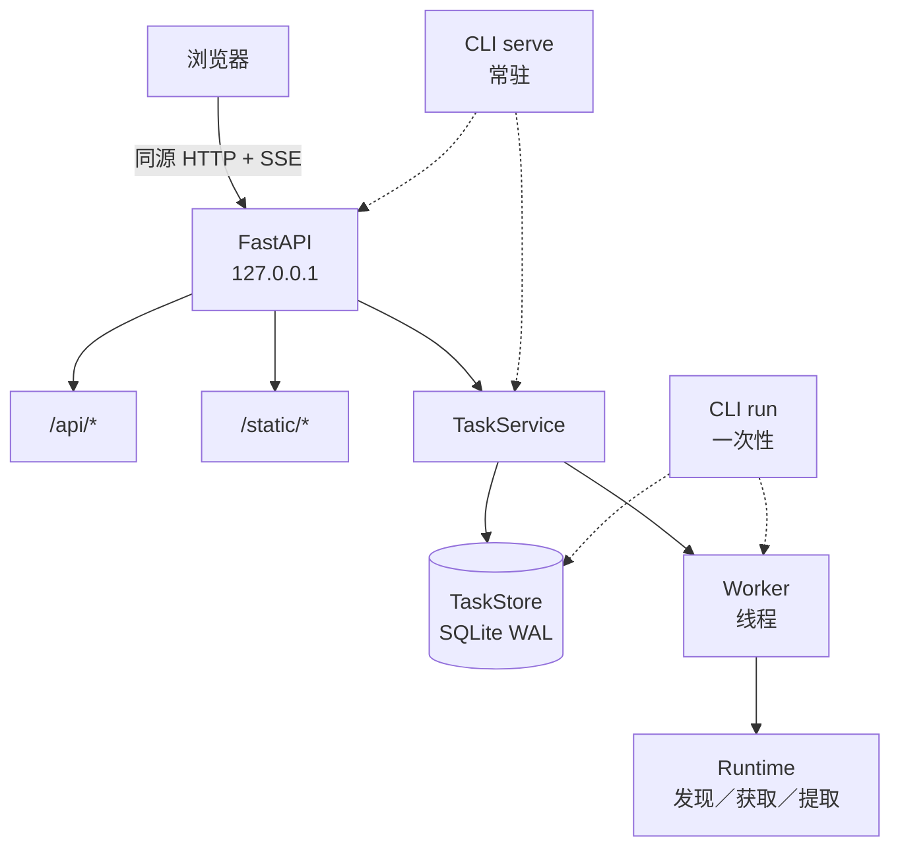

## 用途与边界

本页把[v1 界面范围](25-v1界面范围.md)落成可实现的架构、API、数据、安全和测试设计，供 D08 实施使用。它不新增业务口径：任务状态、计数和恢复语义以[任务状态与计数契约](09-任务状态与计数契约.md)为准，用户可见行为以[界面与任务管理](06-界面与任务管理.md)为准，任务粒度和资源配额以[ADR 0004](adr/0004-任务粒度、资源配额与Web界面.md)为准。

**当前状态：批次工作台阶段 1 与任务控制台已按 ADR 0009／0010 落地并通过项目方验收；`29` 已于 2026-11-22 通过项目方评审并按确认项对齐。** 2026-11-23 项目方确认批次工作台阶段 1 进入 v1 用户界面：批次列表、导入匹配、批次详情、部分启动、批次级暂停／取消、汇总和导出、站点／任务下钻；内部任务控制台并入同一 Vue 外壳 `/tasks`、`/tasks/{id}`，旧 `/` 原生页面保留技术兜底，不再作为主导航入口。前端技术栈：批次工作台见 [ADR 0009](adr/0009-批次工作台前端技术栈.md)（Vue 3 + TypeScript + Vite），任务控制台并入见 [ADR 0010](adr/0010-任务控制台并入批次工作台外壳.md)，原生页面见 [ADR 0008](adr/0008-前端技术栈与本地Web形态.md)。

## 批次阶段 1（2026-11-23 进入 v1）

对象与归属：

- `batches`：批次／项目，字段包括 `batch_id`、`name`、`country`、`market`、`language`、`category`、`status`、`note`、`created_at`、`updated_at`、`archived_at`。批次是组织对象，不是任务状态或计数单位。
- `batch_sites`：批次内站点，包括 `batch_id`、`site_key`、`domain`、`readiness`（可采／待接入／构建中／无效／重复）、`task_id`（可空）、`note`、`created_at`。一个站点可属于多个批次，但任务仍是一站 × 一规则包版本 × 一市场。
- `tasks` 增加可空 `batch_id`；旧任务和内部任务控制台继续可用。批次汇总从成员站点／任务派生，不新增计数口径。

API 最小集（与 `25` 一致）：

- `GET /api/batches`：列表、状态／国家／品类筛选和归档开关。
- `POST /api/batches`：创建批次草稿；请求含名称、国家／市场、语言、品类和站点文本或列表。
- `POST /api/batches/{id}/import`：解析站点、去重、无效项和规则包匹配预览；不自动构建。
- `GET /api/batches/{id}`：批次详情、站点清单和派生汇总。
- `POST /api/batches/{id}/start`：只启动可采且未开始的站点；返回受理和跳过原因。
- `POST /api/batches/{id}/pause`、`/cancel`：只作用于合法运行中／排队任务；部分结果保留。
- `GET /api/batches/{id}/export`：按站点目录 + 批次清单导出，保留部分／失败标识；整批合并 CSV 后置。

导入与匹配：

- 站点规范化按域名去重，保留原始输入；无效和重复项必须逐条返回原因，不能只给计数。
- 匹配已有受管规则包时按站点／域名和版本；未匹配进入待接入，不隐藏、不当失败。
- 保存草稿和部分启动分离；批次状态由成员站点／任务派生（草稿、部分就绪、运行中、已完成）。

实施切片（按用户任务纵向）：

1. 批次与站点对象、账本迁移、导入解析／去重／匹配 API 和 T1 测试。
2. 批次列表、新建／导入预览、批次详情和站点下钻；使用真实规则目录和真实案例。
3. 部分启动、批次级暂停／取消、汇总和导出；补真实批次 E2E。
4. 技术最小路径：按 ADR 0009 先验证 Vue 构建、路由、API／SSE、FastAPI `/batch` 托管和一条 Playwright 路径，再扩页面。

不做：自动构建／构建会话 UI、登录、多用户、图表、整批合并 CSV、跨机配额。mock 原型只用于设计评审，不能作为功能验收。

## 现状与差距

`app/` 已有：

- `ecom-crawler run`：一次性创建并执行一个任务，单进程、静态 HTML、SQLite 账本和 D02 导出。
- `ecom-crawler submit`／`worker`／`pause`／`resume`／`cancel`／`status`／`list`：单 worker 控制面，跨进程改账本并等待 runner 在检查点响应。
- `ecom-crawler serve`：FastAPI API 和静态页面，提供健康、规则目录、任务列表／详情、创建／启动／暂停／恢复／取消／归档／还原、URL／商品分页、SSE 和 zip 导出；默认启动托管 worker，`--no-worker` 可只读启动。
- `TaskStore`：任务、工作项、状态、尝试次数、失败分类、启动对账、归档标记和创建幂等键；控制转移有 `request_*` 校验。
- `Worker`：按 `QUEUED` 取任务，支持 `max_tasks` 个线程和 `run_forever`；`run` 固定 `max_tasks=1`。
- 运行时已能写 `events.ndjson`、`task-result.json`、`products.jsonl` 和 URL 清单。
- 同源／Host 校验和写请求 `X-Requested-With` 已接入；规则目录、导出和错误响应边界有 `test_web.py` 覆盖。

仍缺：

- 完整前端原型评审：第一轮（列表／详情／创建／控制／归档／导出）代理评审通过，项目方设计评审已于 2026-11-22 通过；A16 1280 已于 2026-11-23 由项目方验收（Vue 任务控制台 + 批次外壳）。跨浏览器／读屏仍未测。
- 永久移除和异步残留回收；`serve` 已默认托管 worker。
- 规则包目录已接入 `--rules-dir`，但还没有方案编辑器或规则构建器。
- 批次／站点对象和 API 已实现：`batches`、`batch_sites`、`tasks.batch_id`，以及 `/api/batches` 的列表、创建、导入、详情、启动、暂停／取消、归档／还原和导出。站点内嵌在批次详情／站点详情中，没有单独的 `/api/sites`；从一批站点开始的目标工作流、对象模型和线框见[用户工作流与前端信息架构](33-用户工作流与前端信息架构.md)。
- 账本字段已加列，历史任务未回填 `site_key`／`market`；旧任务依赖 `plan_id` 回退。
- 跨进程 A20 资源配额和真实浏览器资源回收证据；单机跨进程租约、过期接管、旧写拒绝、进程／目录回收、单 worker 暂停／取消、迟到结果拒收、启动对账、单实例锁和同进程 A20 已有测试。
- 跨浏览器、读屏和更大规模真实批次的 UI 验收；Web API 已有 `tests/test_web.py`，Vue 任务页已有 Vitest 和真实任务走查。

## 目标架构

下图只画部署单元和主要调用方向；线程、锁、恢复和错误处理见下文与 [任务状态与计数契约](09-任务状态与计数契约.md)。



`/api/*` 覆盖任务、规则、导出和 SSE 事件，`/static/*` 是前端静态资源。

- **单一任务层**：CLI 与 Web 都调用 `TaskStore` 和 `Worker`，不另写业务逻辑。只读切片先由 `serve` 提供 API／页面，`worker` 独立运行；控制切片再把 Worker 收进服务生命周期。
- **服务常驻**：页面关闭不停止后台；服务进程退出后，下一次启动用现有 `recover_orphaned_tasks()` 对账。
- **前端轻量**：FastAPI 直接托管静态文件，前端用原生 ES modules + CSS，不引入 Node 构建链。单机单用户场景不需要 SPA 框架和打包器。技术栈决策见 [ADR 0008](adr/0008-前端技术栈与本地Web形态.md)。
- **不做**：登录、多用户、远程访问、桌面壳、构建会话 UI、永久移除和异步残留回收；这些按 `25` 后置。

## 服务生命周期

新增命令：

```powershell
python -m uv run --project app ecom-crawler serve `
  --db /path/to/tasks.db `
  --out-root /path/to/tasks `
  --rules-dir /path/to/rules `
  --host 127.0.0.1 --port 8765 `
  --max-tasks 1
```

当前 `serve` 已实现 `--db`／`--out-root`／`--rules-dir`／`--host`／`--port`／`--max-tasks`／`--per-domain-rps` 和创建／控制 API；默认托管 worker，`--no-worker` 时由独立 `worker` 进程执行。

启动顺序（控制切片）：

1. 校验参数；`--host` 只允许回环地址，默认 `127.0.0.1`，拒绝 `0.0.0.0`。
2. 获取 `<db>.worker.lock` 单实例锁（复用 D07 的 `worker_lock`）；已有活进程时拒绝启动，避免双 worker 争抢 SQLite。
3. 打开 `TaskStore`；托管 worker（或独立 `worker`）启动时执行 `settle_expired_tasks()`：只结算租约缺失或过期的任务（`RUNNING` → `QUEUED` 并重置在途项，`PAUSING` → `PAUSED`，`CANCELLING` → `CANCELLED`），活租约不碰。
4. `serve` 默认在服务生命周期内启动 Worker 线程；`--no-worker` 时跳过。默认 `max_tasks=1`，A20 通过后可配置为 2。
5. 启动 uvicorn；`GET /api/health` 报告版本、数据库、worker 和队列状态。

关闭顺序：

1. 收到 `SIGINT`／`SIGTERM` 后停止接收新任务。
2. 给在途任务一个宽限期；宽限期内完成自然结束。
3. 宽限期后仍未结束的任务保持 `RUNNING`，由下次启动对账恢复；不把未知在途写成成功。
4. 停止 Worker、关闭 SQLite、删除锁文件。

崩溃恢复使用租约过期扫描，默认单 worker 仍由单实例锁保护；跨机租约为 v1 外；真实浏览器孤儿回收和资源配额仍属 D07，不在本设计内。

## API 契约

基础路径 `/api`，JSON UTF-8，时间为 ISO 8601 UTC。错误统一为：

```json
{"error": {"code": "INVALID_STATE", "message": "task is not paused", "details": {}}}
```

常用错误码：`VALIDATION_ERROR`（400）、`FORBIDDEN`（403）、`NOT_FOUND`（404）、`INVALID_STATE`（409）、`CONFLICT`（409）、`EXPORT_NOT_READY`（409）、`INTERNAL_ERROR`（500）。

### 健康与规则

| 方法 | 路径 | 说明 |
| --- | --- | --- |
| `GET` | `/api/health` | `version`、`db`、`worker_alive`、`queued`、`running`、`max_tasks` |
| `GET` | `/api/rules` | 扫描 `--rules-dir`，返回 `rule_id`、`rule_version`、`task_types`、`site`、`market`、`locale`、`valid`、`errors`；不返回绝对路径 |

规则包只允许从 `--rules-dir` 读取。创建任务用 `rule_id` + `rule_version` 定位，不接受客户端传任意路径。

### 任务

| 方法 | 路径 | 说明 |
| --- | --- | --- |
| `GET` | `/api/tasks?state=&task_type=&include_archived=false&limit=50&offset=0` | 列表；默认不含归档；按 `updated_at DESC, task_id` 排序 |
| `POST` | `/api/tasks` | 创建 `DRAFT`；请求带 `request_id`，重复提交返回同一任务 |
| `POST` | `/api/tasks/{id}/start` | `DRAFT` → `QUEUED`；重复启动返回当前状态 |
| `GET` | `/api/tasks/{id}` | 详情、计数、覆盖、停止原因、质量异常、最近事件 |
| `GET` | `/api/tasks/{id}/items?kind=url\|product&state=&limit=50&offset=0` | 分页查看 URL／商品；按 `updated_at, item_id` 排序 |
| `POST` | `/api/tasks/{id}/pause` | 请求暂停；`202 {accepted: true, state}` |
| `POST` | `/api/tasks/{id}/resume` | 恢复兼容任务；`202` |
| `POST` | `/api/tasks/{id}/cancel` | 请求取消；`202` |
| `POST` | `/api/tasks/{id}/archive` | 终态任务移入回收区；只改可见性 |
| `POST` | `/api/tasks/{id}/restore` | 还原显示；不重新采集 |
| `GET` | `/api/tasks/{id}/events` | SSE；连接后先发 `snapshot`，再推进增量 |
| `GET` | `/api/tasks/{id}/export?format=zip&partial=false` | 下载允许清单内的产物 |

创建请求：

```json
{
  "request_id": "ui-20261121-001",
  "rule_id": "familidoo-d03",
  "rule_version": "1.0.0",
  "task_type": "product",
  "limits": {"max_products": 6, "max_urls": 100, "max_seconds": 180}
}
```

- 创建只生成 `DRAFT`，不自动执行；界面的“创建并启动”先 `POST /tasks`，成功后再 `POST /tasks/{id}/start`。创建成功但启动失败时保留 `DRAFT`，允许重试启动，不重复建任务。
- 同一 `request_id` 返回同一任务；同一 `request_id` 携带不同请求体返回 `409 CONFLICT`。
- `market`／`locale` 取规则包的 `site` 字段；v1.0 不做自由覆盖，多市场用不同规则包版本表达。

状态控制：

| 操作 | 允许的起点 | 重复请求 | 非法状态 |
| --- | --- | --- | --- |
| `pause` | `RUNNING` | `PAUSING`／`PAUSED` 返回当前状态 | 409 |
| `resume` | `PAUSED` | `QUEUED`／`RUNNING` 返回当前状态 | 409 |
| `cancel` | `DRAFT`、`QUEUED`、`RUNNING`、`PAUSING`、`PAUSED` | 终态返回当前状态 | — |
| `archive` | `FINISHED`、`CANCELLED` 且未归档 | 已归档返回当前状态 | 409 |
| `restore` | 已归档终态 | 未归档返回当前状态 | 409 |
| `start` | `DRAFT` | `QUEUED`／`RUNNING`／终态返回当前状态 | — |

控制接口返回“已受理”，最终状态以 `GET /tasks/{id}` 或 SSE 为准；UI 不得在收到 `202` 时直接显示 `PAUSED`／`CANCELLED`。

### 任务响应形状

```json
{
  "task_id": "ui-20261121-001",
  "task_type": "product",
  "plan_id": "familidoo-d03",
  "plan_version": "1.0.0",
  "site_key": "familidoo.fr",
  "domain_key": "familidoo.fr",
  "market": "FR",
  "state": "RUNNING",
  "outcome": null,
  "counts": {"discovered_urls": 6, "valid_products": 3, "excluded": 0, "failed": 0, "pending": 3, "in_flight": 1},
  "coverage": {"status": "UNKNOWN"},
  "stop_reason": null,
  "quality_exceptions": [],
  "archived_at": null,
  "created_at": "2026-11-21T00:00:00Z",
  "updated_at": "2026-11-21T00:00:10Z"
}
```

计数键以 `09` 为准；`quality_exceptions` 从 `task-result.json` 读取，运行中可为空。列表接口可返回较轻的任务摘要，但字段名保持一致。

### 分页与幂等

- 分页用 `limit`（默认 50，最大 200）和 `offset`；返回 `total`、`items`。
- 列表筛选 `state` 可重复传参；`include_archived=true` 时才包含回收区。
- 创建幂等键写入独立 `task_requests` 表，不依赖内存。
- 任务结果写入继续按 `(task_id, product_key)` 幂等，不因重试产生重复商品。

### SSE

连接 `GET /api/tasks/{id}/events` 后：

1. 先发 `event: snapshot`，数据为当前任务详情。
2. 随后转发 `events.ndjson` 的新行；每 500 ms 轮询一次文件，按字节偏移推进。
3. 每 15 秒发 `event: heartbeat`；客户端断线后重新连接，重新拉快照，不依赖补发历史。
4. 事件类型沿用运行时：`task_pausing`、`task_paused`、`task_cancelling`、`task_finished`、`url_discovered`、`product_done`、`task_error` 等；服务端可归一化为 `task_state`、`counts`、`item`、`error`。

任务列表不提供全局 SSE；列表页在控制操作后刷新，正常时每 3 秒轮询 `/api/tasks`，避免为多任务维护第二套事件总线。

### 导出

- `format=zip` 返回压缩包，只包含 `products.csv`、`task-result.json`、`records.jsonl`、`diagnostics/excluded.jsonl`、`diagnostics/failed.jsonl` 中实际存在的文件。
- 文件名固定白名单；拒绝任意路径和 `..`。
- 未结束任务默认返回 `409 EXPORT_NOT_READY`；显式 `partial=true` 时才导出当前快照，并在响应头和压缩包内标注 `partial`。
- 导出文件名包含 `task_id` 和 `plan_version`。

## 数据模型与迁移

`tasks` 表新增：

| 字段 | 用途 |
| --- | --- |
| `site_key` | 任务所属站点标识，列表和筛选使用 |
| `domain_key` | 限速和同站提示使用；v1 用规范化主机名，eTLD+1 作为后续改进 |
| `market` | 列表显示和市场校验 |
| `rule_path` | 规则包相对路径，便于重跑和诊断 |
| `archived_at` | 归档时间；空表示未归档 |

新增幂等表：

```sql
CREATE TABLE IF NOT EXISTS task_requests (
    request_id TEXT PRIMARY KEY,
    task_id TEXT NOT NULL,
    created_at TEXT NOT NULL
);
CREATE INDEX IF NOT EXISTS idx_tasks_updated ON tasks(updated_at);
```

迁移沿用 `TaskStore._init_schema()` 的 `PRAGMA table_info` + `ALTER TABLE` 模式。历史任务启动时按 `input_json.rule_path` 回填 `site_key`／`domain_key`／`market`；规则文件不存在时写 `unknown`，不阻断服务启动。

`archived_at` 不是任务状态；`09` 的 `ARCHIVED` 语义仍只表示“回收区可见性”。

## 安全边界

- **只绑定回环**：默认 `127.0.0.1`；拒绝 `0.0.0.0` 和非回环地址，除非显式增加启动参数（v1 不提供）。
- **同源校验**：所有写操作校验 `Origin`（允许 `http://127.0.0.1:<port>`、`http://localhost:<port>`）和 `Host`；拒绝 `Origin: null`、跨站来源和缺失的 `X-Requested-With`。
- **不做 CORS**：前端与 API 同源托管；不添加通配 CORS 头。
- **规则目录约束**：`GET /api/rules` 只扫描 `--rules-dir`；创建任务只接受规则 ID，服务端解析路径后校验 `resolve().is_relative_to(rules_dir)`，拒绝符号链接逃逸。
- **导出路径约束**：只允许任务目录下白名单文件；压缩包条目使用固定名称，不拼接用户输入。
- **HTML 预览**：商品描述按不可信内容处理，用沙箱 `iframe` 或纯文本展示，不把原站 HTML 注入主文档；设置 CSP，禁止脚本和外部资源。
- **日志与响应**：不回显密钥、Cookie、认证头；错误信息不包含绝对路径和堆栈。
- **单实例**：`worker_lock` 防止两个服务同时消费同一 SQLite；锁由操作系统在进程退出时释放，残留锁文件不阻止下次启动。

以上同源、Host 与写请求校验已在 `app/src/ecom_crawler/web/app.py` 实现；前端写请求自动带 `X-Requested-With: XMLHttpRequest`，拒绝路径由 `app/tests/test_web.py` 覆盖。

v1 不做登录和权限系统；回环绑定 + 同源校验是当前边界，不等同于多用户安全模型。角色与多用户触发条件见[用户角色与职责](31-用户角色与职责.md)。

## 前端设计

本节记录已实现的页面结构、路由和状态约束；设计门、最小设计包、状态矩阵和评审清单见[D08 前端设计包与评审](28-D08前端设计包.md)。

- 静态文件放 `app/src/ecom_crawler/web/`：`index.html`、`app.js`、`style.css`；FastAPI 挂载 `/static`，`GET /` 返回 `index.html`。
- 路由用 hash：`#/tasks`、`#/tasks/new`、`#/tasks/{id}`，避免服务端为每个页面加路由。
- 页面：
  - 任务列表：状态、类型、站点、方案版本、市场、计数、覆盖、停止原因、更新时间；状态／类型筛选；归档开关。
  - 创建任务：选择规则包（站点／市场／版本）、任务类型、预算；提交后显示 `DRAFT` → `QUEUED`，不把“已受理”写成“已完成”。
  - 任务详情：计数卡片、覆盖状态、停止原因、质量异常、URL／商品分页表、事件日志、导出菜单、控制栏。
  - 回收区：归档任务的还原入口。
- 状态表达：加载中、空列表、读取失败、数据过时（显示最后更新时间）、控制请求已受理、非法操作禁用并说明原因。
- 进度：只显示计数和 `coverage.status=KNOWN` 的比例；不显示瞬时速率、ETA 或全站百分比。
- 控制：按钮文案用“暂停”“恢复”“取消任务”“归档”“还原”，不用“停止”；`202` 后显示“已受理，等待后台确认”，由轮询／SSE 更新。
- 可用性：桌面 1280 和窄屏 768 可用；键盘可达、焦点可见、对比度达标；v1 只做浅色主题。
- 前端不直接读 SQLite、不启动采集进程、不拼接规则路径。
- 任务控制台和批次外壳已按 Vue 主路径落地，设计评审已于 2026-11-22 通过（见 `28`／`29`），2026-11-23 项目方验收；跨浏览器／读屏仍未测，不能把当前走查当作全平台验收证据。

## 测试与验收

| 层 | 内容 | 运行方式 |
| --- | --- | --- |
| D07 CLI 控制面 | 状态转移、暂停结清、恢复、取消迟到结果、启动对账 | `app/tests/test_control*.py`，无网络 |
| T1 Web API | health、规则、列表筛选、详情、创建幂等、控制转移、归档／还原、SSE、items 分页、导出白名单、404／409 | `app/tests/test_web.py`，无网络 |
| T2 托管 worker | `serve` 启动／停止 worker；health 返回 managed | `test_managed_worker_lifespan`，无网络 |
| T1 API 契约 | 创建／幂等／启动／暂停／恢复／取消／归档／还原、非法转移、分页、错误码、Origin／Host、规则路径逃逸、导出白名单 | FastAPI TestClient + 临时 SQLite，无网络 |
| T1 账本迁移 | 旧库缺列时自动迁移；历史任务回填 `site_key`／`market`；归档字段不改变状态 | 单元测试 |
| T2 服务 fixture | `serve` 子进程 + 本地 HTTP fixture；通过 API 创建任务、轮询到完成、SSE 收到快照和终态、导出 zip | 子进程集成测试 |
| UI 冒烟 | 列表 → 创建 → 详情 → 暂停／恢复／取消 → 导出；1280／768 截图 | Playwright 或 patchright；fixture 站点 |
| T3 实站 | 一个有界真实任务通过 API／UI 完成，记录请求数、计数、停止原因和导出 | 手工，按预算 |
| A16 | 创建、查看、控制、归档、导出、失败恢复；页面关闭后后台继续 | 真实任务 + 证据 |
| A20 | 两个任务并行、同域限速、单任务暂停／取消隔离 | D07 通过后；未通过时 `max_tasks=1` |

CI 至少加入 `app` 的 T1 和 `ruff`；服务 fixture 和 UI 冒烟可先手工，稳定后再进 CI。`jsonschema` 缺失时失败，不 skip。

## 实施切片

以下切片是**当前任务控制台**的实施顺序，前提是站点已有受管规则包；从一批站点开始的批次工作台目标切片见[用户工作流与前端信息架构](33-用户工作流与前端信息架构.md)，未进入本实施序列。

0. **设计门**：按 [D08 前端设计包与评审](28-D08前端设计包.md) 的两级设计门执行：`29` 的整体基线先评审；本切片只评审新增或变更的页面、状态、控件和契约映射。未通过不进入该切片的页面实现。切片按用户可完成任务划分，不按页面或 API 层划分。
1. **服务骨架与只读 API**：`serve` 命令、锁、健康检查、`GET /api/tasks`、`GET /api/tasks/{id}`、`GET /api/tasks/{id}/export`、静态首页和任务列表／详情只读页。
2. **规则与创建**：`GET /api/rules`、`POST /api/tasks`、`POST /start`、幂等表、创建页和列表刷新。
3. **D07 控制项**：暂停／取消隔离、迟到结果拒收、资源回收、账本控制测试；通过后接 `pause`／`resume`／`cancel`、SSE 和控制栏。
4. **归档与完整导出**：`archive`／`restore`、回收区、`items` 分页、zip 导出和部分导出。
5. **验收收口**：T3 真实任务、A16 证据、1280／768 检查、文档同步。

每个切片先确认用户路径、页面结构／线框和接口契约，再写 API 测试、fixture 和页面；页面实现不能替代设计评审，也不先做占位按钮和假数据。

每个切片的完成定义包含本切片承诺的加载、空、失败、禁用等状态，以及真实数据和可回退路径；只交正常路径不算完成。

## 已定项与后置项

- **批次工作台是否进入 v1**：不进入当前 v1；按 `33` 作为下一阶段基线，进入前先修改 `25`／`26`／`29`，再补 `batches`／`sites`、`batch_id` 和相关 API，不能只在页面上加筛选。
- **前端技术栈（已收口）**：批次工作台和任务控制台主路径使用 Vue 3 + TypeScript + Vite，见 [ADR 0009](adr/0009-批次工作台前端技术栈.md)；任务控制台并入见 [ADR 0010](adr/0010-任务控制台并入批次工作台外壳.md)。原生 ES modules 的 `/` 页面保留为技术兜底，见 [ADR 0008](adr/0008-前端技术栈与本地Web形态.md)，不再作为主导航入口。
- **服务托管（v1 已定）**：v1 由用户手动 `serve`，不做开机自启／托盘；需要系统服务或托盘时另立 ADR，不在实现中临时加。
- **多任务默认值（v1 已定）**：v1 运行默认 `max_tasks=1`，A20 通过后开放 2；ADR 0004 的 2 是目标默认，不是当前默认。
- **域名键（v1 已定）**：v1 用主机名，不做 eTLD+1；跨子域共享限速需后续补 PSL。
- **构建会话**：UI 后置；harness 适配器核心、真实无模型冒烟、真实 prompt＋执行中 interrupt、pause-gate、依赖请求桥和 uv／pip 真实安装已按 ADR 0006 跑通；真实模型工具调用和构建会话 UI 继续单独推进，不阻塞 D08。
- **永久移除**：后置；v1 只做归档／还原。
