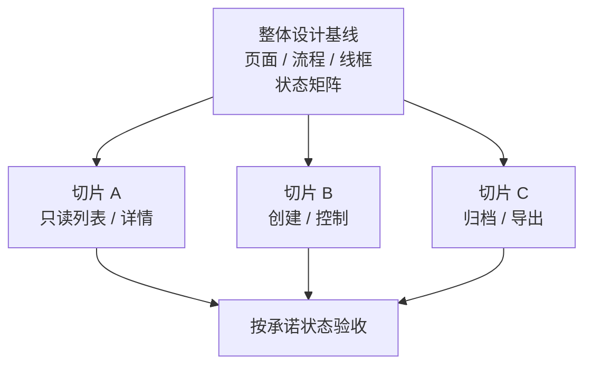

## 用途与边界

本页把[界面与任务管理](06-界面与任务管理.md)的“先按功能和操作目标设计前端原型，再按契约接后端”和[v1 界面范围](25-v1界面范围.md)的“可预览的页面结构／线框先于正式实现（低保真即可）”落成 D08 可执行的设计包与评审门。

它不新增业务口径：任务状态、计数和控制语义以[任务状态与计数契约](09-任务状态与计数契约.md)为准，界面必须有项以 `25` 为准，服务/API 和实现细节以[D08 任务服务与界面设计](26-D08任务服务与界面设计.md)为准。

**当前状态**：D08 已有可运行的 API 和页面；列表／详情／创建／控制／归档／导出第一轮代理评审通过，1280×900 技术复核也已完成（无横向溢出，质量异常改为条目化展示）。[D08 初步设计稿](29-D08初步设计稿.md)已于 2026-11-22 由项目方完成设计门评审；实现已按确认项对齐并重新截图。2026-11-23 项目方验收 Vue 任务控制台与批次外壳（含批次站点深链和长页分段截图）；跨浏览器／读屏仍未测。

**2026-11-23 设计方向更新**：项目方提出前端需要重新建立设计章法，尤其是主体部分，并接受 React 作为新版本前端、旧前端并行过渡；v2 首轮只做桌面端（1280 主规格、1440 检查），窄屏和移动抽屉在前端基本定型后统一适配。v2 的设计基线见[前端设计系统与 v2 视觉方向](35-前端设计系统与视觉方向.md)，技术方向见 [ADR 0012](adr/0012-前端v2技术栈与设计系统.md)（Proposed）；桌面端试点已在 `app/frontend-v2/` 落地（批次列表 + 新建批次弹窗 + 批次详情），未接入生产导航。本页仍是现有 D08 和过渡期 Vue 应用的设计门；`35` 评审通过前，不按 v2 方案改生产页面。

`29` 只覆盖“已有受管规则包之后的任务控制台”；从一批站点开始的目标工作流、批次对象和页面结构见[用户工作流与前端信息架构](33-用户工作流与前端信息架构.md)。批次阶段 1 已进入 v1、实现并通过真实批次验收；任务控制台已并入同一 Vue 外壳（ADR 0010），旧 `/legacy` 保留为技术兜底。

## 设计门

设计门分两层，避免把“切片”当成“页面”来设计：

| 层级 | 何时做 | 评审对象 | 当前落点 |
| --- | --- | --- | --- |
| 整体设计基线 | 第一个 D08 切片前；范围、主流程或导航变化时重评 | 页面清单与导航、关键用户旅程、全局信息层级、全局状态矩阵、1280 主规格线框 | `29` 已于 2026-11-22 通过项目方评审；`33` 的批次默认值已作为下一阶段基线确认，未进入 v1 |
| 切片增量评审 | 每个切片开始前 | 本切片新增或变更的页面、状态、控件、文案和契约映射 | 记录相对 `29` 的增量和待确认项 |

整体基线不等于每个切片都重做一套完整设计；切片增量也不等于可以跳过基线。切片按用户可完成任务划分，不按页面或 API 层划分：一个切片可以跨多个页面，一个页面也可能分属多个切片。

以下用示意切片说明，实际切片顺序见 `26`；图只表达基线与切片的关系，不代表切片编号。

**例子**：

- **切片 A（只读列表／详情）**：整体基线已定义列表、详情、导航和空／失败状态；切片 A 只实现列表、详情及对应状态，不因为“只读”省略失败态。
- **切片 B（创建／控制）**：在基线上补创建面板、控制栏和“已受理，等待后台确认”状态；不重新设计列表和详情。
- **切片 C（归档／导出）**：补归档开关、回收区入口和部分导出标识；沿用基线的列表、详情和导航结构。

规则：

- 新增或改版页面、控制、归档、导出交互前，先完成本页“最小设计包”并评审；整体基线在第一个切片前完成，后续切片只评审增量。
- 新建或整体改版先做全局设计：应用外壳、导航、入口与出口、跨页面主流程、全局状态和对象关系；再拆单页。孤立页面或已实现页面截图不能替代全局原型评审。
- 原型可以使用 mock 数据并独立于后端；后端未实现不构成跳过设计门的理由。
- 页面结构由用户工作流决定，不由规则包、任务模型或 API schema 决定；规则包是站点背后的内部资产，不作为业务用户的主入口。
- 不要求项目方先出设计稿或具备前端设计背景；Agent 先给可预览的页面结构、线框、状态和取舍选项，项目方确认目标用户、用户任务和选择。
- 技术预览、接口联调页、按 API 字段直接生成的表单或表格，都不算设计评审。
- 整体基线评审可以完整一些；切片增量评审约半天到一天，不要求高保真，但必须有可预览的页面结构／线框、明确取舍和未执行项。
- 推荐顺序：用户任务 → 页面清单与关键流程 → 信息层级与线框 → 状态矩阵 → 接口契约与 mock → 实现。
- 设计评审和接口契约评审可以并行；但 **API 已定不能替代页面设计**，**页面已写也不能反推设计合理**。

## 最小设计包

| 产物 | 最低要求 | 评审问题 |
| --- | --- | --- |
| 用户工作流与对象模型 | 用户从什么开始、经过哪些阶段、哪些对象是用户对象、哪些是内部资产；规则包不得作为业务主入口 | 页面结构是从工作流来的，还是从任务表／API 字段反推的？ |
| 页面清单与导航 | 当前任务控制台：任务列表、创建、详情、归档／回收区、导出；批次工作台的页面清单见 `33`；路由和返回路径明确 | 用户从哪进、到哪去？有没有死路或重复入口？ |
| 关键流程 | 创建 → 排队 → 运行 → 控制 → 查看异常 → 导出；失败、恢复、返回上下文写清 | 主任务能一次走通吗？失败后用户知道下一步吗？ |
| 信息层级与线框 | 首屏只做一件事；主操作不超过 3 个；次要信息折叠；开发期 1280 主规格线框，窄屏线框交付前补（可提前） | 首屏先看什么、先做什么？哪些字段只是 API 有、用户不需要？ |
| 状态矩阵 | 加载中、空、读取失败、数据过时、部分结果、禁用、已受理、已完成；任务状态和覆盖未知逐项定义 | 异步和异常状态是否都有可见出口？ |
| 布局与响应式 | 开发期 1280 主规格 + 结构安全；768 窄屏、320 回流与完整操作收纳在交付前适配阶段 | 主规格结构是否稳定？完整适配是否留到交付前？ |
| 视觉约束 | 开发期沿用现有 CSS 令牌和浅色主题；深色、高对比主题在交付前阶段；现有 Vue 应用的样式边界见 [ADR 0011](adr/0011-样式层与CSS框架.md)，v2 方向见 [ADR 0012](adr/0012-前端v2技术栈与设计系统.md) 和 `35` | 视觉是否服务于信息层级，而不是只做装饰？ |
| 契约与 mock | 字段、错误码、SSE 事件、分页和导出映射到真实接口；列出不能交付的 mock | mock 与真实契约的差异是否逐项处理？ |

线框、视觉稿、原型和线框确认的区别见[开发、界面与运行时概念说明](27-开发与运行时概念说明.md)的“界面设计”和“线框确认与验收的区别”两节；本页只定义设计门、最小设计包和评审要求。

本项目的设计门以页面结构／线框、状态矩阵和取舍评审为主，不要求高保真可点击原型；“原型评审”是沿用叫法，实际评审对象是设计稿和线框。

## 原型形式与评审对象

- 设计门最低要求是低保真页面结构／线框、状态矩阵和取舍说明；不要求高保真视觉稿或可点击原型。
- 如果项目方难以从静态线框判断流程，可以按同一份设计基线生成 2–3 个 AI HTML 草稿，或使用墨刀／Figma 做关键页面点击评审；它们只用于评审，不是实现规格，也不能形成第二套真源。
- 批次工作台的可浏览静态原型在 `experiments/d08/batch-workbench-prototype/`，使用 mock 数据，不连接后端；评审时优先按代表任务走这个原型，而不是只看截图。
- 评审按代表任务走：导入一批站点、判断可采性、启动、处理失败、导出和找回；不能只问“页面好不好看”。
- 选定方向后，必须把草稿映射到真实 API、字段、状态和 `26` 的实现切片；草稿省略的状态默认纳入，不能因为没画就不做。

## D08 页面设计要点

### 任务列表

- 主任务是“快速判断哪些任务在跑、哪些失败或停止、下一步该做什么”。
- 首屏优先：状态、类型、站点／方案、市场、计数、停止原因、更新时间。
- 筛选、归档开关和创建入口是次要层；不要把全部 API 字段铺成列。
- 质量异常、事件和 items 明细放到详情页，列表只给摘要和入口。

### 创建任务

- 规则包、任务类型、市场／语言和预算是一组；字段超过 7 项时分组或分步。
- 创建与启动分离；界面可以一次提交两步，但必须显示 `DRAFT` → `QUEUED` 的真实阶段。
- 重复提交按 `request_id` 幂等；提交中防重入；显示“已受理”时不能写成“已启动”或“已完成”。

### 任务详情

- 首屏先给计数、覆盖、停止原因和当前控制状态；质量异常、items、事件日志按需展开。
- 控制栏位置稳定；暂停、恢复、取消、归档／还原按当前状态显示，非法操作真禁用并说明原因。
- 导出区分完整和部分；未结束任务的部分导出必须明确标注。

### 状态与控制

- 控制请求要区分“已受理”和“后台已完成”；最终状态以账本为准。
- 不使用“停止”代替“暂停”或“取消任务”。
- 归档只改可见性，不删除结果；永久移除后置，不能用归档伪装删除。

## 状态矩阵

| 场景 | 必须显示 | 不允许 |
| --- | --- | --- |
| 加载中 | 明确的加载状态和当前对象 | 空白页、闪烁的假数据 |
| 空列表 | 为什么空、下一步做什么、一个主按钮 | 把空列表当成读取成功 |
| 读取失败 | 错误原因、重试入口、最后可信时间 | 静默失败或伪装成空列表 |
| 数据过时 | 旧值、最后更新时间、刷新入口 | 把旧值当当前值 |
| 部分结果 | “部分”标记、缺失范围、停止原因 | 把部分当完整 |
| 控制已受理 | “已受理，等待后台确认”和当前状态 | 直接显示“已暂停／已取消／已完成” |
| 非法操作 | 真禁用并说明原因 | 看着能点、点了才报错 |
| 覆盖未知 | 计数和 `UNKNOWN`，说明没有可靠分母 | 编造百分比、速率或 ETA |

## 布局与响应式

开发期只锁 **1280 主规格 + 浅色主题**；以下窄屏和主题细则在交付前适配阶段执行。已有基础窄屏适配作为提前项保留，不扩成逐切片门禁。

- 开发期主规格按 1280 桌面；768 窄屏、320 回流在交付前适配阶段，不扩大产品承诺。
- 表格在容器内横向滚动，不把整页撑宽；关键操作列不能因横滚被裁掉。
- 窄屏操作收纳到行内菜单、详情页或操作栏，不能直接 `display:none` 删除。
- 创建表单窄屏单列；可见标签、错误关联、提交中防重入、失败保留输入。
- 详情控制栏可换行；危险操作远离主操作；焦点可见且不被遮挡。
- 开发期沿用现有 CSS 令牌和浅色主题；深色、高对比主题在交付前主题适配阶段，不引入第二套视觉语言。现有 Vue 应用样式层决策见 [ADR 0011](adr/0011-样式层与CSS框架.md)；v2 设计方向见 `35` 和 [ADR 0012](adr/0012-前端v2技术栈与设计系统.md)。

## 评审清单

- [ ] 页面清单、导航和关键流程能对应到 `25` 的必须有项。
- [ ] 首屏主任务明确；主操作不超过 3 个；次要信息已折叠。
- [ ] 每个页面和控制都有加载、空、失败、过时、部分、禁用、已受理状态。
- [ ] 控制语义与 `09` 一致：暂停／恢复／取消／归档；已受理与已完成分开。
- [ ] 计数、覆盖、停止原因和质量异常按用户任务组织，不是 API 字段直排。
- [ ] 开发期 1280 主规格线框完成、结构不裁切；768／320 与完整主题在交付前适配阶段检查（提前完成可记录）。
- [ ] 键盘、焦点、对比度、表单标签／错误、触控目标达到 `frontend-design` 基线。
- [ ] mock 与真实契约逐项映射；不能交付的 mock 和连带调整已列出。
- [ ] 评审记录、未执行项和取舍已留档；未通过不进入正式页面实现。

## 评审记录

| 日期 | 范围 | 结论 | 未执行项 | 证据 |
| --- | --- | --- | --- | --- |
| 2026-11-21 | 列表、详情、创建、控制、归档／导出（技术预览；目标 1280／768，本机实际约 1160／700） | 通过（代理评审，待项目方确认） | 项目方在 1280 实机确认；A16 最终验收 | 本地 `serve` + 5 个任务（创建／QUEUED／PAUSING／CANCELLING／FINISHED／归档）；暂停、取消、归档、还原和完整／部分导出链接已实际操作；截图未入库 |
| 2026-11-21 | 列表、创建、详情（1280×900，合成账本，`serve --no-worker`） | 技术复核通过；不是独立初步设计稿评审 | 先评审 `29` 的目标、流程和线框；再由项目方在 1280 实机确认；A16 最终验收 | `experiments/d08/ui-1280/`：5 行列表、创建面板、详情计数／质量异常；三页均无横向溢出；质量异常原为整段 JSON，已改为来源／描述状态／部分原因／缺失字段条目化展示 |
| 2026-11-22 | `29` 任务控制台的目标用户、创建入口、列表／详情结构、控制／归档／导出取舍；`33` 批次默认值作为下一阶段基线 | 通过（项目方设计评审） | 1280 实机 A16 确认；批次工作台实现；构建会话 UI | `29` 的“评审结论”；实现对齐后 `experiments/d08/ui-1280/` 四张截图（列表、创建、详情、商品明细）无横向溢出，覆盖／质量异常数、商品预览和完整计数可见 |
| 2026-11-23 | 真实案例走查：`familidoo` 任务 `web-946474de5cf1`，6／6、0 失败、0 条质量异常（品牌等可空字段不计入）；页首用途说明、服务／worker 状态、`QUEUED` 原因、真实列表／详情、商品字段、归档／还原、导出、新建、暂停／恢复／取消和错误提示 | 通过（内部页面真实案例；不是 A16 签字） | 项目方 1280 实机确认；批次工作台 | 外部证据库 `experiments/d08/ui-preview/`：`evidence.json`、`queue-evidence.json` 和 1280 截图；真实数据暴露并修正了 item 结果缺商品预览、`QUEUED` 无解释、品牌误计质量异常的问题 |
| 2026-11-23 | 任务控制台并入 Vue 外壳、批次站点深链、长页分段截图；真实批次 `b-586052683409`（2 站点、14 有效、0 失败）和 8 条质量异常任务 | 通过（项目方验收） | 跨浏览器／读屏；更大规模批次 | `/tasks`、`/tasks/{id}`、`experiments/d08/batch-workbench-e2e/`；1280 分段图，full-index 仅作索引 |

### 第一轮评审发现与处理

评审使用真实 API 数据，不用 mock：本地 `serve` 加 5 个任务，覆盖 `DRAFT`、`QUEUED`、`PAUSING`、`CANCELLING`、`FINISHED`、`CANCELLED` 和归档状态；列表、详情、创建、暂停／取消、归档／还原和完整／部分导出链接均实际操作。启动失败分支只做代码核对，没有强制制造失败；未实际下载 zip 文件，导出内容由 API 测试覆盖。列表和详情分别在桌面与窄屏检查，目标 1280／768，本机浏览器窗口实际约 1160／700。

已处理：

- 列表首屏默认折叠创建面板，先显示筛选和任务列表；创建仍可一键展开。
- 详情把计数卡片移到元信息之前，首屏先看到有效、排除、失败和待处理。
- 列表计数从 API 键直排改为用户口径摘要：有效商品、业务排除、失败、待处理、在途、发现 URL；详情计数卡片同步中文标签，并兼容 `pending`／`excluded`／`failed` 等别名。
- 表头不再拆行，避免“市场”等窄列标题断字；窄屏增加“可横向滚动查看更多列”提示。
- 详情切换任务时清空旧内容；读取失败不再把上一任务的数据显示在当前任务下。同一任务刷新失败时保留旧值并显示最后可信时间，不伪装成空列表。
- 创建与启动分开处理：创建成功但启动失败时保留 `DRAFT`，引导到详情重试启动，不把已创建任务报成“创建失败”；提交期间禁用按钮。
- 控制请求提交期间禁用按钮；暂停、取消显示“已受理”和当前状态，刷新后按状态收敛；归档后详情显示还原，列表默认隐藏归档，勾选“包含归档”后显示归档标记。
- 导出按状态区分：`DRAFT`／`QUEUED` 隐藏；未结束任务显示“部分导出 zip”并带 `partial=true`；终态显示“导出 zip”。
- 无任务或读取失败时隐藏空详情面板和导出入口。
- 质量异常从整段 JSON 字符串改为条目化展示：来源链接、描述状态和部分原因、缺失字段中文标签；避免让用户自己解析 JSON。

本轮已决定或补完：

- 窄屏列优先级：≤900 px 隐藏类型／市场／计数／更新时间列，任务行内摘要显示类型、市场和计数；列表改用固定列宽，状态和结果不再被挤出视口。
- 枚举中文化：状态、结果、停止原因、类型和覆盖状态显示中文标签，原始值保留在 `title` 供排查；筛选和创建表单的选项同步中文化，并补 `DRAFT` 筛选。
- 控制完成确认：控制请求后显示“已受理”或“已完成”，并按任务状态收敛；暂停到 `PAUSED`、取消到 `CANCELLED`、归档／还原在 `FINISHED`／`CANCELLED` 均可给出完成文案。
- 控制按钮分组：保持页面操作（刷新／导出）与状态控制（暂停／取消／归档）分行，作为降低误触的设计选择，不再要求合并。
- 详情 items 读取失败补最后可信时间；列表、详情和 items 使用同一时间格式。
- 创建页显示由规则包推导的市场和语言，不再只藏在规则包名称里。

第二轮项目方设计评审（2026-11-22）：

- v1.0 仍限定为任务控制台；`33` 的批次工作台默认值作为下一阶段基线，不进入 v1。
- 对照 `25` 补齐三处：列表显示停止原因和覆盖状态；创建页说明市场／语言由规则包确定并显示，不提供自由编辑；详情补商品预览（价格、币种、正文状态、部分原因、缺失字段、字段来源）和完整计数（7 张主卡 + 其余计数行）。
- 保留推荐交互：创建折叠面板、列表质量异常数、单个 zip、归档开关 + 详情还原、取消二次确认；不增加独立创建页、独立 CSV 入口或独立回收区。
- 实现已按确认项对齐并重新截图：`experiments/d08/ui-1280/` 的列表、创建、详情、商品明细四张截图均无横向溢出；A16 1280 已于 2026-11-23 由项目方验收；跨浏览器／读屏仍是剩余项。

剩余边界：

- 1280 主规格已用无头 Chromium 在 1280×900 复核（`experiments/d08/ui-1280/`），列表、创建和详情均无横向溢出；项目方已于 2026-11-23 在 1280 实机确认观感与操作。
- A16 最终设计验收已于 2026-11-23 由项目方确认；代理评审通过不等于正式签字，这条边界仍适用于后续新增页面。
- 本次未实际下载 zip 文件；导出内容由 API 测试和链接状态检查覆盖。
- 窄屏（目标 768，本机约 700）与列优先级是提前完成的基础适配，不作为开发期逐切片门禁；完整窄屏矩阵、320 回流和深色主题仍按交付前适配阶段。

## AI coding 交付约定

给 AI 的输入至少包含：

- 本页设计包，以及 `06`／`25`／`26` 的相关约束。
- 目标页面和流程、首屏信息层级、状态矩阵。
- API 契约、错误码、SSE 事件和 mock 数据。
- 明确要求：先出页面结构、线框和状态清单，确认后再写实现；不要从 API 字段直接生成页面。

评审时先看用户任务、信息层级和状态覆盖，再看视觉；不要用“页面已经能点”或“测试全绿”证明设计评审通过。

## 与相关 Skill 的关系

- `frontend-design`：用户约束、代表任务、任务与渐进披露、线框、视觉令牌、交互状态、可用性验证、无障碍和交付验收。skill 是 agent 侧方法，不随文档包导出；文档内的线框和线框确认解释见[开发、界面与运行时概念说明](27-开发与运行时概念说明.md)。
- `admin-console-design`：后台控制台外壳、列表／详情、表单、长任务、日志和恢复。
- `adaptive-responsive-guide`：主规格先行、完整适配后置；窄屏、320 回流与主题在交付前阶段验证。
- `frontend-qa`：实现后的 UI 缺陷诊断和 DoD 证据；不能替代实现前的设计评审。

## 内部页面验收要求（2026-11-22）

- 页面顶部必须显示“内部技术控制台／非业务工作台”和用途边界，不能只写在文档里。
- 页面必须显示服务状态、worker 模式和排队原因：托管 worker／外部 worker／未检测到 worker 要可区分；`QUEUED` 任务不能让用户猜是状态故障还是服务不在线。
- 页面和操作验收必须用真实案例；合成／mock 数据只用于布局草稿和截图检查，必须标注，不能作为功能或业务验收证据。
- 创建／启动、暂停／恢复、取消、归档／还原和导出要有正确提示；非法操作、读取失败和部分结果要有明确错误或下一步，不能只改按钮状态。
- 真实案例证据包括任务账本、计数、质量异常、导出文件和操作前后状态；合成数据截图只作为布局辅助。
- 当前任务控制台仍只覆盖“已有受管规则包之后的任务”，批次工作台按 `33` 作为下一阶段基线。

## 当前差距与下一步

- D08 页面仍是技术预览；设计门已于 2026-11-22 由项目方通过，A16 仍不能因 API／页面已落地或 1280 技术复核而视为正式验收。
- 实现已按 `29` 的确认项对齐：列表补覆盖／停止原因和质量异常数，创建页说明市场／语言由规则包确定，详情补商品预览和完整计数，取消加二次确认。下一步由项目方在 1280 实机逐页确认，再收口 A16 证据；窄屏完整矩阵与深色主题留到交付前适配阶段。
- 批次工作台按 `33` 作为下一阶段基线；若进入实现，先修改 `25`／`26` 并补批次／站点 API，不能只加一个批次筛选。
- A16 证据应包含设计稿评审、实现／交互证据和项目方确认；代理评审通过不等于正式签字。

## 维护规则

- 业务口径冲突时，以 `06`、`09`、`25`、`26` 为准；本页只维护设计门、最小设计包和评审清单。
- 页面清单、状态或控制语义变化时同步本页；评审记录和未执行项保留，不删除失败证据。
- 新增页面先判断是否属于 D08 承诺范围；超范围项写入后置清单，不用占位页面冒充完成。

## 相关文档

- [界面与任务管理](06-界面与任务管理.md)：用户可见行为、操作语义和界面验收。
- [v1 界面范围](25-v1界面范围.md)：必须有／可后置、API 范围和完成条件。
- [D08 任务服务与界面设计](26-D08任务服务与界面设计.md)：服务、API、账本、前端实现和测试切片。
- [D08 初步设计稿](29-D08初步设计稿.md)：目标用户、预期操作、关键流程、1280 线框和设计取舍。
- [前端设计系统与 v2 视觉方向](35-前端设计系统与视觉方向.md)：v2 的设计主张、令牌、组件、页面重设计和迁移计划。
- [前端 v2 技术栈与设计系统](adr/0012-前端v2技术栈与设计系统.md)：React + Tailwind v4 方向、并行迁移和回退。
- [任务状态与计数契约](09-任务状态与计数契约.md)：状态、计数、控制与迟到结果语义。
- [开发、界面与运行时概念说明](27-开发与运行时概念说明.md)：切片、worker、租约、线框和线框确认等概念的解释。
