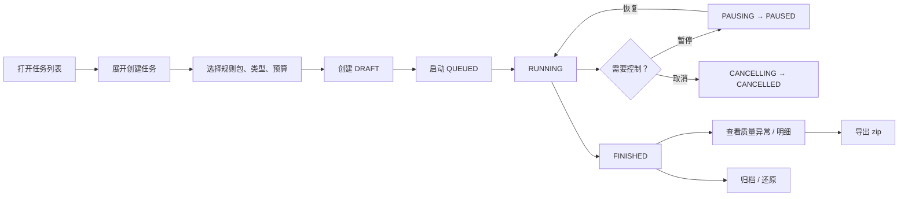

## 用途与边界

本页回答 D08 的三个前置问题：界面为谁解决什么问题、用户预期完成哪些操作、第一版页面和交互大致长什么样。它是**已评审并接受的初步设计稿**，不是冻结布局，也不替代[界面与任务管理](06-界面与任务管理.md)、[v1 界面范围](25-v1界面范围.md)、[D08 服务与界面设计](26-D08任务服务与界面设计.md)和[前端设计包与评审](28-D08前端设计包.md)。

**覆盖范围**：本稿只覆盖“已有受管规则包之后的任务控制台”——任务列表、单站创建、任务详情、控制和导出。它不覆盖从一批站点开始的批次导入、站点接入判断、批次组织、批量执行和批次交付。目标工作流、对象模型和线框见[用户工作流与前端信息架构](33-用户工作流与前端信息架构.md)；本稿不能作为批次工作台的设计验收。

当前已有的 `serve` 页面和 1280 截图是实现与技术复核，不能反过来证明设计已经讨论清楚。本稿已于 2026-11-22 由项目方完成设计门评审；实现按本稿对齐后，仍需项目方在 1280 实机确认，才进入 A16 验收。

## 评审结论（2026-11-22）

项目方确认：v1.0 仍限定为“任务控制台”，批次工作台（`33`）作为下一阶段设计基线，不进入 v1；控制台按 `25` 补齐列表覆盖／停止原因、市场／语言由规则包确定并显示、详情商品预览和完整计数；交互采用创建折叠面板、质量异常数、单 zip、归档开关和取消二次确认。详细记录见[前端设计包与评审](28-D08前端设计包.md)。

本轮设计评审通过的是“页面结构、状态和取舍”，不是 A16 最终验收；实现对齐后仍需 1280 实机确认。**验收对象是内部技术控制台，不是业务产品界面**：页面必须显示用途边界；页面和行为验收要用真实案例，合成数据只用于布局草稿，不能作为功能或业务验收证据。

2026-11-23 补充：批次工作台阶段 1 已确认进入 v1 用户界面（见[用户工作流与前端信息架构](33-用户工作流与前端信息架构.md) 和 `experiments/d08/batch-workbench-prototype/`）；本稿的任务控制台保留为技术下钻和 A16 技术验收面，不再作为业务主入口。

## 为什么现在补前端设计

- **v1.0 要求 Web UI**：J02 的目标用户是懂业务但不写代码的技术运营／数据分析人员；`06` 要求界面围绕创建、观察、控制、查看和导出组织；`25` 已把本地 Web UI 列为 v1.0 必须有项，A16 要验收真实用户旅程。它不是可选的装饰层，而是目标用户使用产品的主要表面。
- **顺序偏晚，但没有失控**：J12 先让 CLI／SQLite／运行时闭环跑通，这个取舍合理；问题在于页面实现先于独立设计稿，第一轮评审用了已实现页面，容易变成 API 字段直排。现在账本、控制语义和 API 已稳定，补设计稿不会推翻核心，但应在继续扩页面之前停下对齐。
- **不是太晚**：目前没有外部用户和兼容负担，页面代码量小，重构成本低于带用户迁移；也不是太早做高保真视觉，因为任务语义刚刚稳定。合适的做法是先定用户任务、流程、线框和状态，再做视觉与实现。
- **v1 的度**：主规格 1280 必须完成；768 做基本可用适配；320 回流、深色主题、图表、构建会话 UI、方案编辑器和批次视图后置。设计交付包括用户任务／流程、1280 线框、状态矩阵、交互与无障碍基线、评审记录；实现交付包括真实 API、完整状态、控制语义、导出和 A16 证据。

## 设计职责与协作方式

- **Agent 先出方案**：不要求项目方先画线框、选布局或写 CSS。Agent 负责把用户任务转成页面结构、关键流程、1280 线框、状态清单、交互说明和可选方案，并给出推荐项与代价。
- **项目方做业务确认**：确认目标用户、必须先完成的用户任务、优先级、操作语义和取舍；发现问题时指出“用户做不到什么／容易误解什么”，不需要给技术实现。
- **前端是给用户的**：每个页面先回答用户要完成什么、失败后下一步是什么；状态和计数以账本为准，不把 API 字段直接铺成页面，不用漂亮截图替代真实操作。
- **评审顺序**：Agent 出初步设计稿 → 项目方选择和修改 → Agent 实现并截图 → 项目方在 1280 实机确认 → A16 证据收口。
- **不静默替用户做视觉决定**：视觉风格、信息密度、创建入口和控制布局等由 Agent 给选项与推荐；项目方不选时不得把“已实现”当成默认通过。

## 目标用户与场景

- 目标用户：懂业务、会选规则包和设预算，但不写代码的技术运营／数据分析人员；单机单用户，浏览器访问本地服务。
- 典型场景：已有受管规则包，用户要创建一次采集任务，观察是否正常，处理异常，导出结果，必要时暂停或取消。
- 当前范围：从受管规则包开始，不覆盖一批新站点的提交、匹配、接入和批次组织；目标工作流见 `33`。
- 非目标：多用户、远程访问、方案编辑器、构建会话 UI、复杂图表和全站覆盖率看板；这些按 `25` 后置。
- **前置条件**：新站方案已由技术操作者通过构建 harness 构建并标记 `verified`，进入受管规则包；本稿从“已有受管规则包”开始，不包含构建会话。
- **角色边界**：采集运营负责创建、观察、控制和导出；业务验收人负责“范围是否够用”的业务结论；维护者负责失败修复和复验。v1 默认同一人／同一会话兼任；角色分离时的只读查看和验收路径不在本稿范围，定义见[用户角色与职责](31-用户角色与职责.md)。

## 界面要回答的问题

- 现在有哪些任务在排队、运行、暂停或结束？哪些需要我处理？
- 这个任务采到了多少有效商品，多少被排除、失败或待处理？停止原因是什么？
- 任务是否还在后台运行？页面关闭后会不会停？
- 我现在能做哪些控制？请求是“已受理”还是“已完成”？
- 结果是否完整？部分结果缺什么？质量异常在哪里？
- 结果能导出吗？导出的文件包含什么？
- 历史任务在哪里？归档后怎么找回？

## 用户预期与操作

| 用户预期 | 界面操作 | 不能出现 |
| --- | --- | --- |
| 快速创建一次任务 | 选择规则包、类型和预算，创建并启动；默认值可接受 | 要求填选择器、CSS 或内部字段 |
| 知道任务现在怎么样 | 列表先显示状态、结果、计数和更新时间；详情看完整计数与停止原因 | 伪造百分比、ETA、速率或全站覆盖 |
| 控制一个正在跑的任务 | 暂停／恢复／取消；区分“已受理”和后台已完成 | 用“停止”代替暂停或取消；按钮点了就假装完成 |
| 看清质量异常 | 详情按来源、描述状态、部分原因、缺失字段展示 | 显示整段 JSON 让用户自己解析 |
| 导出可核对的结果 | 完整任务导出 zip；未结束任务明确部分导出 | 把部分结果当完整结果 |
| 之后还能找回历史 | 终态任务可归档／还原；归档只改可见性 | 用归档伪装删除 |
| 页面关闭不丢任务 | 后台 worker 继续；重开从账本恢复 | 页面状态当唯一真源 |

## 关键流程



## 页面清单与导航

| 页面／区域 | 入口 | 主要任务 | 出口 |
| --- | --- | --- | --- |
| 任务列表 | 根路径 | 判断任务状态、创建入口、筛选、归档开关 | 创建、详情 |
| 创建任务 | 列表内折叠面板 | 选规则包、类型和预算 | 创建并启动、返回列表 |
| 任务详情 | 列表任务 ID | 看计数、停止原因、质量异常、明细和控制 | 返回列表、导出、归档 |
| 归档区 | 列表“包含归档” | 找回已归档任务 | 还原、详情 |

不单独做“方案编辑”“构建会话”和“批次”页面；v1 不承诺这些入口。

## 1280 线框（初步）

以下线框表达页面结构、信息层级和关键状态，不是视觉稿，也不是可点击原型；线框确认的含义和边界见[开发、界面与运行时概念说明](27-开发与运行时概念说明.md)的“界面设计”和“线框确认与验收的区别”两节。

### 任务列表（创建折叠）

```text
┌ 顶栏 ───────────────────────────────────────────────────────────────┐
│ 电商采集   本地控制台      控制请求由托管 worker 执行；页面关闭不停止后台 │
├ 主区 ───────────────────────────────────────────────────────────────┤
│ 任务  [刷新]                                                         │
│ ▸ 创建任务                                                           │
│ [状态 ▾] [类型 ▾]  □ 包含归档                       共 N 个任务       │
│ 任务      类型  站点 / 方案          市场  状态   结果 / 覆盖   计数  更新时间 │
│ ui-queued 商品  familidoo.fr …      FR    排队中  - / 未知      0     …     │
│ ui-finished 商品 familidoo.fr …     FR    已结束  完成 / 已知     2     …     │
│                                                   质量异常 1                │
└──────────────────────────────────────────────────────────────────────┘
```

### 创建任务（展开）

```text
▾ 创建任务
规则包 [familidoo.fr · familidoo-fr-d03@2026.11.21-1 ▾]  类型 [商品 ▾]
最大商品 [6]   最大 URL [20]   最大秒 [180]              [创建并启动]
市场 FR · 语言 fr-FR（由规则包确定，不可编辑）
已加载 1 个规则包
```

### 任务详情

```text
← 返回任务列表
ui-finished                                      [刷新]  [导出 zip]
[归档]

[有效 2] [业务排除 0] [失败 0] [待处理 0] [在途 0] [商品候选 2] [部分描述 1]
导航 1 · 发现 URL 3 · 待访问导航 0 · 已处理商品 2
状态 已结束 | 结果 完成 | 停止原因 自然结束 | 站点 familidoo.fr | 市场 FR
方案 … | 类型 商品 | 覆盖 已知 | 质量异常 1 | 归档 否

质量异常
  https://www.familidoo.fr/fr/example-p1.html
  描述状态：部分 · 部分原因：specifications omitted
  缺失字段：品牌：未提供

[商品] [网址]                                       共 2 条
URL | 名称 | 价格 | 正文 / 质量 | 状态 | 尝试
…  | Product one | 19.99 EUR | 描述：部分 · 缺失：品牌 | 完成 | 0
     字段来源（可展开）
```

### 空、失败和归档

```text
空列表：还没有任务。 [展开创建任务]
读取失败：读取任务失败。最后可信时间 … [重试]
归档：默认列表不显示；勾选“包含归档”后显示，详情提供“还原”
```

## 关键状态

| 状态 | 用户看到什么 | 下一步 |
| --- | --- | --- |
| 加载中 | 当前正在读取的对象和短暂加载提示 | 等待 |
| 空列表 | 为什么空 + 创建入口 | 创建任务 |
| 读取失败 | 错误、重试、最后可信时间 | 重试或回列表 |
| 数据过时 | 旧值、最后更新时间、刷新入口 | 刷新 |
| 部分结果 | “部分”标记、缺失范围、停止原因 | 看明细或重试 |
| 控制已受理 | “已受理，等待后台确认” + 当前状态 | 等待台账收敛 |
| 非法操作 | 真禁用并说明原因 | 选择合法操作 |
| 覆盖未知 | 计数 + “覆盖未知” | 不显示百分比或 ETA |

## 设计决定与取舍

| 决定 | 本稿选择 | 理由 | 结论（2026-11-22） |
| --- | --- | --- | --- |
| 创建入口 | 列表内折叠面板 | 创建只有 5 个左右字段，保留列表上下文；不做一个重表单页 | 接受 |
| 首屏信息 | 状态、结果／覆盖、质量异常数、计数和更新时间优先 | 先回答“现在怎样、哪些要处理”；类型、市场等次要列可窄屏收起 | 接受 |
| 市场／语言 | 由所选规则包确定，创建页显示但不可编辑 | 一个规则包只对应一个市场／入口；自由覆盖会把价格标错市场 | 接受；`25` 措辞同步 |
| 计数展示 | 7 张主卡 + 完整计数行 | 比单一进度条更真实；没有分母时不伪造比例 | 接受 |
| 控制 | 刷新／导出与暂停／取消／归档分行；取消二次确认 | 降低误触；危险操作远离主操作 | 接受 |
| 质量异常 | 详情条目化：来源、描述状态、部分原因、缺失字段；列表显示异常数 | 用户能直接判断缺什么，不用解析 JSON | 接受 |
| 导出 | 单个 zip，未结束任务显式部分导出 | 与 `docs/02`／`09` 的产物组合一致 | 接受 |
| 归档 | 列表开关 + 详情还原 | 归档只改可见性；不引入删除风险 | 接受 |
| 窄屏 | 1280 先定稿；768／320 交付前适配 | 开发期只承诺主规格和浅色主题 | 接受 |

## 与现有实现的关系

- 列表、创建、详情、控制、归档和导出已有技术预览；2026-11-22 已按本稿补齐列表覆盖／停止原因、质量异常数、商品预览、完整计数和取消确认，1280 复核见 `experiments/d08/ui-1280/`，四张截图均无横向溢出。
- 页面顶部已加用途说明：“内部技术控制台／非业务工作台”，明确只验证任务账本、状态与计数、控制、归档和导出。真实案例预览见 `experiments/d08/ui-preview/`：任务 `web-946474de5cf1` 真实抓取 familidoo 6／6、0 失败、0 条质量异常（品牌等可空字段不计入），页面走查通过；合成数据只用于布局检查并在文档中标注。页首和详情同时显示服务/worker 状态与排队原因，避免把 `QUEUED` 误判为状态故障。
- 现有页面不能替代本稿评审；本稿评审通过也不等于 1280 实机签字。A16 仍需项目方按本稿逐页确认。
- 构建会话 UI、方案编辑器、批次、图表和永久移除不在本稿范围。

## 已确认（2026-11-22）

- 目标用户和使用场景：单机、技术运营／数据分析、已有受管规则包，创建并观察任务。
- v1.0 仍限定为任务控制台；批次工作台按 `33` 作为下一阶段基线，不进入 v1。
- 创建任务采用列表内折叠面板；市场／语言由规则包确定并显示，不提供自由编辑。
- 列表首屏接受状态、结果／覆盖、质量异常数、计数和更新时间优先；类型／市场等列窄屏收起。
- 详情接受 7 张主卡 + 完整计数行、条目化质量异常、商品／网址两个页签和商品预览字段。
- 导出接受单个 zip；归档接受列表开关而不是独立回收区；取消需要二次确认。
- 当前基线是业务验收人与采集运营同一人／同一会话；角色分离和 UI 内构建会话属于范围变更，未纳入 v1。
- 设计门评审通过，不等于 A16 最终验收；剩余动作是真实案例走查、1280 实机确认和 A16 证据收口。真实案例预览见 `experiments/d08/ui-preview/`。

## 后续

1. 项目方在 1280 实机按本稿逐页确认或提出修改；实现已按确认项对齐并重新截图。
2. 实机确认后把差异映射到 `26` 的实施切片，更新 A16 证据；若设计评审改变页面结构，先改 `28`／`29` 再改代码。
3. 窄屏完整矩阵和深色主题仍按交付前适配阶段执行。
