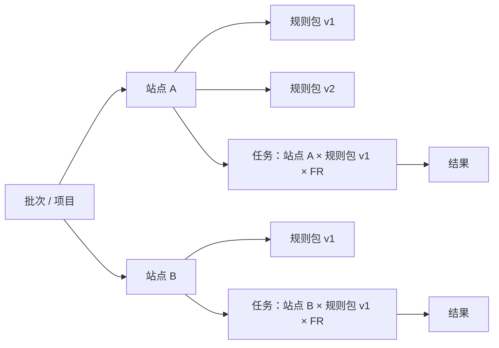

## 用途与边界

本页回答四个问题：用户从什么工作开始、系统要替用户完成哪些步骤、界面应该按什么顺序组织、当前实现与目标设计差在哪里。

它是**目标工作流和前端信息架构的设计基线**，不是已实现功能清单，也不改变 `01`～`09` 的业务规则或 `09` 的任务状态与计数口径。2026-11-23 项目方确认批次阶段 1 进入 v1 用户界面；阶段 1 已实现并验收，内部任务控制台已并入同一 Vue 外壳（`/tasks`、`/tasks/{id}`），旧 `/legacy` 保留为技术兜底。本页描述的是以“一批站点”为起点的用户工作台，不能和旧内部任务控制台混写。

若批量提交站点、批次组织和批次级操作要进入 v1，必须先修改 [v1 界面范围](25-v1界面范围.md)、[D08 任务服务与界面设计](26-D08任务服务与界面设计.md) 和 [D08 初步设计稿](29-D08初步设计稿.md)，前端技术栈已由 [ADR 0009](adr/0009-批次工作台前端技术栈.md) 定为 Vue 3 + TypeScript + Vite，实施前先做最小端到端路径验证；不能把本页当作已经承诺的 v1 能力。

**2026-11-22 确认（已被 2026-11-23 范围变更取代）**：当时批次默认值作为下一阶段设计基线，不进入 v1；2026-11-23 项目方确认批次阶段 1 进入 v1，范围见 `25` 的 2026-11-23 节。

**2026-11-23 项目方确认**：批次阶段 1 进入 v1 用户界面，范围见[ v1 界面范围](25-v1界面范围.md) 的 2026-11-23 节；内部任务控制台并入同一 Vue 外壳（[ADR 0010](adr/0010-任务控制台并入批次工作台外壳.md)），旧 `/legacy` 保留为技术兜底。阶段 1 已按 `26` 的 API／账本设计、`29` 的设计基线和 ADR 0009 实现并验收。

## 结论摘要

- 用户的起点是**一批站点**，不是“规则包”。规则包是系统内部的站点采集方案版本，不应成为业务用户创建任务的第一道门。
- 当前界面解决的是“已有受管规则包之后，如何创建、观察、控制、查看和导出单站任务”；它不解决“如何接收一批站点、判断能否采集、组织批次、批量执行和整批交付”。
- 目标信息架构以**批次（项目）→ 站点 → 任务 → 结果**为主轴；规则包藏在站点背后，只在技术详情和接入状态中出现。
- 批次是组织对象，不是新的任务状态或计数单位；批次汇总由成员任务派生，不把不同任务的商品数简单相加。
- 当前实现与目标设计之间存在对象模型和 API 缺口；应先确认产品模型，再画页面，不能继续在任务列表上做视觉打磨。

## 定位判断

- **任务控制台技术视图**：已并入批次工作台同一 Vue 外壳的 `/tasks`，不是业务用户的产品界面。它的价值在于验证任务状态、控制语义、计数、质量异常、导出和账本恢复；不应继续把任务列表当作产品首页打磨。
- **目标批次工作台**：从一批站点开始，先判断可采性，再组织批次、启动可采站点、监控异常和按批次交付。它需要批次／站点对象和新的 API，不是给任务列表加一个筛选。
- **设计评审**：以全局原型为准，覆盖应用外壳、导航、跨页流程、对象关系和关键状态；mock 数据可以独立于后端。孤立页面、已实现页面截图和单页 demo 都不能替代全局原型评审。
- **实现边界**：本页和 `experiments/d08/batch-workbench-prototype/` 是设计基线，不是已实现产品；阶段 1 已确认进入 v1，实现前必须按 `25`／`26`／`29` 的范围、API 和设计基线落地，并用真实案例验收。原型 mock 只用于设计评审。

## 用户与约束

### 主要用户

| 用户 | 与界面的关系 | 需要知道 | 不需要知道 |
| --- | --- | --- | --- |
| 采集运营／数据分析 | 主要使用者：提交站点、组织批次、发起采集、处理异常、导出结果 | 业务范围、市场／语言、预算、有效商品和质量异常的含义 | CSS／XPath、selector、HTTP、浏览器、代理、数据库、规则包版本 |
| 技术负责人／构建者 | 处理未接入站点、复核方案、修复失败 | 站点分析、规则包、浏览器、验证证据 | 业务验收结论由业务方负责 |
| 业务验收人 | 看批次结果、覆盖、停止原因和异常，判断是否够用 | 有效、排除、失败、部分结果、覆盖未知 | 采集实现和规则包细节 |
| 维护者 | 从失败站点进入任务详情、日志和复跑 | 失败分类、方案版本、复现和复验 | 不需要从批次列表猜测失败原因 |

### 用户约束卡

这些约束会直接影响页面结构，不用人口标签代替：

| 约束 | 本项目默认 | 对设计的影响 |
| --- | --- | --- |
| 使用频率 | 按项目／批次使用，可能一周多次或集中几天 | 批次列表要能按项目、国家、时间找回；不要求记住上次路径 |
| 设备与环境 | 桌面浏览器，本地服务，1280 为主 | 首屏以表格和批次摘要为主；窄屏可后置 |
| 领域知识 | 懂电商业务和数据标准，不是爬虫工程师 | 用“站点、批次、采集范围、结果”说话，不用规则包和选择器当前提 |
| 数字素养 | 能使用表格、筛选、上传和下载，但不一定理解异步任务 | 状态和下一步要显式；不要用内部状态值代替用户语言 |
| 语言 | 中文界面，目标站点可能为法语等外语 | 站点语言和市场分开；不要把目标站点语言当成界面语言 |
| 压力与风险 | 一批站点要交付，失败站点需要解释 | 批次汇总、失败原因、部分结果和导出必须清楚 |
| 任务规模 | 一批可能十几到几十个站点 | 必须支持批量导入、批量匹配、批量启动和批次筛选，不能只做单站表单 |

### 技能边界

| 必须知道 | 界面应该教会 | 不应该要求 |
| --- | --- | --- |
| 目标市场、语言、采集范围和预算 | 什么是批次、什么是可采／待接入 | 规则包版本、selector、XPath |
| 有效商品、部分描述、覆盖未知的含义 | 任务状态、计数、停止原因怎么读 | HTTP、浏览器、代理、限流 |
| 暂停和取消、已受理和已完成的区别 | 为什么有些站点不能立即采集 | SQL、数据库、Python |
| 结果够不够用的业务判断 | 未接入站点如何进入构建、何时可采 | 方案构建、依赖安装、规则修复 |

### 体验目标

- **可信**：批次和站点状态真实；不把“待接入”显示成“运行中”，不伪造批次百分比或完成时间。
- **可控**：支持批次级和站点级暂停／取消；区分“已受理”和“已完成”。
- **可解释**：每个站点为什么不能采、为什么失败、结果缺什么，都能看到下一步。
- **低门槛**：用户从站点列表开始，不需要先理解规则包；默认值可用，技术细节可展开。
- **可恢复**：页面关闭不停止后台；刷新、重开、归档和还原不丢上下文。
- **可交接**：批次、站点、任务、结果和验收记录能按项目导出和找回。

## 为什么不能以规则包为入口

四个对象不能混：

| 对象 | 是什么 | 用户是否直接操作 | 关系 |
| --- | --- | --- | --- |
| 站点 | 一个采集目标网站 | 是，用户按站点提交和查看 | 一个站点可以有多个规则包版本和多个任务 |
| 批次（项目） | 一次提交或交付的一组站点和任务 | 是，用户按批次组织和筛选 | 一个批次包含多个站点；批次汇总由任务派生 |
| 规则包 | 某个站点的一套可执行采集方案版本 | 技术角色维护，业务用户不直接选 | 一个站点可以有 0～N 个规则包；任务绑定一个规则包版本 |
| 任务 | 一个站点 × 一个规则包版本 × 一个市场的一次执行 | 用户通过站点或批次间接操作 | 一个站点可以有多个任务；结果属于任务 |

当前页面把“规则包”做成创建任务的下拉框，等于要求业务用户先完成一次内部翻译：

> “我要采这个网站” → “这个网站对应哪个规则包版本？”

这不是用户的工作。规则包应该在站点背后自动匹配；只有未匹配、需要构建或排查版本时，才在技术详情中出现。

## 目标工作流

| 阶段 | 用户要完成什么 | 系统输出 | 界面落点 | 当前实现 |
| --- | --- | --- | --- | --- |
| 提交批次 | 把一批站点交给系统，命名并归类 | 批次草稿、站点清单、去重和无效项 | 新建批次／导入 | 无，只能选规则包建单任务 |
| 站点核验与匹配 | 知道哪些站能采、哪些要接入、哪些无效 | 每个站点的接入状态和原因 | 批次详情站点表 | 无，只有规则包下拉框 |
| 批次计划 | 设置默认市场／语言、范围、任务类型和预算 | 可启动的批次计划；未就绪站点保留 | 批次配置 | 只有单任务预算字段 |
| 接入与构建 | 让未接入站点进入构建、复核和待采状态 | 构建状态、规则包版本、可采时间 | 站点接入状态；构建详情另开 | 阶段 1 已接入站点级构建；完整构建会话后置 |
| 执行 | 启动可采站点，必要时部分启动 | 每个站点一个任务；批次级状态汇总 | 批次详情操作栏 | 只能逐个创建任务 |
| 监控与异常 | 看整批进度，找到失败／阻塞站点 | 批次摘要、站点状态、异常队列 | 批次详情 | 只有扁平任务列表 |
| 验收与导出 | 判断结果是否够用，按站点／整批导出 | 站点结果、批次汇总、部分结果标识 | 批次结果与导出 | 只能单任务导出 |
| 历史与复用 | 找回批次、复跑站点、换版本 | 历史批次、站点任务历史、复跑入口 | 批次列表／站点详情 | 只有任务状态筛选和归档 |

### 工作流规则

- 批次可以先保存草稿，再逐步补齐站点和计划；不要求一次填完。
- 允许部分启动：可采站点先跑，未接入站点保持“待接入”，不阻塞整批；批次必须显示“未就绪 N 个”，不能伪装整批完成。
- 未接入站点不是错误，是正常状态；阶段 1 由技术角色在站点详情启动构建 Agent，业务用户看到构建进度、失败原因和下一步；完整构建会话 UI 后置。
- 批次级操作和站点级操作共用同一任务服务；批次不是第二套执行器。
- 任何批次汇总都必须标注口径：任务数、站点数、有效商品数是不同维度，不合并成一个“总数”。

## 对象模型



约束：

- 一个任务只对应一个站点、一个规则包版本和一个市场，沿用现有任务粒度。
- 批次是组织和检索对象，状态由成员任务和站点派生；不新增任务状态，不改变 `09` 的计数口径。
- 站点可以属于多个批次（例如同一站点在不同项目复采）；是否允许由业务确认，默认允许多次引用，不复用旧任务结果。
- 规则包是站点级资产，不因批次复制；批次只是引用站点和任务。

## 信息架构

| 层级 | 页面 | 主要任务 | 入口 | 出口 |
| --- | --- | --- | --- | --- |
| 1 | 批次列表（首页） | 找到项目、看整批状态、新建批次 | 根路径 | 新建、批次详情、归档 |
| 2 | 新建批次／导入站点 | 粘贴或上传站点，命名、归类、预览匹配 | 批次列表 | 保存草稿、进入批次详情 |
| 3 | 批次详情 | 看站点清单、接入状态、任务状态、批次操作 | 批次列表 | 站点详情、构建详情、导出 |
| 4 | 站点／任务详情 | 看单站计数、质量异常、控制、导出 | 批次详情 | 返回批次、导出、归档 |
| 5 | 技术详情 | 规则包版本、日志、事件、原始计数 | 站点详情 | 返回站点 |
| 次要 | 全部任务 | 技术角色按任务维度检索和排障 | 顶部导航 | 任务详情 |

首页第一对象应是**批次**，不是任务。任务列表保留为技术角色的“全部任务”视图，不再承担业务用户的主入口。

## 线框

以下线框表达结构、信息层级和关键状态，不是视觉稿，也不是已实现页面。

### 批次列表

```text
┌ 采集批次 ─────────────────────────────────────────────────────────────┐
│ 本地控制台        页面关闭不停止后台                         [新建批次] │
├───────────────────────────────────────────────────────────────────────┤
│ [状态 ▾] [国家／市场 ▾] [品类 ▾]  □ 包含归档          共 N 个批次      │
│ 批次                 国家／市场  站点  可采  待接入  运行  完成  失败  更新 │
│ 法国手工纺织 2026-11  FR          20    12    6       5     7     1     …   │
│ 法国纺织补充 2026-10  FR          8     8     0       0     8     0     …   │
└───────────────────────────────────────────────────────────────────────┘
```

### 新建批次与导入站点

```text
新建采集批次
名称 [法国手工纺织 2026-11]
国家／市场 [FR]  语言 [fr-FR]  品类 [手工／纺织]
站点列表（每行一个网址）
┌───────────────────────────────────────────────────────────────────────┐
│ https://example-boutique.fr/                                          │
│ https://autre-atelier.fr/                                             │
│ …                                                                     │
└───────────────────────────────────────────────────────────────────────┘
[上传 CSV] [解析站点]
预览：有效 18 · 重复 2 · 无效 1
匹配：已接入 12 · 待接入 6
[保存草稿] [保存并检查]
```

### 批次详情

```text
← 批次列表  法国手工纺织 2026-11                    [启动可采站点] [导出]
状态 草稿／部分就绪   国家 FR   语言 fr-FR   品类 手工／纺织
站点 20 · 可采 12 · 待接入 6 · 无效／重复 2
运行 5 · 完成 7 · 失败 1 · 未开始 5

[全部] [可采] [待接入] [运行] [完成] [失败]
┌───────────────────────────────────────────────────────────────────────┐
│ 站点                 接入状态   任务状态  有效／失败  停止原因  更新  操作 │
│ boutique-a.fr        可采       运行中    12／0       -         …    暂停 │
│ atelier-b.fr         待接入     -         -           -         …    查看 │
│ boutique-c.fr        可采       失败      3／2        访问拒绝   …    详情 │
└───────────────────────────────────────────────────────────────────────┘
```

### 站点／任务详情

沿用 [D08 初步设计稿](29-D08初步设计稿.md) 的任务详情，增加：

- 顶部显示所属批次、站点、接入状态；
- 规则包版本、构建记录、日志放进“技术详情”，不占首屏；
- 返回路径回批次详情，而不是只回任务列表。

### 可浏览原型

静态原型在 `experiments/d08/batch-workbench-prototype/`，使用 mock 数据，不连接后端。打开方式：

```powershell
cd experiments/d08/batch-workbench-prototype
python -m http.server 8780
```

访问 `http://127.0.0.1:8780/`。原型覆盖：

- 批次列表、新建批次、站点导入、匹配预览、保存草稿／启动可采站点；
- 批次详情、站点筛选、批次级控制、导出说明；
- 站点／任务详情、质量异常、商品／网址明细、技术详情；
- 全部任务和规则包技术页，说明规则包不是业务入口。

1280 和 768 截图、结构检查和 mock 边界见该目录的 `README.md`、`screens/` 与 `evidence.json`。原型评审通过前，不把任何页面当作已实现。

## 状态与计数

### 批次状态（派生展示，不是任务状态）

| 状态 | 含义 | 用户下一步 |
| --- | --- | --- |
| 草稿 | 站点或计划未完成 | 继续导入、配置或保存 |
| 部分就绪 | 有可采站点，也有待接入／无效站点 | 先启动可采站点，或等待接入 |
| 运行中 | 至少一个成员任务在排队或运行 | 看站点状态、处理异常 |
| 部分完成 | 有任务完成，也有失败／未就绪 | 处理失败、导出部分、决定是否补采 |
| 已完成 | 所有可运行任务进入终态 | 验收、导出、归档 |
| 已归档 | 只影响列表可见性 | 还原或查看历史 |

这些是建议的展示状态，未写入任务状态机；若进入实现，需在 `09` 补充分母和派生规则，不能新增与任务状态冲突的机器状态。

### 站点接入状态

| 状态 | 含义 | 用户下一步 |
| --- | --- | --- |
| 无效／重复 | 网址不合法或已在批次中 | 修正或删除 |
| 待匹配 | 尚未匹配规则包 | 等待系统匹配或人工确认 |
| 待接入 | 没有可用规则包 | 交技术角色构建，或等待 |
| 构建中 | 规则包构建／复核中 | 查看阶段／trace；等待，不显示为可采 |
| 构建失败 | 构建未通过 | 看原因，决定重试或暂不支持 |
| 可采 | 有已验证规则包 | 配置预算并启动 |

### 计数规则

- 批次汇总按站点数、任务数、有效商品数分列，不合并成一个“总数”。
- 同一站点多任务的有效商品数不能简单相加成“商品总数”；需要去重时另定口径。
- 未接入、无效、重复、未开始必须单独计数，不能藏在“失败”里。
- 没有可靠分母时不显示批次百分比、剩余时间或整批完成率。

## 设计与交互原则

- **工作流优先**：先按“提交批次 → 匹配 → 计划 → 接入 → 执行 → 监控 → 验收 → 复用”组织页面，再决定字段和控件。
- **内部概念后置**：首屏用站点、批次、任务、结果说话；规则包、版本、selector、日志放在技术详情。
- **批量默认 + 单站覆盖**：批次给默认市场／语言／预算，站点可覆盖；不要求每个站点重复填表。
- **状态即下一步**：每个状态都要告诉用户能做什么；待接入不是失败，失败不是结束。
- **部分完成可见**：允许部分启动和部分导出，但必须显式标注未就绪、失败和未处理。
- **不伪造进度**：批次汇总按计数和状态，不编造整批百分比、ETA 或全站覆盖率。
- **可恢复**：保存草稿、刷新、重开、归档和还原都以账本为准。
- **角色边界可见**：业务用户看到“待接入”和构建进度，但不在主流程里执行规则构建；技术角色从技术入口进入。

## 当前实现差距

| 能力 | 当前实现（2026-11-23） | 剩余目标 | 影响／后续 |
| --- | --- | --- | --- |
| 第一对象 | 批次／项目为首页 | 保持 | 已解决 |
| 创建入口 | 批次导入／站点匹配；任务创建收进技术视图 | 更大批量默认值和预算 | 已解决业务入口 |
| 站点模型 | `batch_sites`：域名、原始输入、接入状态、规则、任务、构建、出口代理 | 站点主数据和历史 | 阶段 2／3 |
| 批次模型 | `batches`、`batch_sites`、`tasks.batch_id` | 标签、客户、通知 | 阶段 3 |
| 接入状态 | 可采／待接入／构建中／无效／重复 | 构建中与构建会话联动 | 阶段 2 |
| 批量操作 | 批次启动／暂停／取消／归档／导出 | 部分恢复、复跑和整批合并 CSV | 阶段 1 已可用，后两项后置 |
| 批量结果 | 批次 `batch.json` + `sites.csv` + 站点目录 | 单个合并 CSV | 后置 |
| 规则包 | 导入按域名匹配，技术详情显示；站点详情可触发构建、查看详细时间线 trace 和验证失败自动修复 1 轮 | 完整多轮构建会话、真实模型修复轮次和人工复核 | 阶段 1 已有最小构建 |
| API | `/api/batches`、`/api/tasks`、`/api/rules` | 独立 `/api/sites` | 站点内嵌批次详情，暂不单列 |

阶段 1 已实现真实批次、站点深链、批次导出和站点级最小构建（启动、状态、详细时间线 trace、暂停／取消、失败回到待接入、验证失败自动修复 1 轮）；任务控制台并入 `/tasks`、`/tasks/{id}`，旧 `/legacy` 只作技术兜底。剩余主要是完整多轮构建会话协作、真实模型修复轮次、项目化标签、合并 CSV 和更大规模真实批次验收。

## 分阶段落地

### 阶段 0：设计基线（本页）

- 确认用户工作流、对象模型、信息架构、线框和开放问题。
- 不实现后端；不把本页当作已交付页面。
- 评审通过后，才进入阶段 1 的切片设计。

### 阶段 1：最小批次工作台（不自动构建）

2026-11-23 已确认进入 v1，并已完成实现与验收。阶段 1 使用 ADR 0009 的 Vue 外壳和 ADR 0010 的任务控制台并入；原型 mock 只用于设计评审，功能验收使用真实批次（`b-586052683409`，familidoo 6／6、decohappy 8／8，14 有效、0 失败）。

- 新增批次和站点对象，任务增加 `batch_id`。
- 支持粘贴／上传站点、去重、无效项预览、按域名匹配已有规则包。
- 批次详情显示可采／待接入／无效站点，支持启动可采站点、批次暂停／取消、批次汇总和导出。
- 未接入站点进入“待接入”，由技术角色在线下 harness 构建；页面显示状态，不自动构建。
- 规则包从主创建流程隐藏，只在站点技术详情显示。
- **前置**：修改 `25`、`26`、`29`，并确认任务计数、导出和权限边界。

### 阶段 2：构建协作

- 接入构建会话状态、构建队列和技术角色视图。
- 支持从站点发起构建、查看构建进度、复核后转为可采。
- 依赖 `BuildService` 和 harness 适配器；不把构建会话状态混入任务状态。

### 阶段 3：项目化与规模化

- 批次标签、客户／业务线、国家／品类分类、通知和定时复采。
- 多用户、只读验收和权限模型按 `31` 的触发条件另立阶段。

## 验证与验收建议

目标不是统计显著，而是确认用户能否完成工作流。至少用以下代表任务走查：

1. 导入 20 个法国站点，其中有 2 个重复、1 个无效；用户能看清有效、重复、无效数量并修正。
2. 系统标出 6 个待接入站点；用户能理解“待接入”不是失败，并知道下一步找谁。
3. 启动 14 个可采站点；用户能暂停一个、取消一个，并从批次详情看到状态变化。
4. 处理 1 个失败站点；用户能找到失败原因和下一步，不需要读规则包。
5. 导出整批结果；用户能区分完整、部分和失败站点。
6. 一周后找回批次；用户能复跑一个站点或复制为新批次。

记录任务完成、耗时、误点、求助次数和原话；没有真实用户时，用不熟悉产品的同事做代理验证，并标注“代理证据”。

## 开放问题

以下默认值已于 2026-11-22 由项目方确认，2026-11-23 随批次阶段 1 进入 v1；标注“需要确认”的字段仍可在批次实现前调整。

| 问题 | 建议默认 | 需要确认 |
| --- | --- | --- |
| 批次是否等同项目／客户交付？ | 先按“一次提交或一次交付”定义，不绑定客户 | 是否需要客户、合同、业务线字段 |
| 一个站点能否属于多个批次？ | 允许引用，不复用旧结果 | 是否需要站点主数据和历史 |
| 是否允许部分启动？ | 允许，未就绪站点保留并显式标注 | 是否要求整批全部就绪才能启动 |
| 未接入站点由谁构建？ | 阶段 1 由技术角色线下构建 | 是否要把构建入口放进业务界面 |
| 批次汇总怎么算？ | 站点数、任务数、有效商品数分列 | 是否需要去重商品总数 |
| 批次导出格式？ | 按站点目录 + 批次清单，保留部分标识 | 是否需要单个合并 CSV |
| 分类维度？ | 国家／市场、品类、批次时间 | 是否要客户、负责人、标签 |
| 角色分离？ | v1 单用户；需要时再评估登录和只读 | 业务验收人是否必须独立账号 |

## 关联文档

- [业务需求与范围](01-业务需求与范围.md)：目标用户、范围和输入。
- [界面与任务管理](06-界面与任务管理.md)：用户可见行为和当前 v1 边界。
- [v1 界面范围](25-v1界面范围.md)：当前实现承诺和可后置项。
- [D08 任务服务与界面设计](26-D08任务服务与界面设计.md)：当前 API、账本和实现切片。
- [D08 前端设计包与评审](28-D08前端设计包.md)：设计门、最小设计包和评审要求。
- [D08 初步设计稿](29-D08初步设计稿.md)：当前任务控制台的线框和已确认项。
- [用户角色与职责](31-用户角色与职责.md)：角色、职责和构建到运行交接。
- [任务状态与计数契约](09-任务状态与计数契约.md)：任务状态、计数和批次不作为计数单位的口径。
