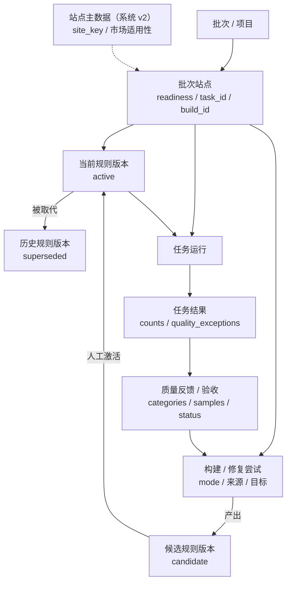
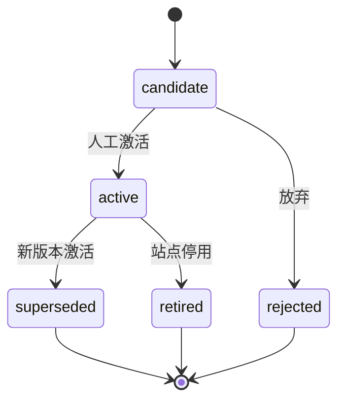
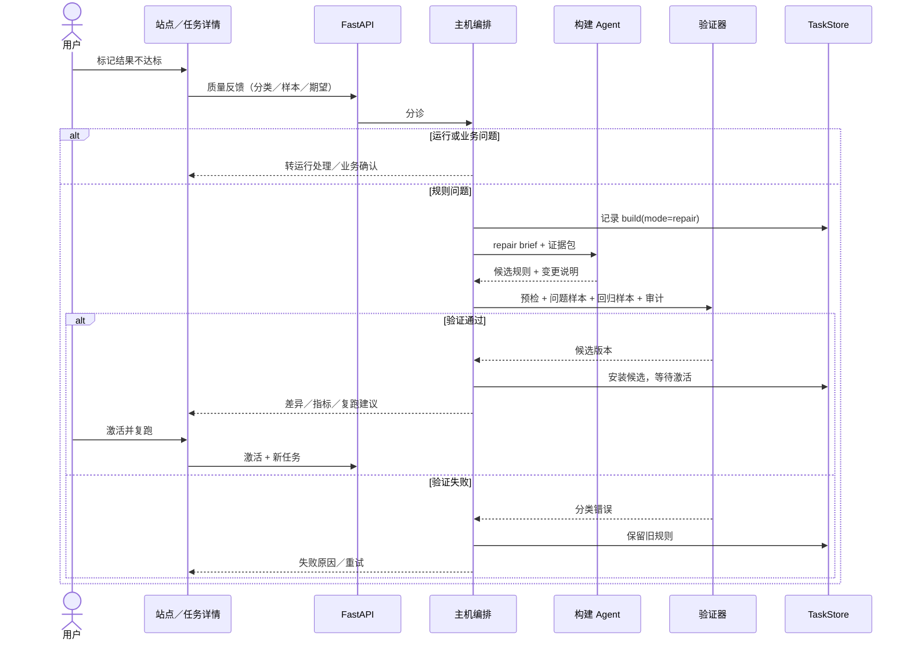

## 用途与边界

本页定义一条非顺利路径：**用户认为采集结果或规则不达标时，系统如何记录判断、收集证据、定向修复、验证、激活、复跑和回滚。**

它不改变[任务状态与计数契约](09-任务状态与计数契约.md)的生命周期和计数口径，不替代[用户工作流与前端信息架构](33-用户工作流与前端信息架构.md)的正常路径，也不把尚未实现的能力写成 v1 承诺。v1 已实现的 HTTP API 仍以[D08 任务服务与界面设计](26-D08任务服务与界面设计.md)为准；本页描述系统 v2 的目标设计、可实现的 API 契约，以及可以提前落地的最小护栏。

**版本口径**：项目文档里有两套三分法，不能混用。

- [用户工作流与前端信息架构](33-用户工作流与前端信息架构.md)的阶段 1／2／3 是**产品与工作流阶段**；本文对应的主目标是阶段 2“构建协作”。
- [采集规则与任务运行时](19-采集规则与任务运行时.md)的 v1／v2／v3 是**运行层并行模型**；本文涉及系统 v2 时，运行层指“每任务一个进程／worker 池”。
- 本文所说的**系统 v2**，是产品阶段 2 与运行层 v2 的组合；不把阶段 2 单独简称 v2，也不把运行层 v2 当成产品阶段。

本文标记为 `proposed`。其中“最小护栏”可作为下一小步实施；规则版本账本、人工激活和回滚属于系统 v2 设计，不自动进入当前 v1 范围。

## 现状与缺口

当前已经有站点级构建、规则验证、内容审计和“重新验证／修复规则”入口，但修复仍是一个**执行动作**，还不是一条可管理的闭环。

| 环节 | 当前实现 | 缺口 |
| --- | --- | --- |
| 用户判定 | 任务结果里有 `business_acceptance` 字段，但两个 runner 都固定写 `NOT_REVIEWED`；2026-11-23 第一切片已补质量反馈 API（创建／查询／详情／分诊），但还没有界面和修复闭环 | 用户可以说“不达标”，但还不能从反馈直接进入修复、激活和复跑 |
| 修复触发 | 站点详情有“重新验证／修复规则”，`mode=repair` 复制已安装规则 | 修复原因只有自由文本；没有任务、样本、质量异常和期望结果的结构化输入 |
| 修复证据 | 工作区有 `existing-rule.yaml`、`repair-context.json`、`repair-brief.md` | 没有当前任务结果、质量异常和失败样本；Agent 曾扫描主机目录找旧结果，brief 约束不是硬隔离 |
| 修复执行 | 同一会话执行，主机校验 schema、选择器和币种 | 不强制 `rule_id` 不变、版本唯一、变更范围受限；同版本会生成带 build id 后缀的文件，随后被判 duplicate |
| 验证 | 6 个样例有效、币种匹配、描述块审计无缺口即通过 | 没有“用户报告的问题是否改善”的断言，也没有旧规则 vs 新规则的回归对比 |
| 安装与激活 | 验证通过后站点规则指针直接切到新版本 | 没有候选／激活区分，也没有人工确认；用户可能不知道规则已经变化 |
| 结果一致性 | 修复成功只改站点规则，`task_id` 不变 | 当前结果仍基于旧规则，但界面没有“结果已过期”标记，也没有回滚入口 |
| 并发与唯一性 | 前端隐藏修复按钮；后端 `repair` 只检查站点 `ready` 和规则文件 | 任务 `RUNNING`／`PAUSED` 时直接调 API 仍可发起修复；多批次同站可能各存一份规则指针 |
| 可复现性 | 任务记录 `plan_version` 和 `rule_path` | 没有规则内容哈希；规则文件被手工改动后，同版本可能对应不同内容 |

> 2026-11-24 更新：规则内容哈希、`rule_versions`、候选／激活／回滚、反馈创建／分诊／复跑和 v2 候选卡已落地；本表保留设计时缺口，不再逐行改写。当前状态以[交接与继续](15-交接.md)为准。

## 设计原则

- **判断与执行分离**：用户“不达标”的判断是一等记录，不是修复 brief 里的一句备注；修复只是处理该记录的一种动作。
- **规则不可变**：规则版本发布后不原地修改；修复产生新版本，旧版本保留。激活是账本指针变化，不是重写 YAML。
- **结果绑定规则内容**：任务记录规则版本和内容哈希；只看版本号不足以证明结果可复现。
- **证据优先、定向修复**：主机准备证据包，Agent 只读工作区；不为字段问题重新枚举全站。
- **人工激活、可回滚**：验证通过只产生候选；用户确认后切换。切换后旧规则和旧任务仍可用于对比和回滚。
- **一个站点同时只允许一个修复**：构建、修复和正式采集不能在同一站点上并发改规则。
- **不删除历史**：修复失败、复跑和回滚都不删除旧规则、旧任务和旧结果。

## 账本与对象模型

建议把当前混在 `batch_sites`、`builds`、`tasks` 和 `task-result.json` 里的信息拆成五类记录。它们不要求一次全部建表，但设计和 API 应能无损映射。

| 记录 | 建议字段 | 当前落点 | 作用 |
| --- | --- | --- | --- |
| 站点与批次成员 | `site_key`、`domain`、市场适用性、`batch_id`、`readiness`、当前 `task_id`、当前 `build_id` | `batch_sites` | 区分“站点身份”和“批次引用”；系统 v2 再拆站点主数据 |
| 规则版本 | `rule_id`、`rule_version`、`sha256`、`parent_version`、`status`、`source_build_id`、`created_at` | `rules/*.yaml` + 站点指针 | 不可变版本、血缘、激活和回滚 |
| 构建／修复尝试 | `build_id`、`mode`、来源版本、目标版本、`feedback_id`、状态、`error_class`、验证摘要、证据哈希 | `builds` | 记录一次构建或修复做了什么、为什么失败 |
| 任务运行 | `task_id`、`rule_id`、`rule_version`、`rule_sha256`、状态、`outcome`、计数、验收结论 | `tasks` + `task-result.json` | 证明结果基于哪份规则，支持复跑和对比 |
| 质量反馈 | `feedback_id`、`task_id`、规则版本、问题分类、样本 URL、期望、状态、解决任务 | 暂无；`business_acceptance` 只有占位 | 承载用户“不达标”的判断和修复验收 |



一个批次可以包含多个站点；图中只画一个站点，其他站点的关系相同。

约束：

- `rule_id` 是站点级稳定标识；修复不换 `rule_id`。
- `rule_version` 在同一 `rule_id` 下唯一；重复版本直接拒绝，不用文件名后缀掩盖。
- 激活状态放在账本，不写回规则 YAML；否则每次激活都会改变规则哈希。
- 任务结果和 `business_acceptance` 分开保存，避免用户事后验收时修改已经生成的任务结果文件。

## 规则版本生命周期



| 状态 | 含义 | 是否可被任务使用 |
| --- | --- | --- |
| `candidate` | 主机验证通过，等待人工确认；YAML 里的 `status: candidate` 可以保留 | 否，除非显式用于验证 |
| `active` | 站点当前生效版本 | 是 |
| `superseded` | 曾被激活，后来被新版本取代 | 仅历史任务和回滚候选 |
| `rejected` | 验证通过但用户放弃，或人工拒绝 | 否 |
| `retired` | 站点停用或规则不再适用 | 否 |

`verified` 是人工复核结论，不等于 `active`。v1 单用户时可以由同一人记录自审；系统 v2 需要独立复核时，把复核人和时间放在规则版本的审计字段里，不把 `verified` 写进 YAML 冒充运行时状态。当前实现把验证通过的规则写成 `candidate` 并更新站点指针；迁移时把这次更新视为一次显式激活，补记激活人和时间，不回写 YAML。

## 修复闭环

### 一、反馈

用户从任务详情或站点详情选择“结果不达标”，填写：

- 问题分类：范围／发现、身份／去重、价格／币种／单位、描述／正文、基础字段、访问／运行、业务预期、其他。
- 受影响的样本 URL：从任务预览、质量异常或手动输入中选择。
- 期望结果：例如“描述应包含规格块”“不应包含促销角标”“应发现该分类下的商品”。
- 备注：只用于补充，不代替分类和样本。

系统生成 `quality_feedback`，状态为 `OPEN`，并关联任务、规则版本和批次站点。**这一步不启动模型，也不改变任务状态。**

### 二、分诊

本节“分诊”特指**反馈分诊**，不是采集前的站点入口分诊；两者区别见[术语表](术语表.md)和[开发、界面与运行时概念说明](27-开发与运行时概念行话说明.md)。

主机先判断问题属于哪一层：

| 分类 | 典型证据 | 处理 |
| --- | --- | --- |
| 范围／发现 | 分类页有商品但未发现、分页提前停止 | 规则修复；验证重点是新入口和停止条件 |
| 身份／去重 | 同商品多 URL、变体被拆成多个商品 | 规则修复；验证重点是身份键和归并 |
| 价格／币种／单位 | 划线价、分期价、单位价错误 | 规则修复或市场出口复核；验证重点是价格来源和币种 |
| 描述／正文 | 短摘要、规格块缺失、促销角标混入 | 规则修复；验证重点是块合成和审计 |
| 基础字段 | 名称、主图、状态、分类错误 | 规则修复；验证重点是字段来源和主商品容器 |
| 访问／运行 | 403、429、挑战、超时、依赖缺失 | 不交给构建 Agent；转运行时或网络处理 |
| 业务预期 | 用户不接受范围、口径或数据用途 | 不修规则；记录验收结论或调整任务范围 |

站点自身有活跃任务（`DRAFT`、`QUEUED`、`RUNNING`、`PAUSING`、`PAUSED`）或活跃构建时，拒绝发起修复，并说明应先暂停、取消或等待；其他站点有构建时，修复请求进入全局构建队列，不返回全局忙。站点没有任务，或任务已经 `FINISHED`／`CANCELLED`，才允许修复规则。

### 三、证据包

主机在工作区生成，不要求 Agent 扫描主机：

- `existing-rule.yaml`：当前生效规则。
- `repair-context.json`：站点、批次、市场、规则版本、规则哈希、问题分类、样本 URL。
- `repair-evidence.md`：任务摘要、计数、`quality_exceptions`、`content_audit`、失败分类、用户期望。
- `samples/`：相关页面快照或 archive 引用；没有存档时只抓问题样本和有界回归样本。
- `rule-diff-policy.md`：本次允许改动的范围。

Agent 只能读工作区输入、声明的样例 URL 和宿主 skills 根；不得读用户目录、其他仓库、旧任务输出或凭据。v1 用 brief 和 session permissions 限制 `read`／`edit`：skills 根只读，`browse`／`htmlmini` MCP 可用，其他 MCP 拒绝；`shell` 仍是宿主用户权限；系统 v2 需要真正的沙箱或只读挂载，不能把自然语言约束当安全控制。

### 四、修复

Agent 输出：

- `../out/plan/rule.yaml`：候选规则。
- `../out/evidence/build-notes.md`：改了什么、为什么、检查了哪些页面。
- `../out/plan/change-summary.json`：机器可读的变更摘要，至少包含 `rule_id`、`rule_version`、`parent_version`、修改的字段／选择器、是否改动发现源和范围。

主机强制检查：

- `rule_id` 与当前规则一致。
- `rule_version` 是新的、在 `rule_id` 下唯一。
- 发现源、范围、市场、币种不变，除非问题分类明确要求范围修复并经用户确认。
- 不降低验证门槛，不删除审计块来“消除缺口”。
- 不写工作区外路径，不安装未授权依赖。

### 五、验证

验证不是“至少一个有效商品”，而是同时回答三个问题：

1. **报告的问题是否改善**：问题样本上必须出现用户期望的结果，或给出原站未提供的证据。
2. **核心字段是否退化**：在回归样本上比较旧规则和新规则的名称、价格、币种、主图、状态、描述和选项。
3. **是否引入新问题**：失败数、排除数、重复数、币种、内容审计缺口不能变差。

验证结果按三段分别记录，不再用一个 `PASSED` 概括：

- `candidate_smoke`：候选规则的有界冒烟，记录是否执行、有效／失败／排除数、币种和商品样本。有反馈时，问题样本会作为商品种子进入同一轮冒烟，避免只验证发现路径碰巧选中的页面。
- `issue_checks`：反馈问题样本的主机检查。描述、价格／币种、基础字段、发现、身份和访问运行有确定性断言；业务预期和自由文本不冒充自动通过。
- `regression`：旧规则和新规则在同一固定商品页集合上的字段对比。候选冒烟先取得商品 URL；修复构建再用旧规则以 `discover=false` 和 `seed_urls` 只抓这批页面，比较名称、价格、币种、主图和描述。描述只在明显缩短时视为退化，避免把合法扩写当成回归；只在新旧两侧都出现的页面计入 `checked`，只在一侧出现的页面写入 `skipped`。

`status` 取值：

- `PASSED`：冒烟有效，问题样本检查通过（如有），需要的回归已执行且无退化；初始构建没有父规则时回归标记为不需要。
- `INCOMPLETE`：冒烟有效，但修复所需的同页回归未执行，或新旧两侧共同覆盖的商品页少于 `min(3, 候选冒烟商品数)`。候选仍可保留查看，但不能激活。
- `FAILED`：冒烟无有效商品、问题样本检查失败或回归发现退化。

未执行的部分必须用 `executed=false`、`reason` 或 `status_reasons` 明说，不用空数组或 `checked=valid_products` 冒充已比较。验证输出写入构建记录：`candidate_smoke`、`issue_checks`、`regression`、`content_audit`、`diff`、`evidence_sha256`。失败时保留旧规则，错误按 schema、选择器、网络、币种、质量问题分类，不用一段字符串代替。

建议的最小验证集：

- 问题样本 3～5 个，覆盖用户报告的具体页面。
- 随机样本 3～5 个，避免只修好被点名的页面。
- 回归样本 3～5 个，覆盖不同模板或分类。
- 旧规则和新规则在同一批页面上跑一次，输出字段级 diff。

### 六、激活

默认**人工确认后激活**：

1. 主机展示候选规则、变更摘要、问题样本对比、回归结果和预计复跑范围。
2. 用户选择“激活”或“放弃”。激活前旧规则继续生效。
3. 激活是事务操作：校验候选版本和哈希、验证证据 → 更新站点当前规则指针 → 旧版本标记 `superseded` → 写审计记录。
4. 激活后不自动删除旧任务；当前任务结果标记为“基于旧规则”。

激活前，主机必须核对验证证据确实绑定到拟激活版本：

- 构建记录的 `target_rule_version`／`target_rule_sha256` 与候选一致，`validation.evidence_sha256` 与构建证据哈希一致。
- `candidate_smoke.executed=true` 且至少 1 条有效商品。
- 修复构建的 `regression.executed=true`、`checked>=min(3, 候选冒烟商品数)`、`regressions=[]`。
- 反馈关联的每个问题样本都有通过的主机检查。
- `status=INCOMPLETE` 返回 `409 VALIDATION_REQUIRED`；`status=FAILED` 或存在回归返回 `409 VALIDATION_FAILED`，旧规则继续生效。
- 回滚不需要重新跑验证，但目标版本和文件哈希仍需核对。

低风险修复（例如只补描述块）可以在系统 v2 评估“自动激活 + 提示复跑”，但默认不这样做。范围、价格、身份、币种变更必须人工确认。

### 七、复跑与关闭

- 复跑创建新 `task_id`，使用新规则版本和哈希；旧任务保留。
- 默认只复跑“规则已过期”的站点；用户也可以显式选择全部复跑。
- 复跑完成后对比修复前后指标：问题样本、有效数、失败数、描述完整度、重复数、币种。
- 结果改善则关闭 `quality_feedback`；没有改善则保留 `OPEN`，可再次修复或标记 `WONTFIX`。
- 如果新规则整体更差，回滚站点指针到上一个 `active` 版本；新任务保留作为证据，不删除。

### 修复时序



## API 契约（系统 v2）

本节把前面的规则修复闭环落成可实现的 HTTP 契约，供后端、前端和验收使用。它是 **v2 契约草案**，不是已经实现的能力；v1 已实现端点仍按[D08 任务服务与界面设计](26-D08任务服务与界面设计.md)执行。

**当前实现状态（2026-11-24）**：`quality_feedback`、`rule_versions`、`site_rules`、`rule_activations` 账本和 `builds`／`tasks` 增量字段已落地；初始构建记录 active 版本并自动激活，定向修复默认只产生 candidate，站点详情可人工激活／拒绝／回滚。反馈修复、复跑、关闭、规则版本列表／详情、站点规则读模型和 v2 候选卡已接入。修复 brief 注入当前任务计数、覆盖、质量异常、内容审计和样本 URL；修复强制同 `rule_id`、递增 `rule_version`、活跃任务守卫。任务详情对比任务与站点规则并显示“结果基于旧规则”。候选规则详情和站点候选卡返回主机生成的 `change_summary`（字段级 diff、选择器变更、发现／范围／市场／币种标记）和规范化 `validation`（问题样本、回归计数、内容审计、diff、证据哈希），候选卡可展开验证明细。v2 新增 `/builds` 构建记录列表和 `/builds/{id}` 详情，展示完整时间线、每轮自动修复、验证明细、审批和 trace；失败构建可在同进程会话内手动继续并重新走主机验证。`ECOM_BUILD_DISABLED=1` 保留读接口、只拒绝新构建和继续。一次性迁移命令 `python -m ecom_crawler.migrate_rules` 可回填站点指针、规则版本、任务哈希和构建目标版本并生成 JSON 报告。构建队列（`QUEUED`、FIFO 调度、排队取消、重启保留排队项）已于 2026-11-24 接入；跨重启会话恢复（中断态、按会话重载、Agent 已结束构建自动复验）已于 2026-11-24 接入并用真实模型中断／继续走查，继续后主机验证 PASSED、候选 `2026.11.24-4` 安装。多轮自动修复在 2026-11-24 用真实模型和注入的主机验证失败走查：`build-051a4cab5a23` 完成 2 轮修复，第 1 轮保持未解决、第 2 轮 resolved，最终第三次真实验证 PASSED、候选 `2026.11.24-mr5` 安装；自然规则缺陷连续触发多轮尚未遇到，仍以注入验证失败验证控制流、历史与状态语义。依赖审批在 2026-11-24 用证据专用服务走查：真实模型请求 `six==1.17.0`，构建详情显示包名／版本／manager／scope／原因，批准后临时 venv 安装并验证，构建 PASSED；生产 `serve` 仍未接安装器，且本次 OpenCode 未对 `skill`／`shell`／`edit`／`request_dependency` 的 ask 规则发出待处理权限请求，权限审批真实触发条件待核查。自动激活、多用户、规则编辑器和队列优先级仍未实现。

**2026-11-24 P0 整改**：普通批次的导入、启动和复跑改为读取 `site_rules`／`rule_versions` 生效账本；YAML `status: verified` 只作为旧规则兼容回退，候选、已拒绝和已替换版本不能从目录扫描进入正常任务。批次市场与规则市场不一致时导入标为待接入并在启动时明确跳过。任务入队后 worker 核对规则文件哈希、任务市场和规则版本，任一不一致以 `PLAN_ERROR` 终止，不发起采集。验证报告拆成 `candidate_smoke`、`issue_checks` 和 `regression` 三段；修复构建用候选冒烟产生的固定商品页集合运行旧规则（`discover=false`）并比较名称、价格、币种、主图和描述，未执行回归记为 `INCOMPLETE`。激活前核对候选哈希、验证证据哈希、冒烟、回归和反馈样本检查，`INCOMPLETE` 返回 `VALIDATION_REQUIRED`，`FAILED` 或存在回归返回 `VALIDATION_FAILED`。测试覆盖跨批次导入、激活后启动、回滚后重新导入、市场错配、入队后哈希变化、价格回归和缺少回归证据；`v2-build-validation.schema.json` 的 `status` 增加 `INCOMPLETE`。

**范围**：质量反馈、修复构建、规则版本账本、站点规则指针、候选激活、回滚、复跑、结果过期标记和验收投影。

**不做**：完整站点主数据、站点 × 市场 readiness、队列优先级与多 worker、多用户权限、自动激活、规则编辑器、规则导入／手工编辑 API、定时复采、构建沙箱和费用上限。这些仍按本文后面的“仍未定”处理，不借 v2 名义扩进本次契约；手工放进 `rules/` 的文件仍由运维和迁移扫描处理，不通过本次新 API 激活。

**版本口径**：系统 v2 不是 URL 版本 v2。新能力继续挂在 `/api` 下，现有 v1 端点和响应保持兼容；只有出现无法兼容的字段或语义变更时才引入 `/api/v2`。所有时间为 ISO 8601 UTC，ID 为不透明字符串，`sha256` 为 64 位十六进制小写字符串。任务读写接口中的历史字段 `plan_id`／`plan_version` 分别等于规则资源的 `rule_id`／`rule_version`；v2 新资源统一用 `rule_*`，不重命名旧任务字段。

**错误**：沿用 `26` 的 `{"error": {"code", "message", "details"}}`。v2 端点必须同时把 FastAPI 请求校验错误归一为同一 envelope；当前 v1 的 422 仍是 `detail` 数组，属于实现前要补的缺口。写操作继续要求同源 `Origin`、回环 `Host` 和 `X-Requested-With: XMLHttpRequest`。

**用户与审计**：v2 仍按单机单用户设计，不新增登录和权限模型。`actor`、`created_by`、`resolved_by` 省略时记为 `local-user`，只用于审计和展示，不作为授权依据；需要多用户时按本文“仍未定”另立阶段。

**契约真源**：服务已在 `/api/openapi.json` 暴露 FastAPI OpenAPI，提交快照为 `app/schemas/openapi.json`，用 `app/tools/export_openapi.py` 重新生成，测试会校验快照。第一切片的反馈端点已补 Pydantic response model；其他端点仍有不少 `dict` 响应，OpenAPI schema 较宽，后续切片补模型时同步快照。前端用 `openapi-typescript` 生成类型，不手写第二份契约；本节解释语义、状态和迁移，OpenAPI 负责机器可读结构。

### 资源与字段

| 资源 | 主键 | 关键字段 | 作用 |
| --- | --- | --- | --- |
| `quality_feedback` | `feedback_id` | `request_id`、`task_id`、`batch_id`、`site_key`、`rule_id`、`rule_version`、`rule_sha256`、`category`、`samples`、`expectation`、`note`、`scope`、`status`、`triage`、`triage_note`、`triage_source`、`duplicate_of`、`repair_build_id`、`rerun_task_id`、`resolution`、`resolution_note`、`created_by`、`resolved_by`、`created_at`、`updated_at`、`closed_at` | 用户“结果不达标”的一等记录 |
| `rule_versions` | `(rule_id, rule_version)` | `sha256`、`parent_version`、`status`、`source_build_id`、`source_feedback_id`、`created_at`、`activated_at`、`activated_by`、`reviewed_by`、`reviewed_at`、`notes` | 不可变规则版本、血缘和激活状态 |
| `site_rules` | `site_key` | `rule_id`、`rule_version`、`sha256`、`path`、`updated_at` | 站点当前生效规则指针；跨批次共享 |
| `rule_activations` | `activation_id` | `site_key`、`rule_id`、`action`、`from_version`、`from_sha256`、`to_version`、`to_sha256`、`reason`、`actor`、`request_id`、`created_at` | 激活／回滚审计 |
| `builds` 扩展 | `build_id` | `feedback_id`、`request_id`、`request_json`（排队参数）、`source_rule_version`、`source_rule_sha256`、`target_rule_version`、`target_rule_sha256`、`error_class`、`change_summary_json`、`validation_json`、`evidence_sha256` | 一次构建或修复做了什么、为什么失败；排队参数用于重启后继续调度 |
| `build_continuations` | `request_id` | `build_id`、`message_sha256`、`message_chars`、`state`、`error`、`created_at` | 失败或中断构建手动继续的幂等键和审计；不保存消息正文 |
| `tasks` 扩展 | `task_id` | `rule_sha256`；`rule_stale` 由读模型派生，不入库 | 证明任务基于哪份规则内容 |
| `batch_sites` | `(batch_id, site_key)` | `readiness`、`task_id`、`build_id` 保留；`rule_id`／`rule_version`／`rule_path` 降级为只读镜像 | 批次成员和当前任务引用 |

`business_acceptance` 仍保存在 `task-result.json` 中，作为任务结束时的不可变快照；用户后续验收不修改该文件，而由 `quality_feedback` 账本投影到 API 读模型。`quality_feedback.request_json` 只保存创建请求的规范化副本用于 `request_id` 幂等比较，不进入 API 响应。

状态枚举：

| 枚举 | 取值 |
| --- | --- |
| 反馈状态 | `OPEN`、`TRIAGED`、`REPAIRING`、`AWAITING_ACTIVATION`、`AWAITING_RERUN`、`RERUN_PENDING`、`RESOLVED`、`WONTFIX` |
| 分诊结果 | `RULE_REPAIR`、`RUNTIME`、`BUSINESS`、`DUPLICATE` |
| 问题分类 | `DISCOVERY`、`IDENTITY`、`PRICE_CURRENCY_UNIT`、`DESCRIPTION`、`BASIC_FIELDS`、`ACCESS_RUNTIME`、`BUSINESS_EXPECTATION`、`OTHER` |
| 反馈结论 | `RESOLVED`、`WONTFIX`、`DUPLICATE` |
| 规则版本状态 | `candidate`、`active`、`superseded`、`rejected`、`retired` |
| 激活动作 | `activate`、`rollback` |
| 构建继续状态 | `ACCEPTED`、`FAILED` |
| 构建 `error_class` | `SCHEMA`、`SELECTOR`、`NETWORK`、`CURRENCY`、`QUALITY`、`TIMEOUT`、`CANCELLED`、`INTERNAL` |

构建的 `state`／`outcome` 沿用 `26` 并扩展队列：`state` 为 `QUEUED`、`CREATED`、`RUNNING`、`PAUSING`、`PAUSED`、`CANCELLING`、`VALIDATING`、`CANCELLED`、`FINISHED`，`outcome` 为 `succeeded`、`failed`、`cancelled`、`interrupted`。`QUEUED` 表示请求已持久化、站点已占用，但尚未创建 Harness 会话；`CREATED` 及之后表示会话已创建。`FINISHED/interrupted` 表示服务重启或停止中断了会话，但会话和工作区仍可继续；它不是成功，也不占用构建槽位。

规则内容哈希 `sha256` 取安装文件字节的 SHA-256，不移除 YAML 字段、不重排内容；激活不重写规则文件。这样手工改动文件会改变哈希，任务和站点指针可以据此发现内容漂移。迁移前的任务没有哈希时为 `null`，不伪造。

### 端点总表

| 方法 | 路径 | 用途 | 成功 |
| --- | --- | --- | --- |
| `POST` | `/api/tasks/{task_id}/feedback` | 对终态任务提交质量反馈 | `201`；幂等重放 `200` |
| `GET` | `/api/tasks/{task_id}/feedback` | 列出任务反馈 | `200` |
| `GET` | `/api/feedback` | 按任务／站点／批次／状态筛选反馈 | `200` |
| `GET` | `/api/feedback/{feedback_id}` | 反馈详情和关联构建／任务 | `200` |
| `POST` | `/api/feedback/{feedback_id}/triage` | 记录分诊结果 | `200` |
| `POST` | `/api/feedback/{feedback_id}/repair` | 启动规则修复构建 | `202` |
| `POST` | `/api/feedback/{feedback_id}/rerun` | 激活后创建复跑任务 | `202` |
| `POST` | `/api/feedback/{feedback_id}/resolve` | 关闭反馈 | `200` |
| `GET` | `/api/rules/{rule_id}/versions` | 规则版本列表 | `200` |
| `GET` | `/api/rules/{rule_id}/versions/{rule_version}` | 规则版本详情 | `200` |
| `POST` | `/api/rules/{rule_id}/versions/{rule_version}/reject` | 放弃候选版本 | `200` |
| `GET` | `/api/sites/{site_key}/rule` | 站点当前规则、候选、过期和反馈摘要 | `200` |
| `POST` | `/api/sites/{site_key}/rule/activate` | 人工激活候选版本 | `200` |
| `POST` | `/api/sites/{site_key}/rule/rollback` | 回滚到历史生效版本 | `200` |
| `GET` | `/api/builds` | 构建列表；支持 `batch_id`、`site_key`、`feedback_id`、`state` | `200` |
| `GET` | `/api/builds/{build_id}` | 构建详情、验证结果和候选规则 | `200` |
| `POST` | `/api/builds/{build_id}/continue` | 继续一个失败或中断且会话可恢复的构建 | `202` |
| `POST` | `/api/batches/{batch_id}/sites/{site_key}/build` | 现有站点构建／修复入口；新增可选 `feedback_id` | `202` |

现有 `GET /api/tasks/{id}`、`GET /api/batches/{id}` 和 `GET /api/rules` 只新增字段，不移除旧字段。

### 质量反馈

创建请求：

```json
POST /api/tasks/web-.../feedback
{
  "request_id": "fb-20261123-001",
  "category": "DESCRIPTION",
  "samples": ["https://example.fr/products/1"],
  "expectation": "描述应包含规格块，不应包含促销角标",
  "note": "业务验收不通过"
}
```

响应：

```json
{
  "created": true,
  "feedback": {
    "feedback_id": "fb-...",
    "task_id": "web-...",
    "batch_id": "b-...",
    "site_key": "example.fr",
    "rule": {
      "rule_id": "example",
      "rule_version": "2026.11.23-1",
      "sha256": "..."
    },
    "category": "DESCRIPTION",
    "samples": ["https://example.fr/products/1"],
    "expectation": "描述应包含规格块，不应包含促销角标",
    "status": "OPEN",
    "triage": null,
    "repair_build_id": null,
    "rerun_task_id": null,
    "created_at": "2026-11-23T00:00:00Z",
    "updated_at": "2026-11-23T00:00:00Z"
  }
}
```

约束：

- 只允许对 `FINISHED` 或 `CANCELLED` 任务提交；任务仍在 `DRAFT`、`QUEUED`、`RUNNING`、`PAUSING`、`PAUSED` 时返回 `409 INVALID_TASK_STATE`。提交反馈不改变任务状态、`outcome`、`stop_reason` 或计数。
- `samples` 最多 50 条，只接受 `http`／`https` URL；`expectation` 必填、1–2000 字符，`note` 最多 2000 字符。`samples` 可以为空仅限 `BUSINESS_EXPECTATION` 和 `OTHER`；其他分类至少提供 1 个可复核样本，否则返回 `400 VALIDATION_ERROR`。
- `request_id` 在 `quality_feedback` 中唯一；同一请求体重放返回 `200` 和原记录，同一 `request_id` 携带不同请求体返回 `409 CONFLICT`。
- `created_by` 省略时记为 `local-user`；`scope` 省略时记为 `Task-scoped review.`。反馈创建后 `created_by` 不再改动。
- 同一任务可以有多条反馈；任务验收投影按“任一未关闭反馈即 `REJECTED_BY_USER`”处理，具体见读模型。

分诊请求：

```json
POST /api/feedback/fb-.../triage
{
  "request_id": "fb-triage-001",
  "triage": "RULE_REPAIR",
  "note": "描述块缺失，范围和价格不变"
}
```

分诊结果：

- `RULE_REPAIR`：进入 `TRIAGED`，可以调用修复接口。
- `RUNTIME`／`BUSINESS`：仍为 `TRIAGED`，但不进入规则修复；由用户通过 `resolve` 记录处理结论，`RESOLVED` 表示问题已由运行处理或业务确认解决，`WONTFIX` 表示不再处理。
- `DUPLICATE`：必须带 `duplicate_of`，直接进入 `WONTFIX`，`resolution=DUPLICATE`，并写 `closed_at` 和 `resolved_by`。
- 分诊允许从 `OPEN`、`TRIAGED` 和 `RERUN_PENDING`（复跑任务已终态）调用；`REPAIRING`、`AWAITING_ACTIVATION`、`AWAITING_RERUN` 和终态返回 `409 INVALID_FEEDBACK_STATE`。

`POST /api/feedback/{id}/repair` 允许从 `OPEN` 或 `TRIAGED` 调用；从 `OPEN` 调用时仅对规则类分类（`DISCOVERY`、`IDENTITY`、`PRICE_CURRENCY_UNIT`、`DESCRIPTION`、`BASIC_FIELDS`、`OTHER`）自动记录 `triage=RULE_REPAIR` 和 `triage_source=repair`，避免界面为了一个按钮强制两次请求。`ACCESS_RUNTIME` 和 `BUSINESS_EXPECTATION` 必须先分诊为 `RUNTIME`／`BUSINESS`，不能直接进入规则修复。`REPAIRING`、`AWAITING_*` 和终态返回 `409 INVALID_FEEDBACK_STATE`。

### 修复构建

修复请求复用现有站点构建字段，不新增第二套构建参数：

```json
POST /api/feedback/fb-.../repair
{
  "request_id": "fb-repair-001",
  "reason": "补描述块并排除促销角标",
  "max_products": 6,
  "max_seconds": 600,
  "repair_rounds": 1,
  "archive_mode": "sample",
  "capture_reasoning": false
}
```

响应：

```json
{
  "accepted": true,
  "build": {
    "build_id": "build-...",
    "mode": "repair",
    "state": "QUEUED",
    "queue_position": 1,
    "feedback_id": "fb-...",
    "source_rule": {"rule_version": "2026.11.23-1", "sha256": "..."},
    "target_rule": null
  },
  "feedback": {"feedback_id": "fb-...", "status": "REPAIRING"}
}
```

前置条件与副作用：

- 反馈必须是 `OPEN` 或 `TRIAGED`，且 `triage` 为空或 `RULE_REPAIR`；否则 `409 INVALID_FEEDBACK_STATE`。
- 反馈必须关联批次站点（`batch_id` 和 `site_key`）；旧内部任务没有批次时返回 `409 INVALID_STATE`，提示从站点构建入口处理，不伪造批次上下文。
- 反馈关联任务必须已终态；站点不能有活跃任务或活跃构建（判定见“并发与事务”）；否则 `409 SITE_BUSY`，`details` 带 `task_id`／`task_state`／`build_id`／`build_state`。
- 站点必须有 `site_rules.active`；没有生效规则时返回 `409 RULE_NOT_ACTIVE`，走现有构建入口，不把首次接入伪装成修复。
- 修复以站点当前 `active` 规则为来源；反馈里的 `rule_version`／`rule_sha256` 只说明问题发生在哪次任务，不用于把站点回退到旧规则。若反馈任务已过期，界面显示“基于旧规则”，修复仍从当前生效版本开始。
- 主机必须把当前规则、任务摘要、`quality_exceptions`、`content_audit`、失败分类、样本 URL 和用户期望写入工作区证据包；Agent 只读工作区，不扫描主机。
- `builds` 记录写入 `feedback_id`、来源版本／哈希和目标版本／哈希；`request_id` 唯一，重复提交返回原构建，不重复启动。
- 构建成功只产生 `candidate` 规则版本，反馈进入 `AWAITING_ACTIVATION`；不自动更新 `site_rules`。
- 构建失败或取消保留旧规则、旧任务和已有结果，反馈回到 `TRIAGED`，记录 `error_class` 和失败摘要，允许重试或关闭。
- 同一站点仍只允许一个活跃构建；其他站点已有构建时，本次修复进入全局 `QUEUED` 队列，按提交顺序等待，不返回全局忙。同一站点重复提交返回 `409 BUILD_CONFLICT`。

现有 `POST /api/batches/{batch_id}/sites/{site_key}/build` 仍可用于不带反馈的手工构建／修复。请求体新增可选 `feedback_id`；带该字段时，行为、守卫和状态更新与本接口一致，并要求反馈属于路径中的 `site_key`，避免两条路径产生不同语义。

### 继续失败或中断构建

失败或服务重启中断的构建可以在同一会话里追加一条用户指令，用于修正 Agent 上次的错误或从中断处继续；这不创建新的构建记录，也不替代反馈修复流程。

```json
POST /api/builds/build-.../continue
{
  "request_id": "continue-20261124-001",
  "message": "上次失败在 discovery.sources，请检查列表入口并重新生成规则。"
}
```

前置条件和副作用：

- 只接受 `state=FINISHED` 且 `outcome` 为 `failed` 或 `interrupted` 的构建；成功构建走反馈修复，取消或活动构建返回 `409 BUILD_NOT_CONTINUABLE`。
- 会话已在进程内时直接复用；服务重启后按 `session_id` 和工作区重新加载 OpenCode 持久化会话，并拒绝上一轮遗留的权限请求。会话已被删除、OpenCode 不可用或工作区缺失时返回 `409 BUILD_SESSION_UNAVAILABLE`，不伪造会话，也不创建新的构建记录。
- `request_id` 写入 `build_continuations` 幂等表；同一键、同一构建和同一消息重放返回当前构建，不重复调用模型；同键不同内容返回 `409 CONFLICT`。消息只保存 SHA-256 和字符数，不复制正文到账本。
- 继续成功后构建回到 `RUNNING`，主机重新启动 watcher；Agent 结束后仍走同一主机验证／安装路径，验证失败可以触发自动修复轮次。构建详情返回 `continuations`（状态、时间、字符数、失败原因）。
- 自动修复轮次只在它自己的后续运行成功时标记 `resolved`；手动继续成功不会把上一轮自动修复改写成“已解决”，构建详情同时显示未解决轮次和继续记录。修复 brief 和 `repair-context.json` 会列出该 `rule_id` 已存在的托管版本，减少 Agent 选择重复版本导致的安装失败。
- `ECOM_BUILD_DISABLED=1` 的只读预览拒绝继续，保留构建读接口和历史；发送继续会产生模型费用，界面必须在按钮旁说明。
- 中断构建的继续指令默认提示 Agent 检查工作区和已有产物，从中断处完成剩余工作；未知在途工具按失败处理，不当作成功。继续成功后若主机验证失败，仍按原自动修复预算处理；重启恢复后首次复验不自动开启新的模型轮次。
- 多人审批、优先级和费用上限仍未实现。

失败或中断继续的错误码：

| 错误码 | HTTP | 说明 |
| --- | --- | --- |
| `BUILD_NOT_CONTINUABLE` | 409 | 构建不是失败／中断终态，或会话 watcher 仍在运行 |
| `BUILD_SESSION_UNAVAILABLE` | 409 | 持久化会话无法重新加载，或工作区缺失 |
| `CONFLICT` | 409 | 同一 `request_id` 对应不同构建或消息 |

### 跨重启会话恢复

`reconcile` 不再把所有活跃构建直接标成失败，边界如下：

- `CANCELLING`：完成取消，置 `CANCELLED`，不恢复会话。
- Agent 已结束但主机未完成验证／安装：工作区 `out/result.json` 为 `FINISHED/succeeded`，或构建停在 `VALIDATING`，主机用工作区重建本地会话并重新跑有界验证；这一过程不调用模型，也不自动开启修复轮次。验证通过后按原激活方式安装规则。
- 其他活跃状态：置 `FINISHED` / `outcome=interrupted`，保留 `session_id` 和工作区，站点恢复原状态（修复构建保留原规则），构建详情显示“已中断”和“继续构建会话”。此时不占用全局构建槽位，`QUEUED` 仍按原顺序调度。
- 没有 `session_id` 或工作区缺失：置 `FINISHED` / `outcome=failed`，说明没有可恢复会话，要求重新构建。
- 服务正常 `shutdown` 同样中断而不删除持久化会话；重启后按上述规则处理。
- 恢复会话时先拒绝上一轮遗留的权限请求，避免新指令被已失效的审批阻塞；依赖请求仍按工作区桥接文件重新处理。

### 构建队列

站点构建和规则修复共用一个全局单运行槽位，其余请求按提交顺序进入 `QUEUED`：

- 入队时把规范化请求持久化到 `builds.request_json`，并把站点 readiness 设为 `building`（note 标“排队中”）。此时不创建 Harness 会话、不发送模型请求。
- 槽位空闲时入队请求立即启动；否则等待当前构建结束、取消或失败后由 watcher 调度下一条。启动前重新检查站点状态、规则文件、源规则哈希、活跃任务和站点 `build_id`；条件失效时记录失败并继续下一条，不让队列空转。
- 排队修复的源规则文件在排队期间被改动时，启动前按哈希拒绝并回到 `TRIAGED`，避免用已经变化的规则继续修复。取消排队或运行中的修复也会把反馈从 `REPAIRING` 放回 `TRIAGED`，不安装候选。
- `GET /api/builds/{id}` 对 `QUEUED` 返回 `queue_position`（从 1 开始），列表响应同样带该字段。待处理依赖同时返回 `pending_dependencies`（ID 列表）和 `pending_dependency_requests`（package、version、manager、scope、reason、source、fallback），构建详情用后者显示包名、版本和用途，不只显示 request ID。
- `POST /api/builds/{id}/cancel` 对 `QUEUED` 直接置 `CANCELLED`、`outcome=cancelled`，释放站点并调度下一条，不调用 Harness。`pause`／`resume` 只接受已启动的构建。
- 同一站点仍最多一个活跃构建（含 `QUEUED`）；`POST /api/batches/{batch_id}/sites/{site_key}/build` 和反馈修复在站点已有活跃构建时返回 `409 BUILD_CONFLICT`，不同站点则排队。
- 重启时，已创建会话的活跃状态标为 `FINISHED/interrupted`（会话保留，可从构建详情继续），不占用槽位；Agent 已完成但主机未验证的构建自动复验；`QUEUED` 保留，`reconcile` 末尾启动最旧一条。`shutdown` 同样保留排队项。`ECOM_BUILD_DISABLED=1` 时不调度队列。
- 失败或中断构建的手动 continue 使用同一槽位；另一个构建运行中时返回 `409 BUILD_CONFLICT`，槽位空闲时可运行，不插入队列顺序。
- 队列当前不做优先级、过期、长度上限或多 worker 并发；这些留到多 worker 与资源配额阶段。

### 规则版本与站点指针

规则版本列表：

```json
GET /api/rules/example/versions?status=candidate&limit=50&offset=0
{
  "total": 1,
  "items": [
    {
      "rule_id": "example",
      "rule_version": "2026.11.23-2",
      "sha256": "...",
      "parent_version": "2026.11.23-1",
      "status": "candidate",
      "source_build_id": "build-...",
      "path": "rules/example-2026.11.23-2.yaml",
      "created_at": "2026-11-23T00:00:00Z",
      "activated_at": null,
      "reviewed_by": null,
      "reviewed_at": null
    }
  ]
}
```

规则版本详情额外返回 `change_summary`、`validation` 和 `source_feedback_id`；机器可校验结构见[`schema/v2-build-change-summary.schema.json`](schema/v2-build-change-summary.schema.json)和[`schema/v2-build-validation.schema.json`](schema/v2-build-validation.schema.json)。`validation` 至少包含：

```json
{
  "status": "PASSED",
  "status_reasons": [],
  "candidate_smoke": {
    "executed": true,
    "valid_products": 6,
    "failed_products": 0,
    "excluded_products": 0,
    "currencies": {"EUR": 6},
    "product_samples": [{"source_url": "https://...", "name": "..."}]
  },
  "issue_checks": [{"sample": "https://...", "expected": "规格块出现", "passed": true}],
  "regression": {
    "executed": true,
    "required": true,
    "checked": 6,
    "compared_fields": ["name", "price_amount", "price_currency", "primary_image_url", "description_html"],
    "regressions": []
  },
  "content_audit": {"products_checked": 6, "description_gaps": 0},
  "diff": {"changed_fields": ["description_html"], "discovery_changed": false},
  "evidence_sha256": "..."
}
```

站点规则读模型：

```json
GET /api/sites/example.fr/rule
{
  "site_key": "example.fr",
  "rule_id": "example",
  "active": {
    "rule_version": "2026.11.23-1",
    "sha256": "...",
    "path": "rules/example-2026.11.23-1.yaml",
    "activated_at": "2026-11-22T00:00:00Z"
  },
  "candidates": [
    {
      "rule_version": "2026.11.23-2",
      "sha256": "...",
      "build_id": "build-...",
      "validation_status": "PASSED",
      "created_at": "2026-11-23T00:00:00Z"
    }
  ],
  "stale_tasks": 1,
  "open_feedback": 1
}
```

约束：

- `rule_id` 是站点级稳定标识，修复不换 `rule_id`；`rule_version` 在同一 `rule_id` 下唯一。重复版本直接拒绝，不用文件名后缀制造“第二份同版本”。
- `rule_versions` 的 `candidate` 只在候选冒烟通过后写入；冒烟通过但必要回归未执行时，候选可保留为 `INCOMPLETE` 供查看，不能激活。`validation.status=PASSED` 只表示主机验证通过，不等于人工复核；`reviewed_by`／`reviewed_at` 记录复核，激活请求的 `actor` 记录实际激活人，单用户时可以是同一人。
- `site_rules` 每个 `site_key` 只指向一个 `active` 版本；同一站点跨批次共用该指针。`candidates` 只列该站点当前 `rule_id` 下的 `candidate`。
- 激活在同一事务内把该 `site_key` 的 `batch_sites.rule_*` 镜像为新指针；原本为 `needs_onboarding`／`building` 的成员置为 `ready`，`invalid`／`duplicate` 保持原状态。回滚只镜像指针，不改变 `readiness`。
- `batch_sites.rule_*` 进入只读兼容期；新写入只更新 `site_rules`，并在同一事务内镜像到该 `site_key` 的所有 `batch_sites` 行，供旧页面读取，但不再把它当真相。
- `GET /api/sites/{site_key}/rule` 对未知 `site_key` 返回 `404 SITE_NOT_FOUND`；已知站点没有生效规则时返回 `200` 和 `active: null`。如果最近一次构建已产生候选，`candidates` 仍返回该候选供首次激活，没有候选时为空。不把“待接入”伪装成已生效规则。
- 批次站点条目里的 `candidate_rule` 取最近一个候选；完整候选列表用 `GET /api/sites/{site_key}/rule` 或规则版本列表。
- `GET /api/rules` 保留现有结构，新增 `sha256`、`status` 字段；不能因为新增字段改变旧客户端行为。

### 激活与回滚

激活请求：

```json
POST /api/sites/example.fr/rule/activate
{
  "request_id": "activate-20261123-001",
  "rule_id": "example",
  "rule_version": "2026.11.23-2",
  "expected_active_version": "2026.11.23-1",
  "expected_active_sha256": "...",
  "feedback_id": "fb-...",
  "reason": "描述块修复已验证",
  "actor": "local-user"
}
```

响应：

```json
{
  "activated": true,
  "site": {
    "site_key": "example.fr",
    "active": {"rule_version": "2026.11.23-2", "sha256": "..."}
  },
  "previous": {"rule_version": "2026.11.23-1", "sha256": "..."},
  "feedback": {"feedback_id": "fb-...", "status": "AWAITING_RERUN"}
}
```

激活前置条件：

- 候选版本存在且状态为 `candidate`；验证状态为 `PASSED`，`evidence_sha256` 与验证记录和候选哈希一致。
- `candidate_smoke.executed=true` 且至少 1 条有效商品；修复候选还要求 `regression.executed=true`、`checked>=min(3, 候选冒烟商品数)`、`regressions=[]`。
- 反馈关联的问题样本均有通过的主机检查；缺少检查返回 `409 VALIDATION_REQUIRED`，检查或回归失败返回 `409 VALIDATION_FAILED`。
- 候选的 `rule_id` 与站点当前 `rule_id` 一致；站点没有生效规则时，只允许来自该站点最近一次 `mode=build` 的候选。
- 站点没有活跃任务或活跃构建；否则 `409 SITE_BUSY`。
- `expected_active_version`／`expected_active_sha256` 可选但推荐；提供且与当前指针不一致时返回 `409 ACTIVATION_CONFLICT`，防止两个页面同时激活。
- `feedback_id` 可选；提供时必须属于该站点、状态为 `AWAITING_ACTIVATION`，且候选来自该反馈的修复构建；激活后反馈进入 `AWAITING_RERUN`。未提供时，如果候选的 `source_build_id` 已关联反馈且该反馈仍为 `AWAITING_ACTIVATION`，主机按该关联自动推进反馈，避免激活后反馈停在 `AWAITING_ACTIVATION`；其他状态不自动改动。
- 激活是同步事务：校验候选、哈希和验证证据 → 旧 `active` 改为 `superseded` → 目标改为 `active` → 更新 `site_rules` → 写 `rule_activations` → 提交。任一步失败全部回滚，旧规则继续生效。
- 激活不删除旧版本、旧任务和旧结果；不自动创建复跑任务。

回滚请求：

```json
POST /api/sites/example.fr/rule/rollback
{
  "request_id": "rollback-20261123-001",
  "to_version": "2026.11.23-1",
  "expected_active_version": "2026.11.23-2",
  "reason": "复跑后描述质量下降",
  "actor": "local-user"
}
```

响应：

```json
{
  "rolled_back": true,
  "site": {"site_key": "example.fr", "active": {"rule_version": "2026.11.23-1", "sha256": "..."}},
  "previous": {"rule_version": "2026.11.23-2", "sha256": "..."},
  "target": {"rule_version": "2026.11.23-1", "sha256": "..."}
}
```

- `to_version` 省略时回滚到最近一次被取代的 `active` 版本；目标必须是 `superseded`，否则 `409 RULE_NOT_ACTIVE`。
- 回滚同样要求站点没有活跃任务或构建，并校验目标版本哈希；当前 `active` 改为 `superseded`，目标改回 `active`，写审计记录。
- 回滚只改站点指针，不删除新版本、新任务和新结果；反馈不会被自动关闭或改动，由用户重新判断。
- 回滚目标如果内容哈希与文件不一致，返回 `409 RULE_HASH_MISMATCH`，不切换指针。

放弃候选：

```json
POST /api/rules/example/versions/2026.11.23-2/reject
{
  "request_id": "reject-20261123-001",
  "reason": "回归样本出现新问题",
  "feedback_id": "fb-...",
  "retry": true
}
```

`candidate` 改为 `rejected`；带 `feedback_id` 时，反馈必须为 `AWAITING_ACTIVATION` 且来自该候选的构建，否则 `409 INVALID_FEEDBACK_STATE`。`retry=true` 把反馈放回 `TRIAGED` 供再次修复，`retry=false` 把反馈改为 `WONTFIX`。候选文件保留，不删除。

### 复跑与关闭

复跑请求：

```json
POST /api/feedback/fb-.../rerun
{
  "request_id": "rerun-20261123-001",
  "limits": {"max_products": 50, "max_urls": 300, "max_seconds": 900},
  "archive_mode": "sample"
}
```

响应：

```json
{
  "accepted": true,
  "task": {
    "task_id": "web-...",
    "state": "QUEUED",
    "plan_id": "example",
    "plan_version": "2026.11.23-2"
  },
  "feedback": {"feedback_id": "fb-...", "status": "RERUN_PENDING"}
}
```

- 只允许从 `AWAITING_RERUN` 调用；创建任务使用当前 `site_rules.active` 和反馈所属 `batch_id`／`site_key`，任务保留旧结果。批次已归档或反馈没有 `batch_id`（旧内部任务）时返回 `409 INVALID_STATE`，提示从任务入口重新创建。
- 任务创建走现有 `TaskStore`／批次站点路径，不另写执行器；`request_id` 唯一，重复提交返回同一任务。
- 任务进入 `QUEUED` 后反馈为 `RERUN_PENDING`。复跑排队、执行及待确认时，批次继续使用上一份已采用结果。用户采用复跑结果时，交付指针与反馈状态在同一事务更新。见[批次采集与交付改进计划](45-批次采集与交付改进计划.md)。
- 如果复跑结果仍不达标，允许从 `RERUN_PENDING` 重新 `triage` 为 `RULE_REPAIR`，再走新一轮修复；旧任务和旧反馈记录保留。

关闭请求：

```json
POST /api/feedback/fb-.../resolve
{
  "request_id": "fb-resolve-001",
  "resolution": "RESOLVED",
  "note": "复跑后规格块和描述长度均达标"
}
```

- `RESOLVED` 允许从 `RERUN_PENDING` 调用，且关联复跑任务必须成功完成、仍是目标的最新任务并使用生效规则；也允许从 `TRIAGED` 调用，但仅限 `triage=RUNTIME` 或 `triage=BUSINESS`，表示问题已由运行处理或业务确认解决。其他状态返回 `409 INVALID_FEEDBACK_STATE`。
- `WONTFIX` 可从除终态外的任意状态调用；`RUNTIME`／`BUSINESS` 分诊也用它记录处理结论。反馈仍在 `REPAIRING` 时，必须先取消或等待修复构建结束，否则返回 `409 SITE_BUSY`；本契约不自动取消构建。
- `RERUN_PENDING` 的 `WONTFIX` 不取消复跑任务；任务继续，由用户另行取消或等待。
- `RESOLVED` 把反馈置为 `RESOLVED`；`WONTFIX` 置为 `WONTFIX`。两者都写 `closed_at` 和 `resolved_by`，不修改任务结果文件。`resolve` 只接受 `RESOLVED`／`WONTFIX`；`DUPLICATE` 由分诊直接写入，不通过 `resolve`。

### 读模型扩展

任务详情新增 `rule`、`feedback` 和 `business_acceptance` 投影，旧字段不变：

```json
{
  "task_id": "web-...",
  "plan_id": "example",
  "plan_version": "2026.11.23-1",
  "rule": {
    "rule_id": "example",
    "rule_version": "2026.11.23-1",
    "sha256": "...",
    "active_version": "2026.11.23-2",
    "active_sha256": "...",
    "stale": true
  },
  "feedback": {
    "open": 1,
    "latest_id": "fb-...",
    "latest_status": "RERUN_PENDING"
  },
  "business_acceptance": {
    "status": "REJECTED_BY_USER",
    "accepted_by": "local-user",
    "accepted_at": "2026-11-23T00:00:00Z",
    "reason": "描述块缺失",
    "scope": "Task-scoped review.",
    "source": "QUALITY_FEEDBACK",
    "feedback_id": "fb-..."
  }
}
```

`rule.stale` 的规则：

- 任务 `rule_sha256` 与站点 `site_rules.sha256` 相同：`false`。
- 不同：`true`，表示结果基于旧规则，需要复跑才能代表当前规则。
- 任务没有哈希、规则文件缺失或站点没有 `active`：`null`，不猜测为最新。

`business_acceptance` 投影规则：

- 没有反馈且任务结果原本是 `NOT_REVIEWED`：返回原值。
- 任一反馈未关闭：`REJECTED_BY_USER`，取最近一条未关闭反馈。
- 全部关闭且至少一条 `RESOLVED`、没有 `WONTFIX`：`ACCEPTED_BY_USER`。
- 全部关闭且存在 `WONTFIX`：`REJECTED_BY_USER`。
- 投影字段沿用 `task-result.json` 的既有结构：`status`、`accepted_by`、`accepted_at`、`reason`、`scope`；另加 `source` 和 `feedback_id` 作为来源标注。状态使用现有枚举 `NOT_REVIEWED`、`ACCEPTED_BY_USER`、`REJECTED_BY_USER`，不新造 `ACCEPTED`／`REJECTED`。
- `accepted_by` 取 `resolved_by` 或 `created_by`，`accepted_at` 取 `closed_at` 或 `updated_at`，`reason` 取 `resolution_note`、`expectation` 或 `note`；没有值时用原任务结果的字段。
- 投影只用于 API 和界面，不写回 `task-result.json`。

批次详情和站点条目新增派生字段，不改变批次状态和计数口径：

```json
{
  "site_key": "example.fr",
  "rule": {"rule_id": "example", "rule_version": "2026.11.23-2", "sha256": "..."},
  "candidate_rule": {"rule_version": "2026.11.23-3", "sha256": "...", "build_id": "build-..."},
  "feedback": {"open": 1},
  "stale_tasks": 1
}
```

构建详情新增：

```json
{
  "feedback_id": "fb-...",
  "source_rule": {"rule_version": "2026.11.23-1", "sha256": "..."},
  "candidate_rule": {"rule_version": "2026.11.23-2", "sha256": "..."},
  "error_class": null,
  "change_summary": {"changed_fields": ["description_html"]},
  "validation": {
    "status": "PASSED",
    "candidate_smoke": {"executed": true, "valid_products": 2},
    "issue_checks": [],
    "regression": {"executed": true, "required": true, "checked": 2, "regressions": []},
    "diff": {},
    "evidence_sha256": "..."
  }
}
```

`GET /api/builds` 保持现有 `{builds: [...]}` 响应，支持 `batch_id`、`site_key`、`feedback_id`、`state`、`limit`，按 `created_at DESC` 返回摘要；`GET /api/builds/{id}` 返回完整验证结果和 trace 入口。`GET /api/tasks/{id}/feedback`、`GET /api/feedback`、`GET /api/rules/{rule_id}/versions` 使用 `{total, items}`，`limit` 默认 50、最大 200，`offset` 默认 0。

### 前端最小落点

| 页面 | 读取 | 动作 |
| --- | --- | --- |
| 任务详情 | `rule.stale`、`feedback`、`business_acceptance` | “结果不达标”提交反馈；查看反馈状态和复跑建议 |
| 站点详情 | `GET /api/sites/{site_key}/rule` 的 `active`、`candidates`、`stale_tasks`、`open_feedback` | 发起修复；查看候选差异和验证结果；激活／放弃／回滚；激活后复跑 |
| 规则版本技术视图 | `GET /api/rules/{rule_id}/versions`、构建 `validation` | 查看血缘、问题样本、回归和 diff；不把规则包放回业务主流程 |
| 批次详情 | 站点条目的 `rule`、`candidate_rule`、`feedback.open`、`stale_tasks` | 显示过期和开放反馈，下钻到站点／任务；不新增批次级反馈对象 |

2026-11-24 已实现任务详情和站点详情的最小落点：任务详情读取／提交反馈、展示状态、分诊、启动修复、创建复跑和关闭；站点详情读取 active／candidates／stale／open_feedback，支持激活、放弃和回滚。候选 diff、验证明细、构建记录列表／详情、每轮修复历史、权限和依赖审批、失败构建手动继续、构建队列、排队取消、重启保留排队项和跨重启中断会话恢复已落地；站点主数据页面仍后置。上述最小落点只使用本节已定义的端点。

### 状态机

反馈状态：

| 当前 | 事件 | 下一状态 | 说明 |
| --- | --- | --- | --- |
| `OPEN` | `triage=RULE_REPAIR/RUNTIME/BUSINESS` | `TRIAGED` | 记录分诊，不改任务 |
| `OPEN`／`TRIAGED` | 启动修复 | `REPAIRING` | 只允许规则问题；带站点忙守卫 |
| `REPAIRING` | 候选验证通过 | `AWAITING_ACTIVATION` | 只产生候选，不切指针 |
| `REPAIRING` | 构建失败 | `TRIAGED` | 保留旧规则，可重试 |
| `AWAITING_ACTIVATION` | 候选被拒绝且 `retry=true` | `TRIAGED` | 可再次修复 |
| `AWAITING_ACTIVATION` | 激活 | `AWAITING_RERUN` | 站点指针已切换 |
| `AWAITING_RERUN` | 创建复跑任务 | `RERUN_PENDING` | 新任务使用新规则 |
| `RERUN_PENDING` | 用户采用复跑结果 | `RESOLVED` | 复跑成功完成，仍是该目标的最新任务，且使用生效规则 |
| `RERUN_PENDING` | 重新分诊 | `TRIAGED` | 结果仍不达标，继续修复 |
| `TRIAGED`（`RUNTIME`／`BUSINESS`） | 运行处理或业务确认解决 | `RESOLVED` | 不经过规则激活 |
| 任意非终态 | `WONTFIX` | `WONTFIX` | 保留记录，不删除 |
| `OPEN`／`TRIAGED` | `DUPLICATE` | `WONTFIX` | 必须带 `duplicate_of` |

规则版本状态：

| 当前 | 事件 | 下一状态 |
| --- | --- | --- |
| `candidate` | 激活 | `active` |
| `candidate` | 放弃 | `rejected` |
| `active` | 新版本激活 | `superseded` |
| `superseded` | 回滚 | `active` |
| `active` | 站点停用（后置） | `retired` |

### 并发与事务

- **站点忙**：同一 `site_key` 存在活跃任务（`DRAFT`、`QUEUED`、`RUNNING`、`PAUSING`、`PAUSED`）或活跃构建（`QUEUED`、`CREATED`、`RUNNING`、`PAUSING`、`PAUSED`、`CANCELLING`、`VALIDATING`）时，修复、激活、回滚和复跑统一返回 `409 SITE_BUSY`，并在 `details` 带阻塞对象。前端和 API 使用同一条件。
- **单槽位队列**：同一时间只有一个运行中的构建；不同站点的构建／修复按插入顺序进入 `QUEUED`，由 watcher 在槽位释放后调度。同一站点同一时间最多一个活跃构建，重复提交返回 `409 BUILD_CONFLICT`。
- **幂等**：反馈创建、修复启动、复跑和激活／回滚使用 `request_id`；同一请求体重放返回原记录或当前状态，不同请求体返回 `409 CONFLICT`。状态转移使用带前置状态的原子更新，更新不到行时返回 `409 INVALID_FEEDBACK_STATE` 或 `409 INVALID_STATE`。
- **激活事务**：核对候选状态、文件哈希、验证证据和站点指针；在 SQLite `BEGIN IMMEDIATE` 中完成旧版本 `superseded`、新版本 `active`、`site_rules` 更新和审计写入。失败整体回滚。
- **回滚事务**：与激活相同；目标必须是 `superseded`，当前指针必须与 `expected_active_*` 一致。
- **不删除**：失败构建、被拒候选、旧规则、旧任务和旧结果都保留；回滚只改指针。

### 错误码

除 `26` 已列错误码外，v2 新增或明确：

| 错误码 | HTTP | 场景 |
| --- | --- | --- |
| `INVALID_TASK_STATE` | 409 | 对未终态任务提交反馈 |
| `INVALID_FEEDBACK_STATE` | 409 | 反馈状态不允许当前动作 |
| `SITE_BUSY` | 409 | 站点有活跃任务或构建 |
| `RULE_NOT_ACTIVE` | 409 | 站点没有生效规则，不能修复／回滚 |
| `RULE_NOT_FOUND` | 404 | 规则版本不存在 |
| `RULE_CONFLICT` | 409 | 规则状态转移失败；具体原因见 message |
| `RULE_NOT_CANDIDATE` | 409 | 激活目标不是候选 |
| `RULE_VERSION_CONFLICT` | 409 | 同一 `rule_id` 下版本重复 |
| `RULE_HASH_MISMATCH` | 409 | 文件哈希与账本不一致 |
| `RULE_ID_MISMATCH` | 409 | 候选 `rule_id` 与站点当前规则不一致 |
| `VALIDATION_REQUIRED` | 409 | 候选缺少候选冒烟、问题样本或必要的同页回归验证 |
| `VALIDATION_FAILED` | 409 | 候选冒烟、问题样本检查或新旧规则回归未通过 |
| `ACTIVATION_CONFLICT` | 409 | 期望的当前版本／哈希与实际不一致 |
| `FEEDBACK_NOT_FOUND` | 404 | 反馈不存在 |
| `SITE_NOT_FOUND` | 404 | 站点规则指针不存在 |
| `BUILD_CONFLICT` | 409 | 同一站点已有活跃构建、构建状态不允许，或手动 continue 时槽位被其他构建占用 |
| `CONFLICT` | 409 | 幂等键请求体冲突 |

所有 v2 错误都必须带可操作的 `details`，至少包含相关 `site_key`、`task_id`、`build_id`、`feedback_id` 中适用的字段；不回显绝对路径、密钥或堆栈。

### 迁移与兼容

**DDL**：建表与加列的规范 SQL 在[`schema/v2-rules-feedback.sql`](schema/v2-rules-feedback.sql)。`CREATE` 语句幂等；`ALTER` 语句由 `TaskStore._init_schema()` 在 `PRAGMA table_info` 确认缺列后执行。当前 SQLite 未启用外键，跨表引用由服务层校验。

迁移步骤：

1. 备份 `tasks.db` 及 `-wal`／`-shm`，记录应用版本和迁移时间；迁移失败可恢复原库。
2. 在 `BEGIN IMMEDIATE` 中创建新表／索引，并按缺列检查执行 `ALTER TABLE`。
3. 回填 `site_rules`：按 `site_key` 归并 `batch_sites` 的规则指针，优先取最近更新且文件可读的一行；同一站点出现多个不同 `(rule_id, rule_version, sha256)` 时选最新并写入迁移报告，不删除其他批次记录。
4. 回填 `rule_versions`：扫描 `rules/` 中的 YAML，计算文件哈希；被 `site_rules` 引用的版本优先记为 `active`（对应 v1 当前指针），未被引用但 YAML 标 `status: candidate` 的记为 `candidate`，其余记为 `superseded`。同一 `(rule_id, rule_version)` 出现不同哈希时不写入可用账本，列入冲突报告。
5. 回填 `tasks.rule_sha256`：按 `input_json.rule_path` 或 `rule_path` 读取文件计算哈希；文件不存在时留空，不阻断启动。
6. 回填 `builds`：旧记录默认 `feedback_id`／来源字段为空，`change_summary_json`／`validation_json` 为空对象；`target_rule_version` 可从原 `rule_version` 回填，但不伪造验证结果。
7. 校验计数并写迁移报告（默认 `<db>.migration-<timestamp>.json`）：`site_rule_conflicts`、`rule_version_conflicts`、`missing_rule_files`、`tasks_without_hash`、`written` 计数。报告不写绝对路径，只写相对规则路径和 ID。
8. 提交事务；任一步失败则回滚并恢复备份，不留下半迁移账本。

兼容与切换：

- `batch_sites.rule_*` 保留只读；旧 API 仍能读，新写入只更新 `site_rules`，并在同一事务内镜像到 `batch_sites`。
- 实现期提供临时开关 `ECOM_RULE_ACTIVATION_MODE=legacy|manual`。`legacy` 保持当前“构建验证通过即更新站点指针”的 v1 行为，但补齐 `rule_versions` 和 `rule_activations` 记录，把这次更新记为一次系统激活（`actor=legacy-build`）；`manual` 只产生候选，等待人工激活。开关在 v2 前端验收后移除。
- 旧任务、旧结果、`task-result.json` 和 9 列 CSV 不变；新字段均为增量，旧客户端可忽略。
- 旧候选的 `validation_json` 若没有 `candidate_smoke`、`regression.executed` 或与构建证据绑定的哈希，不视为通过；激活返回 `VALIDATION_REQUIRED`，需重新运行修复构建产生新候选。迁移不伪造验证结果。
- 现有 v1 端点保持兼容；v2 新端点默认不可用时返回 `404` 或 `409 BUILD_UNAVAILABLE`，不返回半实现的假数据。
- 迁移可以重复执行：已存在的表、列和行跳过；不覆盖已有 `active` 指针；新冲突追加到新的迁移报告。

实现顺序建议：先做反馈表和站点忙守卫（只记录、不改站点指针），再补 `rule_versions`／`site_rules` 和构建关联，随后做候选激活／回滚与审计，最后接复跑、关闭和读模型扩展。每一步都保持 v1 端点兼容，避免一次性冻结整套 v2。

2026-11-24 实现为两层迁移：运行期仍保留增量懒迁移，新表和新列由 `TaskStore._init_schema()` 幂等创建；站点首次构建或读取规则时，从 `batch_sites` 的当前指针和规则文件哈希懒加载 `rule_versions`／`site_rules`。需要一次性扫描全库时，在服务停止后运行：

```bash
python -m ecom_crawler.migrate_rules --db tasks.db --rules-dir rules
```

命令支持 `--report` 指定报告路径（默认 `<db>.migration-<timestamp>.json`）和 `--dry-run` 只扫描不写账本。它按 `site_key` 归并 `batch_sites`，选择最近更新且文件可读的规则指针；已有 `site_rules` 不覆盖；扫描 `rules/` 下的 YAML，被站点指针引用的版本记为 `active`，未被引用且版本高于所有 active 且 YAML 仍标 `status: candidate` 的记为 `candidate`，其余记为 `superseded`；同一 `(rule_id, rule_version)` 出现不同哈希时不写入并列入冲突。任务按 `rule_path` 或 `input_json.rule_path` 回填哈希，构建只回填 `target_rule_version`，不伪造 `change_summary`／validation。报告计数包含 `site_rules_written`、`site_rules_skipped`、`rule_versions_written`、`rule_version_conflicts`、`invalid_rule_files`、`missing_rule_files`、`tasks_without_hash`、`builds_backfilled`，明细只写相对规则路径和 ID。迁移可重复执行，已存在的指针和版本跳过。

初始 `mode=build` 仍自动激活并记录 `actor=build`；`mode=repair` 默认 `manual` 只产生候选，`ECOM_RULE_ACTIVATION_MODE=legacy` 可恢复自动激活。自动激活和多用户保留为后续工作。

### 实施门

进入 `app/` 生产路径前逐项确认：

- [x] 第一切片已在[开工前检查清单](21-开工前检查清单.md)登记 Provisional 例外并实现（2026-11-23，质量反馈账本／查询／分诊）；第二段候选激活闭环已于 2026-11-24 登记并实现（规则版本账本、站点指针、激活／回滚、反馈修复／复跑／关闭，以及候选 diff、验证明细和一次性迁移命令）。整份 `34` 仍为 Proposed，自动激活和多用户未获准实现。
- [x] 决定 OpenAPI 真源（2026-11-23）：采用 FastAPI `response_model` + `/api/openapi.json` + 提交 `app/schemas/openapi.json` + 快照测试；第一切片反馈端点已落地，后续端点补模型时同步快照。
- [ ] 评审 `schema/v2-rules-feedback.sql` 的主键、唯一约束、索引和迁移报告格式（当前一次性迁移报告格式见“迁移与兼容”段，待项目方评审）。
- [ ] 确认 `ECOM_RULE_ACTIVATION_MODE=legacy|manual` 的切换时机和旧 Vue 页面回退路径。
- [ ] 确认修复证据包的边界：`change_summary` 与规范化 `validation` 已由主机生成并纳入 schema 测试，完整证据包打包仍未做。
- [ ] 确认 422 统一错误 envelope 与 v2 端点契约测试进入同一 CI 门禁。

### API 验收

API 级验收至少覆盖：

- 对终态任务创建反馈成功，任务状态、`outcome`、`stop_reason` 和计数不变；对运行中任务返回 `409 INVALID_TASK_STATE`。
- 同一 `request_id` 重放返回原反馈；不同请求体返回 `409 CONFLICT`。
- 站点有活跃任务或构建时，修复／激活／回滚／复跑均返回 `409 SITE_BUSY`，`details` 指出阻塞对象。
- 修复构建写入 `feedback_id` 和来源规则哈希；候选冒烟通过即产生 `candidate`，站点 `active` 不变。
- 重复 `rule_version` 被拒绝；候选缺少冒烟、问题样本或必要回归时返回 `409 VALIDATION_REQUIRED`，检查或回归失败返回 `409 VALIDATION_FAILED`，都不能激活。
- 普通批次的导入、启动和复跑只使用生效规则账本；目录中的未激活、已拒绝或被替换版本不能进入任务。激活前进的批次在激活后启动应使用新版本，回滚后重新导入应回到旧版本。
- 规则市场与批次市场不一致时，导入标为待接入并在启动时明确跳过；任务入队后规则文件哈希或任务市场变化，worker 以 `PLAN_ERROR` 拒绝执行。
- 激活在事务中完成，旧版本变 `superseded`，新版本变 `active`，`site_rules` 指针更新，审计记录可查。
- 激活后旧任务显示 `rule.stale=true`，新任务使用新版本；旧任务和旧结果保留。
- 回滚只改指针，目标版本重新 `active`，新任务和新结果保留。
- 规则文件手工改动后哈希不一致，激活和回滚被拒绝，任务显示过期或未知。
- 反馈从 `OPEN` 走到 `RESOLVED`／`WONTFIX` 的每条合法路径有测试，非法路径返回 409。
- 422 请求校验错误返回统一 `error` envelope，不再是裸 `detail` 数组。
- 现有 v1 API 回归通过；批次导出、任务详情和页面不因新增字段破坏。

这些检查与[验收场景与比较方法](05-验收场景与比较方法.md)的 A21“构建到运行交接”、A22“失败与质量复查”一起记录；是否新增 A23 仍由项目方决定，本文不擅自扩编号。

## 安全、简单、高效、易管理

| 目标 | 具体做法 | 明确不做 |
| --- | --- | --- |
| 安全 | 规则不可变 + 内容哈希；同 `rule_id` 版本唯一；激活事务；修复前检查活跃任务；构建工作区隔离；变更白名单 | 不用文件名后缀掩盖重复版本；不把 brief 约束当沙箱；不允许修复绕过任务状态 |
| 简单 | 一个入口“结果不达标”；问题分类用选项；默认先做不调模型的复验；一次只跑一个构建 | 不让用户填 selector；不要求用户理解规则包版本；不把每次修复做成完整重建 |
| 高效 | 复用 archive；问题样本 + 回归样本；旧／新规则同页 diff；只复跑过期站点 | 不为字段问题重新枚举全站；不做没有基线的“再跑一遍看看” |
| 易管理 | 规则版本列表、构建历史、任务血缘、质量反馈、过期标记、回滚、审计导出 | 不让旧任务指向可变规则；不让同站多批次各自维护一份真相 |

## 系统 v2 的新问题

本节列出超出本次 API 契约的更大范围问题。`site_rules` 只解决站点当前规则指针的跨批次共享，不解决完整站点主数据、站点 × 市场 readiness 或运行层隔离。

### 运行层 v2：每任务进程／worker 池

当前单进程线程池在系统 v2 要面对：

- 构建、修复和正式采集同时存在时，谁占用哪个槽位；FIFO 构建队列和排队取消已实现，仍需每站点锁和跨任务资源协调。
- 每任务进程退出、崩溃、重启后的对账；构建会话本身不能随服务重启恢复。
- 浏览器实例、profile、临时目录和出口的配额；修复验证也消耗这些资源。
- 同站多任务共享限速和会话，但不同进程的限速不自动合并；需要站点级协调或明确不承诺。

### 产品阶段 2：构建协作

- 多站点同时需要构建或修复时，当前只允许一个构建运行；FIFO 队列和排队取消已实现，优先级仍未实现。
- 构建会话的暂停、恢复、权限审批、依赖请求、失败／中断继续和跨重启会话恢复已从任务控制分离到构建记录页；队列优先级仍未实现。
- 用户、构建者、复核者可能不是同一人；需要角色、审计和独立验收。
- 规则导入、手工编辑和外部规则需要 provenance、schema 迁移和校验，不能只看 YAML 能否解析。

### 站点与市场

- 当前同一站点在不同批次各有一份 `batch_sites` 规则指针；修复一个批次不会自动更新另一个。
- 任务粒度是“站点 × 规则版本 × 市场”，但站点 readiness 目前是站点级；多市场站点需要“站点 × 市场”的规则适用性和 readiness。
- 定时复采和站点漂移需要 `last_validated_at`、规则哈希和变更检测，否则旧结果会悄悄过期。

### 成本、数据与安全

- 模型调用需要 token／费用上限和失败分类；不能只靠 `max_seconds` 兜底。
- 构建工作区、archive 和旧任务会持续增长；需要保留策略、清理配额和可复现快照。
- 构建 Agent 的 shell 权限需要真正的沙箱或只读挂载；不能只靠提示词禁止读主机。
- 规则 schema 会演进；任务结果要记录 schema 版本和规则哈希，旧任务不能因为新 schema 无法解释。

## 分阶段落地

### 最小护栏（可先于系统 v2）

- 新增 `quality_feedback` 最小记录和创建／查询 API：记录分类、样本、期望、理由、范围和验收人；`task-result.json` 保持不可变，接受／拒绝由 API 投影。
- 修复 API 增加活跃任务守卫；前端和 API 使用同一条件。
- 修复强制同 `rule_id`、新 `rule_version`；重复版本直接报错。
- 修复 brief 加入当前任务摘要、质量异常和样本，不再要求 Agent 扫描主机。
- 任务详情显示“结果基于规则 X，当前站点规则 Y”，两者不一致时标记“结果已过期”。
- 规则验证通过后先保持候选，至少给用户一个确认步骤；在人工激活落地前，不自动覆盖站点规则。

2026-11-23 已实现四项护栏：修复 brief 加入当前任务摘要、质量异常和样本（读取 `task-result.json`，写计数、覆盖、内容审计、前 10 条质量异常和最多 8 个样本 URL）；定向修复在站点存在 `DRAFT`／`QUEUED`／`RUNNING`／`PAUSING`／`PAUSED` 任务时返回冲突；定向修复强制同 `rule_id`、递增 `rule_version`，重复版本报错；任务详情对比任务与站点规则版本并显示“结果基于旧规则”。其余护栏，包括候选激活和规则版本账本，仍待实现。

### 规则版本账本（系统 v2）

- 按“API 契约（系统 v2）”落 `rule_versions`、`site_rules`、`rule_activations` 和反馈端点；先保持 v1 端点兼容，再补读模型字段。
- 新增规则版本记录：哈希、父版本、状态、来源构建、激活时间、复核人。
- 候选／激活／取代／拒绝／停用状态；站点只指向一个 `active` 版本。
- 问题样本 + 回归样本验证；旧／新规则 diff。
- 激活、回滚和复跑入口；质量反馈状态闭环。

### 运行层与规模化（系统 v2 之后）

- 队列优先级与过期策略、每站点锁、构建／浏览器配额。
- 站点主数据、站点 × 市场、多批次引用。
- 定时复采、漂移检测、自动复验和过期任务提示。
- 多用户、独立验收、审计和权限。
- 构建沙箱、费用上限、保留策略和可观测性。

## 验收检查

若进入实现，至少检查：

- 用户拒绝结果后，能记录问题分类、样本、期望、验收人和时间；任务状态和计数不变。
- 同一站点有活跃任务或活跃构建时，修复请求被拒绝并给出下一步；其他站点有构建时进入 FIFO 队列，同站重复提交仍返回冲突。
- 修复必须产生同 `rule_id` 下的新版本；重复版本被拒绝，不生成第二份同版本文件。
- 修复失败保留旧规则、旧任务和已有结果；站点回到可采或待接入的语义清楚。
- 修复通过只产生候选；用户激活前站点仍使用旧规则。
- 激活后当前任务显示“基于旧规则”，复跑创建新任务，旧任务保留。
- 回滚只改站点指针，不删除新任务和新结果。
- 同一批次的复跑和汇总不重复计数；批次只统计当前任务。
- 规则内容哈希可核对；手工改规则不会被当成同一版本继续使用。

这些检查可以和[验收场景与比较方法](05-验收场景与比较方法.md)的 A21“构建到运行交接”、A22“失败与质量复查”一起记录；是否新增 A23 由项目方决定，本文不擅自扩编号。

## 已定口径与未决项

### 已定（2026-11-23）

- `quality_feedback` 先做任务级；批次只汇总未关闭数量，不新增批次级反馈对象。
- 用户验收写独立账本；`task-result.json` 的 `business_acceptance` 保留任务结束时的原始快照，API 做投影，不修改已生成结果文件。
- 规则状态以账本为准；YAML 里的 `status: candidate` 只是静态描述，激活不重写 YAML。
- 默认人工激活；低风险自动激活不进入本次契约，需要时先定义风险分级和回滚演练。
- 站点规则指针新增 `site_rules`，跨批次共享；完整站点主数据和“站点 × 市场”readiness 后置，本次仍按站点级。
- 系统 v2 API 继续挂在 `/api` 下，保持 v1 兼容；不新增 `/api/v2` 前缀。
- 同一时间只允许一个运行中构建；其他站点按 FIFO 进入 `QUEUED`，同站仍做忙守卫；排队取消和重启保留排队项已实现，优先级后置。
- 旧规则、旧任务、旧结果、失败构建和被拒候选都不删除；回滚只改指针。

### 仍未定（进入实现前确认）

- 多用户、角色、独立复核人和审计权限。
- 构建队列的优先级与过期策略、跨站点资源配额。
- 完整站点主数据、站点 × 市场 readiness、定时复采和漂移检测。
- 自动激活的风险分级、允许范围和回滚演练。
- 构建沙箱采用容器、独立用户还是只读挂载。
- 模型费用上限、工作区／archive 保留策略和可观测性。

## 关联文档

- [用户工作流与前端信息架构](33-用户工作流与前端信息架构.md)：正常路径、对象模型、批次工作台和阶段划分。
- [D08 任务服务与界面设计](26-D08任务服务与界面设计.md)：当前 API、构建状态和实现切片。
- [v1 界面范围](25-v1界面范围.md)：v1 承诺和可后置项。
- [用户角色与职责](31-用户角色与职责.md)：谁判定、谁修复、谁验收。
- [任务状态与计数契约](09-任务状态与计数契约.md)：任务状态、计数和业务验收字段。
- [验收场景与比较方法](05-验收场景与比较方法.md)：A21、A22 的验收口径。
- [采集规则与任务运行时](19-采集规则与任务运行时.md)：运行层 v1／v2／v3 并行模型。
