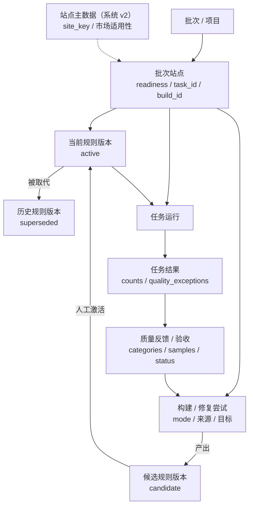
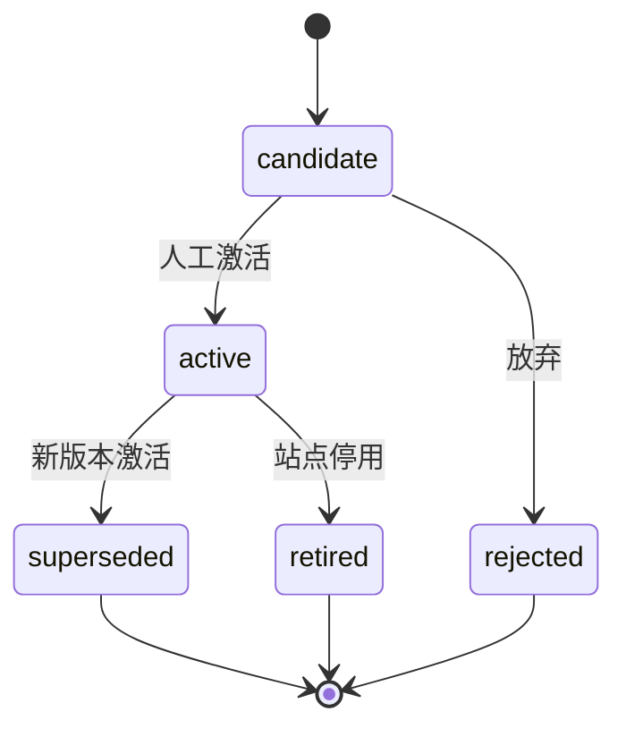
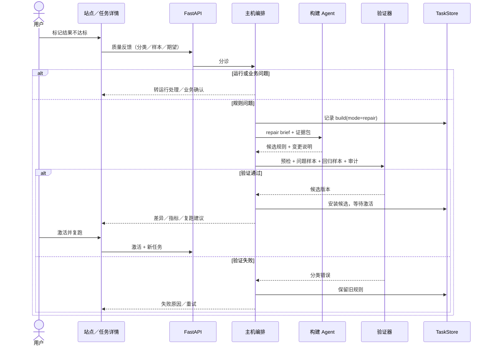

## 用途与边界

本页定义一条非顺利路径：**用户认为采集结果或规则不达标时，系统如何记录判断、收集证据、定向修复、验证、激活、复跑和回滚。**

它不改变[任务状态与计数契约](09-任务状态与计数契约.md)的生命周期和计数口径，不替代[用户工作流与前端信息架构](33-用户工作流与前端信息架构.md)的正常路径，也不把尚未实现的能力写成 v1 承诺。API 的当前实现仍以[D08 任务服务与界面设计](26-D08任务服务与界面设计.md)为准；本页描述系统 v2 的目标设计，以及可以提前落地的最小护栏。

**版本口径**：项目文档里有两套三分法，不能混用。

- [用户工作流与前端信息架构](33-用户工作流与前端信息架构.md)的阶段 1／2／3 是**产品与工作流阶段**；本文对应的主目标是阶段 2“构建协作”。
- [采集规则与任务运行时](19-采集规则与任务运行时.md)的 v1／v2／v3 是**运行层并行模型**；本文涉及系统 v2 时，运行层指“每任务一个进程／worker 池”。
- 本文所说的**系统 v2**，是产品阶段 2 与运行层 v2 的组合；不把阶段 2 单独简称 v2，也不把运行层 v2 当成产品阶段。

本文标记为 `proposed`。其中“最小护栏”可作为下一小步实施；规则版本账本、人工激活和回滚属于系统 v2 设计，不自动进入当前 v1 范围。

## 现状与缺口

当前已经有站点级构建、规则验证、内容审计和“重新验证／修复规则”入口，但修复仍是一个**执行动作**，还不是一条可管理的闭环。

| 环节 | 当前实现 | 缺口 |
| --- | --- | --- |
| 用户判定 | 任务结果里有 `business_acceptance` 字段，但两个 runner 都固定写 `NOT_REVIEWED`；没有 API 或界面修改它 | 用户说“不达标”无法落成可追踪记录；只能写一段修复原因 |
| 修复触发 | 站点详情有“重新验证／修复规则”，`mode=repair` 复制已安装规则 | 修复原因只有自由文本；没有任务、样本、质量异常和期望结果的结构化输入 |
| 修复证据 | 工作区有 `existing-rule.yaml`、`repair-context.json`、`repair-brief.md` | 没有当前任务结果、质量异常和失败样本；Agent 曾扫描主机目录找旧结果，brief 约束不是硬隔离 |
| 修复执行 | 同一会话执行，主机校验 schema、选择器和币种 | 不强制 `rule_id` 不变、版本唯一、变更范围受限；同版本会生成带 build id 后缀的文件，随后被判 duplicate |
| 验证 | 6 个样例有效、币种匹配、描述块审计无缺口即通过 | 没有“用户报告的问题是否改善”的断言，也没有旧规则 vs 新规则的回归对比 |
| 安装与激活 | 验证通过后站点规则指针直接切到新版本 | 没有候选／激活区分，也没有人工确认；用户可能不知道规则已经变化 |
| 结果一致性 | 修复成功只改站点规则，`task_id` 不变 | 当前结果仍基于旧规则，但界面没有“结果已过期”标记，也没有回滚入口 |
| 并发与唯一性 | 前端隐藏修复按钮；后端 `repair` 只检查站点 `ready` 和规则文件 | 任务 `RUNNING`／`PAUSED` 时直接调 API 仍可发起修复；多批次同站可能各存一份规则指针 |
| 可复现性 | 任务记录 `plan_version` 和 `rule_path` | 没有规则内容哈希；规则文件被手工改动后，同版本可能对应不同内容 |

## 设计原则

- **判断与执行分离**：用户“不达标”的判断是一等记录，不是修复 brief 里的一句备注；修复只是处理该记录的一种动作。
- **规则不可变**：规则版本发布后不原地修改；修复产生新版本，旧版本保留。激活是账本指针变化，不是重写 YAML。
- **结果绑定规则内容**：任务记录规则版本和内容哈希；只看版本号不足以证明结果可复现。
- **证据优先、定向修复**：主机准备证据包，Agent 只读工作区；不为字段问题重新枚举全站。
- **人工激活、可回滚**：验证通过只产生候选；用户确认后切换。切换后旧规则和旧任务仍可用于对比和回滚。
- **一个站点同时只允许一个修复**：构建、修复和正式采集不能在同一站点上并发改规则。
- **不删除历史**：修复失败、复跑和回滚都不删除旧规则、旧任务和旧结果。

## 账本与对象模型

建议把当前混在 `batch_sites`、`builds`、`tasks` 和 `task-result.json` 里的信息拆成五类记录。它们不要求一次全部建表，但设计和 API 应能无损映射。

| 记录 | 建议字段 | 当前落点 | 作用 |
| --- | --- | --- | --- |
| 站点与批次成员 | `site_key`、`domain`、市场适用性、`batch_id`、`readiness`、当前 `task_id`、当前 `build_id` | `batch_sites` | 区分“站点身份”和“批次引用”；系统 v2 再拆站点主数据 |
| 规则版本 | `rule_id`、`rule_version`、`sha256`、`parent_version`、`status`、`source_build_id`、`created_at` | `rules/*.yaml` + 站点指针 | 不可变版本、血缘、激活和回滚 |
| 构建／修复尝试 | `build_id`、`mode`、来源版本、目标版本、`feedback_id`、状态、`error_class`、验证摘要、证据哈希 | `builds` | 记录一次构建或修复做了什么、为什么失败 |
| 任务运行 | `task_id`、`rule_id`、`rule_version`、`rule_sha256`、状态、`outcome`、计数、验收结论 | `tasks` + `task-result.json` | 证明结果基于哪份规则，支持复跑和对比 |
| 质量反馈 | `feedback_id`、`task_id`、规则版本、问题分类、样本 URL、期望、状态、解决任务 | 暂无；`business_acceptance` 只有占位 | 承载用户“不达标”的判断和修复验收 |

一个批次可以包含多个站点；图中只画一个站点，其他站点的关系相同。

约束：

- `rule_id` 是站点级稳定标识；修复不换 `rule_id`。
- `rule_version` 在同一 `rule_id` 下唯一；重复版本直接拒绝，不用文件名后缀掩盖。
- 激活状态放在账本，不写回规则 YAML；否则每次激活都会改变规则哈希。
- 任务结果和 `business_acceptance` 分开保存，避免用户事后验收时修改已经生成的任务结果文件。

## 规则版本生命周期

| 状态 | 含义 | 是否可被任务使用 |
| --- | --- | --- |
| `candidate` | 主机验证通过，等待人工确认；YAML 里的 `status: candidate` 可以保留 | 否，除非显式用于验证 |
| `active` | 站点当前生效版本 | 是 |
| `superseded` | 曾被激活，后来被新版本取代 | 仅历史任务和回滚候选 |
| `rejected` | 验证通过但用户放弃，或人工拒绝 | 否 |
| `retired` | 站点停用或规则不再适用 | 否 |

`verified` 是人工复核结论，不等于 `active`。v1 单用户时可以由同一人记录自审；系统 v2 需要独立复核时，把复核人和时间放在规则版本的审计字段里，不把 `verified` 写进 YAML 冒充运行时状态。当前实现把验证通过的规则写成 `candidate` 并更新站点指针；迁移时把这次更新视为一次显式激活，补记激活人和时间，不回写 YAML。

## 修复闭环

### 一、反馈

用户从任务详情或站点详情选择“结果不达标”，填写：

- 问题分类：范围／发现、身份／去重、价格／币种／单位、描述／正文、基础字段、访问／运行、业务预期、其他。
- 受影响的样本 URL：从任务预览、质量异常或手动输入中选择。
- 期望结果：例如“描述应包含规格块”“不应包含促销角标”“应发现该分类下的商品”。
- 备注：只用于补充，不代替分类和样本。

系统生成 `quality_feedback`，状态为 `OPEN`，并关联任务、规则版本和批次站点。**这一步不启动模型，也不改变任务状态。**

### 二、分诊

主机先判断问题属于哪一层：

| 分类 | 典型证据 | 处理 |
| --- | --- | --- |
| 范围／发现 | 分类页有商品但未发现、分页提前停止 | 规则修复；验证重点是新入口和停止条件 |
| 身份／去重 | 同商品多 URL、变体被拆成多个商品 | 规则修复；验证重点是身份键和归并 |
| 价格／币种／单位 | 划线价、分期价、单位价错误 | 规则修复或市场出口复核；验证重点是价格来源和币种 |
| 描述／正文 | 短摘要、规格块缺失、促销角标混入 | 规则修复；验证重点是块合成和审计 |
| 基础字段 | 名称、主图、状态、分类错误 | 规则修复；验证重点是字段来源和主商品容器 |
| 访问／运行 | 403、429、挑战、超时、依赖缺失 | 不交给构建 Agent；转运行时或网络处理 |
| 业务预期 | 用户不接受范围、口径或数据用途 | 不修规则；记录验收结论或调整任务范围 |

有活跃任务（`DRAFT`、`QUEUED`、`RUNNING`、`PAUSING`、`PAUSED`）或活跃构建时，拒绝发起修复，并说明应先暂停、取消或等待。站点没有任务，或任务已经 `FINISHED`／`CANCELLED`，才允许修复规则。

### 三、证据包

主机在工作区生成，不要求 Agent 扫描主机：

- `existing-rule.yaml`：当前生效规则。
- `repair-context.json`：站点、批次、市场、规则版本、规则哈希、问题分类、样本 URL。
- `repair-evidence.md`：任务摘要、计数、`quality_exceptions`、`content_audit`、失败分类、用户期望。
- `samples/`：相关页面快照或 archive 引用；没有存档时只抓问题样本和有界回归样本。
- `rule-diff-policy.md`：本次允许改动的范围。

Agent 只能读工作区输入和声明的样例 URL；不得读用户目录、其他仓库、旧任务输出或凭据。v1 用 brief 和 session permissions 限制 `read`／`edit`／`skill`／MCP，仅允许 host 复制的 `product-crawl-workflow` 副本；`shell` 仍是宿主用户权限；系统 v2 需要真正的沙箱或只读挂载，不能把自然语言约束当安全控制。

### 四、修复

Agent 输出：

- `../out/plan/rule.yaml`：候选规则。
- `../out/evidence/build-notes.md`：改了什么、为什么、检查了哪些页面。
- `../out/plan/change-summary.json`：机器可读的变更摘要，至少包含 `rule_id`、`rule_version`、`parent_version`、修改的字段／选择器、是否改动发现源和范围。

主机强制检查：

- `rule_id` 与当前规则一致。
- `rule_version` 是新的、在 `rule_id` 下唯一。
- 发现源、范围、市场、币种不变，除非问题分类明确要求范围修复并经用户确认。
- 不降低验证门槛，不删除审计块来“消除缺口”。
- 不写工作区外路径，不安装未授权依赖。

### 五、验证

验证不是“至少一个有效商品”，而是同时回答三个问题：

1. **报告的问题是否改善**：问题样本上必须出现用户期望的结果，或给出原站未提供的证据。
2. **核心字段是否退化**：在回归样本上比较旧规则和新规则的名称、价格、币种、主图、状态、描述和选项。
3. **是否引入新问题**：失败数、排除数、重复数、币种、内容审计缺口不能变差。

建议的最小验证集：

- 问题样本 3～5 个，覆盖用户报告的具体页面。
- 随机样本 3～5 个，避免只修好被点名的页面。
- 回归样本 3～5 个，覆盖不同模板或分类。
- 旧规则和新规则在同一批页面上跑一次，输出字段级 diff。

验证输出写入构建记录：`issue_checks`、`regression`、`content_audit`、`diff`、`evidence_sha256`。失败时保留旧规则，错误按 schema、选择器、网络、币种、质量问题分类，不用一段字符串代替。

### 六、激活

默认**人工确认后激活**：

1. 主机展示候选规则、变更摘要、问题样本对比、回归结果和预计复跑范围。
2. 用户选择“激活”或“放弃”。激活前旧规则继续生效。
3. 激活是事务操作：校验候选版本和哈希 → 更新站点当前规则指针 → 旧版本标记 `superseded` → 写审计记录。
4. 激活后不自动删除旧任务；当前任务结果标记为“基于旧规则”。

低风险修复（例如只补描述块）可以在系统 v2 评估“自动激活 + 提示复跑”，但默认不这样做。范围、价格、身份、币种变更必须人工确认。

### 七、复跑与关闭

- 复跑创建新 `task_id`，使用新规则版本和哈希；旧任务保留。
- 默认只复跑“规则已过期”的站点；用户也可以显式选择全部复跑。
- 复跑完成后对比修复前后指标：问题样本、有效数、失败数、描述完整度、重复数、币种。
- 结果改善则关闭 `quality_feedback`；没有改善则保留 `OPEN`，可再次修复或标记 `WONTFIX`。
- 如果新规则整体更差，回滚站点指针到上一个 `active` 版本；新任务保留作为证据，不删除。

### 修复时序

## 安全、简单、高效、易管理

| 目标 | 具体做法 | 明确不做 |
| --- | --- | --- |
| 安全 | 规则不可变 + 内容哈希；同 `rule_id` 版本唯一；激活事务；修复前检查活跃任务；构建工作区隔离；变更白名单 | 不用文件名后缀掩盖重复版本；不把 brief 约束当沙箱；不允许修复绕过任务状态 |
| 简单 | 一个入口“结果不达标”；问题分类用选项；默认先做不调模型的复验；一次只跑一个构建 | 不让用户填 selector；不要求用户理解规则包版本；不把每次修复做成完整重建 |
| 高效 | 复用 archive；问题样本 + 回归样本；旧／新规则同页 diff；只复跑过期站点 | 不为字段问题重新枚举全站；不做没有基线的“再跑一遍看看” |
| 易管理 | 规则版本列表、构建历史、任务血缘、质量反馈、过期标记、回滚、审计导出 | 不让旧任务指向可变规则；不让同站多批次各自维护一份真相 |

## 系统 v2 的新问题

### 运行层 v2：每任务进程／worker 池

当前单进程线程池在系统 v2 要面对：

- 构建、修复和正式采集同时存在时，谁占用哪个槽位；需要构建队列和每站点锁。
- 每任务进程退出、崩溃、重启后的对账；构建会话本身不能随服务重启恢复。
- 浏览器实例、profile、临时目录和出口的配额；修复验证也消耗这些资源。
- 同站多任务共享限速和会话，但不同进程的限速不自动合并；需要站点级协调或明确不承诺。

### 产品阶段 2：构建协作

- 多站点同时需要构建或修复时，当前全局只允许一个构建；需要队列、优先级和取消语义。
- 构建会话的暂停、恢复、权限审批和依赖请求需要和任务控制分开。
- 用户、构建者、复核者可能不是同一人；需要角色、审计和独立验收。
- 规则导入、手工编辑和外部规则需要 provenance、schema 迁移和校验，不能只看 YAML 能否解析。

### 站点与市场

- 当前同一站点在不同批次各有一份 `batch_sites` 规则指针；修复一个批次不会自动更新另一个。
- 任务粒度是“站点 × 规则版本 × 市场”，但站点 readiness 目前是站点级；多市场站点需要“站点 × 市场”的规则适用性和 readiness。
- 定时复采和站点漂移需要 `last_validated_at`、规则哈希和变更检测，否则旧结果会悄悄过期。

### 成本、数据与安全

- 模型调用需要 token／费用上限和失败分类；不能只靠 `max_seconds` 兜底。
- 构建工作区、archive 和旧任务会持续增长；需要保留策略、清理配额和可复现快照。
- 构建 Agent 的 shell 权限需要真正的沙箱或只读挂载；不能只靠提示词禁止读主机。
- 规则 schema 会演进；任务结果要记录 schema 版本和规则哈希，旧任务不能因为新 schema 无法解释。

## 分阶段落地

### 最小护栏（可先于系统 v2）

- 给任务增加用户验收记录：`business_acceptance` 可写、可读，记录分类、样本、理由、范围和验收人。
- 修复 API 增加活跃任务守卫；前端和 API 使用同一条件。
- 修复强制同 `rule_id`、新 `rule_version`；重复版本直接报错。
- 修复 brief 加入当前任务摘要、质量异常和样本，不再要求 Agent 扫描主机。
- 任务详情显示“结果基于规则 X，当前站点规则 Y”，两者不一致时标记“结果已过期”。
- 规则验证通过后先保持候选，至少给用户一个确认步骤；在人工激活落地前，不自动覆盖站点规则。

### 规则版本账本（系统 v2）

- 新增规则版本记录：哈希、父版本、状态、来源构建、激活时间、复核人。
- 候选／激活／取代／拒绝／停用状态；站点只指向一个 `active` 版本。
- 问题样本 + 回归样本验证；旧／新规则 diff。
- 激活、回滚和复跑入口；质量反馈状态闭环。

### 运行层与规模化（系统 v2 之后）

- 构建队列、每站点锁、构建／浏览器配额。
- 站点主数据、站点 × 市场、多批次引用。
- 定时复采、漂移检测、自动复验和过期任务提示。
- 多用户、独立验收、审计和权限。
- 构建沙箱、费用上限、保留策略和可观测性。

## 验收检查

若进入实现，至少检查：

- 用户拒绝结果后，能记录问题分类、样本、期望、验收人和时间；任务状态和计数不变。
- 活跃任务或活跃构建时，修复请求被拒绝，并给出下一步。
- 修复必须产生同 `rule_id` 下的新版本；重复版本被拒绝，不生成第二份同版本文件。
- 修复失败保留旧规则、旧任务和已有结果；站点回到可采或待接入的语义清楚。
- 修复通过只产生候选；用户激活前站点仍使用旧规则。
- 激活后当前任务显示“基于旧规则”，复跑创建新任务，旧任务保留。
- 回滚只改站点指针，不删除新任务和新结果。
- 同一批次的复跑和汇总不重复计数；批次只统计当前任务。
- 规则内容哈希可核对；手工改规则不会被当成同一版本继续使用。

这些检查可以和[验收场景与比较方法](05-验收场景与比较方法.md)的 A21“构建到运行交接”、A22“失败与质量复查”一起记录；是否新增 A23 由项目方决定，本文不擅自扩编号。

## 开放问题

- `quality_feedback` 是任务级还是批次级？建议先任务级，批次级只做汇总。
- 用户验收写回 `task-result.json` 还是独立账本？建议独立账本，API 合并展示，避免修改已生成结果。
- 规则状态放在 YAML 还是账本？建议账本；YAML 只保留 `status: candidate` 作为静态描述。
- 低风险修复是否允许自动激活？当前默认人工；若要自动化，先定义风险分级和回滚演练。
- 多市场站点是否按“站点 × 市场”分别 readiness？建议系统 v2 这样做，v1 仍按站点。
- 构建沙箱用容器、独立用户还是只读挂载？需要按本机环境和依赖安装需求单独确认。

## 关联文档

- [用户工作流与前端信息架构](33-用户工作流与前端信息架构.md)：正常路径、对象模型、批次工作台和阶段划分。
- [D08 任务服务与界面设计](26-D08任务服务与界面设计.md)：当前 API、构建状态和实现切片。
- [v1 界面范围](25-v1界面范围.md)：v1 承诺和可后置项。
- [用户角色与职责](31-用户角色与职责.md)：谁判定、谁修复、谁验收。
- [任务状态与计数契约](09-任务状态与计数契约.md)：任务状态、计数和业务验收字段。
- [验收场景与比较方法](05-验收场景与比较方法.md)：A21、A22 的验收口径。
- [采集规则与任务运行时](19-采集规则与任务运行时.md)：运行层 v1／v2／v3 并行模型。
