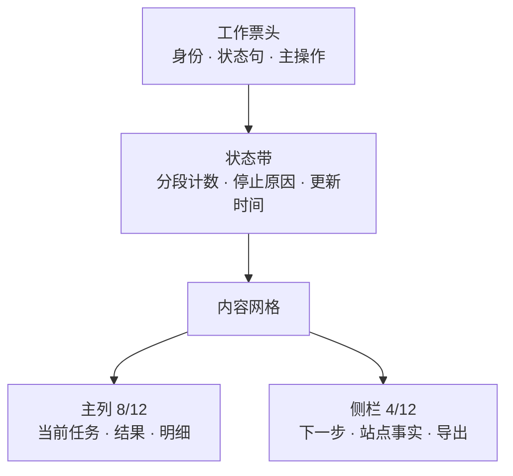
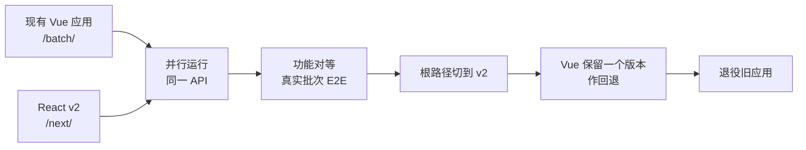

## 用途与边界

本页记录 2026-11-23 项目方对前端设计方向的意见，并把它展开成可评审、可实施、可验收的 v2 设计基线。它回答四个问题：

- 现有前端为什么“缺乏章法”，尤其是主体部分。
- v2 的设计主张、视觉语言和页面结构应该是什么。
- 组件、令牌、页面模板和交互规范如何支撑功能继续增长。
- 迁移到新前端时，如何与现有 Vue 应用并行、验收和回退。

本页不改变业务口径：任务状态、计数和控制语义以[任务状态与计数契约](09-任务状态与计数契约.md)为准，v1 界面范围以[v1 界面范围](25-v1界面范围.md)为准，用户工作流与信息架构以[用户工作流与前端信息架构](33-用户工作流与前端信息架构.md)为准，设计门和评审要求以[D08 前端设计包与评审](28-D08前端设计包.md)为准。技术栈决策见[ADR 0012](adr/0012-前端v2技术栈与设计系统.md)；现有 Vue 应用在迁移完成前继续按[ADR 0009](adr/0009-批次工作台前端技术栈.md)和[ADR 0011](adr/0011-样式层与CSS框架.md)运行。

**当前状态**：v2 已设为 **默认入口**（FastAPI 根路径 307 到 `/next/`），旧 Vue 保留在 `/batch/` 作直访兜底，v2 导航不再提供旧版工作台、旧版任务列表、技术兜底或任务详情跳转。v2 当前覆盖批次列表、新建批次弹窗、批次详情、继续导入、站点详情和站点级构建；任务列表／详情和站点任务历史仍由旧版提供，但没有 v2 入口，功能对等未完成。设计基线仍为 **Provisional**。

**2026-11-23 桌面优先范围**：v2 首轮只做桌面端，1280 为主规格、1440 检查宽屏；768、390、320、移动抽屉、窄屏操作收纳和触屏目标在界面基本定型后统一适配，不作为本轮设计、桌面端试点或功能对等的验收条件。

v2 虽已是默认入口，但仍按 **Provisional** 管理：旧版继续承接未迁移功能，但 v2 不再提供旧版入口；完成功能对等后再退役旧构建。默认入口不等于功能对等完成。

### 术语说明

- **设计系统**：令牌、基础组件、领域组件、页面模板和交互规范的集合，不是一套现成 UI 主题。
- **设计令牌**（token）：把颜色、字号、间距、圆角、阴影和动效写成有语义的变量，页面引用语义而不是具体值。
- **页面模板**：列表、详情、导入、技术控制台等页面的固定骨架；新页面先选模板，再填内容。
- **工作票头**（job ticket header）：每页顶部的紧凑标题区，包含对象身份、当前状态句、主操作和次要操作。
- **状态带**（status band）：用分段计数和状态词表达“现在处于哪一步”，不伪造百分比或完成时间。
- **单一工作表面**：一屏最多一个主要白色工作区；其余内容用分隔线和留白组织，不把所有区块都做成卡片。
- **Strangler 模式**：旧前端继续运行，新前端按页面逐步接管，达到功能对等后切换入口，最后退役旧实现。

## 项目方意见记录

2026-11-23 项目方意见（转述）：

> 现有前端设计比较缺乏章法，尤其是主体部分。考虑根据目标功能需求——功能可能继续丰富——正经设计一版前端稿。可以用 Vue 或 React，配合合适的 CSS 框架（如 Tailwind CSS），构建现代化、高审美、扩展性和可维护性俱佳的前端。设计风格要成熟、逻辑清晰、贴合用户工作流、符合直觉、操作体验顺畅，并在用户友好性和规范上争取较高标准。

这段意见不是“换一套皮肤”，而是对**设计质量、结构章法和长期可维护性**的要求。把它拆成可验收目标：

| 意见 | 可验收目标 |
| --- | --- |
| 缺乏章法，主体部分尤其明显 | 页面有固定模板和信息层级；首屏先回答“是什么、什么状态、下一步做什么”；主体区不再是无差别卡片堆叠 |
| 功能可能继续丰富 | 令牌、组件和页面模板能组合扩展；新增页面不重新发明布局、间距和控件 |
| 现代化、高审美 | 有明确视觉主张和记忆点；不套默认后台模板，不用装饰掩盖层级 |
| 扩展性和可维护性 | 语义令牌、组件契约、特性目录、类型化 API、测试和视觉回归；禁止页面里散落硬编码值 |
| 成熟、逻辑清晰 | 状态、计数、操作和下一步按工作流组织；内部概念后置；不伪造进度 |
| 贴合用户工作流、符合直觉 | 以批次 → 站点 → 任务 → 结果为阅读主轴；主操作随状态变化；危险操作可预期 |
| 操作顺畅 | 筛选即时、刷新保留旧值、异步有受理态、错误可恢复、键盘可完成主路径 |
| 用户友好和规范 | 对齐 WCAG 2.2 AA、中文排版、表单校验、焦点管理、桌面端结构安全和状态矩阵；完整窄屏适配后置 |

## 现状诊断

### 观察与证据

2026-11-23 复核现有 Vue 应用，主要事实如下：

- `app/frontend/src/style.css` 为 29,053 字节、1,873 行（非空 1,590 行），含 31 个 CSS 变量、约 226 个顶层类选择器、5 个媒体查询和 1 组关键帧。
- 11 个 `.vue` 文件没有 `<style>` 块，页面样式全部通过全局类名复用；`SiteDetailView.vue` 约 49 KB，`TaskDetailView.vue` 约 25 KB，`BatchDetailView.vue` 约 22 KB。
- 1280 截图（`experiments/d08/batch-workbench-e2e/`）显示：批次列表首屏由页头、筛选面板、四张 KPI 卡和表格依次堆叠；批次详情和站点详情由六张 KPI 卡、若干面板和长列表组成；任务详情在首屏重复展示状态、停止原因、六张计数卡和任务信息。
- 所有面板使用同一套白底、1px 边框、6px 圆角和极弱阴影；标题、正文、辅助文字的字号差有限；主体区域没有主列／侧栏、没有固定的“下一步”位置。
- 表格行内常见两行单元格（主值 + 灰色小注），数字没有统一右对齐或等宽数字；行操作直接铺“暂停／继续／详情”按钮，操作优先级不清晰。
- 筛选区占一整块面板并需要“应用筛选”；筛选状态不进入 URL，刷新或返回会丢失上下文。
- 批次详情的“全量目录”“复跑已完成站点”两个复选框直接放在页头操作区，和主操作竞争注意力；取消确认使用页内横条，推动内容下移。

这些是设计问题，不是框架能力问题。Vue 3 完全能实现下面的方案；当前问题来自缺少页面模板、视觉层级和组件契约。

### 根因

| 现象 | 根因 |
| --- | --- |
| 所有区块都像卡片，主次不分 | 只有一种面板外观，没有“主工作表面 / 侧栏 / 辅助区 / 分隔区”的层级语法 |
| 首屏被 KPI 卡占满，下一步靠文字找 | 计数被当成展示主体，而不是状态带；页面没有固定的“下一步”组件 |
| 表格难扫读 | 信息密度没有分级：身份、状态、结果、元数据混在同一层级；数字和状态缺少统一排版 |
| 页面各写各的间距和控件 | 令牌偏底层，缺少语义层；`panel`、`card`、`badge`、`button` 是全局类，没有变体和状态契约 |
| 样式改动需要全站回归 | 226 个顶层选择器共享全局作用域，页面增长后冲突和误覆盖风险上升 |
| AI 生成页面时不知道复用哪个类 | 类名按外观命名而非按角色命名，缺少“这个页面该用哪个模板”的入口 |

### 保留与重做

保留：

- 应用外壳的桌面交互：侧栏固定／悬停展开、焦点回收、跳过链接、服务状态轮询；移动抽屉后置。
- 任务状态、计数、控制语义、`QUEUED` 解释、已受理与已完成的区分、部分结果标识。
- API、SSE、路由边界、导出白名单和真实批次验收证据。
- 已做的可访问性基础：跳过链接、`aria-*`、焦点可见、按钮语义、表格横向滚动容器。

重做：

- 视觉语言和令牌体系；页面模板；组件层；表格与表单的密度；首屏信息层级。
- 把 KPI 卡改为状态带和指标条；把“下一步”做成固定组件；把高级选项收进启动对话框。
- 把全局外观类改为语义组件；把页面级硬编码值收进令牌。

## 设计主张

**安静的工作台**（Quiet Workbench）。

一句话主张：**每一页先回答“现在是什么状态、下一步做什么”，再让数据自己说话。**

三个记忆点：

- **工作票头**：每页顶部的紧凑标题区，左侧是对象身份和一句状态说明，右侧是主操作；不做一个占半屏的 hero。
- **状态带**：用分段计数和状态词表达进度，例如“可采 12 · 待接入 2 · 运行 3 · 已完成 7”；没有可靠分母时不显示百分比。
- **单一工作表面**：主内容是一块平坦的工作表面，用分隔线和留白分区；侧栏只放上下文、下一步和导出；不再把每个区块做成独立卡片。

反对的做法：

- KPI 卡网格、仪表盘式大数字堆叠、没有行动的“总览”。
- 渐变、毛玻璃、重阴影、彩色图标墙、标题 emoji。
- 伪造百分比、ETA、完成率；把“已入队”显示成“运行中”。
- 一个页面多个同等权重的实心主按钮；图标-only 的主操作；hover 才能发现的操作。
- 卡片套卡片、每个字段一个 badge、状态只用颜色表达。

### 表单型操作与弹窗偏好（2026-11-23）

- 通用判断按 `frontend-design` 的“页面切换与页内弹窗”：轻量、单对象、短流程优先页内弹窗或抽屉；需要独立深链、复杂多步骤、长表单或与页面内容并排对照时才单独成页。本节只记录本项目落地选择，不复制通用规则。
- 新建批次是批次列表页内的弹窗：从页头、空态或侧栏打开；保存或启动后关闭弹窗、留在列表、刷新相关数据并显示提示，不默认跳到详情页。
- 弹窗的标题、说明、焦点管理、关闭保护、就地错误和主次操作按 `frontend-design` 与组件规范执行；不用弹窗承载长流程或嵌套弹窗。

## 视觉方向

### 参考与边界

方向参考三类产品，只取原则，不复制外观：

- **Linear**：克制的字体层级、细线分隔、安静的状态色、键盘优先。
- **Cloudflare 控制台**：数据密度、侧栏分组、表格与批量操作的组织方式。
- **Stripe**：表单的分组、帮助文本、错误恢复和可读的金额／数字排版。

不采用大型带视觉的组件库默认主题，避免出现“项目令牌 + 组件库主题 + 框架默认样式”三套视觉语言。

### 色彩

采用“纸 + 墨 + 松绿”的浅色体系。正文使用近黑墨色，背景是略带暖调的纸灰，主色是深松绿而不是默认企业蓝；状态色只用于状态，不用于装饰。

| 语义令牌 | 浅色值 | 用途 |
| --- | --- | --- |
| `canvas` | `#F4F5F1` | 页面背景 |
| `surface` | `#FFFFFF` | 主工作表面、弹窗 |
| `surface-muted` | `#F8F9F5` | 表头、次级区块 |
| `surface-sunken` | `#ECEEE7` | 输入框底、分段控件槽 |
| `ink` | `#1A1D19` | 标题、正文主色 |
| `ink-2` | `#4F564D` | 次级正文 |
| `ink-3` | `#666D63` | 辅助说明、时间戳 |
| `line` | `#E0E3DA` | 常规分隔线、表格线 |
| `line-strong` | `#C7CBC0` | 输入框边界、强调分隔 |
| `accent` | `#1F5C4A` | 主操作、链接、焦点 |
| `accent-hover` | `#174A3B` | 主操作悬停 |
| `accent-soft` | `#E4F0EA` | 选中行、轻提示底 |
| `success` | `#2C6A4D` | 完成、可采、正常 |
| `success-soft` | `#E5F2EA` | 完成态浅底 |
| `warning` | `#8F5F00` | 待处理、部分完成、排队 |
| `warning-soft` | `#FAF0D9` | 待处理浅底 |
| `danger` | `#A23A2E` | 失败、取消、危险操作 |
| `danger-soft` | `#F8E7E4` | 失败、危险浅底 |
| `info` | `#2C5C78` | 技术信息、中性提示 |
| `info-soft` | `#E5EFF5` | 技术提示浅底 |
| `focus` | `#1F5C4A` | 键盘焦点环 |

规则：

- 语义令牌只在 `:root` 和主题覆盖层定义；页面和组件不直接写十六进制颜色。
- 状态必须同时有文字或图标，不能只靠颜色；状态色不用于普通标签和装饰。
- 主色只承担“可操作”和“当前选中”；大面积背景保持中性。
- 深色主题后置，但令牌按语义命名，届时只覆盖语义层，不改组件。

### 字体与排版

不加载网络字体，使用系统字体栈，保证本地离线可用：

- 无衬线：`ui-sans-serif, system-ui, -apple-system, "Segoe UI", "PingFang SC", "Hiragino Sans GB", "Microsoft YaHei", sans-serif`
- 等宽：`ui-monospace, "Cascadia Code", "SFMono-Regular", Consolas, monospace`

字号控制在七档：

| 角色 | 字号／行高 | 字重 | 用途 |
| --- | --- | --- | --- |
| Display | 28／36 | 600 | 批次名、站点域名等页面主标题 |
| H1 | 22／30 | 600 | 页面标题、弹窗标题 |
| H2 | 17／26 | 600 | 区块标题 |
| Body | 14／22 | 400 | 正文、表格、表单 |
| Body strong | 14／22 | 600 | 表格身份列、关键值 |
| Small | 13／20 | 400 | 次级说明、表格辅助行 |
| Caption | 12／18 | 400 | 时间戳、字段标签、元数据 |

补充规则：

- 数字统一使用 `font-variant-numeric: tabular-nums`；金额、计数、百分比在表格中右对齐。
- 中文正文行高不低于 1.6；不使用斜体、两端对齐和全大写英文标签。
- 页面主标题只出现一次；弹窗内标题用 H1 档，不再嵌套第二层大标题。
- 链接使用主色并在悬停时加下划线；不要把整段文字做成链接。
- 编号、ID、URL、规则版本使用等宽字体和 `overflow-wrap: anywhere`，长行不撑破容器。

### 间距、圆角与阴影

- 基础单位 4px；常用阶梯为 4、8、12、16、24、32、48；64 只用于页面级大间距。
- 页面左右留白：桌面 32，平板 24，手机 16。
- 主工作表面内边距 24；紧凑区块 16；表格单元格横向 16、纵向 12。
- 区块间距 32；同区块内字段间距 16；行内元素间距 8。
- 圆角四档：控件 4、面板 8、浮层 12、胶囊 999。
- 阴影三档：面板无阴影；粘性栏和浮层使用轻阴影；模态使用大阴影。阴影带轻微冷色相，不用纯黑大模糊。

控件尺寸：

| 控件 | 高度 | 说明 |
| --- | --- | --- |
| Button sm／md | 32／36 | 表格行内用 sm；页头和表单用 md |
| IconButton sm／md | 32／36 | 图标 16／18 |
| Input／Select | 36 | 与 Button md 对齐 |
| 表格行 | 48／40 | 默认 48；技术密集表 40 |
| 工具条 | 48 | 可换行，不压缩控件 |
| 侧栏项 | 36 | 图标 18，文字 14 |

### 图标与动效

- 统一使用 Lucide 图标，16／18／20 三档，线宽 1.75；状态点用实心圆，不用图标代替状态文字。
- 动效只服务于状态变化：悬停 120ms、面板和浮层 180ms、模态 240ms；缓动 `cubic-bezier(0.2, 0, 0, 1)`。
- 页面内容不做入场动画；不因动画改变焦点或阻塞操作。
- `prefers-reduced-motion: reduce` 时关闭位移和缩放，只保留瞬时状态切换。

## 布局系统

### 应用外壳

| 区域 | 尺寸／行为 | 说明 |
| --- | --- | --- |
| 顶栏 | 高 56，粘性 | 左侧品牌和面包屑，右侧服务状态；不放大标题 |
| 侧栏 | 展开 248，收起 64 | 分组“工作台”“系统”；固定偏好存本地；悬停展开只覆盖、不推挤内容 |
| 主内容 | 最大宽 1560，左右 32 | 内容自适应；不让整页横向滚动 |
| 移动导航 | 小于 1024（后置） | 本轮不做；前端基本定型后补抽屉、焦点陷阱和关闭后焦点回收 |
| 服务状态 | 顶栏右侧胶囊 | 正常／异常／读取中；`title` 给出 worker 模式和版本 |

侧栏分组保持少而稳定：

- **工作台**：采集批次、全部任务。
- **系统**：服务状态、技术兜底入口（仅在需要时出现）。
- **底部**：版本号、内部工具标识、侧栏收起按钮。

导航项使用“图标 + 文字 + 当前项”，不要只靠颜色；收起态保留图标和可访问名称，悬停或聚焦时显示浮层标签。

### 页面模板

新页面先选模板，不在页面里重新发明骨架。

| 模板 | 适用页面 | 骨架 |
| --- | --- | --- |
| 列表页 | 批次列表、全部任务 | 工作票头 → 指标条 → 工具条 → 数据表 → 分页／空态 |
| 详情页 | 批次详情、站点详情、任务详情 | 工作票头 → 状态带 → 主列 8／侧栏 4；窄屏侧栏下沉 |
| 列表页弹窗 | 新建批次 | 批次列表页内 Dialog：表单 7／预览 5，不跳页；保存或启动后回列表 |
| 技术控制台 | 旧任务控制台、构建详情 | 高密度工具条 → 表格／时间线 → 详情抽屉或分区 |

详情页的主列／侧栏关系：



侧栏在 1280 及以上固定在右侧，顶部与工作票头对齐；1024 及以下的侧栏下沉、堆叠和移动抽屉后置。侧栏只放“下一步、事实、导出、低频批次管理”，不重复主列的计数和明细。

### 栅格与断点

- 12 列栅格，列间距 24；主列 8 列，侧栏 4 列；侧栏宽度不低于 320、不高于 400。
- 1280 是开发期主规格；1440 检查宽屏留白；1024、768、390、320 的侧栏、单列、抽屉和回流后置。
- 断点按内容需要设置，不按设备名堆叠；桌面端优先用 `minmax()`、`flex-wrap` 和容器查询处理组件内部布局。
- 页面主内容不使用 `100vw`；全宽只用于固定的浮层背景。

### 密度

- 表格默认行高 48；紧凑技术表 40；表头 36。
- 列表首屏目标：1280×900 下至少看到 6 行数据，筛选和指标不把表格推到首屏之外。
- KPI 不再使用大卡片；指标条单项高度 56，标签 12、值 20、辅助说明 12。
- 页面不追求“一屏塞完”，但首屏必须能判断状态和下一步。

## 组件系统

组件分三层，避免页面直接拼装原始样式：

- **基础组件**：按钮、输入、选择、复选框、开关、徽标、对话框、菜单、提示、骨架等。
- **领域组件**：批次状态、站点接入状态、任务状态、状态带、下一步、站点身份、构建时间线、商品预览、质量异常列表等。
- **页面模板**：列表、详情、导入、技术控制台；页面只组合领域组件和基础组件。

### 基础组件清单

| 组件 | 变体／状态 | 关键要求 |
| --- | --- | --- |
| `Button` | primary、secondary、ghost、danger；sm、md；loading、disabled | 一个区域最多一个 primary；文案是“动词 + 对象”；loading 不改变宽度 |
| `IconButton` | ghost、secondary；sm、md | 必须有 `aria-label`；悬停显示 tooltip；不作为唯一主操作 |
| `Input` / `Textarea` | 默认、错误、禁用、只读 | 可见标签；错误用 `aria-describedby` 关联；不靠占位符当标签 |
| `Select` | 默认、错误、禁用 | 原生 `select` 优先；自定义菜单必须支持键盘和读屏 |
| `Checkbox` / `Switch` | 默认、错误、禁用 | 点击区域不小于 24；手机不小于 44；标签可点击 |
| `Field` | 标签、帮助、错误、必填 | 错误在字段下方；提交时聚焦首个错误；保留已填值 |
| `Badge` / `StatusBadge` | neutral、success、warning、danger、info | 状态点 + 文字；不只靠颜色；不使用全大写 |
| `Panel` / `Section` | surface、muted、plain | 面板不是默认容器；优先用分隔线组织内容 |
| `Toolbar` | 默认、粘性 | 筛选、搜索、批量操作；窄屏可换行或收进筛选浮层 |
| `DataTable` | 默认、紧凑；空、加载、错误 | 表头粘性；数字右对齐；身份列不被截断；行操作收进菜单 |
| `MetricStrip` | 2–4 项 | 标签、值、上下文；不做大卡片；超过 4 项进入状态带或计数区 |
| `StatusBand` | 分段计数、状态词 | 不伪造百分比；段宽按真实计数；无分母时只显示计数 |
| `NextStep` | 信息、警告、危险 | 一句话说明下一步 + 一个主操作；不堆多个按钮 |
| `EmptyState` | 首次为空、筛选为空、无权限 | 一句话 + 一个主操作；左对齐，不用装饰插画 |
| `ErrorState` | 页面级、区块级、行内 | 原因、重试、最后可信时间；不伪装成空列表 |
| `Skeleton` | 行、卡片、表格 | 只用于首次加载；刷新保留旧数据并显示更新中 |
| `Dialog` / `ConfirmDialog` | 普通、危险 | 焦点陷阱；Esc 关闭；危险操作写清对象和后果；默认焦点在安全选项 |
| `DropdownMenu` | 行操作、导出、更多 | 键盘可达；点击外部关闭；焦点回到触发器 |
| `Toast` | success、error、info | 一次一个；`role="status"`；错误可手动关闭 |
| `Tooltip` | 文本、快捷键 | 只补充说明，不承载唯一信息；键盘聚焦也能看到 |
| `Tabs` | 下划线、分段 | 用于同一对象的并列视图；不用于跨页面导航 |
| `CopyButton` | 图标、文字 | 复制后给出可见反馈；复制失败有错误提示 |

### 领域组件

| 组件 | 职责 | 注意 |
| --- | --- | --- |
| `BatchStatusBadge` | 批次派生状态 | 文案与 `33` 的状态表一致；不新增机器状态 |
| `SiteReadinessBadge` | 可采、待接入、构建中、无效、重复 | “构建失败”由最近构建派生，不新增枚举 |
| `TaskStateBadge` | 任务状态 + outcome | 区分已受理、暂停中、取消中、已完成、部分、失败 |
| `BatchStatusBand` | 站点、任务、结果三段计数 | 段与筛选联动；不显示虚假完成率 |
| `BatchNextStep` | 根据状态给出下一步 | 例如“先启动 12 个可采站点”“2 个站点待接入，不阻塞” |
| `SiteIdentity` | 域名、原始输入、备注 | 域名是主身份；规则版本不放在首屏 |
| `TaskCounts` | 有效、排除、失败、待处理、在途 | 标签用用户语言；数字等宽 |
| `QualityIssueList` | 来源、描述状态、缺失字段、部分原因 | 条目化，不显示整段 JSON |
| `BuildTimeline` | 阶段、思考、工具调用、可见文本、tokens／费用 | SSE 实时追加；思考默认展开、工具卡片、自动跟随；思考默认不写入 trace |
| `ProductPreview` | 图片、名称、价格、品牌、分类、字段来源 | 运行中 3 秒刷新；结束后保留最近 10 条 |
| `ExportMenu` | 完整／部分导出、批次 ZIP、任务 ZIP | 未结束任务标注“部分”；禁用时说明原因 |
| `ImportPreview` | 有效、重复、无效、待接入、可采 | 先解析再保存；修改后提示预览过期 |

### 组件规则

- 组件只使用语义令牌；颜色、间距、字号、圆角不在特性代码里写死。
- 一个组件只承担一个职责；页面级组合放进模板或特性组件，不把业务逻辑塞进基础组件。
- 变体用类型约束，不用布尔参数堆叠；状态必须有默认、悬停、聚焦、禁用、加载、错误。
- 表格列定义和单元格渲染分离；领域格式化（状态、金额、时间、计数）集中在 `lib/format`。
- 所有交互控件使用语义元素；禁用 `div onClick`；图标按钮必须有可访问名称。
- 组件测试覆盖关键状态；新增基础组件必须同时补测试和设计页示例。

## 页面重设计

页面清单与首屏目标：

| 页面 | 用户任务 | 主操作 | 首屏重点 |
| --- | --- | --- | --- |
| 批次列表 | 找回项目、判断整批状态 | 新建批次 | 批次、状态、可启动站点 |
| 新建批次（列表页弹窗） | 导入站点、看懂匹配 | 保存并启动可采站点 | 预览计数、无效／待接入说明 |
| 批次详情 | 判断整批进度、处理站点 | 启动／暂停 | 状态带、下一步、站点清单 |
| 站点详情 | 判断单站能否采、结果是否够用 | 启动采集／构建／修复 | 任务状态、下一步、结果预览 |
| 全部任务 | 技术角色检索和排障 | 打开任务 | 状态、结果、站点／批次 |
| 任务详情 | 看计数、质量、明细、导出 | 暂停／继续／导出 | 状态带、质量异常、结果 |

### 批次列表

目标：让用户在一屏内找到批次、判断状态、进入下一步。

首屏顺序：

- 工作票头：标题“采集批次”、一句说明、主操作“新建批次”。
- 指标条：批次总数、运行中、需关注、可采／站点；不超过四项。
- 工具条：搜索、状态、国家／市场、品类、包含归档、重置；结果计数。
- 数据表：批次、市场、站点、任务、状态、更新、行操作。

主要改动：

- 删除四张 KPI 大卡，改为 56px 高的指标条；首屏至少提前 180px 给表格。
- 筛选从独立面板改为表格上方工具条；筛选变化即时生效，写入 URL；保留“重置”。
- 表格身份列显示批次名 + 批次 ID + 品类；站点列显示总数和分段状态，不再用两行小字堆说明。
- 状态列用状态徽标 + 一句“可启动 N”；更新时间右对齐；行操作收进“查看 / 导出 / 归档”菜单。
- 空态区分“还没有批次”和“筛选没有结果”；前者给“新建批次”，后者给“重置筛选”。

验收要点：

- 1280×900 下，表格首行在首屏内；至少 6 行可见。
- 筛选后 URL 可回放；刷新不丢筛选。
- 无横向滚动；窄屏列优先级明确。

### 新建批次（列表页弹窗）

目标：把“粘贴站点 → 看懂匹配结果 → 保存或启动”放在批次列表页内完成，不跳独立页面。

入口与退出：

- 批次列表页头“新建批次”、空态“新建批次”、侧栏“新建批次”都打开同一个弹窗；`?new=1` 可深链打开。
- 关闭、Esc 或遮罩点击回到列表；关闭后焦点回到触发按钮；有未提交输入时先提示。
- 保存草稿或保存并启动后关闭弹窗、留在列表、刷新批次数据并显示结果提示；不自动跳到批次详情。

结构：

- 桌面弹窗宽约 1040，最大高度 86vh；标题和说明在顶部，表单 7／预览 5 两栏，底部固定操作栏。
- 左侧：批次信息、国家／市场／语言／品类、备注、站点列表、CSV 上传。
- 右侧：匹配预览、四个计数、无效／重复条目、待接入说明、站点匹配表；内容过长时右栏独立滚动。
- 底部：取消、解析并预览、保存草稿、保存并启动可采站点；主操作只有一个。

交互：

- 表单修改后，预览标记“已过期”，保存和启动真禁用并说明原因；重新解析后恢复。
- 无效／重复条目给出原始输入和原因；待接入说明“不阻塞整批”，并提供技术入口。
- CSV 上传与粘贴合并；文件名可见；支持追加而不是覆盖。
- 保存失败保留输入；保存成功但启动失败时关闭弹窗并提示“批次已保存，启动失败”，列表刷新后可见，不把已创建批次报成创建失败。
- 启动只受理可采且未开始的站点；按钮文案写清数量，例如“保存并启动 2 个”。

验收要点：

- 20 个站点中 2 个重复、1 个无效时，四个计数和问题列表清楚。
- 解析后修改任一字段，预览过期提示可见，按钮真禁用并说明原因。
- 保存草稿或保存并启动后关闭弹窗、留在批次列表、刷新数据并显示提示；URL 移除 `new`，不跳详情页。
- 关闭、Esc、遮罩点击后焦点回到触发按钮；处理中不能重复提交或误关闭。
- 1280 下弹窗不溢出，左右栏各自滚动，底部操作栏始终可用；窄屏适配后置。

### 批次详情

目标：先回答“整批现在怎样、下一步做什么”，再让用户处理站点。

工作票头：

- 返回批次列表；批次名；一句状态说明，例如“12 可采 · 2 待接入 · 3 运行中”。
- 主操作随状态变化：可启动时“启动可采站点”，运行中时“暂停”，全部完成时“导出结果”。
- 次要操作：继续导入（页内弹窗）、导出、归档；取消批次放在侧栏“批次管理”并二次确认。

状态带：

- 分段条：可采、待接入、构建中、无效／重复；点击段筛选站点表。
- 任务段：运行、排队、暂停、完成、失败／部分。
- 结果段：有效商品、失败商品；不把不同任务的有效商品简单相加成“总数”。

下一步：

- 固定位置的 `BatchNextStep`，例如：
  - “先启动 12 个可采站点；2 个待接入不会阻塞整批。” → 主操作“启动可采站点”。
  - “3 个任务运行中，2 个排队；默认逐个执行。” → 链接“查看运行中的站点”。
  - “批次已完成，1 个站点部分失败。” → 主操作“查看失败站点”，次操作“导出结果”。

站点清单：

- 工具条：筛选标签（全部、可采、待接入、运行、失败等）、搜索、刷新。
- 表格：站点身份、接入状态、任务状态、有效／失败、停止原因、更新、行菜单。
- 行菜单：查看详情、启动、暂停／继续、构建／修复、导出站点；不再把所有按钮铺在行内。
- 高级启动选项（全量采集、复跑已完成站点）收进“启动可采站点”对话框；全量采集不额外设商品数或时长上限（数量／时长传 `null`），保留重试次数、进程／适配器安全超时和 sample 存档 20 页；默认值清楚，高成本选项有说明。

> 2026-11-23 默认入口实现：工作票头、状态带、下一步、站点表、启动弹窗、继续导入弹窗、暂停、归档／恢复、取消确认和 ZIP 导出入口已落地；站点行以域名进入 v2 站点详情，行菜单在后续批次操作收口中补。

侧栏：

- 批次事实：国家／市场、语言、品类、备注、创建／更新时间。
- 计划：默认预算、存档模式、并发说明。
- 导出：批次 ZIP、站点清单；部分结果标识。
- 活动：最近导入、最近启动、最近失败；不重复主表。

删除或降级：

- 六张 KPI 大卡改为状态带和指标条。
- 页头两个复选框移入启动对话框。
- 页内取消确认横条改为确认对话框。
- “打开内部任务控制台”从警告文案里的链接改为侧栏技术入口。

验收要点：

- 1280 首屏能看到工作票头、状态带、下一步和至少 4 行站点。
- 启动、暂停、取消、归档、导出各自有明确的受理态和最终态。
- 待接入、无效、重复不被算成任务失败；部分完成有明确标识。

### 站点详情

目标：先判断这个站点能不能采、现在跑到哪、结果够不够用，再进入技术细节。

工作票头：

- 返回批次；域名；接入状态徽标；一句状态说明（任务状态 + 最近更新）。
- 主操作随状态变化：待接入时“启动构建”；可采未开始时“启动采集”；运行中“暂停”；失败时“查看原因 / 修复规则 / 复跑”；已完成“导出站点结果”。
- 次操作：刷新、导出、归档；规则版本和构建 ID 放进技术详情。

状态带：

- 任务状态、有效／失败／排除、停止原因、最后更新时间。
- 覆盖状态为 `UNKNOWN` 时只显示计数和“无可靠分母”，不显示百分比。

主列：

- **当前任务**：状态、计数、停止原因、控制按钮；不再用六张计数卡重复。
- **结果预览**：最近有效商品；图片、名称、价格、品牌／分类、正文状态；点击打开大图和完整描述；提供“查看全部结果”。
- **质量问题**：条目化来源、描述状态、部分原因、缺失字段；没有异常时给一句“本次没有质量异常”。
- **任务历史**：同一站点的多次任务、规则版本、结果摘要；支持进入旧任务。
- **技术详情**：规则路径、规则版本、构建 trace、页面存档、原始计数；默认折叠。

侧栏：

- 下一步：根据状态给一个主操作和一句解释。
- 站点事实：市场、语言、品类、最近构建、预算、出口代理（仅技术角色可见）。
- 构建：构建状态、最近阶段、耗时、tokens／费用摘要；详细时间线在主列构建面板内联，SSE 实时追加。
- 导出：站点 ZIP、CSV 预览。

待接入状态：

- 首屏明确“没有可用规则包”，解释构建会读取站点、生成规则、做有界验证，失败会保留原状态和原因。
- 主操作“启动构建”；次操作“返回批次”；不把构建说成采集。
- 构建中显示阶段和已用时；不显示虚假剩余时间。

验收要点：

- 1280 首屏能判断接入状态、任务状态、下一步和第一屏结果。
- 技术细节默认折叠；规则版本不在首屏抢注意力。
- 运行中刷新保留旧值并显示更新时间；失败可重试；不丢上下文。

> 2026-11-23 v2 实现：路由 `#/batches/:batchId/sites/:siteKey`，从批次详情的站点行进入。页头为返回批次、域名、接入／任务／构建徽标、输入网址、状态句和主操作；状态带显示任务、有效／失败、覆盖和质量异常。主列依次为当前任务、已采数据预览（最多 10 条有效商品，点击看大图）、质量异常、CSV 表格预览、任务明细（商品／网址切换）和构建面板；侧栏为下一步、站点事实、导出与入口；技术详情默认折叠。待接入站点的首屏主操作是“启动构建”，构建选项在页内弹窗完成（出口代理、实时思考、自动修复、全量目录、样例归档）；可采未开始站点可在当前页直接“启动采集”，批次启动请求带 `site_keys`，不再要求回批次；构建启动／修复、取消任务和取消构建用页内 Dialog，暂停／继续直接发请求；构建时间线走 `/api/builds/{id}/events` SSE，思考默认展开并实时追加，工具卡片显示状态和入参／输出，新内容自动跟随滚动；实时思考需服务端 `ECOM_BUILD_CAPTURE_REASONING=1`，默认不写入 trace。结果预览和 CSV 预览在任务运行中每 3 秒刷新。任务历史、完整描述全文弹窗和站点级归档仍后置；CSV 描述当前去标签显示，全文通过导出查看。

### 全部任务与任务详情

目标：保留技术角色的排障能力，但不让它成为业务主入口。

全部任务：

- 高密度列表；工具条包含状态、站点／市场、批次、时间、包含归档。
- 列：任务 ID、站点、批次、类型／市场、状态、结果、有效／失败、更新时间、行菜单。
- 任务 ID 用等宽小字号；站点和批次可深链；行菜单提供详情、暂停／继续、导出。
- 空态说明“没有符合条件的任务”，提供重置筛选；不生成演示数据。

任务详情：

- 工作票头：任务 ID、站点、批次、状态；主操作随状态变化（暂停／继续／导出）；归档在更多菜单。
- 状态带：任务状态、停止原因、有效／失败／排除、覆盖、质量异常数。
- 主列：结果摘要、质量问题、商品／网址／事件标签页；商品预览支持大图和描述。
- 侧栏：任务事实、完整计数、导出、技术详情入口。
- 控制请求显示“已受理”，最终状态以账本为准；取消二次确认；归档说明只改可见性。

验收要点：

- 任务列表在 1280 下不横向溢出；状态和结果列不被挤出。
- 详情页刷新不显示上一个任务的数据；读取失败保留旧值并显示最后可信时间。
- SSE 断线重连以快照为准，不重复追加事件。

### 旧技术控制台

- 保留在 `/legacy`，只作为排障兜底；页首继续标注“内部技术控制台 / 非业务工作台”。
- 视觉上不追新设计系统，避免双轨维护；新前端达到功能对等后，逐步把仍有价值的只读能力迁入“技术详情”，再决定是否退役。

## 交互与文案

### 异步与状态

- **已受理 ≠ 已完成**：暂停、取消、启动、归档提交后显示“已受理，等待后台确认”，并保留当前状态；刷新后按账本收敛。
- **运行中刷新**：保留旧数据，显示“更新中”和最后更新时间；不闪空、不回退到骨架屏。
- **加载**：首次加载用骨架屏；区块刷新用细进度条或状态文字；按钮 loading 不改变宽度。
- **空态**：说明为什么空、下一步是什么、只给一个主操作；筛选为空和首次为空分开。
- **错误**：页面级错误给原因、重试和最后可信时间；区块错误不影响其他区块；行内错误贴近对象。
- **部分结果**：显式标注“部分”，说明缺失范围、停止原因和可导出的内容。
- **禁用**：真禁用并给出原因；不伪装可点击；不用禁用提交代替表单校验。
- **覆盖未知**：只显示计数和 `UNKNOWN`，不编造百分比、速率或 ETA。

### 操作与反馈

- 主操作随状态变化，但同一页面同一时刻只有一个实心主按钮。
- 危险操作（取消批次、归档、永久移除）使用确认对话框，写清对象名、影响和可恢复性；默认焦点在安全选项。
- 行操作收进菜单，减少表格噪音；菜单项按“查看 → 控制 → 导出 → 危险”排序。
- 启动批次时用对话框承载高级选项；默认值可接受，高成本选项有解释。
- 成功用轻量 toast 或页内状态条；错误保留到用户处理或关闭；不使用 `window.alert`。
- 复制 ID、URL、描述后给出“已复制”反馈；复制失败说明原因。
- 导出区分完整和部分；未结束任务的部分导出必须标注；禁用时说明原因。

### 文案

- 首屏用用户语言：批次、站点、任务、结果、待接入、部分完成；规则包、选择器、trace 放在技术详情。
- 状态词与 `09`、`33` 一致；不新增“停止中”“处理中”等含糊词。
- 按钮文案写“动词 + 对象 + 后果”，例如“启动 12 个可采站点”“取消整个批次”“导出批次 ZIP”。
- 数字带单位和口径，例如“有效商品 989”“失败商品 1”“覆盖未知”；不把不同维度合成“总数”。
- 时间统一为 `YYYY-MM-DD HH:mm`，悬停显示完整时间和时区；相对时间只作辅助。
- 金额显示币种代码；计数使用千位分隔；表格数字等宽右对齐。

## 响应式与无障碍

### 响应式

**本轮范围**：只承诺桌面端。1280 是主规格，1440 检查宽屏留白；1024 以下、768、390、320、移动抽屉、触屏目标和窄屏操作收纳都留到前端基本定型后统一适配。桌面端仍保留结构安全底座：不写死内容宽度、布局可换行、长文本和媒体不撑破容器；但不在本轮逐页做窄屏矩阵。

- 1280 主规格；1440 检查宽屏结构和留白。
- 桌面端侧栏保持展开／收起两态；移动抽屉后置。
- 详情页主列／侧栏在 1280 及以上成立；1024 以下的侧栏下沉和堆叠后置。
- 表格在桌面端不横向溢出；窄屏列优先级、行菜单收纳和横向滚动策略后置。
- 工具条和操作区在桌面端可换行；窄屏筛选浮层和操作收纳后置。
- 表单桌面端单列或两列分组；窄屏单列和软键盘避让后置。
- 触控目标 44px、移动端手势和 `any-hover` 适配后置。

### 无障碍

- 目标 WCAG 2.2 AA；正文对比度不低于 4.5:1，大文本和非文字控件不低于 3:1。
- 所有交互可用键盘完成；焦点可见且不被粘性栏遮挡；对话框焦点陷阱并返回触发点。
- 表单有可见标签、正确 `type`／`inputmode`／`autocomplete`；错误用 `aria-describedby` 关联，提交时聚焦首个错误并保留输入。
- 表格有 `caption` 或可访问名称；表头用 `scope`；排序、筛选和分页有文字状态。
- 状态更新用 `role="status"` 或 `role="alert"`；不只靠颜色。
- 图标按钮有 `aria-label`；装饰图标 `aria-hidden="true"`。
- 桌面端支持 200% 缩放；不禁止缩放；不锁定横向滚动。320 回流和窄屏适配后置，不作为本轮验收。
- 尊重 `prefers-reduced-motion`、`forced-colors` 和系统对比度设置。
- 中文页面设置 `lang="zh-CN"`；目标站点语言与界面语言分开。

## 技术实现

以下按 [ADR 0012](adr/0012-前端v2技术栈与设计系统.md) 的 Provisional 方向展开；v2 已是默认入口，旧 Vue 仅承接未迁移功能，并按 ADR 0009／0011 继续运行到退役。

### 技术栈决策

| 层 | 选择 | 说明 |
| --- | --- | --- |
| 框架 | React 19（当前稳定版，实施时锁定） | v2 默认前端；旧 Vue 已弃用，仅保留未迁移功能，达到功能对等后退役 |
| 语言 | TypeScript strict | 字段、状态、API 类型在编译期检查 |
| 构建 | Vite 当前稳定版 | 静态产物由 FastAPI 托管；不增加终端用户运行时 |
| 样式 | Tailwind CSS v4 + `@tailwindcss/vite` | 用 `@theme` 定义语义令牌；不需要 PostCSS 配置链 |
| 组件 | shadcn/ui + Radix UI + CVA | 复制进仓库、自己拥有；交互行为和无障碍由 Radix 承担 |
| 数据 | TanStack Query | 服务端状态、缓存、失效和重试；不引入全局 store 存服务端数据 |
| 路由 | React Router，hash 模式 | 迁移期不改 FastAPI 路由；后续可切路径路由 |
| 表单 | React Hook Form + Zod | 分组校验、错误关联、保留输入；简单表单可只用受控组件 |
| 表格 | 自有 `DataTable` + TanStack Table（按需） | 先满足当前列和服务端分页；排序、列可见性、选择增多后再引入 |
| 图标 | Lucide React | 统一线宽和尺寸 |
| 测试 | Vitest + React Testing Library + Playwright + axe | 组件、关键路径、可访问性 |
| 代码质量 | ESLint + Prettier + TypeScript | 含 react-hooks、jsx-a11y、tailwindcss 类名排序 |
| API 类型 | `openapi-typescript` | 从 FastAPI OpenAPI 生成，不手写第二份契约 |

版本策略：以上都是方向；实施时锁定当前稳定版并写入 lockfile。Vue 3.6 在 2026-09 仍是 RC，不把 Vapor Mode 当稳定基线；Node 使用 24.15+，避免当前 `EBADENGINE` 警告。

### 为什么是 React

- 设计系统要重建，页面模板和组件层本来就要重写；React 的重写成本高于 Vue 改造，但不是从零开始做业务。
- React 生态在数据密集后台更成熟：shadcn/ui、Radix、TanStack Query／Table、React Hook Form、cmdk、Sonner 等都有稳定模式。
- shadcn/ui 的“复制进仓库、自己拥有”模式适合本项目：不绑定组件库主题，视觉完全由项目令牌控制。
- AI 生成 React + Tailwind 的代码样本更多，组件边界和类型约束更容易复核。
- 现有 Vue 应用继续可用，迁移失败可回退，不需要一次性停机。

不选“Vue + Tailwind 重做”不是因为它做不到；Vue 3 + Tailwind + Reka UI 也能达到同等设计质量，且改造量更小。把它作为**回退方案**：如果 React 桌面端试点在视觉还原、构建、测试或开发效率上明显不如预期，就用同一套设计系统和页面模板在 Vue 上实现，业务和 API 不变。

不选“在 Vue 壳里嵌 React 页面”或微前端：两套框架、两套构建、两套状态和样式边界，复杂度和回归面大于收益；并行运行是两个独立应用，不是页面内混装。

### 为什么是 Tailwind

现有样式层已经命中 ADR 0011 的重新评估条件：

- **重复手写**：面板、KPI 卡、表格、徽标、按钮在 6 个视图反复出现，差异主要是间距、颜色和列宽。
- **类名冲突与回归**：226 个顶层全局类选择器；一次样式改动需要全站截图才能确认影响。
- **协作可读性**：`SiteDetailView.vue` 约 49 KB，新增页面时很难判断该复用哪个类；硬编码值持续增加。
- **组件行为缺口**：对话框、菜单、焦点陷阱、表单错误关联等反复自建，缺陷率上升。

Tailwind v4 的收益不是“少写 CSS”，而是：

- `@theme` 把令牌变成一等公民，间距、颜色、字号、圆角有统一刻度。
- 工具类在模板里就近表达布局，减少“这个类到底在哪里定义”的跳转。
- 构建只生成用到的样式；Vite 插件不需要 PostCSS 配置链。
- 配合 CVA 和自有组件，可以把视觉约束收在组件层，而不是散落在页面。

风险与约束：

- 长类名串会降低模板可读性；通过组件层、`@utility` 和“页面不直接写复杂样式”控制。
- 迁移期会同时存在旧 CSS 和新 Tailwind；按页面迁移，禁止在新页面继续写旧全局类。
- 不允许在特性代码里写任意值（如 `text-[13.5px]`、`bg-[#123456]`）；需要新值先补令牌。
- 不引入带视觉的组件库主题；shadcn/ui 只提供复制进仓库的结构和交互，视觉由令牌决定。

### 令牌落地

Tailwind v4 用 `@theme` 定义语义令牌，示意如下；实际值以本节令牌表为准，实施时写入 `src/styles/tokens.css`。

```css
@import "tailwindcss";

@theme {
  --color-canvas: #f4f5f1;
  --color-surface: #ffffff;
  --color-surface-muted: #f8f9f5;
  --color-ink: #1a1d19;
  --color-ink-2: #4f564d;
  --color-ink-3: #666d63;
  --color-line: #e0e3da;
  --color-line-strong: #c7cbc0;
  --color-accent: #1f5c4a;
  --color-accent-soft: #e4f0ea;
  --color-success: #2c6a4d;
  --color-warning: #8f5f00;
  --color-danger: #a23a2e;
  --color-info: #2c5c78;

  --radius-control: 0.25rem;
  --radius-panel: 0.5rem;
  --radius-overlay: 0.75rem;
  --spacing-page: 2rem;
  --font-sans: ui-sans-serif, system-ui, -apple-system, "Segoe UI",
    "PingFang SC", "Hiragino Sans GB", "Microsoft YaHei", sans-serif;
}
```

约定：

- 页面用 `bg-surface`、`text-ink`、`border-line`、`rounded-panel`、`p-6` 这类语义工具类，不写 `bg-[#fff]`、`text-[13.5px]`。
- 重复出现的组合（如“工作票头”“状态带”）上移为 Vue／React 组件或 `@utility`，不在每个页面复制长类名串。
- 主题切换只覆盖语义令牌；组件不感知主题名。

### 目录与分层

| 目录 | 职责 |
| --- | --- |
| `src/app/` | 应用入口、路由、全局 Provider、错误边界 |
| `src/features/batches/` | 批次列表、新建、详情及其 API、状态和组件 |
| `src/features/sites/` | 站点详情、构建、修复、结果预览 |
| `src/features/tasks/` | 任务列表、任务详情、SSE、导出 |
| `src/components/ui/` | 基础组件；只依赖令牌和工具函数 |
| `src/components/domain/` | 跨特性的领域展示组件；不直接请求 API |
| `src/styles/` | `tokens.css`、`base.css`、少量 `@utility` |
| `src/lib/` | API 客户端、格式化、URL 状态、类型、`cn()` |
| `src/test/` | 测试工具、MSW handler、可访问性辅助 |

规则：

- 特性之间不直接 import 内部实现；共享能力上移到 `components/domain` 或 `lib`。
- 页面只组合模板和领域组件，不直接拼装表格列、状态映射和金额格式。
- 服务端状态归 TanStack Query；筛选、标签页、分页归 URL；弹窗、侧栏展开等 UI 状态归组件或本地偏好。
- 每个路由一个错误边界；区块错误不拖垮整页。
- 重面板（构建时间线、商品大图、长描述）按需加载；首屏不加载。

### 迁移与并行



迁移原则：

- **不一次性停机**：Vue 应用保持可用；React 应用在 `/next/` 下开发和验收。
- **功能对等再切换**：批次列表、新建、批次详情、站点详情、全部任务、任务详情、SSE、导出、构建与预览全部对齐后，才把根路径切到 v2。
- **同一 API、同一账本**：两个前端不各自维护状态真源；切换不改变任务层。
- **按页面验收**：每个页面用真实批次和真实任务走查，不用纯 mock 证明完成。
- **旧应用只修阻断缺陷**：迁移期不在 Vue 上继续做视觉打磨，避免双轨投入。
- **回退**：根路径切回 `/batch/`，React 应用可下线；API 和数据不受影响。

功能对等矩阵在实施时逐项维护，至少覆盖：

- 批次：列表筛选／归档、新建预览／CSV／保存／启动、详情导入／启动／暂停／取消／归档／导出、全量采集（不设数量／时长上限）、复跑。
- 站点：任务控制、构建／修复、构建时间线、结果预览、CSV 预览、质量问题、技术详情、导出。
- 任务：列表筛选、详情、SSE、商品／网址分页、质量异常、导出、归档／还原。
- 全局：服务状态、面包屑、深链、空／错／加载／过期状态、键盘路径。

## 分阶段计划

| 阶段 | 范围 | 产物 | 通过条件 |
| --- | --- | --- | --- |
| 设计基线 | 本页 + ADR 0012 | 设计方向、令牌、组件清单、页面结构、迁移计划 | 项目方评审通过；确认 React v2 与 Tailwind 方向 |
| 默认入口（当前） | 应用外壳 + 批次列表 + 新建批次弹窗 + 批次详情 + 继续导入 + 站点详情与构建 | React 壳、令牌、基础组件、真实 API 列表和详情、站点结果预览、构建／修复弹窗、任务控制；根路径指向 `/next/`，v2 不再提供旧版入口 | 1280／1440 走查；构建、类型、测试通过；旧版只在服务端直访兜底；窄屏后置 |
| 功能对等 | 任务列表／详情、SSE、任务历史、完整描述弹窗 | 全部阶段 1 路由、SSE、任务历史与结果全文 | 真实批次 `b-586052683409` 和真实任务 E2E 通过；对等矩阵无 P0 缺口 |
| 收口 | 清理旧应用依赖与样式 | 删除 Vue 构建、旧全局 CSS、失效 ADR 引用 | 文档、CI、部署路径同步；无死链 |

截至 2026-11-23，v2 已设为默认入口，旧版标注弃用；批次、继续导入、站点详情和站点构建已在 v2，任务列表／详情、SSE 和任务历史仍待迁移，功能对等、旧版退役和收口未完成。

试点失败条件：

- 同一页面在 React 下无法达到设计稿的结构和交互，或需要大量自定义补丁。
- 构建、类型、测试或 FastAPI 托管出现阻断问题。
- 开发效率明显低于 Vue 方案，导致对等迁移不可控。
- 出现无法接受的包体积或首屏性能问题。

命中任一条，回退到“Vue 3 + Tailwind + 同一设计系统”，不继续扩大 React 迁移面。

## 默认入口与桌面端试点记录（2026-11-23）

**范围**：v2 已作为默认入口，覆盖应用外壳、批次列表、新建批次弹窗、批次详情、继续导入、站点详情和站点级构建，桌面端 1280／1440；旧 Vue 保留在 `/batch/`，标注“已弃用”，继续提供任务列表／任务详情、SSE 和站点任务历史。批次详情已接真实批次 API，支持启动弹窗、继续导入弹窗、暂停、归档／恢复、取消确认和 ZIP 导出；站点详情接批次、构建、任务明细和 CSV API，支持结果预览、质量异常、构建启动／修复、构建审批、任务暂停／继续／取消和站点 ZIP 导出。

**实现**：`app/frontend-v2/`，React 19 + TypeScript + Vite + Tailwind CSS v4；基础组件包括 `Button`、`Input`、`Textarea`、`Select`、`Checkbox`、`Badge`、`PageHeader`、`MetricStrip`、`DataTable`、`ReadinessBar`、`EmptyState`、`ErrorNotice`；新建批次用 Radix Dialog，在列表页内完成解析、保存和启动；批次详情用工作票头、`BatchStatusBand`、`BatchNextStep` 和 8／4 主列／侧栏，启动选项（全量采集、复跑已完成／已取消站点）用页内 Dialog，继续导入用页内 Dialog（支持粘贴和 CSV），全量采集不额外设商品数或时长上限，归档／取消用确认 Dialog；站点详情用工作票头、状态指标条、8／4 主列／侧栏、`BuildPanel`、`BuildTimeline`、`BuildStartDialog`、`ProductPreviewDialog` 和 `TaskCsvPreview`，构建启动／修复、取消任务和取消构建用页内 Dialog；构建时间线优先用 `EventSource` 订阅 `/api/builds/{id}/events`，连接失败回退 `/messages` 轮询，任务运行和构建状态仍按需轮询；数据用 TanStack Query 接真实 `/api/batches`、`/api/batches/{id}`、`/api/batches/{id}/import`、`/api/batches/{id}/sites/{site_key}/build`、`/api/builds/{id}`、`/api/builds/{id}/messages`、`/api/builds/{id}/events`、`/api/tasks/{id}/items`、`/api/tasks/{id}/csv` 和 `/api/health`。FastAPI 将 v2 构建挂载到 `/next/` 并把根路径 307 到 `/next/`；旧 Vue 构建仍在 `/batch/` 作直访兜底，v2 不再提供旧版入口。

**已自验**：

- FastAPI 根路径 307 到 `/next/`，`/next/` 返回 v2 构建；`/batch/` 仍由服务端托管旧构建作直访兜底。v2 侧栏已移除“全部任务（旧版）”“旧版工作台（弃用）”“技术兜底入口”和“返回旧版”，页头移除“新版默认”；批次详情和站点详情不再跳转旧版任务。
- 全量启动请求经浏览器拦截核对：`limits` 为 `{max_urls:null, max_products:null, max_seconds:null, max_attempts:2}`，不再发送 8000／3000／14400；前端 20 个测试、后端 `test_web`／`test_execution` 25 个和 `test_batches` 14 个用例通过，覆盖 `Limits` 空值、`build_task` 持久化、无上限运行器哨兵、继续导入写入、单站点启动和构建 SSE 快照／结束。
- `npm run lint`、`npm run typecheck`、`npm test`（20 个用例）、`npm run build`、`npm run format:check` 通过；首屏 JS 约 172 KB gzip，Vite 仍提示单 chunk 超过 500 KB，后续按路由拆分。
- 本地临时账本 10+ 个批次（合成站点列表，仅用于布局和状态走查，未入库、不算真实批次验收）：1280／1440 无页面级横向溢出；列表筛选“草稿”后 4 行、搜索“德国”后 1 行；筛选写入 URL。
- 加载骨架、空态、读取失败、重试、刷新和“包含归档”状态走查；错误态不再同时显示“还没有批次”。
- 新建批次弹窗：`?new=1` 可打开并聚焦名称；空名称校验聚焦首错；预览 2 可采／1 待接入／1 无效；保存草稿后关闭弹窗、留在列表、刷新并显示提示；保存并启动受理 1 个站点；Esc 可关闭。
- 批次详情：`b-18c91ba286eb` 显示 5 个站点、2 可采、1 待接入、2 无效／重复；状态带点击“待接入”写入 `?site=needs` 并收窄到 1 行；再搜索“unknown”仍为 1 行；启动弹窗默认聚焦“取消”，Esc 可关闭；归档确认后状态变为“已归档”，再恢复回“部分就绪”并显示提示。
- 已完成批次 `b-8b26f1326b07` 显示 6 个有效商品、1 个已完成任务和“批次已完成”的下一步；页头与侧栏导出入口可见；页头“复跑站点”打开预勾选复跑的启动弹窗，启动数量按可采站点计算。
- axe 批次列表、批次详情、站点详情（可采／待接入／已完成三种状态）主页面均 0 violations、0 incomplete；启动／归档／继续导入／构建／商品预览弹窗 0 violations、2 incomplete（Radix 焦点守卫与遮罩背景的对比度无法自动判定，已人工查看）；新建批次弹窗 0 violations、2 incomplete（同类原因，已人工查看）；控制台和页面错误 0。
- 列表批次行“查看”进入 v2 批次详情，页内“返回批次列表”保留列表查询串；批次详情的站点行进入 v2 站点详情；新建批次、继续导入、构建启动／修复和取消确认都在 v2 弹窗完成，不跳页。
- 继续导入弹窗：打开聚焦站点输入；站点文本随请求提交；导入结果展示可采／待接入／重复／无效计数和问题条目；脏输入关闭有确认；导入后站点清单刷新，弹窗可继续追加。
- 站点详情：`b-18c91ba286eb` 的可采站点显示“站点可采，尚未启动”、规则修复面板和“启动采集”；点击后弹窗只提交 `site_keys: ["familidoo.fr"]`，勾选全量时同时提交 `max_urls/max_products/max_seconds: null`、`max_attempts: 2`、`archive_mode=sample`、`archive_sample_limit=20`，启动后留在当前页并出现“当前任务／排队中”。待接入站点显示“还没有可用规则包”，构建弹窗默认聚焦“取消”，勾选全量目录后请求体为 `catalog_scope=full`、`catalog_products=3000`、`max_seconds=900`、`archive_mode=sample`、`repair_rounds=1`；修复弹窗请求体为 `mode=repair` 并携带修复原因。已完成站点 `b-8b26f1326b07` 显示 6 张有效商品卡、6 行 CSV、质量异常 0 和“采集完成”，商品卡可打开大图弹窗。
- 任务控制经路由拦截核对：运行中显示“暂停任务”，暂停后显示“继续任务”，取消走确认弹窗；暂停、继续、取消三个请求均发出，页面提示“已受理”。
- 构建时间线经本地 SSE 模拟核对：思考文本随帧增长、工具卡片从“运行中”变为“完成”并显示入参／输出、助手文本按时间穿插、新内容自动跟随；思考块默认展开，流结束后状态从“实时”变为“已结束”；页面 axe 0 violations、0 incomplete，1280／1440 无页面级横向溢出。预览服务已用 `ECOM_BUILD_CAPTURE_REASONING=1`、`ECOM_BUILD_PERSIST_REASONING=0` 重启，构建弹窗默认勾选“实时思考”，请求体携带 `capture_reasoning=true`；思考默认只实时展示，不写入 trace。
- 真实构建 `build-b350864915c5`（`bennytex.com`，`opencode-go/deepseek-v4.1-flash` variant high）：SSE 收到实时 reasoning 增量、工具卡片和助手文本，约 273 秒后 `FINISHED`；目标站是 Squarespace parking page／private，`robots.txt` disallow all，主机验证无有效商品，构建失败。实时思考链路在真实模型上可用；该站不适合作为成功构建样本，成功构建和规则安装待另选站点。构建结束后 trace 默认不含 reasoning，页面用内存中的本次实时思考合并展示。
- 构建访问约束：构建启动前 host 机会式探测 `robots.txt`，只把 `Sitemap:` URL 注入 brief，失败不阻塞，不读整份、不解析 `Disallow`／`Crawl-delay`；构建 workspace 写入 `work/AGENTS.md`，固定“先读 brief／参考规则、不要读 robots 全文、只使用 host 给出的 Sitemap URL、不用 archive 替代”的阅读与访问规则，build brief／repair brief 同步增加 Site access and robots 段。构建会话共享宿主 skills 只读，`browse`／`htmlmini` MCP 可用，`webfetch`／`websearch` 和 Patchright 可用；本地读 `input/`、`out/`、`work/` 和 skills 根，其他工作区外路径拒绝；`shell` 仍是宿主用户权限。旧行为（disallow 或不可读返回 409）已被 2026-11-23 统一策略取代。
- 桌面端表头在页面滚动时吸附在顶栏下方（1280 下滚动到页底验证表头停在 56px）。

**未执行**：

- 真实任务（非拦截）的启动、暂停、取消状态变化：临时账本没有运行中的任务，启动会触发真实 worker；本轮只验证弹窗、归档／恢复和拦截下的控制请求。
- 导出 ZIP 的实际下载与内容核对；页面只验证按钮和 URL 逻辑。
- 成功构建、真实规则安装、权限审批和完整构建会话：本轮真实构建因目标站是 parking page 失败，但实时思考、工具调用和结束合并已验证；另选可用站点后的成功构建仍待执行。
- 真实任务暂停／继续／取消：本轮只做路由拦截，未在真实运行任务上验证。
- 任务列表／详情、SSE、站点任务历史和完整描述全文弹窗的功能对等。
- 真实批次 `b-586052683409` 的对照走查；本次用本地临时账本验证列表、详情、站点和状态，不代表真实批次验收。
- 项目方完整视觉评审、768／390／320、移动抽屉、触屏、跨浏览器和读屏。
- 旧版退役、回退演练和生产环境实际部署验证。

证据截图和临时账本按根目录 `AGENTS.md` 放在仓库外，不提交；复跑命令见 `app/frontend-v2/README.md`。状态为 **Provisional**，功能对等完成后再转 Accepted 并退役旧版。

## 验收标准

### 设计验收

- 每页只有一个主任务和一个主操作；首屏能回答“这是什么、现在什么状态、下一步做什么”。
- 主体区不再是无差别卡片堆叠；详情页有主列／侧栏；计数不重复。
- 指标条不超过四项；超过的计数进入状态带或“全部计数”。
- 轻量表单型页面（如新建批次）在列表页内弹窗完成；保存或启动后留在当前页、刷新数据并显示提示，不跳页。
- 每个页面覆盖加载、空、读取失败、数据过时、部分结果、禁用、已受理状态。
- 1280／1440 截图走查；桌面端无页面级横向溢出；768／390／320 和移动抽屉本轮不验收。
- 键盘可完成主路径；焦点可见；对话框焦点陷阱和返回正确；对比度达到 AA。
- 真实批次和真实任务走查；合成数据只用于布局，不作为功能验收。
- 不伪造进度、覆盖率、ETA；状态词与 `09`／`33` 一致。

### 技术验收

- `npm run lint`、`npm run typecheck`、`npm test`、`npm run build` 通过。
- 关键页面有组件测试或 E2E；至少一条 Playwright 主路径和一条 axe 检查。
- 1280／1440 无控制台错误；桌面端无页面级横向溢出；窄屏未验。
- 首屏 JS 目标不超过 250 KB gzip，超出时记录原因和后续拆分计划。
- 特性代码不出现硬编码颜色、字号、间距和圆角；新值先补令牌。
- 组件变体和状态有测试；新增基础组件有设计页示例。
- 真实批次 `b-586052683409` 的列表、详情、站点、任务、导出路径可走通；质量异常任务可查看。

### 未覆盖

- 深色／高对比主题：令牌已预留，v2 首版不实现。
- 768／390／320、移动抽屉、触屏目标、窄屏操作收纳：本轮不做，待前端基本定型后统一适配。
- Firefox／Safari 完整矩阵：首版以 Chromium 走查为主，交付前补。
- 读屏完整矩阵：做 axe 和键盘走查，NVDA／VoiceOver 手工走查按可用环境补。
- 100+ 站点批次和 1000+ 商品长列表：分页和密度按当前规模设计，更大规模另做性能验收。
- 完整构建会话 UI、图表、定时复采：不在本次设计范围。

## 评审记录

| 日期 | 范围 | 结论 | 未执行项 |
| --- | --- | --- | --- |
| 2026-11-23 | 项目方意见记录、现状诊断、设计主张、视觉方向、页面结构、技术方向；桌面端试点 + 新建批次弹窗 + 批次详情 + 继续导入 + 站点详情与构建 | 项目方验收批次详情和继续导入；v2 已设为默认入口，旧版降级并标注弃用；站点详情和构建已自验 | 任务列表／详情与 SSE 迁移；完整功能对等；旧版退役；窄屏和跨浏览器 |

## 开放问题

| 问题 | 当前建议 | 需要确认 |
| --- | --- | --- |
| React v2 是否作为正式方向 | 已决定：v2 默认入口；旧版仅保留未迁移功能并标注弃用；完成对等后退役 | 任务列表／详情和 SSE 迁移的排期 |
| 组件来源 | shadcn/ui 复制进仓库 + Radix 行为；不引入完整主题 | 是否允许新增这些依赖 |
| 表格库 | 先自有 `DataTable`，排序／列可见性增多再上 TanStack Table | 当前表格是否需要列排序和列显隐 |
| 路由 | 迁移期 hash；FastAPI 增加 SPA 回退后切路径路由 | 是否愿意改 FastAPI 静态托管 |
| 深色主题 | 令牌预留，首版不做 | 是否进入 v2 首版 |
| 窄屏适配时机 | 前端基本定型后统一适配 768／390／320、移动抽屉和触屏 | 已确认（2026-11-23），无待确认项 |
| 旧应用保留时长 | 切换后保留一个版本，再退役 | 是否需要长期保留 `/legacy` |
| 视觉回归 | Playwright 截图 + 人工走查；不引入云端视觉服务 | 是否需要自动像素对比 |
| 设计页 | 开发环境 `/design` 组件目录；不引入 Storybook | 是否需要独立组件文档站 |

## 关联文档

- [用户工作流与前端信息架构](33-用户工作流与前端信息架构.md)：批次 → 站点 → 任务 → 结果的对象关系、页面清单和工作流。
- `frontend-design`（agent 侧）：页面切换与页内弹窗、渐进式披露、可用性基线和设计系统落地；通用规则以该 skill 为准，本页只记录项目落地选择。
- [D08 前端设计包与评审](28-D08前端设计包.md)：设计门、最小设计包、状态矩阵和评审清单。
- [v1 界面范围](25-v1界面范围.md)：当前必须有的页面和操作。
- [界面与任务管理](06-界面与任务管理.md)：用户可见行为和操作语义。
- [任务状态与计数契约](09-任务状态与计数契约.md)：状态、计数、控制和迟到结果。
- [D08 任务服务与界面设计](26-D08任务服务与界面设计.md)：API、SSE、账本和前端实现切片。
- [ADR 0012](adr/0012-前端v2技术栈与设计系统.md)：React v2、Tailwind v4、并行迁移和回退。
- [ADR 0009](adr/0009-批次工作台前端技术栈.md)：现有 Vue 3 应用的技术栈和迁移边界。
- [ADR 0011](adr/0011-样式层与CSS框架.md)：现有样式层决策和重新评估条件。
- [Tailwind CSS v4 安装文档](https://tailwindcss.com/docs/installation/using-vite)：Vite 插件接入方式。
- [shadcn/ui](https://ui.shadcn.com/) 与 [Radix UI](https://www.radix-ui.com/)：React 侧的组件来源和交互行为。
- [TanStack Query](https://tanstack.com/query)：服务端状态、缓存和失效。
- [shadcn-vue](https://www.shadcn-vue.com/) 与 [Reka UI](https://reka-ui.com/)：Vue 侧的 headless 组件备选；用于回退方案评估。
- [Vue 3.6 发布状态](https://github.com/vuejs/core/releases)：2026-09 仍为 RC，不把 Vapor Mode 作为稳定基线。
