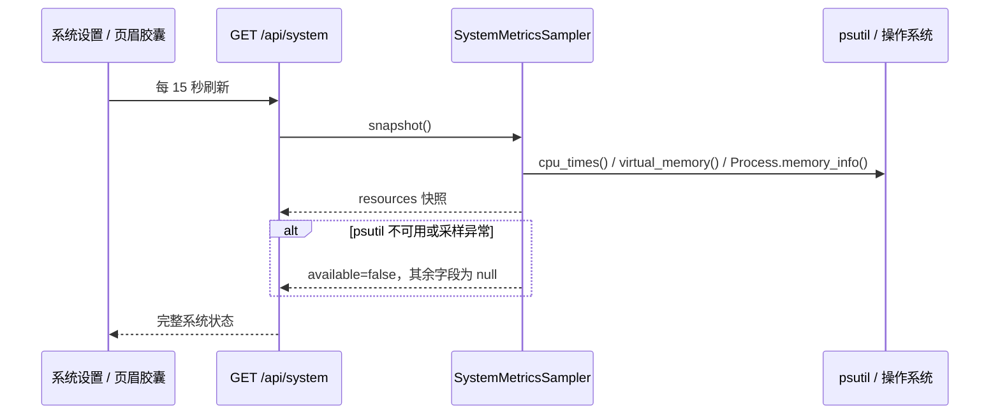

# 系统设置页设计

> 浏览器认证交互已由 [访问密钥登录与会话认证设计](43-访问密钥登录与会话认证设计.md) 和 [ADR 0019](adr/0019-访问密钥登录页与会话认证.md) 修订：浏览器改用固定用户名 `ecom` + 访问密钥的登录页和会话 Cookie，Basic 仅保留给命令行脚本。本页保留系统设置页的整体结构；涉及认证、密钥和退出的细节以 `43` 为准。

## 目标与入口

系统设置页给同一操作者一个集中入口，确认“服务以什么方式被访问、是否安全、当前资源是否够用、数据在哪里”。入口是侧栏“规则与设置 → 系统设置”，路由 `/settings`，也可直接访问 `/#/settings`。

当前页面可编辑局域网开关、访问密钥、托管 worker 的同时采集任务数、规则分析并发、采集计划与速率（正式采集默认上限、默认站点 RPS／并发和站点策略列表），以及图片加载代理（自动／指定／直连和系统图片代理地址）。绑定地址、端口、允许的 Host、路径和多用户权限由部署管理。

## 信息架构

页面保持单列，最大宽度与现有设置页一致，按任务重要性排序：

- **概览摘要**：服务状态、访问范围、认证、活跃负载。用于 10 秒内判断当前是否局域网开放、是否启用认证、是否有任务或构建在跑。
- **访问与认证**：局域网开关、访问密钥管理（自定义、随机生成、退出登录）、访问地址、允许的 Host、HTTP 明文提示。
- **资源与运行**：worker 模式与槽位、采集和规则分析并发、采集计划与速率（正式采集默认上限、默认站点 RPS／并发、站点策略列表）、图片加载代理（自动／指定／直连、系统图片代理地址、服务默认代理是否已配置）、CPU 与内存采样、活动/排队/暂停任务、活动/排队构建、数据库大小、磁盘剩余与使用率、进程线程和运行时长。
- **数据与路径**：数据库、输出目录、规则目录。路径中的用户主目录折叠为 `~`，每项可复制。
- **环境与版本**：应用版本、Python、操作系统、启动时间，以及可写/只读、构建可用、规则目录。
- **页脚说明**：哪些设置即时生效、哪些需要重启，以及密钥哈希和 HTTP 明文边界。

不把操作按钮塞进概览；不在只读状态伪装可点击控件。

## 关键交互链路

### 开关局域网

1. 入口：访问与认证卡的开关。开关只在服务以非回环地址启动、已配置密钥、服务可写且页面未暂停刷新时可用。
2. 开启：直接 `PUT /api/system/access {lan_enabled:true}`，成功后本地查询缓存立即更新，提示“局域网访问已开启”。不需要重启。
3. 关闭：先弹确认框，说明其他设备将无法访问；如果当前正从局域网访问，额外说明本页会在下次请求断开。
4. 关闭成功：更新缓存；如果是局域网客户端，暂停自动刷新并提示回到本机。开关禁用原因写“局域网访问已关闭；请回到本机继续操作”，不误导用户反复刷新。
5. 失败：保留当前开关值，显示就地错误，可手动刷新恢复。

### 管理访问密钥

1. 入口：访问与认证卡的“访问密钥”区域，提供自定义密钥输入、“保存密钥”和“生成随机密钥”。
2. 自定义：输入 1–256 个字符的密钥，确认“所有设备需要重新登录”后提交；旧密钥和旧会话立即失效。
3. 随机生成：确认后调用 `POST /api/system/access/token` 生成一次性密钥，在对话框中展示并支持复制。
4. 成功：暂停自动刷新；自定义密钥提示“已更新，请重新加载并用新密钥登录”，随机密钥保留一次性对话框和“查看新密钥”入口。
5. 退出登录：调用 `/api/auth/logout` 清除当前浏览器会话并回到登录页；其他设备需要重新登录时轮换密钥。
6. 失败：显示错误，恢复自动刷新；旧密钥继续有效。

### 纯回环启动

1. 页面显示“当前仅监听回环地址”，开关禁用。
2. 提供重启参数 `--host 0.0.0.0 --port <port>` 和复制按钮。
3. 如果尚未配置密钥，提示先生成密钥；生成后密钥哈希写入账本，重启时无需再把明文放进命令行。
4. 重启后页面可正常开关局域网；绑定地址和端口仍只读。

## 状态矩阵

| 状态 | 展示与行为 |
| --- | --- |
| 首次加载 | “正在读取系统状态…”；失败时 ErrorNotice + 重试 |
| 局域网能力未建立 | 摘要“仅本机”；开关禁用；显示重启参数 |
| 局域网已关闭 | 摘要“局域网关闭”；开关可重新开启（回环客户端）；LAN Host 403 |
| 局域网已开启 | 摘要“局域网开放”；显示访问地址和明文警告 |
| 密钥未配置 | 开关禁用；密钥区按钮为“生成随机密钥” |
| 密钥已配置 | 显示上次轮换时间；提供自定义密钥、随机生成和退出登录 |
| 只读预览 | 开关、自定义密钥和随机生成禁用；退出登录仍可用 |
| 轮换成功未重新加载 | 自动刷新暂停；一次性密钥提示或“已更新”提示常驻 |
| 从局域网关闭访问 | 自动刷新暂停；提示回到本机；开关禁用原因不误导 |
| 请求失败 | 错误就地显示，不清空已知状态；可手动刷新 |

## 响应式

- 页面单列，`max-w-5xl`；概览为 2 列（窄屏）／4 列（桌面）。
- 资源区 2 列（窄屏）／3 列（平板）／4 列（桌面）；分隔线用背景色间隙实现，不额外画网格。
- 访问与认证在桌面分两列：左侧将局域网开关、访问地址和允许的 Host 归在一起，右侧管理密钥；窄屏依次上下排列。地址提示随局域网开放、关闭或仅监听回环的状态变化，不把示例地址当作真实地址。
- 数据与路径、环境与版本在 `lg` 以上并排，以下堆叠。
- 390px 下不出现页面级横向溢出；长路径和 URL 允许断行，复制按钮换行到下一行仍可点击。
- 所有对话框使用现有 Radix Dialog 模式：标题、说明、焦点管理、关闭按钮、窄屏宽度 `min(…, calc(100vw-24px))`。

## API 契约

| 方法 | 路径 | 用途 |
| --- | --- | --- |
| `GET` | `/api/system` | 服务/访问/资源/路径/版本快照 |
| `GET` | `/api/system/collection-policy` | 采集计划与速率、正式上限、默认站点速率和站点策略 |
| `PUT` | `/api/system/collection-policy` | 保存采集计划与速率，对新任务生效 |
| `PUT` | `/api/system/access` | `{lan_enabled: boolean}`，立即切换并持久化 |
| `POST` | `/api/system/access/token` | 请求体可选 `{token?: string}`；无体随机生成，带值保存自定义密钥 |
| `POST` | `/api/auth/login` | 固定用户名 `ecom` + 访问密钥登录，设置会话 Cookie |
| `POST` | `/api/auth/logout` | 清除当前浏览器会话 |

`GET /api/system` 的 `server` 包含 `host`、`port`、`lan_capable`、`lan_enabled`、`auth_required`、`token_configured`、`token_updated_at`、`session_ttl_seconds`、`allowed_hosts` 和 `urls`。`runtime`、`work`、`storage`、`paths` 分别承载运行开关、队列计数、磁盘/数据库和路径；`resources` 承载 CPU、内存和服务进程内存采样。页面不依赖 `/api/health` 拼接这些字段。

### 系统资源采样

本稿增补（2026-11-27）：完整仪表放在系统设置页「资源与运行」，工作台等页面只在页眉显示 CPU／内存简化胶囊，点击进入 `/settings?focus=resources` 并滚动到该区。两者共用 `GET /api/system` 的 `resources` 快照。采样只读，不新增写接口，也不改变任务调度；决策与回退见 [ADR 0026](adr/0026-系统资源采样与页眉胶囊.md)。

- 字段：`available`、`cpu_percent`、`cpu_count`、`cpu_window_ms`、`memory_used_bytes`、`memory_total_bytes`、`memory_percent`、`process_rss_bytes`、`sampled_at`。
- CPU 使用率按两次 `cpu_times()` 的增量计算，表示“自上次采样以来”的平均值，不是瞬时值；首次调用没有上一采样点时返回 `null`，页面显示“采样中”，下一次刷新后显示。采样窗口写入 `cpu_window_ms`，页面按实际窗口标注。
- 内存使用率取 `(total - available) / total`，与页面进度条一致；`process_rss_bytes` 只表示采集服务进程，不包含 Chromium 子进程的完整内存。
- 采样按请求触发，不启动后台线程；服务启动时先取一次基线。`psutil` 缺失或调用异常时只把 `resources.available` 置为 `false`，不阻断 `/api/system` 的其他字段。
- 磁盘仍使用现有 `storage` 字段；系统设置页在「资源与运行」顶部显示 CPU、内存、磁盘三个环形仪表，并把队列、数据库、运行时长留在下方统计。磁盘剩余低于 10% 时显示警告，不把阈值只做成颜色。
- 页眉胶囊只显示 CPU 和内存百分比，不展开磁盘或队列；CPU／内存达到 70% 用警告色、90% 以上用危险色。读取中、不可用或不支持时隐藏，不以 0 冒充。
- 依赖 `psutil>=7,<8`，Windows／Linux／macOS 通用，许可证为 BSD-3-Clause。不引入后台监控进程或数据库表。

验收：

- 后端：`test_web` 覆盖 `resources` 字段存在与取值范围；`test_system_metrics` 覆盖 CPU 增量、首次采样、psutil 不可用回退和进程内存。
- 前端：系统设置页覆盖三个仪表、采样中、不可用和窄屏单列；页眉覆盖胶囊显示、阈值色调和跳转系统设置；工作台不再出现资源面板；全量 Vitest、lint、typecheck、format、build。
- 浏览器：1280、768、390 三档检查仪表布局、页眉胶囊、刷新、阈值文案和页面级横向溢出；系统设置页不再显示“CPU 和内存暂不采集”。

## 安全与文案

- 密钥只保存哈希，页面不提供“查看旧密钥”；一次性密钥对话框明确“关闭或刷新后无法再次查看”。
- 关闭局域网后仍要求密钥；不得因为“看起来只允许回环”就跳过认证。
- 页面明确 HTTP 明文和可信局域网边界；不提供公网、TLS 或多用户承诺。
- 绑定地址和端口只读；用户需要重启时给完整参数，不提供假的“立即生效”。
- 路径折叠 `~`，但不隐藏运行目录结构；页面本身只对已认证用户开放。

## 验收

- 后端：系统状态字段、开关持久化与 LAN 阻断、自定义／随机密钥、旧会话与旧密钥失效、登录限流、回环能力限制、只读 403 和只读登录、非回环无密钥拒绝、CLI 已存密钥检测。
- 前端：`SystemSettingsPage.test.tsx`、`LoginPage.test.tsx` 覆盖概览/资源/路径、关闭确认、自定义保存、随机密钥一次性展示、退出登录、固定用户名 `ecom` + 密钥登录、`next` 深链接和只读禁用；全量 Vitest、lint、typecheck、format、build。
- 浏览器：1440 和 390 截图、开关切换、自定义密钥、随机密钥、登录页、旧会话 401／新会话 200、重启不传密钥仍能读取已存哈希、窄屏无横向溢出。证据在仓库外 `workbench/access-key-login-2026-11-25/`。
- 用户路径：按[测试策略](23-测试策略.md#用户路径卡)执行 `V-01`～`V-05`。
- 未覆盖：页面内重绑、允许的 Host 编辑、真实另一台设备、防火墙、mDNS、TLS 和多用户。CPU／内存采样已由本页 `resources` 契约覆盖，但宿主机 CPU 与浏览器子进程的细分占用仍不展示。

## 采集运行参数提案

已实现。批量采集时，操作者可以在“系统设置 → 资源与运行”填入同时执行采集的任务数，默认 1。字段接受浏览器可精确表示的正整数，2 是已有实站对照的档位。双槽位收益的适用范围见[对照结果](45-批次采集与交付改进计划.md#2026-11-26-对照结果)。

- **字段范围**。首版只编辑托管 worker 的同时采集任务数；浏览器任务数和每域请求速率可展示当前值。浏览器配额有多档验收且确有调节需求时，再开放第二个字段。批次试采／正式计划、单任务内部并发、模型构建预算和运行参数各沿用原入口。
- **保存与生效**。复用 SQLite 的系统设置存储。保存时显示“已保存，下次启动生效”。页面同时显示当前生效值及与其不同的下次启动值。操作者可在当前工作结束后按原方式重启；保存动作只修改持久化设置。恢复默认清除页面保存值。
- **有效值来源**。启动时依次取显式 CLI 参数、账本设置、应用默认值。显式启动参数继续优先，页面显示对应参数名，该字段只读。外置 worker 模式由 worker 的启动参数管理，只读预览无法保存。维护 `serve --max-tasks` 时保留“省略”与“明确传 1”的区别，页面与启动流程共用账本设置的解析和校验。
- **接口与布局**。沿用 FastAPI、SQLite 设置存储和 React v2 的系统页。现有 `GET /api/system` 提供生效值、下次启动值及来源；`PUT /api/system/collection-slots` 保存下次启动值，`max_tasks: null` 恢复默认。字段和按钮放在「资源与运行」内，窄屏换行。通过现有认证、同源写入和只读约束。
- **验收**。Chromium 在独立账本从页面保存 3，刷新后仍显示当前 1／下次 3；服务重启后显示当前 3，三个本地夹具任务同时运行并全部完成。显式传 `--max-tasks 1` 后显示启动参数，移除参数则读回原保存值。恢复默认并重启后回到 1。后端回归验证旧账本无保存值、非法输入、CLI 覆盖和只读／外置 worker。证据位于仓库外 `workbench/batch-capacity-2026-11-26/settings-6360cc91/`。
- **规则分析并发**。同一区域独立设置首次接入和修复共用的构建槽位，默认 1，接受正整数，保存和恢复默认于下次启动生效。`GET /api/system` 返回当前构建槽位和下次启动值，`PUT /api/system/build-slots` 接受相同数值契约。显式 `--max-builds` 优先。未启用规则分析时页面隐藏该字段。工作机制与真实模型验收见[规则分析并发](37-构建Agent-Harness集成与使用说明.md#规则分析并发提案)。

### 图片加载代理

已实现。位于「采集计划与速率」下方，保存到 `app_settings.image_proxy`，保存后之后加载的商品图片立即生效，不需要重启。

- **自动**：任务或站点代理优先，其次服务默认代理和系统图片代理，最后直连；代理失败继续下一路。
- **指定**：只使用系统图片代理，失败显示图片占位，不回退直连。
- **直连**：不使用代理；系统图片代理输入框禁用。
- 代理 URL 接受 `http`／`https`／`socks5`，不接受内嵌账号或密码。任务定义里的代理仍优先于系统设置。
- 取图由 `/api/media/image` 完成，安全边界和限流见[图片加载代理设计](52-图片加载代理设计.md)；本页只负责保存模式和系统代理地址。
- 数据预览表头的“预览设置”在当前页打开 Dialog，复用本页同一套 `ImageProxyForm`，不在查看数据时把用户带到系统设置页；CSV 描述的单行／换行仍由表头直接切换。

### 采集计划与速率

已实现。位于「资源与运行」下方，保存到 `app_settings.collection_policy`，只影响之后创建的任务；运行中或暂停中的任务保持原计划，不需要重启服务。

- **正式采集默认**：`formal_unlimited` 默认开启，正式采集不额外设服务层商品数或时长上限，由规则声明范围、分页和目录自然结束。关闭后可设置商品上限（1–100000）和时长上限（60–86400 秒）；单次正式运行仍可通过启动 API 的显式 `limits` 覆盖。
- **默认站点速率**：`default_per_domain_rps` 和 `default_concurrency` 只用于没有站点级策略的域名，留空继承规则／服务默认；站点详情「采集速率」中的站点级字段优先。
- **站点策略列表**：页面显示已保存的域名、RPS 和并发；站点级编辑仍在站点详情「站点资料 → 采集速率」。
- **接口**：`GET/PUT /api/system/collection-policy`；`PUT` 接受 `formal_unlimited`、`formal_max_products`、`formal_max_seconds`、`default_per_domain_rps`、`default_concurrency`，拒绝未知字段和越界值。后端在批次启动、技术任务和自动接入创建任务时合并该策略。
- **验收**：正式默认无上限、关闭后的显式上限、默认速率合并、站点策略优先、非法值 422；前端系统设置页保存和状态展示。证据见本轮测试与 `SystemSettingsPage.test.tsx`。
