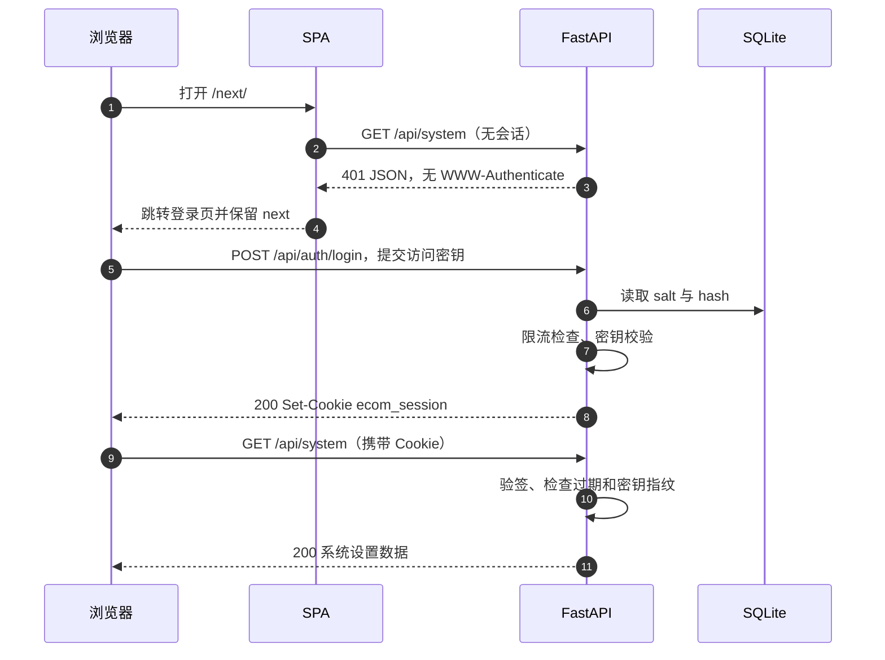
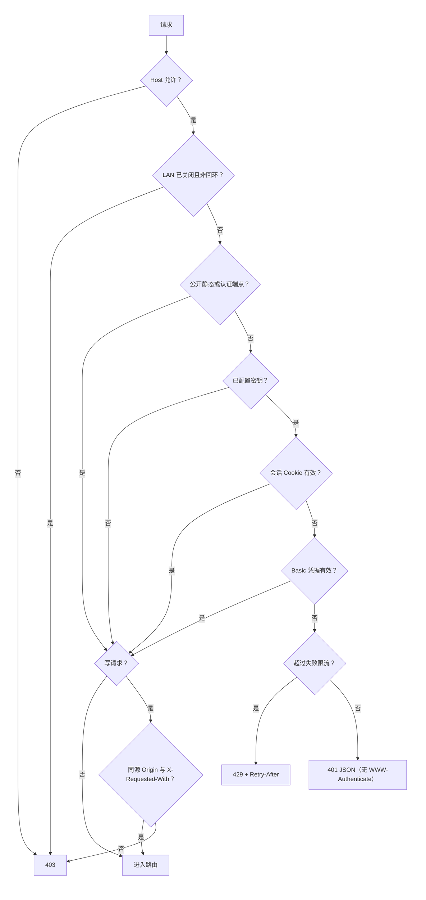
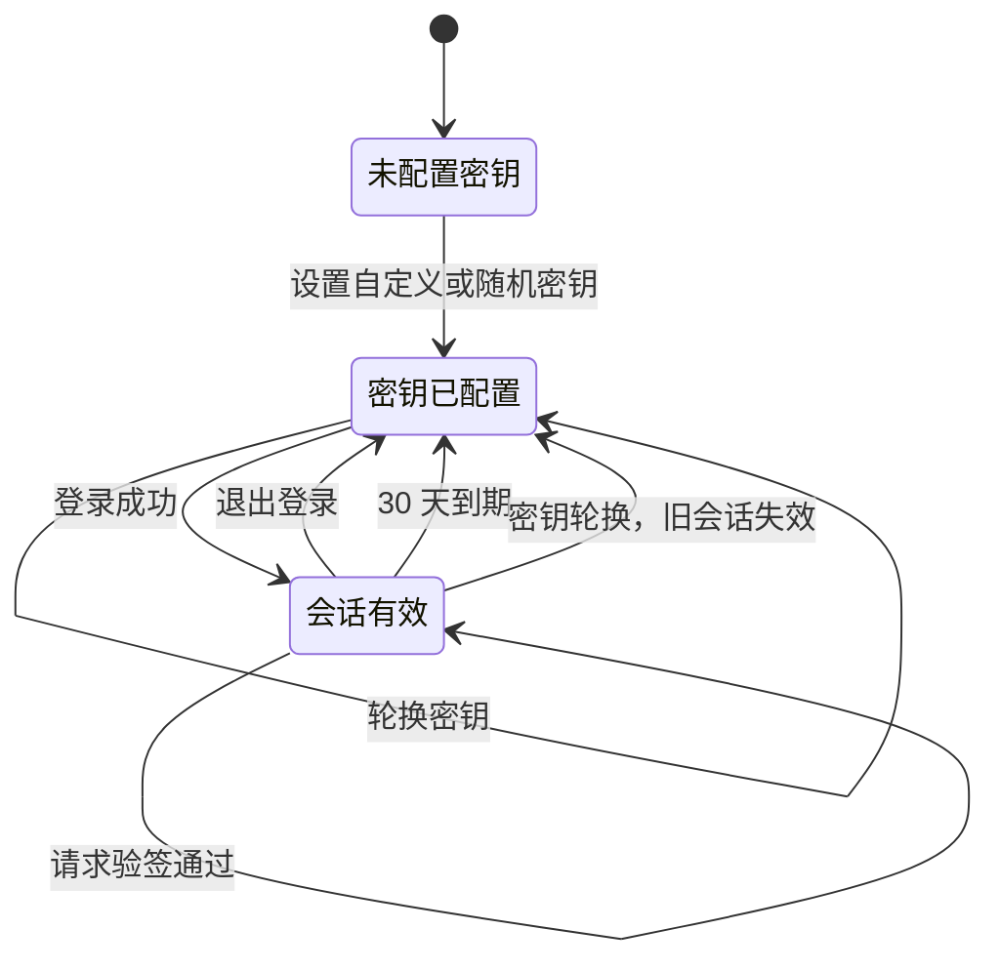

# 访问密钥登录与会话认证设计

## 目标与边界

本设计解决当前局域网访问的三个实际问题：

- 浏览器 HTTP Basic 认证框强制填写用户名，而服务端只校验密码；用户不知道用户名该填什么。
- 令牌只能由服务端生成，最短 16 位，无法设置自己记得住的简单密钥。
- 没有登录页、会话和退出登录；每次请求都走 Basic，浏览器原生弹窗无法承载错误提示、限流和跳转。

目标是在不引入 TLS、多用户和公网暴露的前提下，让用户从浏览器打开页面后**只填一个访问密钥**即可进入，并保留命令行脚本兼容、密钥轮换、失败限流和只读预览能力。

非目标：

- 不做 HTTPS、反向代理公网暴露、OAuth、SSO 或多因素认证。
- 不做多用户、角色权限、按人审计和按设备撤销会话。
- 不做密钥找回、密钥托管或密钥明文存储。
- 不把 HTTP 明文下的“简单密钥”宣传成强安全凭据；它只服务于可信局域网和单用户。

## 现状与问题

当前认证行为：

- `serve` 以非回环地址启动时启用 HTTP Basic，用户名被忽略，密码是访问令牌。
- 令牌由 `secrets.token_urlsafe(24)` 生成，CLI／环境变量要求至少 16 位，页面只能轮换，不能自定义。
- 所有页面、API、SSE、导出和静态资源都要求 Basic；浏览器原生弹窗负责收集凭据。
- 没有会话、登录页和退出登录；关闭页面后浏览器是否记住凭据由浏览器决定。

这组行为在技术上能工作，但没有通过“首次使用”验收：用户看到用户名输入框时无法从页面判断该填什么，也无法把 32 位随机串换成自己记得住的密钥。测试和截图只覆盖了已实现行为，没有覆盖“新用户能否独立登录”。

本设计把 `V-01`～`V-05` 作为首批用户路径验收场景，定义见[测试策略](23-测试策略.md#用户路径卡)。

## 关键决策

| 决策 | 选择 | 理由 | 主要替代方案 |
| --- | --- | --- | --- |
| 浏览器认证 | 独立登录页 + 会话 Cookie | 只填密钥；可显示错误、限流和跳转；不再触发浏览器 Basic 弹窗 | 保留 Basic 并写帮助文案（不满足“只填密钥”） |
| 访问密钥 | 用户自定义或服务端随机；1–256 字符 | 满足“懒人方便”；不做大小写／数字／符号强制 | 继续 16 位随机（不满足自定义） |
| 密钥存储 | 随机 salt + SHA-256，只存哈希 | 与现有账本兼容；不保存明文 | 明文存储（扩大泄露面） |
| 会话 | 无状态 HMAC 签名 Cookie，30 天 | 不新增数据表；重启后仍有效；密钥轮换可让旧会话失效 | 服务端会话表（可逐设备撤销，但当前过度） |
| 失败保护 | 同一 IP 60 秒 5 次失败后锁 30 秒 | 简单密钥的主要补偿控制 | 不限制（短密钥可被在线暴力尝试） |
| 静态入口 | `/next/` 与静态资源公开，API 保护 | SPA 必须先加载登录页；静态资源不含业务数据 | 服务端 302 到登录页（会丢失 hash 深链接） |
| 命令行兼容 | 保留 Basic，浏览器不再触发 | 现有 curl／脚本不破坏 | 全部改为 Bearer（迁移面大） |
| 只读模式 | 登录／退出不受只读写保护影响 | 只读服务仍需登录查看；它们不写账本 | 只读下只能用 Basic（浏览器体验倒退） |
| 密钥轮换 | 旧会话立即失效 | 会话签名绑定当前密钥指纹 | 只换密码、不失效会话（容易遗留旧会话） |

## 工作机制

### 首次登录



关键点：

- 401 响应**不带** `WWW-Authenticate`，浏览器不会弹出原生 Basic 框；SPA 可以接管跳转。
- 登录页只显示一个“访问密钥”输入框，不出现用户名字段。
- 登录成功后设置 HttpOnly Cookie；后续请求不再需要 Basic 头。
- 深链接通过 `next` 参数保留，登录后回到原页面，而不是固定回批次列表。

### 访问判定顺序



这个顺序的理由：

- **先校验 Host 和局域网开关**：错误 Host 或已关闭的局域网不应进入认证分支，避免把请求当成合法登录尝试。
- **公开静态在认证之前**：登录页本身必须能加载；公开的只是 SPA 外壳和静态资源，API 数据仍在认证之后。
- **会话优先于 Basic**：浏览器正常路径使用 Cookie；Basic 只作为脚本兼容，不触发原生弹窗。
- **写请求最后校验**：登录和退出也需要同源 `Origin` 与 `X-Requested-With`，避免跨站登录或退出。
- **登录端点的限流在端点内完成**：它没有会话可校验，失败计数和 429 由 `POST /api/auth/login` 自己处理；流程图中的限流分支同时覆盖 Basic 失败。

### 密钥与会话生命周期



关键不变量：

- 密钥轮换生成新的 salt 和 hash，会话签名中的密钥指纹随之变化，旧会话全部失效。
- 退出登录只清除当前浏览器的 Cookie；无状态会话无法逐设备撤销。需要让所有设备退出时轮换密钥。
- 会话到期或密钥轮换后回到登录页，不需要重启服务。

## 密钥策略与安全论证

### 允许的密钥

- 长度 1–256 个字符；首尾空白会被去掉，纯空白拒绝。
- 不强制大小写、数字、符号，不做弱密钥黑名单；这是用户明确要求的“懒人方便”。
- 拒绝控制字符，避免日志、HTTP 头和输入框出现不可见字符。
- 登录页支持 Unicode；命令行 Basic 建议使用 ASCII，避免不同客户端的编码差异。

1–256 是传输和输入边界，不是复杂度要求。256 足以覆盖长口令，又避免无界输入；1 字符密钥在可信局域网内可用，但必须理解它只能防误访问，不能防同网段嗅探或暴力尝试。

### 存储与比较

- 密钥只保存随机 16 字节 salt 和 SHA-256 哈希，写入 `app_settings.serve_token`。
- 校验使用 `hmac.compare_digest`，避免明显的时序差异。
- 随机生成的密钥只在一次性对话框显示；自定义密钥提交后不回显。
- 密钥、Cookie 和 Authorization 头不写入日志、trace 或页面错误信息。

### 会话签名

会话 Cookie 为无状态签名值：

```text
payload = {"iat": 签发时间, "exp": 到期时间, "v": 当前密钥哈希前 16 位}
value = base64url(payload) + "." + base64url(HMAC-SHA256(密钥哈希, payload))
```

- `HttpOnly`：JavaScript 读不到，降低 XSS 直接窃取会话的价值。
- `SameSite=Lax`：跨站 POST 不携带 Cookie，配合同源 `Origin` 和 `X-Requested-With` 降低 CSRF 风险。
- `Path=/`、`Max-Age=30 天`；当前只支持 HTTP，因此不设置 `Secure`，并在页面和文档明确边界。
- `v` 绑定当前密钥指纹；轮换密钥后旧 Cookie 验签或指纹失败，用户必须重新登录。
- 不做服务端会话表：当前单用户、单进程，无状态会话足够；需要逐设备撤销、在线会话列表或多人审计时再升级。

无状态会话的已知限制：

- 退出登录只清当前浏览器；被复制的 Cookie 在到期前仍可能有效。
- 数据库读取者可以伪造会话；但数据库同时包含任务数据和设置，属于同一信任边界。
- 服务端重启后，只要账本中的密钥哈希不变，会话继续有效；这符合“懒人方便”，也意味着不能靠重启踢掉所有会话。

需要立即让所有设备失效时，使用密钥轮换，而不是重启服务。

### 失败限流

- 同一客户端 IP 在 60 秒内失败 5 次后锁定 30 秒，返回 `429` 和 `Retry-After`。
- 登录页错误和 Basic 错误共用同一套计数；成功登录清除该 IP 的计数。
- 限流只保存在进程内存，重启后清零；不引入持久化锁定，避免用户忘记密钥后长期无法恢复。
- 限流不能阻止同网段抓包；HTTP 明文下抓到的密钥和 Cookie 仍可直接使用。这是本设计接受的边界。

## 会话与 Cookie 细节

| 项目 | 取值 | 说明 |
| --- | --- | --- |
| Cookie 名 | `ecom_session` | 与现有设置键分离，便于识别 |
| 有效期 | 30 天 | 登录页不提供“记住我”开关，默认长期 |
| `HttpOnly` | 是 | 降低 XSS 读取 |
| `SameSite` | `Lax` | 跨站 POST 不带 Cookie |
| `Secure` | 否 | 当前只有 HTTP；上 TLS 后再开启 |
| `Path` | `/` | 覆盖 `/api` 和 `/next` |
| `Domain` | 不设置 | 只作用于当前主机 |
| 服务端状态 | 无 | 签名校验，无会话表 |

服务端重启、账本迁移和只读启动都不需要迁移会话；旧 Cookie 继续按签名和到期时间校验。

## 公开边界与 401 行为

### 公开路径

只对 `GET`／`HEAD` 公开：

- `/` 和 `/next`、`/next/...`：SPA 外壳、路由分块、样式、图片等静态资源。
- `/favicon.ico`：避免浏览器控制台噪声。

受保护：

- `/api/*`，但 `/api/auth/login` 和 `/api/auth/logout` 除外。
- 旧 `/batch/`、`/legacy`、`/static/` 和导出下载。
- 任何写请求，包括登录、退出和系统设置写接口。

公开静态不等于公开数据：API 仍需有效会话或 Basic；SPA 外壳本身不包含任务、路径或密钥。

### 为什么不让服务端 302 到登录页

服务端可以把 `/next/` 重定向到登录页，但 URL fragment（`#/settings`）不会发送给服务端，重定向后深链接丢失。让 SPA 先加载、由 API 401 触发前端跳转，才能保留 `next=%23%2Fsettings` 并回到原页面。

### 为什么 401 不带 `WWW-Authenticate`

带 `WWW-Authenticate: Basic` 会让浏览器在 API 401 时弹出原生用户名／密码框，直接破坏登录页体验。命令行客户端使用 `curl -u` 时会主动发送 Basic 头，不需要挑战；因此 401 只返回 JSON。

## API 契约

| 方法 | 路径 | 认证 | 请求 | 成功响应 |
| --- | --- | --- | --- | --- |
| `POST` | `/api/auth/login` | Host、LAN、同源写保护 | `{key: string}` | `200 {ok: true, expires_in: 2592000}` + `Set-Cookie` |
| `POST` | `/api/auth/logout` | Host、LAN、同源写保护 | 无 | `200 {ok: true}`，清除 Cookie |
| `GET` | `/api/system` | 会话或 Basic | 无 | 系统状态；含 `server.session_ttl_seconds` |
| `POST` | `/api/system/access/token` | 会话或 Basic、可写、同源 | `{token?: string}`，空体表示随机生成 | `{token: string \| null, generated: boolean, access: ...}` |
| `PUT` | `/api/system/access` | 会话或 Basic、可写、同源 | `{lan_enabled: boolean}` | `{access: ...}` |

错误：

- `400 INVALID_ACCESS_KEY`：空、纯空白、控制字符或超过 256 字符。
- `401 INVALID_KEY`：密钥不匹配；不区分“密钥不存在”和“密钥错误”。
- `409 TOKEN_NOT_CONFIGURED`：尚未配置密钥，不能登录。
- `429 TOO_MANY_ATTEMPTS`：携带 `Retry-After` 秒数。
- `403 READ_ONLY`：只读模式拒绝密钥轮换和局域网开关，但登录／退出仍可用。
- `403 FORBIDDEN`：Host、局域网开关或同源写保护拒绝。

`POST /api/system/access/token` 的响应：

- 无请求体或 `token` 为 `null`：随机生成，返回一次性明文和 `generated: true`。
- 请求体带 `token`：校验并保存自定义密钥，返回 `token: null` 和 `generated: false`；页面使用用户输入值，不回显。

## 前端交互

### 登录页

- 路由 `/next/#/login?next=%23%2Fsettings`，不套用应用外壳。
- 只显示“访问密钥”一个输入框，标签、说明、错误提示和“进入”按钮。
- 输入框 `type=password`、自动聚焦、回车提交、`autocomplete=current-password`。
- 错误就地显示；429 显示服务端返回的重试秒数；不清空已输入的密钥，允许修正。
- 登录成功后导航到 `next`；`next` 只接受内部 hash 路径（`#/...`），拒绝外部 URL 和 `//` 开头，避免开放重定向。
- 页面不显示用户名；命令行兼容说明只放在文档和设置页的次要说明里。

### 设置页

- “访问与认证”卡改为“访问密钥”管理：
  - 自定义密钥输入框和“保存密钥”按钮；保存前确认所有设备需要重新登录。
  - “生成随机密钥”作为更强选项，保留一次性对话框。
  - “退出登录”按钮，调用 `/api/auth/logout` 后回到登录页。
- 更换密钥成功后暂停自动刷新，提示“密钥已更新，请重新加载并用新密钥登录”；不立即发起轮询，避免在用户保存密钥前弹出登录页。
- 只读模式禁用自定义、随机和局域网开关，但保留退出登录。
- 页面明确说明：浏览器登录页只填密钥；命令行 Basic 用户名任意，仅供脚本使用。
- 指标和文案从“HTTP Basic”改为“登录页认证已启用”，不再把 Basic 当作浏览器主路径。

### 401 与跳转

- `getJson`／`sendJson` 遇到 401 时，如果当前不在登录页，跳转 `#/login?next=<当前 hash>`。
- `/api/auth/login` 和 `/api/auth/logout` 的 401 不触发跳转，避免登录页自身循环。
- 跳转保留当前 hash，登录成功后回到原页面；刷新和直接深链接同样适用。
- 如果用户已登录但手动打开登录页，提交新密钥会重新签发会话；不额外做“已登录”拦截。

## 兼容、迁移与回滚

- 现有 `app_settings.serve_token` 的 salt/hash 格式不变，已有 16 位以上令牌继续有效，不强制轮换。
- `--access-token` 和 `ECOM_SERVE_TOKEN` 继续可用；长度校验改为 1–256，旧的 16 位以上值不受影响。
- 旧 Basic 脚本继续用 `curl -u "任意用户名:密钥"`；服务端仍忽略用户名。
- 浏览器首次访问会看到登录页，而不是 Basic 弹窗；已有 Basic 缓存凭据仍可能被浏览器自动发送，服务端继续接受。
- 新后端与新前端需一起部署：旧前端没有登录路由，遇到 401 会显示错误；旧后端没有 `/api/auth/login`，新前端登录会 404。发布时构建并重启同一个服务实例。
- 回滚只需恢复代码并重启；账本中的 token 哈希兼容，旧 Basic 认证恢复；会话 Cookie 被旧代码忽略，不需要清理数据。
- 不修改 `app_settings` 结构，不需要数据库迁移。

## 替代方案

- **保留 Basic，只在页面写“用户名任意”**：改动最小，但浏览器仍弹原生框，仍要求用户理解一个本不该存在的字段；不满足“只填密钥”。
- **Bearer Token + localStorage**：前端实现简单，但 XSS 可直接读取；HttpOnly Cookie 更稳妥。
- **查询参数传密钥**：SSE 和下载方便，但会进入日志、Referer 和历史记录；不采用。
- **服务端会话表**：支持逐设备撤销和在线会话列表，但需要新表、清理和并发设计；当前单用户阶段收益不足，保留为升级路径。
- **只允许 16 位以上随机令牌**：安全默认更强，但与用户明确要求的“简单密钥”冲突；改用限流和可信局域网边界补偿。
- **不做限流**：少一层实现，但短密钥可被同网段在线暴力尝试；不采用。
- **服务端 302 到登录页**：会丢失 hash 深链接；改用 SPA 内 401 跳转。
- **删除 Basic**：浏览器体验更单一，但破坏现有 curl／脚本；保留为兼容路径。

## 验证计划

首批用户路径按[测试策略](23-测试策略.md#用户路径卡)执行：

| 编号 | 场景 | 关键证据 |
| --- | --- | --- |
| `V-01` | 全新浏览器打开 `/next/#/settings`，只填密钥登录 | 登录页无用户名；登录后回到设置页；刷新仍有效 |
| `V-02` | 错误密钥连续失败 | 明确错误；第 5 次后 429 + `Retry-After`；不泄露密钥是否存在 |
| `V-03` | 设置页保存自定义密钥，旧会话来访问 | 旧 Cookie 401；新密钥登录成功；深链接保留 |
| `V-04` | 退出登录并重启服务 | 退出后回登录页；重启后有效会话仍有效 |
| `V-05` | 关闭局域网／只读模式 | 外部设备 403；只读可登录但不能改密钥 |

自动化补充：

- 后端：登录成功／失败、Cookie 属性、会话验签与过期、密钥轮换使旧会话失效、限流 429、只读登录、公开静态与受保护 API、401 无 `WWW-Authenticate`、Basic 兼容。
- CLI：1 字符和 256 字符密钥可用；空、纯空白、控制字符和超长拒绝；旧 16 位令牌继续可用。
- 前端：登录页只渲染密钥字段、错误与 429、`next` 校验；设置页自定义保存、随机生成、退出登录、只读禁用。
- 真实入口：8765、Chromium 全新 profile、控制台和日志无未预期错误；证据卡写入 `docs/15` 或提交说明。

不覆盖：真实第二台物理设备、防火墙、mDNS、TLS、多用户、浏览器密码管理器、跨浏览器差异。需要这些能力时另做安全设计。

## 实施顺序与回滚

- 先完成本设计与 ADR 0019，确认接口、Cookie、限流和公开边界。
- 后端：`access.py` 密钥校验、会话签名、限流；`app.py` 登录／退出、访问判定、Token 接口；`cli.py` 长度校验。
- 前端：API 客户端 401 跳转、登录页、设置页自定义密钥与退出。
- 测试：后端、前端、构建和文档；真实 8765 跑 `V-01`～`V-05`。
- 回滚：恢复代码并重启；不迁移数据库；旧 Basic 路径可用。若登录页不可用但 Basic 仍可用，可作为临时兜底。

## 结论

对当前阶段，这套方案比继续扩展 Basic 更合理：

- 浏览器只填一个密钥，直接满足用户目标。
- 不新增依赖、不新增数据表、不做数据库迁移。
- 会话无状态，重启不丢；密钥轮换可让所有旧会话失效。
- 限流补偿简单密钥的在线猜测风险，同时保留“简单密钥”的便利。
- 静态外壳公开、API 保护，既保住深链接，又不暴露业务数据。
- Basic 保留为脚本兼容，不破坏现有自动化。
- 需要 TLS、多用户、逐设备撤销或公网暴露时，可在现有登录页和会话接口上演进，不需要推翻交互。
