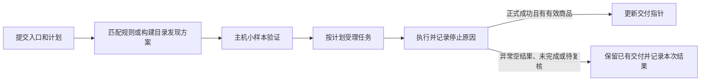
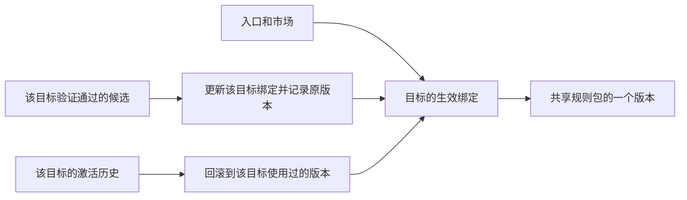
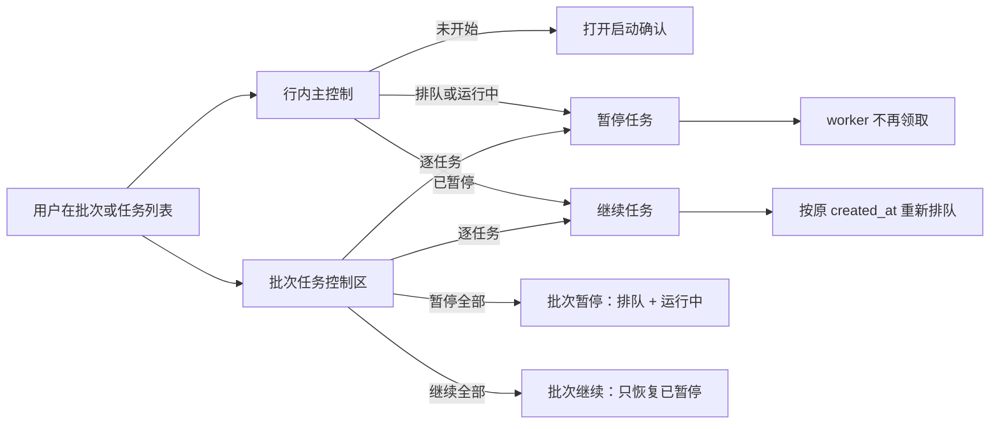

# 批次采集与交付改进计划

操作者交一批网址，确认市场和试采／正式采集计划，回来处理阻塞并导出可用结果。批次是工作入口。站点详情承接单目标处理，任务和构建详情用于证据与排障。规则修复沿用[现有反馈流程](34-规则修复与异常工作流.md)。

## 范围、状态与入口

| 顺序 | 决策 | 验收 |
| --- | --- | --- |
| 1. 保留目标 | 域名用于复用规则和共享请求配额。非根路径及查询组成显式入口。支持从指定入口开始的 `entry_links`、`listing` 和 `html_index`，导航限制在目标路径和查询范围。商品页仍按规则约束，可以位于单独的商品路径。缺适用规则的目标进入待接入。 | 同站不同分类各自保留，重复输入合并。规则与指定入口不符时不能入队。 |
| 2. 保护交付 | 批次站点保存最新任务和已采用结果。正式更新以完整成功的结果替换，用户反馈复跑先保留原交付；用同等计划且已看过结果后显式采用。首次运行仍允许导出明确标注的试采或部分结果。 | 新运行排队、失败、取消、待确认时，批次 ZIP 仍含上一份结果。采用后结果来源和 ZIP 一起切换。刷新或重启后保持一致。 |
| 3. 统一计划 | 批次保存试采／正式选项。试采每目标最多 20 件商品、180 秒，并保留发现预算。正式采用规则声明范围，每目标最多 1 万件或 1 小时。整批、勾选和单站启动使用该批次计划。旧批次沿用已有请求默认和历史入口。 | 从各入口提交相同目标，任务计划一致。新建后进入新批次。预览由系统更新，异常列表只列一遍。 |
| 4. 就地处理 | 批次清单链接到审批、候选规则和复跑结果。启动时可选择一起接入待采目标。一次最多接入 10 个，每目标构建时间 10 分钟、输入 20 万及输出 3 万 token。沿用模型池、现有构建队列和主机验证，验证通过后按批次计划入采集队列。 | 从批次出发可处理接入、复核与复跑，回到同一批次继续交付。 |

布局沿用现有工作台。新建弹窗优先展示批次名称、站点列表、市场、采集计划和系统预览；批次清单优先展示入口、执行和交付状态，异常链接位于对应行。低频元数据可展开。

试采结束后可在原批次开始正式采集，复用同一目标清单。正式运行期间仍可导出标有试采状态的结果，成功后再切换交付结果。

## 技术决策与验证

沿用 [FastAPI、SQLite 与本地 worker](adr/0001-技术栈与运行形态.md)、[现有调度](adr/0004-任务粒度、资源配额与Web界面.md)与 [React v2](adr/0012-前端v2技术栈与设计系统.md)。本计划在[开工检查清单](21-开工前检查清单.md)登记 Provisional 实施范围。目标匹配继续由规则目录和生效账本判断；新增可空字段兼容既有 SQLite 账本和 API 调用。保留旧任务、规则、ZIP 和分享链接，升级前备份账本。若需回退应用版本，使用同一版本的账本备份恢复，避免旧逻辑解释新增目标的含义。

先用临时账本和本地商品夹具复验上述行为，再运行后端全量、前端检查及文档校验。涉及新站自动构建的线上预算和队列行为，使用单独获准的实站／模型演练验证。已实施项及证据记在[交接页](15-交接.md)。

### 本地验收

- 同站两个带查询的入口各自采到对应商品，批次 ZIP 分目录记录各自的入口和任务。规则未覆盖的分类保留为待接入。
- 修复复跑入队后批次可见，失败和待确认阶段继续导出原交付任务。采用后 ZIP 指向复跑任务；同一请求重放仍返回原复跑任务。
- 使用构建适配器夹具验证显式接入授权、主机验证成功后入采集队列。真实模型、真实站点与该额度下的接入产出待单独验证。
- Windows 后端全量双进程 403 项通过。前端 Vitest 150 项通过，类型、lint、格式和生产构建通过。浏览器以临时账本验证自动预览、保存后进入批次、试采 ZIP 与转正式采集。

### 交付正确性续做

1. 正式采集遇到规则的发现保护上限且仍有下一页或未处理来源时，记录 `BUDGET_EXHAUSTED` 与具体上限。已有有效商品则是部分结果，继续保留上一份已采用结果。到最后一页且没有下一页时仍可自然结束。
2. 批次 ZIP 的批次信息、站点任务选择和统计使用同一账本快照。运行中的站点保留状态，批次 ZIP 只打包已结束任务的文件；正在复跑时沿用此前已采用的文件。成功任务缺少商品 CSV 或结果清单时标记缺失。

本地通过正式采集截断、最后一页自然结束、试采结果保留及打包期间任务写入的回归。Windows 后端全量 404 项通过，Chromium 批次冒烟与文档导出复核通过。

显式入口包含 `page_param` 声明的页码时，从该页继续。翻页只改页码，保留入口的筛选值，包括同一筛选键的多个值。其他分页类型仍按入口查询约束处理。

临时账本曾复现域名与分类共用 `rule_id` 时，分类候选受全局单生效版本约束阻塞。修复见下文的[规则复用与市场适用性](#规则复用与市场适用性)。真实模型与真实站点的自动接入仍待走查。

### 正式范围、交付替换与入队

本轮沿用上述 Provisional 实施范围。在批次内新建规则时，规则的发现方案按提交入口的约定范围设计，主机仍小样本验字段。域名入口可使用适用的目录发现源。分类入口的导航须留在提交范围内。只声明入口链接的构建适用于小样本验证，缺少目录发现方案时不直接作为新批次的正式规则。小目录可以用不需翻页的列表表达，验收不设最低商品总量。已有人工核准规则按原适用范围使用。

完成正式复采时，包含有效商品的成功结果可以替换已有交付。零有效商品的结果应保留在任务历史里，首次导出时清楚标为空，已有交付时则保留此前结果。来源确实变为空时，可通过现有反馈复跑验收明确采用新的结果。

批次 ZIP、批次清单中的单目标下载和站点详情使用同一份已采用结果。任务详情保留当前运行和历史任务的下载入口。

试采转正式要跟首次正式任务或接入构建的受理一起写入账本。没有任何可受理对象时保留试采计划。批次已经转正式后，重复提交转正式请求只返回当前状态，避免重复复采。按现有请求授权继续处理同一批次的待接入范围。

用本地构建适配器验证正式接入只在目录发现方案通过主机验证后入队。用本地商品夹具验证复采全排除仍保留原交付，及试采无可入队对象时保持试采、受理后重复请求不增建任务。保留原任务和文件供回查。应用回退时使用升级前的账本备份。

本地验收已覆盖上述路径。Windows 后端全量 407 项通过，React v2 的 150 项测试、类型检查、lint、格式和构建通过。Chromium 真实页面验证了站点下载、批次 ZIP、刷新后状态及试采转正式。旧自动接入构建若只有入口链接，正式启动会提示补齐发现范围。

### 规则复用与市场适用性

在[规则账本实施范围](21-开工前检查清单.md)内沿用 SQLite 指针和激活记录。新批次按同一入口和市场复用规则绑定，首页也区分已指定的市场。域名继续用于共享请求配额。历史目标键、任务、交付和链接继续可用。新目标可继承经过匹配的旧规则，以自己的绑定记录使用当时的版本。

候选按来源目标显示和激活。激活只移动该目标的绑定，其他使用方保留原版本。旧版本仍被使用时保持 `active`，最后一个绑定离开时变为 `superseded`。默认回滚取当前目标最近一次替换掉的版本，包含仍被其他目标使用的版本。跨目标发布需要分别验证各自范围，现有页面沿用逐目标激活。

旧库启动时移除规则包全局的单版本索引。应用降级时使用升级前的账本备份，旧索引无法表达同一规则包多个版本分别生效。本地回归验证了候选隔离、独立激活与回滚、FR／US 首页入队并共享域名配额键、既有目标链接和历史任务版本。

Windows 后端串行全量 409 项通过。双进程两分片用例通过，运行器仍报告退出时有临时资源，采用串行结果作为本轮全量验收证据。前端 150 项及 Chromium 批次冒烟通过。

### 单任务控制与排队暂停

批次页原来只有整批启动、暂停和取消，单任务控制藏在批次站点行和任务列表的「⋯」菜单里；批次暂停还会跳过排队任务，worker 继续领取后续任务。本轮把主控制提到行上，并在批次详情增加任务控制区，同时让排队任务可以直接暂停。

排队任务暂停直接进入 `PAUSED`，不经过 `PAUSING`；运行中任务仍在在途结清后进入 `PAUSED`。暂停和 worker 领取在同一 SQLite 写事务里按当前状态判断，先提交的一方生效。批次暂停逐任务受理，批次继续只恢复 `PAUSED`，`PAUSING` 等待自行结清；新增 `POST /api/batches/{batch_id}/resume` 返回与暂停相同的受理和跳过结构。

界面上，批次站点清单和任务列表的操作列改为「主控制按钮 + ⋯」；批次详情在摘要和站点清单之间列出活动任务，逐任务暂停、继续、取消，并提供整批暂停和继续。取消、导出、归档和重新采集仍在菜单，取消保留二次确认。设计见[单任务控制与排队暂停设计](47-单任务控制与排队暂停设计.md)，决策见 [ADR 0023](adr/0023-单任务控制与排队暂停.md)。

验收覆盖 `QUEUED` 暂停到 `PAUSED`、暂停后 worker 不领取、恢复按原队列位置重新排队、运行中暂停仍经过 `PAUSING`、批次暂停包含排队、批次继续只恢复已暂停、行内按钮和任务控制区的浏览器走查。数据库结构和任务状态枚举不变，回退不需要迁移；派生批次状态「已暂停」、强制中止在途和优先级队列不在本轮范围。

2026-11-27 本地验收：本切片后端完整回归 411 项、`ruff` 通过；前端 167 项、`lint`、`typecheck`、`format:check` 和 `build` 通过；叠加前序切片后的工作区为后端 435 项、前端 175 项。临时账本副本在 1280／390 验证了行内启动／继续、逐任务继续、排队暂停、批次继续（受理 1 个、跳过 1 个已结束）和批次暂停（受理 1 个、跳过 1 个已结束），任务列表验证了行内继续和排队暂停；窄屏无页面级横向溢出。真实 8765 已用原账本和原命令重启并加载新构建，登录页和静态资源正常，登录后的控制待项目方验收。证据在仓库外 `workbench/task-control-2026-11-27/`。
