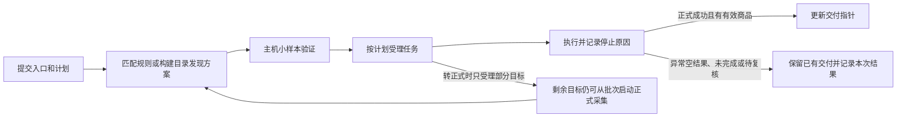
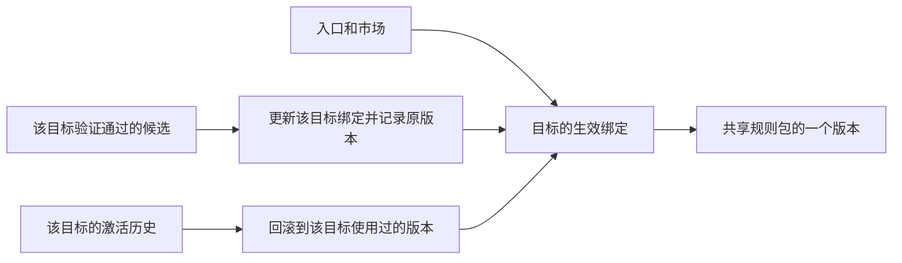
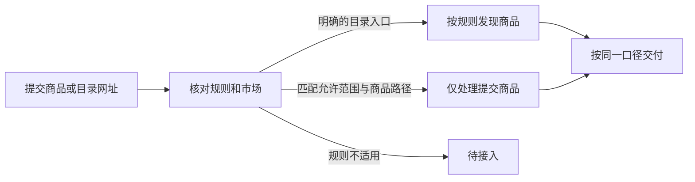
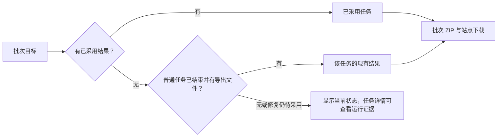
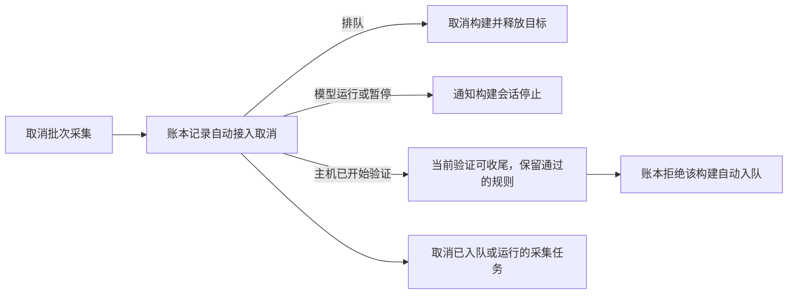
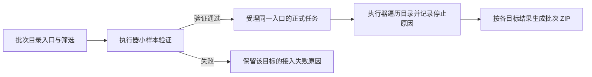
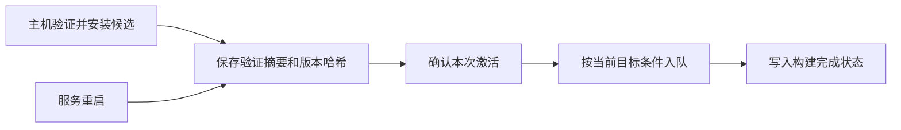
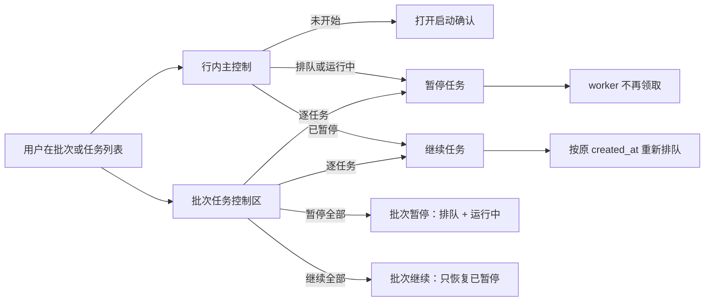

# 批次采集与交付改进计划

操作者交一批网址，确认市场和试采／正式采集计划，回来处理阻塞并导出可用结果。批次是工作入口。站点详情承接单目标处理，任务和构建详情用于证据与排障。规则修复沿用[现有反馈流程](34-规则修复与异常工作流.md)。

## 范围、状态与入口

| 顺序 | 决策 | 验收 |
| --- | --- | --- |
| 1. 保留目标 | 域名用于复用规则和共享请求配额。非根路径及查询组成显式入口。支持从指定入口开始的 `entry_links`、`listing` 和 `html_index`，导航限制在目标路径和查询范围。商品页仍按规则约束，可以位于单独的商品路径。缺适用规则的目标进入待接入。 | 同站不同分类各自保留，重复输入合并。规则与指定入口不符时不能入队。 |
| 2. 保护交付 | 批次站点保存最新任务和已采用结果。正式更新以完整成功的结果替换，用户反馈复跑先保留原交付；用同等计划且已看过结果后显式采用。首次运行仍允许导出明确标注的试采或部分结果。 | 新运行排队、失败、取消、待确认时，批次 ZIP 仍含上一份结果。采用后结果来源和 ZIP 一起切换。刷新或重启后保持一致。 |
| 3. 统一计划 | 批次保存试采／正式选项。试采每目标最多 20 件商品、180 秒，并保留发现预算。正式采集默认不额外设服务层商品数或时长上限，由规则声明范围和目录自然结束；仍保留重试次数、进程／适配器安全超时。整批、勾选和单站启动使用该批次计划；操作员仍可对单次正式运行显式设置上限。旧批次沿用已有请求默认和历史入口。 | 从各入口提交相同目标，任务计划一致。新建后进入新批次。预览由系统更新，异常列表只列一遍。 |
| 4. 就地处理 | 批次清单链接到审批、候选规则和复跑结果。启动时可选择一起接入待采目标。一次最多接入 10 个，每目标按[接入预算](#接入构建预算与样本)执行。验证通过后按批次计划入采集队列。 | 从批次出发可处理接入、复核与复跑，回到同一批次继续交付。 |

布局沿用现有工作台。新建弹窗优先展示批次名称、站点列表、市场、采集计划和系统预览；批次清单优先展示入口、执行和交付状态，异常链接位于对应行。低频元数据可展开。

试采结束后可在原批次开始正式采集，复用同一目标清单。正式运行期间仍可导出标有试采状态的结果，成功后再切换交付结果。

## 技术决策与验证

沿用 [FastAPI、SQLite 与本地 worker](adr/0001-技术栈与运行形态.md)、[现有调度](adr/0004-任务粒度、资源配额与Web界面.md)与 [React v2](adr/0012-前端v2技术栈与设计系统.md)。本计划在[开工检查清单](21-开工前检查清单.md)登记 Provisional 实施范围。目标匹配继续由规则目录和生效账本判断；新增可空字段兼容既有 SQLite 账本和 API 调用。保留旧任务、规则、ZIP 和分享链接，升级前备份账本。若需回退应用版本，使用同一版本的账本备份恢复，避免旧逻辑解释新增目标的含义。

先用临时账本和本地商品夹具复验上述行为，再运行后端全量、前端检查及文档校验。涉及新站自动构建的线上预算和队列行为，使用单独获准的实站／模型演练验证。已实施项及证据记在[交接页](15-交接.md)。

### 本地验收

- 同站两个带查询的入口各自采到对应商品，批次 ZIP 分目录记录各自的入口和任务。规则未覆盖的分类保留为待接入。
- 修复复跑入队后批次可见，失败和待确认阶段继续导出原交付任务。采用后 ZIP 指向复跑任务；同一请求重放仍返回原复跑任务。
- 使用构建适配器夹具验证显式接入授权、主机验证成功后入采集队列。真实模型、真实站点与该额度下的接入产出待单独验证。
- Windows 后端全量双进程 403 项通过。前端 Vitest 150 项通过，类型、lint、格式和生产构建通过。浏览器以临时账本验证自动预览、保存后进入批次、试采 ZIP 与转正式采集。

### 交付正确性续做

1. 正式采集遇到规则的发现保护上限且仍有下一页或未处理来源时，记录 `BUDGET_EXHAUSTED` 与具体上限。已有有效商品则是部分结果，继续保留上一份已采用结果。到最后一页且没有下一页时仍可自然结束。
2. 批次 ZIP 的批次信息、站点任务选择和统计使用同一账本快照。运行中的站点保留状态，批次 ZIP 只打包已结束任务的文件；正在复跑时沿用此前已采用的文件。成功任务缺少商品 CSV 或结果清单时标记缺失。

本地通过正式采集截断、最后一页自然结束、试采结果保留及打包期间任务写入的回归。Windows 后端全量 404 项通过，Chromium 批次冒烟与文档导出复核通过。

显式入口包含 `page_param` 声明的页码时，从该页继续。翻页只改页码，保留入口的筛选值，包括同一筛选键的多个值。其他分页类型仍按入口查询约束处理。

临时账本曾复现域名与分类共用 `rule_id` 时，分类候选受全局单生效版本约束阻塞。修复见下文的[规则复用与市场适用性](#规则复用与市场适用性)。真实模型与真实站点的自动接入仍待走查。

### 正式范围、交付替换与入队

本轮沿用上述 Provisional 实施范围。在批次内新建规则时，规则的发现方案按提交入口的约定范围设计，主机仍小样本验字段。域名入口可使用适用的目录发现源。分类入口的导航须留在提交范围内。只声明入口链接的构建适用于小样本验证，缺少目录发现方案时不直接作为新批次的正式规则。小目录可以用不需翻页的列表表达，验收不设最低商品总量。已有人工核准规则按原适用范围使用。

完成正式复采时，包含有效商品的成功结果可以替换已有交付。零有效商品的结果应保留在任务历史里，首次导出时清楚标为空，已有交付时则保留此前结果。来源确实变为空时，可通过现有反馈复跑验收明确采用新的结果。

批次 ZIP、批次清单中的单目标下载和站点详情使用同一份已采用结果。任务详情保留当前运行和历史任务的下载入口。

试采转正式要跟首次正式任务或接入构建的受理一起写入账本。没有任何可受理对象时保留试采计划。批次已经转正式后，重复提交转正式请求只返回当前状态，避免重复复采。按现有请求授权继续处理同一批次的待接入范围。

批次保存当前采集计划，任务保存入队时使用的计划。一次转正式可能只受理部分目标，例如某个规则文件暂不可用，或服务在逐站入队期间中断。正式批次中仍只关联已结束试采的目标视为待正式采集。规则可用时可从原「启动可采站点」接着入队，已有正式任务的目标只有显式选择重新采集才会再次执行。入队事务核对当前关联任务，防止并发请求替换其他请求刚受理的任务。待正式采集期间批次显示未完成，已有试采结果仍可下载。

用本地构建适配器验证正式接入只在目录发现方案通过主机验证后入队。用本地商品夹具验证复采全排除仍保留原交付，及试采无可入队对象时保持试采、受理后重复请求不增建任务。保留原任务和文件供回查。应用回退时使用升级前的账本备份。

本地验收已覆盖上述路径。Windows 后端全量 407 项通过，React v2 的 150 项测试、类型检查、lint、格式和构建通过。Chromium 真实页面验证了站点下载、批次 ZIP、刷新后状态及试采转正式。旧自动接入构建若只有入口链接，正式启动会提示补齐发现范围。

续跑回归使用两个分类入口。暂移一个规则文件，转正式时只受理另一个入口。恢复规则后，原启动入口只补跑遗漏目标，正式结果采用前仍可下载试采结果。过期请求不能替换已入队的任务，即使该任务已结束。Windows 双进程全量 416 项、前端 151 项和 Chromium 冒烟通过。

### 规则复用与市场适用性

在[规则账本实施范围](21-开工前检查清单.md)内沿用 SQLite 指针和激活记录。新批次按同一入口和市场复用规则绑定，首页也区分已指定的市场。域名继续用于共享请求配额。历史目标键、任务、交付和链接继续可用。新目标可继承经过匹配的旧规则，以自己的绑定记录使用当时的版本。

候选按来源目标显示和激活。激活只移动该目标的绑定，其他使用方保留原版本。旧版本仍被使用时保持 `active`，最后一个绑定离开时变为 `superseded`。默认回滚取当前目标最近一次替换掉的版本，包含仍被其他目标使用的版本。跨目标发布需要分别验证各自范围，现有页面沿用逐目标激活。

旧库启动时移除规则包全局的单版本索引。应用降级时使用升级前的账本备份，旧索引无法表达同一规则包多个版本分别生效。本地回归验证了候选隔离、独立激活与回滚、FR／US 首页入队并共享域名配额键、既有目标链接和历史任务版本。

Windows 后端串行全量 409 项通过。双进程两分片用例通过，运行器仍报告退出时有临时资源，采用串行结果作为本轮全量验收证据。前端 150 项及 Chromium 批次冒烟通过。

### 商品直采与批次操作

用户可以将商品网址与分类网址一起提交。目录规则明确声明的列表入口继续按列表执行。规则的商品路径和允许范围能匹配提交网址时，执行器只处理该商品，使用原规则的字段验收和导出。陌生网址沿用原接入流程，构建识别为商品页时，主机只用该页验证。不能验证的目标继续显示待接入，无需用户预先判型。

批次清单通过站点链接打开详情。行菜单只保留启动、控制和导出等动作。整批启动只处理未开始目标。整批复采、所选目标启动和试采转正式由各自入口确定范围，确认框展示数量和接入成本。计划沿用现有入口、SQLite 和执行器，回退应用时沿用此前备份。用同批商品与分类夹具验证范围、查询参数和 ZIP，并通过浏览器检查入口和入队。

本地验收覆盖同批商品与目录、保留变体查询、未知商品目标的小样本主机验证及正式任务入队。Windows 双进程后端全量 411 项、前端 150 项和 Chromium 批次冒烟通过。

### 站点与批次的导出口径

操作者从站点或批次下载同一个目标时，应拿到同一份交付结果。批次 ZIP 已排除尚未采用的修复复跑，但站点按钮在没有旧交付时会退回当前任务，提供了批次 ZIP 中没有的文件。

沿用现有结果指针、任务 ZIP、批次快照和 React v2 入口。站点读取后端提供的可导出任务编号，普通首跑的部分结果可按现有约定导出。未结束的任务和待采用的修复留在任务详情。验收覆盖首跑未结束、普通部分结果、首次修复待采用、已有交付后复跑，以及采用后版本同步切换。新增字段随应用版本回退，账本结构沿用现有设计。

批次清单为每个站点记录 `delivery_task_id`、`delivery_source`、`rule_id`、`rule_version`、`rule_sha256` 和 `finished_at`；`delivery_source` 用 `adopted` 表示显式采用的反馈复跑，`current` 表示普通当前结果（含正常完成后写入的交付指针）。同名列同步写入 `sites.csv`，使 ZIP 内的任务选择、规则版本和结果时效可核对。

本地回归验证了首跑采集中、已有交付的复跑，以及首次修复采用前后的版本。后端双进程全量 412 项、前端 150 项通过。Chromium 冒烟核对了采用结果的站点下载地址和批次 ZIP 内容。

2026-11-28 在正式账本副本上做了一次真实站点复核：bennytex、bubutissus、gaspardetleonie 三个 FR 目标按试采计划各采 20 件，合计 60 件有效、0 失败，任务规则版本和站点生效版本一致；bennytex 的历史反馈创建真实复跑 3 件有效、0 失败，采用后批次交付指针与 ZIP 切换到复跑任务。正式账本未改动，未调用模型。证据在仓库外 `workbench/real-site-batch-20261128/`。

### 取消批次采集

从同一批次取消采集，覆盖未结束的采集任务和该批次启动的自动接入。单独发起的规则构建或修复沿用各自的取消入口。已经采用的交付和原任务记录继续可查。取消后可从原批次重新启动。

以 SQLite 写事务作为构建取消与自动入队的顺序依据。入队先提交则按已有任务取消，取消先提交则拒绝自动入队。保留启动、任务控制、构建队列与已有预算。取消排队项时释放站点；运行中的会话继续显示真实状态。已开始的主机验证可在原预算内完成，取消后不再追加模型修复轮次。重启时取消尚未结束的接入，读取历史记录。回退到旧版本前先等相关构建结束。

验收覆盖构建排队和运行、验证开始前和验证中取消、采集已入队、重复取消、保留已交付结果和隔离单独发起的构建。真实模型与实站接入继续按现有试点预算验收。

Windows 双进程后端全量 415 项及前端 150 项通过。Chromium 在临时账本的批次详情中启动自动接入，再取消并等待目标恢复为待接入。

### 用户流程走查

2026-11-26 用 Chromium 156、独立账本和合成店铺，从工作台页面完成登录、刷新、新建批次、试采、转正式、补跑和下载。提交两个分类入口、一个带变体参数的商品链接、一个重复项和一个无效项。系统受理三个有效目标，ZIP 内各有一条商品，来源、英镑价格以及单品实际请求的变体参数符合预期。

转正式前暂移一个规则文件。批次受理两个目标并显示被跳过的原因，刷新后仍可筛出唯一待正式采集目标。此时 ZIP 的清单标明两份正式结果和一份试采结果。规则恢复后，从原启动入口只补跑一个目标，第二次下载得到三份正式结果。

陌生店铺通过页面发起接入。测试适配器提供固定规则，实际主机验证通过，worker 自动采集两件商品，工作台可下载 ZIP。现有 Chromium 冒烟也复验了从批次取消自动接入。真实模型、公开站点和常驻账本的登录后操作仍待验收。

| 发现 | 对用户的影响 |
| --- | --- |
| 服务默认代理覆盖任务中已记录的站点代理。将两个测试店铺分配给不同出口时，陌生店的规则验证成功，随后自动采集因走错出口而失败。两个出口都可达目标时，同一流程通过。 | 依赖指定出口的站点可能出现接入成功、正式结果为空的情况。 |
| 转正式后有遗漏目标时，整批 ZIP 移到「更多」。同一行显示「待正式采集」和旧任务的「完成」。 | 用户要额外寻找下载入口，也容易把旧试采的完成状态理解为正式采集已完成。 |

可复跑脚本、截图和四份测试 ZIP 位于仓库外证据目录 `workbench/core-user-walkthrough-2026-11-26/`。

### 指定出口与正式补跑交付

构建验收与采集使用同一个已选出口。任务入队时记录站点或本次指定的代理，worker 先用该值，未指定时回退到服务默认代理。批次同时有待处理目标和可下载结果时，页头并列提供启动与下载。待正式采集的行在旧任务徽标加上「试采」，保留任务历史链接。

在默认代理只能访问已接入店铺、站点代理只能访问陌生店铺的条件下复跑，陌生店铺实际验证、自动采集并导出两件商品。试采转正式遗漏一项时，页头仍可直接下载混合 ZIP，补跑后 ZIP 包含完整的正式交付。后端全量 417 项、前端 152 项通过，常驻 8765 重启并加载新构建。测试证据位于仓库外 `workbench/proxy-and-delivery-fix-2026-11-26/`。

### 接入构建预算与样本

在「模型配置 → 批次接入预算」调整每目标的模型会话时限、累计输入和累计输出 token。保存后新提交的接入采用页面设置。恢复默认时，读取服务启动时的 `ECOM_BUILD_MAX_TOTAL_SECONDS`、`ECOM_BUILD_MAX_INPUT_TOKENS` 和 `ECOM_BUILD_MAX_OUTPUT_TOKENS`，未配置时采用 15 分钟、40 万输入和 8 万输出（含推理）。已受理的构建按入队预算执行。独立构建与修复沿用各自参数。主机验证仍使用验证阶段的超时。

沿用现有设置表、构建队列和 React 配置页。验收核对保存、恢复、重新打开服务后的读取、只读保护及已排队记录的预算。

构建简报先让 Agent 获取并判型提交网址。单商品使用原地址和一份样本，复用静态响应核对选择器、字段及币种。目录任务仍需识别范围和实际分页。Agent 记录规则、简短说明和视觉样本，主机负责受控验证及决定是否启动采集。

### 真实模型单商品交付

2026-11-26 从 Chromium 登录独立账本，提交 Atelier Léonie 的 Herby Hopper 商品链接和 FR 市场。从批次发起自动接入，使用实际 OpenCode 2.4.2 和模型池中的 CommandCode DeepSeek V4.1 Flash。三个结果为同一商品的复验，模型运行使用当前主机账号。

| 构建 | 档位与简报 | 用时 | 输入／输出含推理 | 结果 |
| --- | --- | ---: | ---: | --- |
| `build-8ba82655dc6e` | high，原简报 | 378 秒 | 128,711／30,655 | 达到原 30,000 输出上限，未入队 |
| `build-bcde33712d80` | low，原简报 | 336 秒 | 103,461／23,165 | 主机验证 6 件通过，但任务采入 8 件相关商品，单商品验收失败 |
| `build-482e1ce967a4` | low，新简报 | 140 秒 | 106,047／14,282 | 只验原链接 1 件，通过后自动采集 1 件，ZIP 标为正式交付 |

从下载的 CSV 对照原页面，商品来源与币种一致，公开购买单位价为 0.35 EUR／厘米，标题另显示 35 EUR／米。首次验收脚本误把每米参考价当成购买单位价，已用保存页面和同一份 ZIP 重新核验。证据保存在仓库外 `workbench/real-model-formal-workflow-focused-2026-11-26/`。这三次是单商品复验，目录和批量接入仍需单独验证。

### 目录接入范围与批次验收

接入后，主机验证和采集都用批次提交的目录入口、筛选和分页起点。复用现有执行器的入口约束，主机按原小样本预算检查字段，正式任务记录实际范围和停止原因。验证样本上限、目录自然结束和正式任务触及上限分别按样本数、运行停止原因判定。小目录自然结束时允许少于样本上限。沿用当前规则包、账本和页面入口，回退代码版本即可恢复此前行为。

本地验收从带两个品牌筛选的第 2 页接入，在主机请求中核对第 3 页和两个筛选值，并确认只创建一个正式任务。实站沿用现有 OpenCode 模型池和独立账本，从页面一次启动多个目标。以原目录后续页的商品网址和独立商品链接为抽检依据，核对正式 ZIP 的范围、币种和任务来源。若某目标失败，核对失败原因和其他结果是否仍可导出。

本地回归中，修复前主机在第 2 页取得 1 件后结束，修复后访问第 3 页并保留两项筛选，取得 2 件，自动入队一个正式任务。原有正式分页回归继续验证触及上限时标记部分结果并保留旧交付。

2026-11-26 从 Chromium 提交 Tognar 的滑雪蜡分类和一个独立商品链接，在新账本使用 OpenCode 的 `commandcode/deepseek/deepseek-v4.1-flash#low`。目录直连基线为 14 页、158 个唯一商品网址。候选目录规则和正式采集结果按同一份基线核对。

| 目录构建 | 用时／工具调用 | 正式交付 |
| --- | --- | --- |
| `build-32331ea33228`，原简报 | 562 秒／85 次 | 枚举 14 个分页入口。宽泛商品路径使主机将分类页当商品处理，验证无有效样本，自动修复后仍失败。目录待接入，同批单品完成，ZIP 保留 1 件 USD 商品。 |
| `build-e445ccd9353c`，单入口分页简报 | 258 秒／40 次 | 主机通过 6 件样本。按页码采到 158 件，和基线逐网址一致，随后请求第 15 页得到 404，目录标为部分结果。单品正式交付 1 件。 |
| `build-b35d590bfed3`，优先下一页链接 | 207 秒／38 次 | 回到原批次只补目录。主机通过 6 件样本，正式采集 237 秒，在第 14 页自然结束。目录 ZIP 158 件，146 件来自后续页，逐网址与基线相符。单品继续使用原来的正式任务，两个目标各有一个正式任务，均为 USD。 |

简报优先采用网站提供的下一页链接。编号链接同样可以用 `next_link`，末页无需尝试超范围页码。缺少下一页链接的编号分页使用 `page_param`。验证阶段只检查入口、一个后续页和代表商品，正式任务按所声明的范围运行。运行证据在仓库外 `workbench/real-model-mixed-catalog-2026-11-26/`。

最后一次目录构建使用 135,042 输入和 18,521 输出 token（含推理），低于入队限额。正式采集执行 14 个导航工作项、158 个商品工作项和一次 robots 的 Sitemap 行探测，0 失败。导出中原覆盖说明按来源数量把单来源目录写成单页试采，已改为按规则发现到的候选解释覆盖计数，并复用本地分页回归核对。实站 ZIP 保存的是修正该说明之前的原始输出。

### 简报与采集 Skill 去重复验

同一模型档位与预算下，从 Chromium 在新账本一次接入 Tognar 目录和单品。目录 `build-9ab74a3ea514` 通过 6 件主机样本，正式采集在第 14 页自然结束，ZIP 中 158 件逐网址匹配基线。单品 `build-27d430152cdc` 只采原链接 1 件。两个目标各有一个正式任务，均为 USD。

实测版目录简报与工作区规则由 19,668 字符降至 15,965 字符。和上一条成功的目录构建相比，本次输入由 135,042 降至 112,134 token，工具调用由 38 增至 43 次，构建耗时由 207 增至 333 秒。单次对照支持输入减少，耗时表现需要更多样本。单品构建耗时 159 秒，30 次工具调用。最后的启动指令、预算说明和 Shopify 适用范围措辞经本地回归核对。真实运行输入和 ZIP 证据在仓库外 `workbench/brief-skill-alignment-2026-11-26/`。[维护入口](37-构建Agent-Harness集成与使用说明.md#构建指导维护注意事项)

浏览器已下载 ZIP，业务断言及账本任务数通过。隔离脚本在收尾时报告 OpenCode 临时文件残留，ZIP 完整性另行复核。

### 批次中断与交付恢复

沿用当前批次入口、SQLite 账本和构建恢复机制。主机验证及规则安装完成后，把验证摘要和版本哈希写入构建账本，再激活和入队。重启遇到这份记录时，按同一个构建编号继续处理。激活依据同一个请求编号，入队检查目标规则、当前任务和取消记录。规则文件缺失或哈希不符时，在构建记录中显示失败原因。

验收在真实 SQLite 和隔离输出目录中执行。分别模拟激活后、入队后的中断，检查激活记录和正式任务各只有一条。正在复采、取消或预算截断时，站点与批次继续下载上一次采用的交付。把停写后的账本、规则和输出复制到新的空目录，核对重新导出的任务编号和 CSV。回退应用时沿用原版本的备份，回退前等待在途验证收尾。

2026-11-26 本地复验。两处中断在修复前均被标为构建中断，修复后重启收尾成功，保留原激活记录，自动创建或沿用唯一正式任务，未再次调用模型或运行主机验证。混合批次先完成试采，再遇到正式分页预算截断和取消复采。还原账本、规则和输出后，只读服务的站点 ZIP 与批次 ZIP 都保留原试采 CSV，逐字节一致，规则文件与账本哈希一致。操作步骤见仓库 `app/README.md` 的“备份与恢复批次交付”。

另用常驻账本的备份，在空目录还原批次 `b-5ad551c1778f` 及已采用任务 `web-687a85f9f897` 所需的规则和结果。Chromium 156 登录只读副本，从批次和站点分别下载 ZIP，两份 CSV 均与原文件逐字节一致（14,326 字节）。证据在仓库外 `workbench/batch-recovery-2026-11-26/`。

以后改动构建收尾时，从三个持久化点检查重放：验证摘要、规则激活、采集任务关联。导出核对采用任务编号和文件内容；ZIP 生成时间随下载变化。实站和 OpenCode 中断演练另行记录，本轮故障注入使用合成规则和隔离账本。

### 双槽位采集验收计划

单 worker 对照已完成。应用默认使用 1 个任务槽位和 1 个浏览器槽位。验收关注多目标的整批等待、同域限速、任务隔离和交付正确。构建队列保持现行单槽位，对照使用已接入目标。

1. 让 `stealth` 与 `browser`、`hybrid` 使用同一浏览器配额。回归覆盖默认引擎和按 URL 类型覆盖引擎，核对并行时槽位占用与释放。保持现有同域限速器。
2. 使用隔离账本，固定两个同域目录和一个异域目标、规则版本、采集范围、出口、速率及浏览器槽位。先用本地夹具，再从现有基准站按预算抽取代表目标。对照 `--max-tasks 1 --max-browser-tasks 1` 和 `--max-tasks 2 --max-browser-tasks 1`。各轮使用独立任务和产物，保留所有结果；实站按预算重复，记录测量波动。
3. 通过批次工作台启动并记录整批完成时间、各目标排队与运行时长、同域合计请求速率、失败及重试、浏览器峰值和导出内存峰值。核对同域速率遵守配置，浏览器资源符合槽位约束，ZIP 的任务编号和商品归属一致。
4. 另跑一轮，在两个任务实际运行时暂停或取消其中一个，再检查另一个能独立完成，晚到的结果不会覆盖终态，已有交付仍可下载。沿用 [A20 验收口径](05-验收场景与比较方法.md#必须覆盖的场景)。

双槽位在代表性批次中有可重复的收益，并通过限速、资源、操作隔离和导出验收后，再为使用者提供该配置，默认仍可回到单槽位。先验证单进程内并行；独立 worker 进程的合计限速另有约束，容量结论限于本轮测过的组合。设置入口与生效方式见[采集运行参数提案](42-系统设置页设计.md#采集运行参数提案)。

#### 2026-11-26 对照结果

连续四轮按 1、2、2、1 槽运行，使用真实批次 API、独立 SQLite 账本、一个托管 worker、一个浏览器槽和每域每秒一次的请求调度。每轮核对同时运行任务峰值与配置相符。对照都使用静态规则，实际浏览器占用为 0。浏览器与 `stealth` 的配额判断和槽位占用／释放通过本地回归。以下时间从启动请求到全部站点进入终态，导出峰值为 Python 分配量，包括测试客户端接收 ZIP。

| 范围 | 1 槽用时 | 2 槽用时 | 导出核对 |
| --- | --- | --- | --- |
| 本地夹具：同域两目录和异域目录 | 8.57、8.62 秒 | 5.58、7.60 秒 | 每轮同域 6 请求、异域 3 请求，三份 CSV 网址一致，导出峰值约 0.66–0.80 MiB |
| 实站：Ma Petite Mercerie 同分类的两个起始页，Ecolaines 分类 | 29.46、27.37 秒 | 20.66、14.57 秒 | 每轮同域 7 请求、异域 4 请求，三个目标各交付 1 件，网址逐目标一致，导出峰值约 0.52–0.54 MiB |

实站四轮同域限速器放行间隔最短约 1 秒。另一次本地双槽运行通过 API 取消其中一项，另外两项独立完成，ZIP 没有被取消项的商品。已采用交付保护及迟到结果拒收分别由[恢复回归](#批次中断与交付恢复)与 A20 回归覆盖。实站首两轮选用 Touchatou、Familidoo 作为异域目标时遇到连接或传输超时，未获得完整对照，均保留日志。上述结果支持在设置页开放双槽选项，默认继续用单槽。证据保存在仓库外 `workbench/batch-capacity-2026-11-26/`，实站入口和预算见[基准站复核](12-验收基准站点.md#2026-11-26-单-worker-双槽位采集复核)。

### 单任务控制与排队暂停

批次页原来只有整批启动、暂停和取消，单任务控制藏在批次站点行和任务列表的「⋯」菜单里；批次暂停还会跳过排队任务，worker 继续领取后续任务。本轮把主控制提到行上，并在批次详情增加任务控制区，同时让排队任务可以直接暂停。

排队任务暂停直接进入 `PAUSED`，不经过 `PAUSING`；运行中任务仍在在途结清后进入 `PAUSED`。暂停和 worker 领取在同一 SQLite 写事务里按当前状态判断，先提交的一方生效。批次暂停逐任务受理，批次继续只恢复 `PAUSED`，`PAUSING` 等待自行结清；新增 `POST /api/batches/{batch_id}/resume` 返回与暂停相同的受理和跳过结构。

界面上，批次站点清单和任务列表的操作列改为「主控制按钮 + ⋯」；批次详情在摘要和站点清单之间列出活动任务，逐任务暂停、继续、取消，并提供整批暂停和继续。取消、导出、归档和重新采集仍在菜单，取消保留二次确认。设计见[单任务控制与排队暂停设计](47-单任务控制与排队暂停设计.md)，决策见 [ADR 0023](adr/0023-单任务控制与排队暂停.md)。

验收覆盖 `QUEUED` 暂停到 `PAUSED`、暂停后 worker 不领取、恢复按原队列位置重新排队、运行中暂停仍经过 `PAUSING`、批次暂停包含排队、批次继续只恢复已暂停、行内按钮和任务控制区的浏览器走查。数据库结构和任务状态枚举不变，回退不需要迁移；派生批次状态「已暂停」、强制中止在途和优先级队列不在本轮范围。

2026-11-27 本地验收：后端完整回归 435 项、`ruff` 通过；前端 175 项、`lint`、`typecheck`、`format:check` 和 `build` 通过。临时账本副本在 1280／390 验证了行内启动／继续、逐任务继续、排队暂停、批次继续（受理 1 个、跳过 1 个已结束）和批次暂停（受理 1 个、跳过 1 个已结束），任务列表验证了行内继续和排队暂停；窄屏无页面级横向溢出。真实 8765 已用原账本和原命令重启并加载新构建，登录页和静态资源正常，登录后的控制待项目方验收。证据在仓库外 `workbench/task-control-2026-11-27/`。
