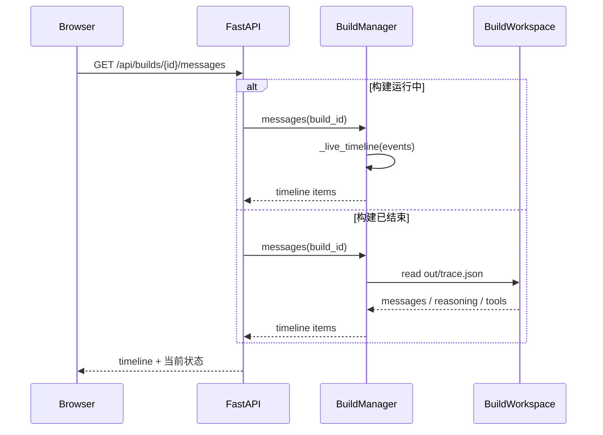
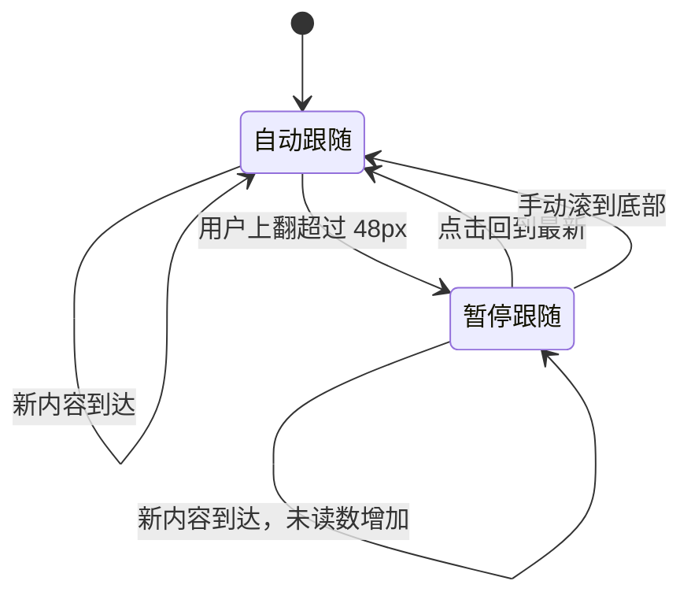

## 用途与边界

本页只定义一个改动：替换构建详情现有的时间线组件，让技术操作者能看到更完整的采集 Agent 工作细节。**不新增独立会话页、路由、输入框、左侧会话列表或「对话／轨迹」标签**；构建详情的页头、运行状态、验证证据、修复轮次、审批和导出入口保持不变。

目标：

- 思考、工具调用、助手文本按时间组织，连续工具合并为可折叠活动组。
- 工具行能看名称、目标、状态、耗时，展开看脱敏后的入参和输出。
- 思考默认可折叠，流式中展开，结束后收起。
- 自动跟随最新；用户上翻后显示「回到最新」，不抢滚动位置。
- 结束后在时间线末尾显示紧凑的工作摘要。

非目标：

- 不做聊天式会话页、底部输入框、模型选择、轨迹表和左侧列表；这些只出现在原型里，用于比较风格。
- 不改变构建状态机、审批、验证、规则安装和导出契约。
- 除 Markdown 渲染外不新增前端依赖；Markdown 使用 `react-markdown` + `remark-gfm`，默认不渲染 raw HTML。不引入 diff 库或第二套 UI 框架。

视觉参考：

- 主参考 OpenCode `packages/session-ui/src/timeline-next`（MIT）：转录式紧凑行、活动组、展开内容缩进 14px、状态行在末尾。
- 次参考项目方启动的 DeepSeek Harness WebUI：更活泼的间距和完成摘要，但不落地其画布、输入卡和会话列表。

## 已确认决策

| 决策 | 结论 | 说明 |
| --- | --- | --- |
| 范围 | 只替换时间线组件 | 其他构建详情区域不动 |
| 布局 | 保留现有构建详情和四视图 | 时间线仍在「日志与 Trace」视图内 |
| 风格 | OpenCode 简约时间线 | DSH 只作风格参考，不新增其框架 |
| 数据 | 沿用 `/api/builds/{id}/messages` 的 `timeline` | 必要时扩展现有 item 字段，不新增 API |
| 审批 | 继续用现有审批区 | 不把审批搬进时间线 |

## 现状与问题

| 现状 | 问题 |
| --- | --- |
| `BuildTimeline.tsx` 只有 text／reasoning／tool 三类，扁平列表 | 连续工具调用不分组，长会话变成一长串卡片 |
| `_live_timeline` 只消费 `message_delta`、`reasoning`、`tool_started`、`tool_finished` | 实时工具行没有入参／输出，结束后才从 trace 补 |
| `_trace_timeline` 有工具输入／输出，但前端用大卡片逐个展示 | 细节有，但层级重、扫读成本高 |
| 时间线卡片带图标圆点、边框和块标题 | 与成熟 Agent 时间线的紧凑行差距大 |
| 自动跟随只在 `messages` 变化时滚到底 | 用户上翻后没有「新内容」提示，展开历史块容易跳走 |

真正的限制是“展示形态”和“实时数据完整度”两件事：历史构建的 trace 已经足够做完整时间线；运行中要看到工具入参／输出，需要补一点后端事件字段。

## 目标结构

时间线仍在构建详情的「日志与 Trace」视图内，面板结构保持：

| 区域 | 内容 |
| --- | --- |
| 面板头 | 「构建时间线」、实时／轮询徽标、回到最新、trace 下载入口（沿用现有） |
| 时间线滚动区 | 指令、思考、工具活动组、助手文本、通知、末尾状态行 |
| 面板尾 | 思考保留说明、截断说明、流错误（沿用现有） |

不做新的页面容器；只替换滚动区内容和显示语法。

## 数据契约

首期沿用现有 `BuildMessages.timeline`，不新增 API。现有 item：

```ts
interface BuildTimelineItem {
  kind: "text" | "reasoning" | "tool";
  created_at: string | null;
  role?: string;
  text?: string;
  name?: string;
  status?: string;
  input?: unknown;
  output?: string | null;
  duration_ms?: number | null;
}
```

可选扩展（只在后端已有数据时补，不强行造）：

- `call_id?: string`：工具完成事件按 ID 配对，避免并行时错配。
- `exit?: number | null`、`truncated?: boolean`：shell 结束状态和输出截断标记。
- `completed_at?: string | null`：工具耗时和排序。

约束：

- 工具输入输出继续走 `trace.py` 的 `_redact`、`_tool_output`、`_looks_like_html` 和截断；前端只展示，不重新拼接原始 HTML。
- 工具输入里的 `content`／`newString`／`oldString` 只显示字符数，不显示正文；需要看全文时走 trace。
- 思考仍受 `ECOM_BUILD_CAPTURE_REASONING`／`ECOM_BUILD_PERSIST_REASONING` 控制；未开启时显示说明，不伪造。
- 首期最多展示现有 200 条；完整内容仍以 trace 下载为准。

## 数据来源

| 构建状态 | 来源 | 说明 |
| --- | --- | --- |
| 运行中 | `_live_timeline` 的事件流 | 保留现有 SSE；工具行可先显示名称、状态、耗时 |
| 已结束 | `trace.json` 的 messages／reasoning／tools | 现有的完整输入输出；无需新接口 |
| 运行中要看工具入参 | 事件 `session.tool.called` 的 `input` | 小范围补后端 summary；不新增轮询 |
| 运行中要看工具输出 | `session.tool.success` 的可用字段 | 字段缺失时显示“结束后可查看完整输出” |

首期建议先做前端显示语法；后端实时工具输入输出作为第二步，不阻塞组件迁移。



## 视觉语法

采用 OpenCode 的转录式紧凑行：

- 助手文本：14px／24px 普通段落，不套卡片；代码块用浅色面板和 mono。
- 指令／用户消息：右侧或强调块，最多 82%／64ch；构建 Agent 的 brief、修复指令都按这个处理。
- 思考：28px 行，16px 图标 + 「思考」+ 状态／耗时；展开正文 13px／20px，muted，缩进 14px + 1px 竖线。
- 工具活动组：28px 行，16px 图标 + 「工具活动」+ 工具名摘要 + 状态／次数；展开后嵌套工具行。
- 工具行：28px 行，固定四列对齐（16px 图标／36px 动词／弹性目标／右对齐状态与耗时）；活动组标题列稍宽以容纳「工具活动」。目标截断，耗时使用等宽数字。展开看入参／输出。
- 状态不用胶囊标签：成功用绿色勾、失败用红色叉、运行中用 spinner；颜色只作辅助，图标带 `sr-only` 文案，不以颜色作为唯一信息。
- 通知：紧凑 tinted 行，不做大卡片。
- 末尾状态行：13px muted + spinner／耗时；结束后显示「已完成，用时 …」和工作摘要。
- 字体：行标题 13px／16px、530；主体 13px／16px、440；助手正文 14px／24px；代码 11–12px mono。

工具分级：

- `line`：shell、webfetch、grep、glob、read 等，显示“动词 + 目标 + 状态 + 耗时”。
- `file`：write、edit、patch，显示文件路径、变更字符数和状态；首期不画 diff。
- `event`：后台 shell、子代理任务等，显示事件标题和状态；首期只做通用行。

## 交互规则

### 自动跟随



- 进入日志视图或切换构建时，滚到底部并开启跟随。
- 用户上翻超过 48px 视为暂停跟随；显示「回到最新（N）」。
- 新内容到达时，跟随状态滚到底；暂停状态只增加未读数，不抢滚动位置。
- 展开历史活动块时，如果不在底部，暂停跟随；展开底部当前块时保持跟随。
- `prefers-reduced-motion: reduce` 时使用即时滚动。

### 折叠与展开

| 块 | 默认 | 交互 |
| --- | --- | --- |
| 思考 | 流式中展开，结束后折叠 | 点击整行切换；显示状态、耗时或字数 |
| 活动组 | 当前组展开，历史组折叠 | 组头显示工具数、状态、总耗时 |
| 工具行 | 摘要常驻，详情折叠 | 失败时自动展开输出；运行中显示 spinner |
| 助手文本 | 常驻 | 超过约 1,200 字符时折叠，显示「展开全文」 |
| 指令 | 常驻或折叠 | 构建 brief、修复指令可折叠，避免首屏被长文占满 |

折叠状态按构建 ID + 行 ID 存在 `sessionStorage`，刷新保留；首期不写账本。

### 无障碍

- 时间线容器 `role="log"`，但不设置 `aria-live="polite"`；当前活动用单独 `role="status"` 行。
- 活动组、思考、工具详情使用按钮／`<details>`，带 `aria-expanded` 和 `aria-controls`。
- 新内容不抢焦点；「回到最新」可用键盘到达。
- 折叠标题保留可访问名称，不只用图标。
- 窄屏下工具元数据换行，代码块在自身容器内横向滚动，不让页面横向溢出。

## 验收矩阵

| 场景 | 预期 |
| --- | --- |
| 运行中文本流 | 2 秒内出现新文本；跟随开启时滚到底；上翻后不抢位置并显示未读数 |
| 思考流式 | 展开显示增量；结束后可折叠；未开启时显示说明 |
| 工具运行 → 成功 | 行内状态从 running 变 success，耗时出现；详情可展开输入／输出 |
| 工具失败 | 自动展开错误输出；状态和颜色可区分；不丢失后续文本 |
| 连续工具 | 合并为一个活动组；组头显示数量和总耗时；历史组默认折叠 |
| 助手文本 | 普通段落，无卡片；代码块在自身容器内滚动 |
| 指令／修复 brief | 作为紧凑指令块显示；长文可折叠，不占满首屏 |
| 结束后打开 | 从 trace 生成相同结构的行；无 trace 时回退并说明；不轮询 |
| live → finished | 滚动位置和折叠状态保留；行 ID 不跳变 |
| 长输出 | 详情内部滚动，显示截断标记；页面无横向溢出 |
| 1280／768／390／320 | 工具元数据换行；回到最新可达；无页面级横向溢出 |
| 键盘 | Tab 可达活动组、思考、工具详情和回到最新；焦点不被新内容抢走 |
| 旧视图 | 构建详情四视图、审批、验证和导出不受影响 |

## 实施切片

1. **前端时间线**（首要）：重写 `BuildTimeline.tsx`，新增纯投影 `buildTimeline.ts`（分组、工具摘要、状态行），补组件测试；保留现有 props 和 API。
2. **样式收口**：紧凑行、活动组、工具详情、思考、指令块、末尾状态行；1280／390 走查；axe 与键盘。
3. **实时数据增强**（可选）：`events.py` 为 `session.tool.called` 补脱敏 input，为 `session.tool.success` 补可用 output；`_live_timeline` 配对 call_id；补后端测试。字段缺失时前端降级，不阻塞切片 1。
4. **文档**：更新 `docs/41` 的时间线说明、`docs/15` 交接和前端待办；旧 `/messages` 与四视图保持不变。

估算：只做前端时间线约 2–4 天（含测试、样式和 390 走查）；实时工具入参／输出再加约 1–2 天。相比新增独立会话页，改动面小很多。

## 风险与回退

| 风险 | 处理 |
| --- | --- |
| 实时工具没有 input/output | 前端显示“结束后可查看完整输出”；第二步再补事件字段 |
| trace 截断 | 保留 trace 下载；界面显示截断标记，不假装完整 |
| 长会话性能 | 首期最多 200 条；按行 ID memo；后续再评估虚拟滚动 |
| 折叠状态错乱 | 行 ID 稳定；live → trace 切换测试 |
| 视觉与现有四视图冲突 | 只替换滚动区；面板头、审批区和导出保持 |
| 回退 | 保留旧 `BuildTimeline` 一个版本；新组件异常时切回旧渲染；不改账本 |

## 实现记录（2026-11-26）

- `BuildTimeline` 已替换为转录式紧凑时间线：思考、工具活动组、工具行、助手文本和末尾状态行；旧的面板头、四视图、审批、验证和 trace 入口保持不变。
- 新增 `buildTimelineModel.ts`：连续工具分组、工具主语提取、工具动词和时长格式化；新增对应单测。
- 工具组默认只展开“有运行中工具”的组；历史大组（例如 76 次调用）默认折叠，组头显示次数、耗时和失败状态。
- 工具行改为固定列网格：图标／36px 动词／目标／右侧状态与耗时；动词与路径间距收紧。成功、失败和运行中不再使用胶囊标签，改为行内勾／叉／spinner + 颜色，耗时右对齐并使用等宽数字。
- 工具行展开显示脱敏后的入参／输出；失败工具默认展开；实时缺少入参／输出时显示“结束后可查看完整入参和输出”。
- 助手文本为普通段落，代码块在自身容器内滚动；用户／修复指令用右侧强调块；思考在实时构建中展开、结束后折叠。
- 助手文本和指令支持 Markdown：段落、列表、行内代码、围栏代码块、表格和链接；raw HTML 不渲染。使用 `react-markdown` + `remark-gfm`，时间线相关分块约 186 KB（gzip 56 KB），仍按路由懒加载；默认批次页不受影响。
- 自动跟随保留；上翻后显示「回到最新」，不抢滚动位置。
- 验证：前端 163 项测试、lint、typecheck、format 和 build 通过；真实构建 `build-fc66334cd8a2` 在 8765 的「日志与 Trace」已加载新时间线，76 次工具组默认折叠，Markdown 列表和行内代码正常渲染，完成状态显示「验证通过」。
- 未做：运行中工具入参／输出的后端事件增强；独立会话页、输入框、对话／轨迹标签和左侧会话列表仍只在原型中参考，不进入实现。

## 参考与许可

- OpenCode `packages/session-ui/src/timeline-next`、`timeline/`、`components/basic-tool.css`，仓库 `anomalyco/opencode`（MIT，`dev` 分支）。参考紧凑行、活动组、嵌套轨道和状态行；如移植纯 TS 逻辑，保留版权声明并新增 `THIRD_PARTY_NOTICES`。
- 项目方启动的 DeepSeek Harness WebUI：参考完成摘要和间距，不引入其画布、输入卡或会话列表。
- 现有实现：`app/frontend/src/features/sites/BuildTimeline.tsx`、`app/src/ecom_crawler/builds.py`、`app/src/ecom_crawler/harness/events.py`、`app/src/ecom_crawler/harness/trace.py`。
