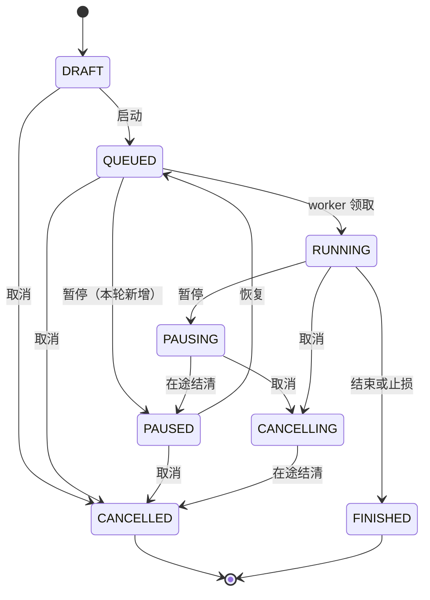
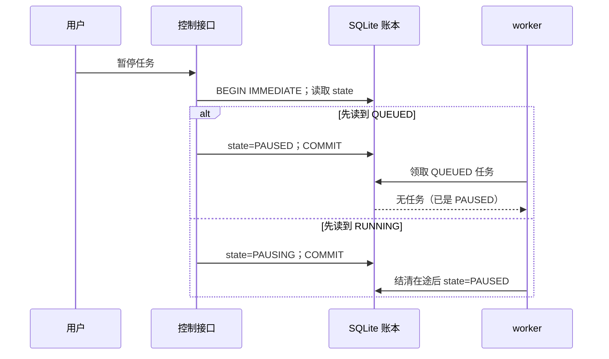

# 单任务控制与排队暂停设计

## 用途与边界

本页解决批次和任务页面“看得到批次操作、找不到单任务操作”的问题，并补齐排队任务不能暂停的限制。改动只涉及现有采集任务状态机、批次控制接口、React v2 的行操作和批次详情，不新增任务状态、存储字段或调度器。

单任务控制不是新能力：批次站点行、任务列表行和任务详情页已经能暂停、继续和取消，只是入口收在行尾「⋯」菜单里；批次页头只有整批启动、暂停和取消。另一个真实缺口是 `QUEUED` 任务不能暂停，批次「暂停」会跳过排队任务，worker 仍会继续启动后续任务。

## 现状与问题

| 入口 | 现状 | 问题 |
| --- | --- | --- |
| 批次详情页头 | 启动可采站点、暂停批次、取消批次 | 只有整批主操作，单任务控制不可见 |
| 批次站点清单 | 行尾「⋯」有启动、暂停、继续、取消 | 需要先发现菜单；排队任务没有暂停项 |
| 任务列表 | 行尾「⋯」有暂停、继续、取消 | 单任务操作同样被菜单遮住；草稿任务没有启动入口 |
| 任务详情、站点详情 | 页头主按钮 | 已可用，不在本轮改动范围 |
| 批次列表 | 暂停、继续已暂停任务 | 继续由前端逐任务调用，失败时只能部分成功 |

`POST /api/batches/{batch_id}/pause` 目前对 `QUEUED` 任务返回“排队任务尚未运行，不能暂停；可取消”，所以批次暂停后，排队任务仍会被 worker 接着领取。任务列表和批次站点清单也没有把当前状态对应的主操作直接摆到行上。

## 目标与非目标

目标：

- 在批次站点清单和任务列表的每一行直接显示当前可用的主控制，取消和导出仍留在「⋯」。
- 在批次详情增加任务控制区，集中列出运行中、暂停中、排队中和已暂停的任务，逐任务控制，并提供整批暂停／继续。
- 允许 `QUEUED` 任务暂停，批次暂停覆盖排队和运行中的任务；新增批次继续接口，避免前端逐任务发请求。
- 保持现有取消、归档、恢复、导出和交付语义不变。

非目标：

- 不新增 `QUEUED_PAUSED` 等任务状态，不修改数据库结构，不要求迁移。
- 不实现强制中止在途、优先级队列、跨批次调度或多用户权限。
- 不新增派生批次状态「已暂停」；批次状态仍按现有派生规则展示。
- 不改变构建会话的暂停／继续／取消。

## 已确认决策（2026-11-27）

- 采用行内直控：批次站点清单和任务列表每行显示一个主控制按钮，再加「⋯」。批次页头继续保留整批操作。
- 采用批次内任务控制区：在批次摘要和站点清单之间列出活动任务，逐个控制和整批暂停／继续。
- 一并处理排队任务：`QUEUED` 可直接暂停到 `PAUSED`，批次暂停包含排队任务，新增批次继续接口。

## 状态机与语义

### 状态转移

- `QUEUED` 暂停直接进入 `PAUSED`：还没有开始工作，不存在在途结清，不需要经过 `PAUSING`。
- `RUNNING` 暂停仍进入 `PAUSING`，由 runner 结清在途后落到 `PAUSED`。
- `PAUSED` 恢复回到 `QUEUED`；排队顺序沿用任务原有的 `created_at`，暂停不会把任务挪到队尾。
- `PAUSING`、`PAUSED` 重复暂停是幂等的；`CANCELLING`、`CANCELLED`、`FINISHED` 不允许暂停。
- `DRAFT` 不提供暂停；草稿任务用启动或取消处理。
- 取消语义不变：`PAUSED`、`QUEUED` 取消直接进入 `CANCELLED`，`RUNNING`／`PAUSING` 进入 `CANCELLING`。

### 与 worker 的竞态

暂停和 worker 领取都在同一个 SQLite 写事务里按当前状态判断，先提交的一方生效：

同理，worker 先领取时 `QUEUED` 已变成 `RUNNING`，暂停请求会走 `PAUSING`；不会出现“已经暂停但 worker 仍在领取”的状态。批量暂停逐任务推进，个别任务被并发取消或已进入终态时，该项作为跳过返回，不影响其他任务。

## 接口

| 方法与路径 | 本轮行为 |
| --- | --- |
| `POST /api/tasks/{task_id}/pause` | `QUEUED` → `PAUSED`；`RUNNING` → `PAUSING`；`PAUSING`／`PAUSED` 幂等；其他状态报非法转移 |
| `POST /api/tasks/{task_id}/resume` | `PAUSED` → `QUEUED`；排队或运行中幂等返回当前状态 |
| `POST /api/tasks/{task_id}/start` | 不变：`DRAFT` → `QUEUED`，供任务列表草稿行使用 |
| `POST /api/batches/{batch_id}/pause` | 覆盖 `QUEUED` 和 `RUNNING`；`PAUSING`／`PAUSED` 幂等；`DRAFT` 跳过并说明可取消；终态跳过 |
| `POST /api/batches/{batch_id}/resume`（新增） | 只恢复 `PAUSED`；`PAUSING` 等待自行结清；其他状态跳过并说明；返回与暂停相同的 `accepted`／`skipped`／`batch` 结构 |
| `POST /api/batches/{batch_id}/cancel` | 不变 |

批次控制的响应结构保持 `accepted`、`skipped`、`batch`，取消额外保留 `cancelled_onboarding`。不新增请求体字段。

## 界面

### 行内主控制

批次站点清单和任务列表共用同一套状态映射，操作列从左到右为「主控制按钮 + ⋯」：

| 对象状态 | 主控制 | 保留在「⋯」 |
| --- | --- | --- |
| 未开始、可采 | 启动 | 复制、导出、归档等 |
| `QUEUED` | 暂停 | 取消、导出 |
| `RUNNING` | 暂停 | 取消、导出 |
| `PAUSING` | 无（显示暂停中） | 取消、导出 |
| `PAUSED` | 继续 | 取消、导出 |
| `CANCELLING` | 无 | 导出 |
| 已结束、已取消 | 无 | 重新采集（仅批次站点）、导出、归档 |
| `DRAFT`（任务列表） | 启动 | 取消、归档 |

- 主控制按钮使用图标按钮，带 `aria-label`、`title` 和 `aria-busy`；请求中显示旋转图标并禁用。
- 批次站点的「启动」沿用现有确认框，因为需要确认采集计划和是否重新采集；暂停／继续直接调用接口，成功后刷新批次。
- 任务列表的「启动」直接调用任务启动接口；暂停／继续沿用现有反馈。
- 操作列宽度从 40px 调整到能容纳两个按钮；窄屏卡片布局沿用现行操作区。

### 批次任务控制区

位于批次摘要之后、站点清单之前，只在本批存在活动任务时显示：

- 标题「任务控制」，显示运行中、排队中、已暂停的数量。
- 逐任务列出：站点域名、状态徽标、已处理／有效数量、任务详情链接，以及暂停、继续、取消按钮。
- 排序按运行中、暂停中、已暂停、排队中、取消中，再按更新时间倒序。
- 列表在固定最大高度内滚动，避免长批次把站点清单推得很远。
- 标题旁提供「暂停全部」和「继续全部」，分别调用批次暂停和新增的批次继续接口；按钮按是否存在可操作任务禁用。
- 取消仍走二次确认，并复用现有单任务／所选任务确认框。

### 页头与批次列表

- 批次详情页头新增「继续已暂停任务」主操作：没有可采站点、没有运行中任务但有已暂停任务时，主按钮显示继续；否则保留现有启动／暂停／导出的优先级。
- 「更多」中在存在已暂停任务时提供「继续批次采集」。
- 批次列表的「继续已暂停任务」改用批次继续接口，不再逐任务请求；失败项仍按站点汇总提示。
- 批次列表的暂停判断加入排队任务，避免只有排队任务时看不到暂停入口。

## 失败、回退与兼容

- 单任务控制失败只在对应行或控制区提示，不阻断其他任务；批次控制逐项返回受理和跳过原因。
- `PAUSING` 任务不强行改成 `PAUSED`，等 runner 结清；`CANCELLING` 任务不提供暂停或继续。
- 不新增数据库列或枚举，旧版本读取 `PAUSED` 任务仍按现有状态展示；回退应用版本不需要账本迁移。
- 暂停只改变派发，不删除已产生结果、交付指针和任务文件；取消仍按现有规则保留部分结果。
- 排队任务恢复后保持原有 `created_at`，但如果期间新建了更早的任务，仍按队列顺序领取；本轮不新增优先级。

## 验证

- 后端状态测试：`QUEUED` 暂停到 `PAUSED`、重复暂停、恢复回 `QUEUED`、暂停后 worker 不再领取、`RUNNING` 暂停仍经过 `PAUSING`、`DRAFT` 暂停被拒绝。
- 批次接口测试：暂停同时受理排队和运行中任务；继续只恢复已暂停任务；暂停中任务不被继续；重复请求幂等；取消和归档保持原行为。
- 前端测试：状态到主控制的映射；批次站点行按钮调用正确接口；任务列表草稿启动、排队暂停；任务控制区逐任务操作、整批暂停／继续、取消确认；只读和失败提示。
- 手工走查：用临时账本准备运行中、排队、已暂停和终态任务，在 1280 和窄屏检查行内按钮、控制区、批次继续和提示；再让常驻 8765 加载新构建，核对实际入口。
- 回归命令按应用 `app/README.md` 的“环境与测试”执行后端受影响的 `runtime`／`web` 分组和前端 `lint`、`typecheck`、`test`、`format:check`、`build`；合并前跑后端完整 `all`。

## 实现记录（2026-11-27）

- 后端：`TaskStore.request_pause()` 允许 `QUEUED` 和 `RUNNING`，分别落到 `PAUSED` 和 `PAUSING`；批次暂停改为覆盖排队和运行中，批次继续新增 `POST /api/batches/{batch_id}/resume`，只恢复 `PAUSED`；OpenAPI 快照同步。
- 前端：批次站点清单和任务列表增加行内主控制；批次详情增加任务控制区；批次详情页头在只有已暂停任务时提供继续主操作；批次列表继续改用批次接口。
- 自动化：后端完整回归 435 项通过，`ruff check app` 通过；前端 175 项测试、`lint`、`typecheck`、`format:check`、`build` 通过；文档链接检查和导出复核通过。
- 页面走查：临时账本副本服务 `127.0.0.1:8879` 验证逐任务继续、排队暂停、批次继续和批次暂停；任务列表验证行内继续和排队暂停。1280 与 390 无页面级横向溢出，截图和请求记录在仓库外 `workbench/task-control-2026-11-27/`。
- 真实入口：`127.0.0.1:8765` 已用原命令和原账本重启，登录页、新前端资源（`index-CR8sMrlQ.js`）和认证边界正常；因未持有真实访问密钥，未在真实账本登录后点击控制，留给项目方验收。

## 未纳入

- 派生批次状态「已暂停」；当前暂停后批次仍可能显示「运行中」。
- 强制终止在途、暂停时立即回收浏览器、任务优先级和队列重排。
- 批次级多选后一次暂停不同状态的混合选择；仍按现有批量条逐项处理。
- 任务列表的重新采集入口；重新采集仍从批次站点或站点详情发起。
