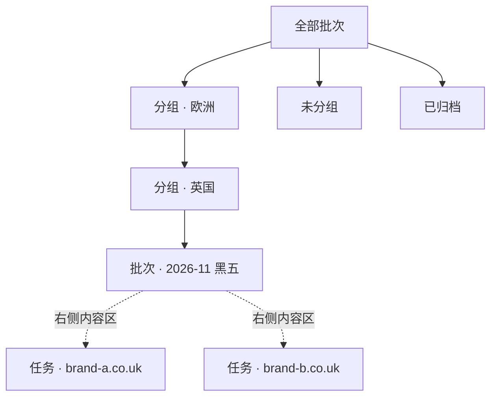

# 批次目录树管理设计

## 用途与边界

本页定义批次列表从“平面表格”扩展为“目录树 + 内容区”的组织方式，解决批次和任务增多后难以归类、查找和批量整理的问题。目录树负责导航和归类，不改变批次、站点、任务、规则和导出的归属关系。

本稿是 2026-11-27 讨论后的初稿，默认采用“分组可嵌套、批次不嵌套、任务留在批次内容区”的方案。实现前仍需确认[未决问题](#未决问题)；未确认前不进入生产代码。

本页不改变任务状态机、计数口径、worker 调度、采集规则、交付快照和导出格式。物理删除、回收站、多父级标签和跨批次任务移动不在首版范围。

## 目标与非目标

目标：

- 用可嵌套的虚拟分组整理批次，支持新建、改名、移动和解散。
- 左侧目录树展示分组和批次；右侧内容区在分组下显示批次表，在批次下显示任务文件表。
- 批次支持改名、移动分组、归档和恢复；任务沿用现有暂停、继续、取消和归档能力。
- 保留现有批次表、筛选、批量操作、批次详情和任务详情，不另造一套数据口径。
- 支持 URL 深链接、浏览器返回、键盘操作、窄屏抽屉和只读模式。
- 迁移只做增量，不自动重构现有批次数据。

非目标：

- 不做“批次嵌套批次”，不把批次同时当项目容器和分组容器。
- 不允许任务跨批次移动；任务仍属于原批次的站点和交付链。
- 不做物理删除、回收站、彻底清理或删除审批；首版统一用解散和归档表达。
- 不提供手工新建任务；任务仍由批次启动生成，技术控制台的 `POST /api/tasks` 不进入业务界面。
- 不做多父级标签、收藏夹、保存视图和手动拖拽排序，这些留给后续阶段。
- 不改变批次派生状态、任务计数、有效商品数和导出结构。

## 现状与问题

| 现状 | 问题 |
| --- | --- |
| 批次列表是平面表格，支持状态、国家、分类、关键词和归档筛选 | 批次增多后只能靠筛选找回，无法形成稳定的项目分组 |
| `batches.category` 是单个自由文本字段 | 只能表达一个维度，不能嵌套，也不能表达“欧洲 / 英国 / 2026-11”这类路径 |
| 批次有 `archived_at`，归档和恢复只影响列表可见性 | 归档批次没有固定的“已归档”入口，混在筛选器里 |
| 批次通过 `batch_sites.task_id`、`delivery_task_id` 关联任务 | 任务跨批次移动会破坏交付、导出、历史和质量反馈归属 |
| `GET /api/batches` 逐批次组装站点、任务和汇总 | 目录树如果直接复用 `batch_payload`，会形成 N+1 查询 |
| 已有 `store.update_batch()` 但 Web API 没有批次更新入口 | 批次改名、移动分组需要补 `PATCH` 接口 |
| 任务已有暂停、继续、取消和归档接口 | 可以直接复用，不需要新状态或新执行器 |

## 参考设计与取舍

| 参考 | 借用 | 不借用 |
| --- | --- | --- |
| Finder／Windows 资源管理器 | 左树右内容、面包屑、拖拽移动、行内改名、“移动到”菜单 | 物理删除和回收站，首版不做 |
| Postman Collection | 文件夹到请求的层级、拖拽和批量移动 | 请求跨 Collection 搬家，任务不跨批次 |
| Gmail 标签／照片相册 | 归类不等于拥有，移出分组不删除对象 | 一个对象挂多个分组，首版保持单父级 |
| Notion 侧栏 | 行内新建、展开收起和键盘操作 | 无限层级，建议最多四层 |
| VS Code 资源管理器 | 子节点按需加载、树保持紧凑 | 把上千个任务全部展开进树 |

关键取舍：批次本身是“一次项目容器”，已经有稳定的 `batch_id`、站点、任务、交付和导出。把它直接做成可嵌套目录，会让父批次同时承担项目和分组的双重语义；把任务移到别的批次，会破坏 `batch_sites.task_id`、`delivery_task_id` 和导出快照。因此采用“虚拟分组 + 固定归属”的文件管理器模型：目录只改变展示位置，不改变对象归属。

## 信息架构



虚线表示任务显示在右侧内容区，不是左侧树节点。

| 节点 | 类型 | 说明 |
| --- | --- | --- |
| 全部批次 | 智能节点 | 显示所有未归档批次，保留现有表格和筛选 |
| 未分组 | 智能节点 | `folder_id` 为空的批次 |
| 已归档 | 智能节点 | `archived_at` 非空的批次，可恢复 |
| 分组 | 用户目录 | 可嵌套；只包含分组和批次 |
| 批次 | 项目目录 | 属于一个分组；包含站点和任务 |
| 任务 | 内容区文件 | 属于批次和站点；显示在批次内容区 |

布局：

```text
┌ 批次目录 ─────────┬ 内容区 ──────────────────────────┐
│ 搜索               │ 全部批次 / 欧洲 / 英国            │
│ 全部批次      128  │                                  │
│ ▾ 欧洲         42  │ 选中分组：批次表格                │
│   ▸ 英国       12  │ 选中批次：任务文件表              │
│   📁 2026-11    8  │                                  │
│ 未分组          7  │                                  │
│ 已归档          3  │                                  │
└────────────────────┴──────────────────────────────────┘
```

- 桌面端默认显示左侧树，可折叠；窄屏收成“目录”按钮打开的抽屉，不要求触屏拖拽。
- 选中分组：右侧显示该分组下的批次表，默认包含子分组，提供“仅当前分组”开关；表格增加“位置”列。
- 选中批次：右侧显示任务文件表，默认当前任务，可切换历史；顶部保留“打开批次详情”和“启动批次”。
- 选中“全部批次／未分组／已归档”：分别显示全部、未归类、已归档批次；归档节点提供恢复。
- 批次详情仍保持独立页面；从详情返回时恢复目录树选中项、展开状态和滚动位置。

## 对象与规则

### 分组

- 用户可以新建任意层级的分组，名称 1～80 个字符，去除首尾空白，不允许控制字符和 `/`。
- 同一父级下分组名称唯一，比较时不区分大小写；批次名称不强制唯一，避免破坏历史数据。
- 最大四层（根级为第 0 层）；移动分组时检查目标不是自己或自己的后代。
- 分组可以同时包含子分组和批次；空分组允许存在。
- 分组没有归档状态；删除分组等于“解散”，子分组和批次上移到上一级，不删除任何批次。

### 批次

- 批次只有一个 `folder_id`，可以为空；为空时显示在“未分组”。
- 批次可以改名、移动分组、修改分类和备注；`country`、`market`、`language` 在导入站点后不作为目录树的可编辑字段，避免影响规则匹配。
- 归档批次保留原 `folder_id`；恢复后回到原分组，原分组已解散则回到根级。
- 批次在树上的状态点只表示“有运行中／有失败／有待接入”，不另造一套批次状态；完整状态仍看批次表和详情。

### 任务

- 任务仍由批次启动生成；目录树不提供“新建任务”入口。
- 任务显示在批次内容区，按站点和当前任务展示；历史任务可切换查看。
- 任务不跨批次移动。需要重新采集时，沿用批次的复跑、试采转正式或站点构建流程。
- 任务没有用户可编辑名称；改名诉求用站点 key 或批次备注表达，不新增任务名称字段。

### 分类

- `category` 保留为扁平标签，继续支持现有筛选，不直接变成目录层级。
- 可选提供一次性的“按分类生成分组”操作：先预览分类和批次数量，再在根级创建同名分组并归入批次；分类值保留，不删除。
- 不自动迁移，避免把历史自由文本解释成用户没有确认过的层级。

## 交互规则

### 浏览与选中

- 树节点单击选中；分组选中后右侧显示批次表，批次选中后右侧显示任务表。
- 批次行、任务行和“打开批次详情”按钮保持现有深链接；进入详情再返回时恢复树状态。
- 树和表格的筛选互不覆盖：目录选中是导航，表格筛选是结果过滤；重置筛选不清空目录选中。
- 搜索同时过滤树和右侧内容；命中节点自动展开祖先，并显示匹配数量。

### 新建与改名

- “新建分组”在树内行内输入，Enter 确认，Esc 取消；失败时保留输入并在节点旁显示原因。
- “新建批次”沿用现有弹窗，自动带入当前分组；在批次节点上新建时带入其父分组。
- 分组改名用行内编辑；批次改名用菜单或批次详情，调用新增的 `PATCH /api/batches/{batch_id}`。
- 改名失败（重名、超长、权限、只读）不关闭编辑态，错误就地显示。

### 移动

- 桌面端支持拖拽：分组拖到分组改变父级，批次拖到分组改变 `folder_id`；拖到“未分组”清空 `folder_id`。
- 拖拽必须显示合法目标和非法目标；批次不能拖到批次上，分组不能拖进自己的后代。
- 所有拖拽操作都有等价的“移动到…”对话框，供键盘、触屏和读屏使用。
- 多选批次可批量移动；批量请求在一个事务内完成，任一目标非法则整体失败并说明。
- 移动只更新分组关系，不改变批次状态、任务状态、计数、规则或导出。

### 解散与归档

- “解散分组”需二次确认，说明“子分组和批次将上移到上一级，不会删除批次；运行中的任务不受影响”。
- 解散时如果子分组或批次与目标父级重名，返回冲突并列出名称，不做静默合并；用户改名后重试。
- 批次和任务只提供归档／恢复，不提供物理删除。归档批次进入“已归档”节点，任务归档沿用现有任务列表语义。
- 若后续确需彻底删除，单独设计回收站、导出备份、终态限制和二次确认，不并入目录树首版。

### 键盘与可访问性

- 树使用 `role="tree"`／`treeitem`、`aria-expanded`、`aria-selected` 和 roving tabindex。
- 方向键展开／收起／移动焦点，Enter 打开，F2 改名，Delete 只触发解散或归档确认，不直接删除数据。
- 拖拽必须有“移动到…”替代路径；移动完成后焦点回到原节点或新位置，并通过 `aria-live` 宣布结果。
- 窄屏下树变为抽屉；关闭后焦点回到“目录”按钮。

### 空态、加载和错误

- 空分组显示“此分组为空，可新建批次或拖入批次”，不显示误导性的 0 行表格。
- 树加载时保留骨架和已选节点；加载失败显示重试，不清空当前内容。
- 移动采用乐观更新，失败回滚并提示；重名、环、超深、目标不存在分别给出可操作的原因。
- 只读模式隐藏新建、改名、移动、解散和归档入口；树和内容仍可浏览。

## 增删改查语义

| 对象 | 增 | 删 | 改 | 查 |
| --- | --- | --- | --- | --- |
| 分组 | 任意层级新建 | 解散，内容上移，不删除批次 | 改名、移动、防环、限深 | 树、搜索 |
| 批次 | 在分组内新建 | 归档／恢复，沿用现有接口 | 改名、移动、分类和备注 | 树、表格、详情 |
| 任务 | 批次启动时生成，不手工新建 | 归档／恢复，沿用现有接口 | 暂停、继续、取消、归档；不改名 | 批次内容区、任务详情 |

“删”首版统一做软删除的原因：

- 批次和任务已经关联结果、导出、质量反馈、构建和规则版本，物理删除会留下孤儿数据。
- 现有产品已经用归档表达“从工作区移除”，目录树不引入第二套更危险的删除语义。
- 分组解散只改变归类，不触碰批次和任务，用户可以放心整理。

## 数据模型

```sql
CREATE TABLE IF NOT EXISTS batch_folders (
    folder_id TEXT PRIMARY KEY,
    parent_id TEXT,
    name TEXT NOT NULL,
    sort_order INTEGER NOT NULL DEFAULT 0,
    created_at TEXT NOT NULL,
    updated_at TEXT NOT NULL
);

ALTER TABLE batches ADD COLUMN folder_id TEXT;

CREATE INDEX IF NOT EXISTS idx_batch_folders_parent
    ON batch_folders(parent_id, name);
CREATE INDEX IF NOT EXISTS idx_batches_folder
    ON batches(folder_id);
```

说明：

- `parent_id` 为 `NULL` 表示根级；`batches.folder_id` 为 `NULL` 表示未分组。
- `sort_order` 先保留给后续手动排序，首版按名称或更新时间排序，不暴露排序手柄。
- 同级分组名称唯一建议用应用层事务校验；SQLite 的 `NULL` 父级不适合直接依赖普通唯一索引。
- 迁移是纯增量：新增表、列和索引，不重写现有批次、任务、站点、规则或导出。
- 只读服务不执行迁移；新版本首次以可写模式启动账本后再提供树接口，避免只读打开旧账本时缺表。

## API 契约

| 方法与路径 | 用途 | 关键约束 |
| --- | --- | --- |
| `GET /api/batch-tree` | 返回分组、批次摘要、未分组和归档计数 | 轻量聚合，不逐批次调用 `batch_payload` |
| `POST /api/batch-folders` | 新建分组 | 名称、父级、深度校验 |
| `PATCH /api/batch-folders/{folder_id}` | 改名或移动分组 | 防环、限深、同级重名 409 |
| `DELETE /api/batch-folders/{folder_id}` | 解散分组 | 子分组和批次上移；重名冲突返回 409 |
| `PATCH /api/batches/{batch_id}` | 批次改名、分类、备注、移动分组 | 只允许目录树相关字段；归档批次按现有语义处理 |
| `POST /api/batches/move` | 批量移动批次 | 全量校验，单事务；任一非法则整体失败 |
| `GET /api/batches?folder_id=...&include_descendants=...` | 按目录筛选批次表 | 与现有状态、国家、分类、关键词筛选组合 |
| `GET /api/tasks?batch_id=...` | 批次内容区任务文件 | 复用现有任务列表和任务详情 |

树接口响应草案：

```json
{
  "folders": [
    {
      "folder_id": "f-...",
      "parent_id": null,
      "name": "欧洲",
      "batch_count": 3,
      "descendant_batch_count": 42
    }
  ],
  "batches": [
    {
      "batch_id": "b-...",
      "name": "2026-11 黑五",
      "folder_id": "f-...",
      "updated_at": "2026-11-27T00:00:00Z",
      "signals": {
        "running": 1,
        "failed": 0,
        "needs_onboarding": 2
      }
    }
  ],
  "unfiled": { "batch_count": 7 },
  "archived": { "batch_count": 3 }
}
```

实现注意点：

- 树接口只返回名称、分组、更新时间和运行信号，完整批次状态继续由 `GET /api/batches/{batch_id}` 提供。
- 运行信号用一次聚合查询计算，避免每个批次读取站点、任务和汇总。
- `PATCH /api/batches/{batch_id}` 不开放 `country`、`market`、`language`，避免改变已导入站点的规则匹配条件。
- 写接口继续受同源写保护和只读模式约束；错误沿用现有 `error.code`／`message` 结构。
- OpenAPI 快照、前端 API 类型和文档链接同步更新。

## 迁移与兼容

- 新表、`batches.folder_id` 和索引通过 `TaskStore._init_schema()` 条件迁移；现有批次全部落在“未分组”。
- 不根据 `category` 自动创建分组；提供可选的一次性“按分类生成分组”预览操作。
- 旧前端读取 `GET /api/batches` 不受影响；新字段对旧客户端是附加字段。
- 归档批次保留 `folder_id`；恢复时回到原分组，分组已解散则回到根级。
- 回退到旧版本时新增表和列仍保留，旧代码忽略它们；不需要回滚数据。
- 在真实账本副本上验证批次总数、归档状态、任务数、导出结果和站点规则指针不变，再在 8765 验收。

## 失败与边界

| 场景 | 行为 |
| --- | --- |
| 同级分组重名 | 409，保留编辑态，提示改名 |
| 分组移动到自己的后代 | 409，树不显示可放置高亮 |
| 超过四层 | 400，提示先整理层级 |
| 目标分组不存在或已解散 | 404／409，刷新树后重试 |
| 多选移动中有非法目标 | 整体回滚，列出失败项 |
| 解散后子项重名 | 409，列出冲突名称，不做静默合并 |
| 移动运行中的批次 | 允许；只改 `folder_id`，任务和 worker 不受影响 |
| 只读服务 | 写接口 403，树和内容只读 |
| 树接口数据过期 | 前端重新拉取树和当前表格；移动失败回滚乐观更新 |

## 实现状态

P1 已在独立 worktree `p1-batch-tree` 基于 `8f11647` 实现，待项目方验收：

- 后端新增 `batch_folders`、`batches.folder_id`、`GET /api/batch-tree`、分组 CRUD、批次 `PATCH`、批量移动和按目录筛选；完整后端 421 项测试和 `ruff` 通过。
- 前端批次页改为左侧目录树、右侧批次表或任务文件面板；支持新建、改名、移动、解散分组、批次移动和归档节点；前端 170 项测试及 `lint`／`typecheck`／`format`／`build` 通过。
- 独立账本副本在 1280／390 走查目录树、目录筛选、任务面板和新建分组，390 无页面级横向溢出；截图在仓库外 `workbench/p1-batch-tree-2026-11-27/`。
- 任务面板当前展示批次任务（含历史），当前任务／历史切换和跨分组搜索留在 P2。只读模式的前端按钮隐藏尚未接入，API 写保护已生效。

## 分阶段

实施前置：当前「单任务控制与排队暂停」切片验收／提交后再开始 P1。两者会改到 `store.py`、`web/app.py`、`BatchesPage.tsx`、`api.ts` 和 OpenAPI，同一批文件不宜并行混改。

P1 核心：

- `batch_folders` 表、`batches.folder_id`、迁移和存储层 CRUD。
- `GET /api/batch-tree`、分组 CRUD、批次 `PATCH` 和按目录筛选。
- 左侧树 + 右侧内容区；分组下批次表，批次下任务表。
- 新建、改名、移动、解散；批次归档／恢复；任务控制复用现有接口。
- URL 深链接、返回恢复、只读、窄屏抽屉、空态和错误态。

P2 效率：

- 多选拖拽、跨分组搜索、键盘完整操作、当前／历史任务切换。
- 树上的运行信号、分组计数和重名冲突的就地处理。
- 移动对话框、拖拽滚动和批量移动反馈。

P3 扩展：

- 多父级标签和保存视图，解决一个批次同时属于客户、国家、月份等多个维度。
- 手动排序、回收站／彻底删除、审计日志和多用户权限。

## 验收

- 后端：分组 CRUD、防环、限深、同级重名、解散上移、批次移动、归档交互、批量移动回滚、只读 403、旧账本迁移。
- 前端：树的展开／收起／选中、新建／改名／移动／解散、拖拽与“移动到”等价路径、归档节点、URL 返回、空态和错误态。
- 浏览器：1280、768、390 三档无页面级横向溢出；键盘可完成主要操作；axe 无新增 violation。
- 真实入口：在 8765 用账本副本完成建分组、移批次、刷新、归档、恢复和解散，确认批次详情、任务控制和导出不变。
- 性能：至少用 500 个批次验证树接口不产生逐批次 N+1；树首屏和移动后刷新有可接受响应。
- 文档：链接检查、导出检查和 OpenAPI 快照同步。

未覆盖：真实多用户权限、跨设备并发、十万级批次、真实触屏拖拽和读屏全流程。

## 未决问题

| 问题 | 本稿默认 | 备选 |
| --- | --- | --- |
| 目录层级 | 分组 → 批次 → 任务内容区，批次不嵌套 | 批次本身可嵌套；或只做批次 → 任务两层 |
| 任务位置 | 任务在批次右侧内容区，不跨批次移动 | 任务作为可展开叶子进树；或允许任务挂到任意分组 |
| 删除语义 | 分组解散，批次／任务归档 | 允许物理删除，需回收站、备份和审批 |
| 分类字段 | 保留为标签，可选一键生成分组 | 直接把现有 `category` 当目录层级 |
| 默认布局 | 桌面左侧树常驻、可折叠 | 列表／目录视图切换，默认列表 |

## 关联文档

- [用户工作流与前端信息架构](33-用户工作流与前端信息架构.md)
- [批次采集与交付改进计划](45-批次采集与交付改进计划.md)
- [单任务控制与排队暂停设计](47-单任务控制与排队暂停设计.md)
- [批次目录树管理 ADR](adr/0024-批次目录树管理.md)
- [交接与继续](15-交接.md)
