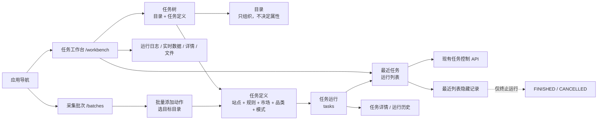
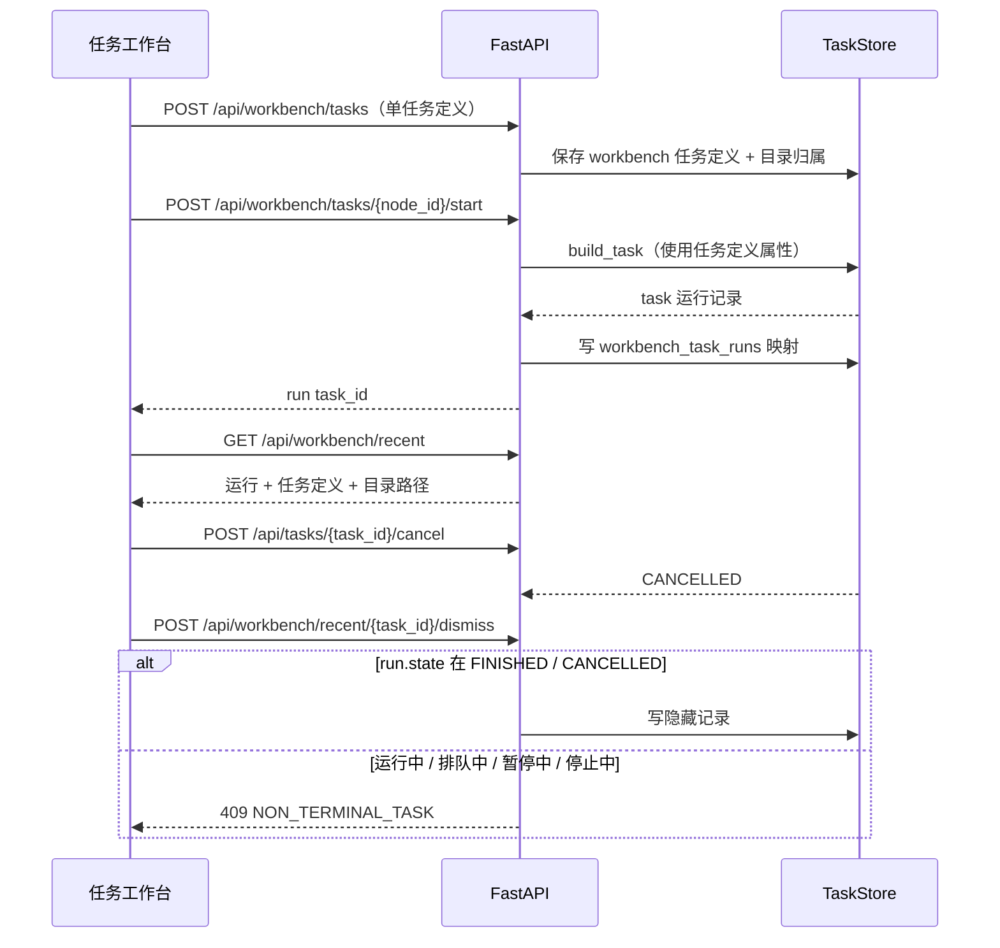
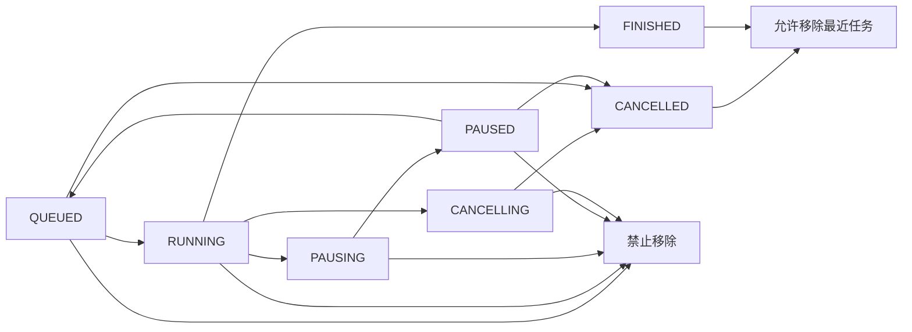
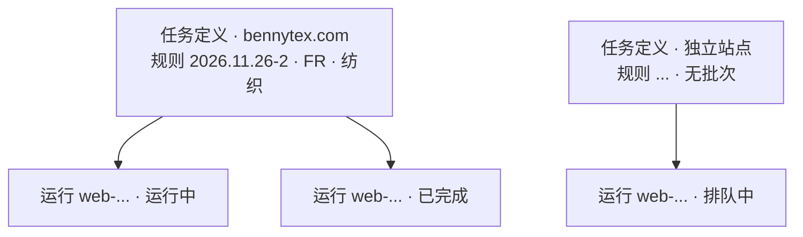

# 任务树与最近任务工作台设计

## 用途与边界

本页定义“任务工作台”：左侧是可自由组织的任务树，右侧默认显示最近添加/启动的任务，底部跟随当前任务的运行日志。目标是让日常操作不再在批次、站点、任务和构建页面之间来回跳转，同时把“目录”“任务定义”“任务运行”“批次”四个概念分开。

本稿是 2026-11-27 讨论后的设计稿。已确认的语义：

- 任务树只有目录和任务定义两类节点，层级不限，名称自由。
- 一个任务节点是一个长期任务定义（站点、规则、市场、国家/语言/品类等属性）；运行产生执行记录，重复运行更新当前执行，树保持稳定。
- 任务可以独立存在（无批次），也可以由批次批量添加；批次只是“一次性添加一批同国家/语言/市场/品类站点”的快捷方式，不是语义容器。
- 目录只负责组织，不能根据目录推断里面任务的属性；任务的规则、市场、国家/语言/品类由任务定义自己决定，可覆盖批次默认值。
- 批次批量添加是把批次中的站点任务定义放进指定目录，批次 ID 可作为来源信息保留，但移动目录不改变任务属性。
- 右侧最近任务按最近添加/启动排序，允许从列表移除；只有 `FINISHED`／`CANCELLED` 的终止运行允许移除，运行中、排队中、暂停中等非终止状态禁止。
- 移除只影响最近任务列表，任务定义仍在树中；运行历史仍可在任务详情查看。

本页不改变任务运行状态机、worker 调度、采集规则、计数口径和现有批次目录树。物理删除任务定义、跨设备多用户、多父级标签和运行中子节点不在首版范围。

## 与既有模型的区别

当前后端把 `tasks` 当作一次执行，把 `batches`／`batch_sites` 当作任务归属和导出链。本设计新增“任务定义”这一层：

| 概念 | 当前实现 | 本设计 |
| --- | --- | --- |
| 目录 | `batch_folders` 只组织批次 | 任务树目录，可任意嵌套，只组织任务定义 |
| 批次 | 导入站点、匹配规则、启动任务、导出 ZIP 的容器 | 一次性批量添加动作；可来源标记，不是目录语义 |
| 任务定义 | 无独立实体；批次站点 + 规则即为定义 | 长期任务节点：站点、规则、市场、国家/语言/品类、模式、限制 |
| 任务执行 | `tasks` 表 | 由任务定义启动，仍写 `tasks`；通过映射表挂到定义 |
| 最近任务 | 无独立视图 | 跨定义/跨批次的执行列表，可隐藏终止运行 |

这意味着本设计不是把现有 `tasks` 直接搬进树，而是新增任务定义和运行映射。运行状态机、计数和任务详情保持不变。

与 [批次目录树管理设计](48-批次目录树管理设计.md)／[ADR 0024](adr/0024-批次目录树管理.md) 的关系：

- 保留现有 `/batches` 批次页和批次目录树，继续服务批次生命周期管理。
- 新增 `/workbench` 任务工作台；任务树是独立组织层，不替换批次树。
- ADR 0024 的“任务留在批次内容区”只约束批次页；本设计在任务工作台内增加任务定义。若后续要把两棵树合并，需要先修订 ADR 0024 并补充递归汇总、导出和迁移论证。
- 批次批量添加仍复用现有批次创建/导入和规则匹配；但不强制任务永久挂在批次目录。

## 目标与非目标

目标：

- 用目录树组织任务定义，支持新建目录、单个任务、批量添加已有批次、创建新批次。
- 任务定义可独立存在，也可带批次来源；目录移动不影响批次、规则、市场或导出。
- 任务定义可设置规则、国家、语言、市场、品类、采集模式、限制和代理；批次只提供默认值。
- 启动/重试从任务定义创建运行；运行进入最近任务；树节点显示当前/最近运行状态，树不因重复运行增长。
- 最近任务按 `COALESCE(started_at, created_at)` 倒序，支持移除/恢复；非终止运行禁止移除。
- 底部日志跟随选中运行或任务定义，复用现有任务事件和结果接口。

非目标：

- 不改变现有 `tasks` 状态机、计数、worker 和任务详情。
- 不做任务定义物理删除、回收站、运行子节点展开或多父级标签。
- 不改变批次目录树、批次详情、批次 ZIP 和任务详情。
- 不把任务树提升为应用全局侧边栏；首版是 `/workbench` 页内左栏。
- 不做多人权限、跨设备列表偏好和十万级节点虚拟化。

## 信息架构与机制



创建到最近任务的时序：



运行状态与移除资格：



任务定义与运行的关系：



树只显示定义和当前/最近运行摘要；运行历史从任务详情或最近任务查看。

## 对象与规则

### 目录

- 名称 1～80 字符，去除首尾空白，禁止控制字符；不强制同级唯一。
- 可包含目录和任务定义；不限层级，移动做环检测。
- 目录没有国家、语言、市场、品类、规则等属性；不能根据目录推断任务同类。
- 删除目录等于解散：子目录和任务定义上移到上一级，不删除定义或运行。
- 首版支持新建、改名、移动、排序和解散；不支持物理删除。

### 任务定义

- 是长期实体，树中一个节点对应一个定义；任务运行不增加树节点。
- 字段：显示名称、站点 URL/域名、站点 key、规则 ID/版本/路径、任务类型、采集模式（试采/正式）、国家、语言、市场、品类、限制、代理、备注、批次来源（可空）。
- 站点 URL 必填；规则必须从可用规则包中选择，且任务类型受规则支持。
- 国家、语言、市场、品类默认从批次复制（批量添加时），之后可在任务定义上覆盖；目录不参与。
- 任务定义的属性只对之后创建的运行生效；运行中的任务保持入队时锁定。
- 任务定义可以关联批次来源（`batch_id` 可空），但移动目录不改变 `batch_id`、规则或市场。
- 首版不提供“删除定义”；可停止运行、改名和移动。后续如需归档/删除，单独设计引用检查和历史保留。

### 批次批量添加

- “添加已有批次”：选择批次和目标目录，把该批次的站点任务定义加入目录；已有同批次同站点定义时跳过或返回已存在，不重复创建。若站点已有当前任务，同时写 `workbench_task_runs` 把现有运行挂到定义；没有任务的定义显示“未启动”。
- “新建批次”：复用现有批次创建流程（名称、国家/语言/市场/品类、站点导入、规则匹配）；创建成功后把站点任务定义放入目标目录，批次只作为来源和批量默认值。
- 批次任务定义可以移动到任意目录；目录移动不改变批次来源、规则或导出归属。
- 批次 ZIP 导出继续按 `batch_id` 聚合批次运行；独立任务（`batch_id` 为空）不进入批次 ZIP，使用任务导出。
- 任务级属性覆盖批次默认值后，启动使用任务定义属性；批次详情仍展示批次站点和任务，但任务的实际规则/市场以定义和运行入队信息为准。

### 任务运行与最近任务

- 启动/重试任务定义时创建新的 `tasks` 运行，并通过 `workbench_task_runs` 关联；树节点显示最新运行摘要。
- 带 `batch_id` 的定义启动时，运行写入 `batch_id`，并在同一事务内更新 `batch_sites.task_id`／交付指针，保证批次详情、批次 ZIP 和任务详情看到同一次运行；任务定义属性优先于批次默认值。独立任务不写批次指针，只走任务导出。
- 最近任务从 `tasks` 派生，按 `COALESCE(started_at, created_at) DESC` 排序，跨定义、跨批次；可包含尚未加入任务树的运行。
- “从最近列表移除”只写 `workbench_recent_dismissals(task_id, dismissed_at)`，不改任务状态、不删定义、不影响树。
- 只有 `TERMINAL_TASK_STATES`（`FINISHED`、`CANCELLED`）允许移除；其他状态前端禁用、API 409。
- 批量移除全量校验；任一非终止整体拒绝。
- 撤销/恢复删除隐藏记录；新的运行是新 `task_id`，自然回到最近列表。
- 运行历史与任务详情复用现有页面；树节点不展开每次运行子节点。

### 任务操作映射

| 界面动作 | 接口 | 说明 |
| --- | --- | --- |
| 启动任务定义 | `POST /api/workbench/tasks/{node_id}/start` | 用定义属性创建运行；定义无运行或已有终止运行时可用 |
| 重试 | 同上，或 `POST /api/workbench/tasks/{node_id}/start?rerun=true` | 新运行，不覆盖旧历史 |
| 暂停 | `POST /api/tasks/{task_id}/pause` | 现有状态机 |
| 继续 | `POST /api/tasks/{task_id}/resume` | 现有状态机 |
| 取消 | `POST /api/tasks/{task_id}/cancel` | 现有状态机 |
| 导出运行 | 现有任务导出 URL | 独立运行可单独导出 |
| 导出批次 | 现有批次 ZIP | 只包含 `batch_id` 匹配的运行 |
| 打开详情 | `/tasks/{task_id}` | 不新增详情页 |

## 数据模型

```sql
CREATE TABLE IF NOT EXISTS workbench_nodes (
    node_id TEXT PRIMARY KEY,
    node_type TEXT NOT NULL CHECK (node_type IN ('group', 'task')),
    parent_id TEXT,
    name TEXT NOT NULL,
    sort_order INTEGER NOT NULL DEFAULT 0,
    created_at TEXT NOT NULL,
    updated_at TEXT NOT NULL
);

CREATE INDEX IF NOT EXISTS idx_workbench_nodes_parent
    ON workbench_nodes(parent_id, sort_order);

CREATE TABLE IF NOT EXISTS workbench_task_defs (
    node_id TEXT PRIMARY KEY REFERENCES workbench_nodes(node_id) ON DELETE CASCADE,
    input_url TEXT NOT NULL,
    domain TEXT NOT NULL,
    site_key TEXT NOT NULL,
    batch_id TEXT,
    country TEXT,
    language TEXT,
    market TEXT,
    category TEXT,
    task_type TEXT NOT NULL DEFAULT 'product',
    collection_mode TEXT NOT NULL DEFAULT 'sample',
    rule_id TEXT NOT NULL,
    rule_version TEXT NOT NULL,
    rule_path TEXT NOT NULL,
    limits_json TEXT NOT NULL DEFAULT '{}',
    proxy TEXT,
    note TEXT,
    created_at TEXT NOT NULL,
    updated_at TEXT NOT NULL
);

CREATE INDEX IF NOT EXISTS idx_workbench_task_defs_batch
    ON workbench_task_defs(batch_id, site_key);

CREATE TABLE IF NOT EXISTS workbench_task_runs (
    node_id TEXT NOT NULL REFERENCES workbench_nodes(node_id) ON DELETE CASCADE,
    task_id TEXT NOT NULL REFERENCES tasks(task_id) ON DELETE CASCADE,
    created_at TEXT NOT NULL,
    PRIMARY KEY (node_id, task_id),
    UNIQUE (task_id)
);

CREATE INDEX IF NOT EXISTS idx_workbench_task_runs_node
    ON workbench_task_runs(node_id, created_at DESC);

CREATE TABLE IF NOT EXISTS workbench_recent_dismissals (
    task_id TEXT PRIMARY KEY,
    dismissed_at TEXT NOT NULL
);
```

说明：

- 目录节点只写 `workbench_nodes`；任务节点同时写 `workbench_nodes` 和 `workbench_task_defs`，在同一事务内完成。
- `batch_id` 可空；有值只表示来源，不约束目录位置，也不强制规则/市场一致。
- `workbench_task_runs` 是运行与定义的映射；现有 `tasks` 表不新增列，旧任务仍可被列表和详情读取。
- 任务定义不强制 `(batch_id, site_key)` 唯一；同名/同站点可以有多条定义（不同规则或市场），但批量添加对同一批次站点默认跳过重复。
- 运行记录是执行历史；树节点显示最新运行，最近任务显示运行列表。
- 迁移为纯增量；只读服务不建表、不写隐藏记录。

### 初始数据

首版不自动把现有批次铺成树，避免把历史批次结构解释成用户没有确认过的目录。任务工作台首次打开时：

- 树为空，显示“新建目录 / 新建任务 / 添加已有批次 / 新建批次”。
- 最近任务仍显示 `tasks` 中已有的运行；没有任务定义的运行显示“未加入任务树”。
- 用户可通过“添加已有批次”把批次站点定义为任务节点，或在最近任务行选择“加入任务树”。
- 如项目方希望一次性迁移，可增加显式“导入全部批次”按钮；不做隐式种子。

## API 契约

| 方法与路径 | 用途 | 关键约束 |
| --- | --- | --- |
| `GET /api/workbench/tree` | 返回目录、任务定义、当前运行摘要 | 轻量聚合，不逐节点调用 `_summary` |
| `POST /api/workbench/groups` | 新建目录 | 名称、父级、顺序；父级必须是目录/根 |
| `PATCH /api/workbench/nodes/{node_id}` | 目录/任务定义改名 | 只改显示名；不改身份或属性 |
| `POST /api/workbench/nodes/{node_id}/move` | 移动/排序 | `parent_id` + `after_node_id`；防环；单事务 |
| `DELETE /api/workbench/groups/{node_id}` | 解散目录 | 子项上移；不删除定义或运行 |
| `POST /api/workbench/tasks` | 新建单个任务定义 | 站点、规则、国家/语言/市场/品类、模式、限制；`batch_id` 可空 |
| `PATCH /api/workbench/tasks/{node_id}` | 编辑任务定义属性 | 只影响之后运行；运行中任务保持锁定 |
| `POST /api/workbench/import-batch` | 批量添加已有批次 | `batch_id` + 目标目录；跳过重复，返回新增/跳过清单 |
| `POST /api/workbench/tasks/{node_id}/start` | 启动/重试任务定义 | 用定义属性 build_task；写运行映射；任务状态机不新增 |
| `GET /api/workbench/recent?scope=&q=&limit=&offset=` | 最近运行/运行中/已移除 | 默认 100，上限 200；按启动时间倒序 |
| `POST /api/workbench/recent/{task_id}/dismiss` | 移除最近运行 | 仅 `FINISHED`／`CANCELLED`；否则 409 |
| `POST /api/workbench/recent/{task_id}/restore` | 恢复最近运行 | 删除隐藏记录；幂等 |
| `POST /api/workbench/recent/dismiss` | 批量移除 | 全量校验，任一非终止整体 409 |
| `POST /api/workbench/runs/{task_id}/attach` | 把已有运行加入任务树 | 选择目标目录/创建定义；用于历史运行 |

树响应草案：

```json
{
  "nodes": [
    {
      "node_id": "g-...",
      "node_type": "group",
      "parent_id": null,
      "name": "法国 / 纺织",
      "sort_order": 0,
      "task_count": 10,
      "running_count": 3
    },
    {
      "node_id": "n-...",
      "node_type": "task",
      "parent_id": "g-...",
      "name": "bennytex.com 全量",
      "sort_order": 0,
      "definition": {
        "input_url": "https://www.bennytex.com/fr/",
        "domain": "bennytex.com",
        "site_key": "bennytex.com",
        "batch_id": "b-...",
        "country": "FR",
        "language": "fr",
        "market": "FR",
        "category": "纺织",
        "rule_id": "bennytex-fr",
        "rule_version": "2026.11.26-2",
        "collection_mode": "formal"
      },
      "current_run": {
        "task_id": "web-...",
        "state": "RUNNING",
        "counts": {"processed_products": 1284, "valid_products": 1201, "failed_products": 4},
        "started_at": "2026-11-27T08:00:01Z",
        "updated_at": "2026-11-27T08:42:16Z"
      }
    }
  ]
}
```

最近运行响应草案：

```json
{
  "total": 14,
  "items": [
    {
      "task_id": "web-...",
      "node_id": "n-...",
      "batch_id": "b-...",
      "batch_name": "bennytex 全量",
      "path": "法国 / 纺织 / bennytex",
      "definition_name": "bennytex.com 全量",
      "state": "RUNNING",
      "outcome": null,
      "counts": {"processed_products": 1284, "valid_products": 1201, "failed_products": 4},
      "started_at": "2026-11-27T08:00:01Z",
      "can_dismiss": false
    }
  ]
}
```

实现注意：

- `can_dismiss` 由服务端按 `TERMINAL_TASK_STATES` 计算。
- `POST /api/workbench/tasks/{node_id}/start` 用定义属性构造 `Task`，不依赖批次启动；批次批量添加只负责创建定义，不自动启动。
- 批次 ZIP 只聚合 `batch_id` 匹配的运行；独立运行使用任务导出。
- 写接口沿用同源写保护和只读模式；错误结构沿用现有 `error.code`／`message`。
- OpenAPI 快照、前端 API 类型和文档链接同步更新。

## 布局与交互

桌面端固定三窗格：

```text
┌ 任务树 ─────────────┬ 最近任务 ─────────────────────────────┐
│ 搜索          + 新建 │ 最近 / 运行中 / 已移除  搜索   刷新   │
│ ▾ 法国 / 纺织        │ ┌ 状态 任务/定义 目录 进度 启动 操作 ┐ │
│   ▾ bennytex         │ │ ...                                │ │
│     bennytex.com     │ │ ...                                │ │
│     独立站点任务     │ └────────────────────────────────────┘ │
│                      │ 运行日志 / 实时数据 / 任务详情 / 文件   │
└──────────────────────┴────────────────────────────────────────┘
```

### 页眉资源胶囊

工作台不内嵌资源仪表；页眉在服务状态旁显示一个 CPU／内存简化胶囊，避免占用任务列表和日志窗格：

- 胶囊只显示 CPU 和内存百分比，不展开磁盘、队列或路径；点击进入 `/settings?focus=resources`，页面滚动到系统设置页「资源与运行」查看完整仪表和详细统计。
- 每 15 秒刷新；CPU／内存达到 70% 用警告色、90% 以上用危险色，并在 `title` 和 `aria-label` 中写明数值。
- 读取中、采样不可用或 `resources.available=false` 时隐藏胶囊，不显示 0；窄屏（`md` 以下）隐藏，避免挤压服务状态。
- 详细资源、磁盘、路径和开关仍在 `/settings`，工作台只读。

“+ 新建”菜单放在树头或选中节点的行菜单，目标位置取当前选中目录；没有选中时放根级。右键目录也会打开同一组创建入口：

- 新建目录/任务组
- 新建单个任务
- 添加已有批次
- 新建批次
- 重命名、移动到…、解散目录

右键任务显示控制菜单（启动/暂停/继续/取消、改名、移动、移除/恢复、复制、详情）；触屏和键盘使用行尾「⋯」与树头「+」，右键只作为指针快捷键。

新建单个任务表单分组：

- 站点：显示名称、站点 URL（必填）
- 归属：目标目录
- 采集定义：规则、任务类型、采集模式
- 属性：国家、语言、市场、品类（可从批次默认值带入）
- 限制：最大 URL／商品／时长、代理（可选）

交互规则：

- 树单击选中；目录展开/收起；任务定义显示状态点、当前运行摘要和行内主控制。
- 双击/回车展开目录；F2 改名；“移动到…”对话框作为拖拽的键盘路径。
- 拖拽只改目录归属和顺序；任务定义的批次、规则、市场和导出不变。
- 最近运行行可以启动/暂停/继续/重试/取消/导出/定位/复制/加入任务树。
- 非终止运行的移除按钮禁用；菜单显示“结束后才能移除”；批量移除在混合状态时禁用。
- 底部日志跟随选中运行；选中任务定义但没有运行时显示“启动后可查看日志”。
- 窄屏（<900px）树变抽屉，最近任务/日志二选一；新建/移动/移除都必须有非拖拽路径。
- 只读模式隐藏新建、改名、移动、解散、移除/恢复，任务控制和导出按现有只读规则禁用。

## 失败与边界

| 场景 | 行为 |
| --- | --- |
| 非终止运行移除 | 409 `NON_TERMINAL_TASK`；前端禁用并说明原因 |
| 批量移除含非终止 | 整体拒绝，列出 task_id |
| 任务定义无运行 | 树显示“未启动”；启动创建运行，不新增树节点 |
| 目录移动到自己的后代 | 409 `TREE_CYCLE`，不高亮非法目标 |
| 规则包不存在/不支持任务类型 | 400 `INVALID_RULE`／`INVALID_TASK_TYPE`，保留表单 |
| 批次批量添加重复 | 跳过并返回清单，不重复创建定义 |
| 独立任务无批次 | 允许；最近任务和任务详情正常，批次 ZIP 不包含 |
| 任务定义属性变更时有运行中任务 | 只影响之后创建的运行；当前运行保持入队属性 |
| 目录/任务同名 | 允许，路径和站点域名消歧 |
| 只读服务 | GET 可用；写接口 403 |
| 历史运行未加入树 | 最近任务显示“未加入任务树”，可加入 |

## 迁移、兼容与回滚

- 新增四张表；不修改 `tasks`、`batches`、`batch_sites` 和 `batch_folders` 的现有列。
- 旧任务和旧批次页保持可用；新任务定义只影响工作台。
- 首次打开不自动种子；用户显式“添加已有批次”或“加入任务树”。
- 回退时停用 `/workbench` 和新表即可；旧任务、批次、导出和批次目录树不受影响。
- 真实账本验收前复制账本，验证独立运行、批次运行、批次 ZIP、任务导出和任务详情。

## 测试与验收

后端：

- 定义 CRUD、目录移动/防环/解散、任务定义启动/重试、运行映射、批次批量添加去重、独立任务无批次、最近运行排序、终止状态移除、批量拒绝、只读。
- 迁移只建表，不改旧任务；旧运行可加入任务树；批次 ZIP 不包含独立任务。
- 任务定义属性覆盖批次默认值；运行入队锁定。

前端：

- 新建目录、新建单个任务、添加已有批次、新建批次入口；表单校验和失败保留。
- 树拖拽/移动对话框、改名、解散、搜索、展开收起、右键目录/任务菜单、未加入树提示。
- 最近任务筛选/搜索、启动/暂停/继续/重试/取消/导出、非终止移除禁用、移除/恢复/撤销、日志跟随。
- 页眉资源胶囊：CPU／内存百分比、阈值色调、不可用隐藏、15 秒刷新、点击进入系统设置。
- 键盘、焦点回收、URL 返回、只读、空态、加载/失败态。

浏览器与真实入口：

- 1280／768／390 无页面级横向溢出；窄屏抽屉和任务/日志切换；axe 无新增 violation。
- 8765 账本副本完成：新建独立任务、添加批次、启动、暂停/取消、终止后移除、恢复、拖拽目录；核对任务数、批次 ZIP、独立导出和任务详情。
- 性能：至少 500 个目录/定义和 100 条最近运行；树接口无逐节点 N+1。

## 分阶段

P1 读取与新建：

- 新表、目录/任务定义数据模型、`GET /api/workbench/tree`、`GET /api/workbench/recent`。
- 任务工作台布局、新建目录/单个任务、最近任务列表、日志跟随。
- 启动任务定义创建运行、运行映射、只读和空态。

P2 树管理与批量添加：

- 改名/移动/解散、拖拽与“移动到…”对话框。
- 添加已有批次、新建批次到目录、运行加入任务树。
- 最近任务移除/恢复/撤销、非终止禁用、批量全量校验。
- 窄屏适配、键盘、返回恢复。

P3 效率与扩展：

- 树搜索服务端化、懒加载/虚拟化、批量移动、快捷键、最近任务窗口。
- 归档/删除定义、运行历史树、多用户权限。

## 未决问题

| 问题 | 本稿默认 | 备选 |
| --- | --- | --- |
| 初始树 | 空树，显式添加批次/新建任务 | 首次种子现有批次；或只种子目录 |
| 任务定义删除 | 首版不提供，仅停止/改名/移动 | 归档或删除，需引用检查 |
| 批次采购关系 | `batch_id` 仅来源，目录不影响 | 批次节点长期保留；或任务跨批次 |
| 任务级属性编辑范围 | 规则、市场、国家/语言/品类、模式、限制可覆盖 | 只允许创建时设置；或只允许部分字段 |
| 同名 | 允许，路径/域名消歧 | 同级唯一，冲突 409 |
| 历史运行加入树 | 单条加入，生成/复用定义 | 批量导入旧运行；或只读不加入 |
| 全局侧边栏 | 页面内左栏 | 提升为应用主侧栏 |
| 多用户 | 单用户账本 | 用户级隐藏记录和权限 |

## 关联文档

- [批次目录树管理设计](48-批次目录树管理设计.md)
- [批次目录树管理 ADR](adr/0024-批次目录树管理.md)
- [任务树与最近任务工作台 ADR](adr/0025-任务树与最近任务工作台.md)
- [单任务控制与排队暂停设计](47-单任务控制与排队暂停设计.md)
- [前端设计系统与 v2 视觉方向](35-前端设计系统与视觉方向.md)
- [用户工作流与前端信息架构](33-用户工作流与前端信息架构.md)
- [测试策略](23-测试策略.md)
- [交接与继续](15-交接.md)
