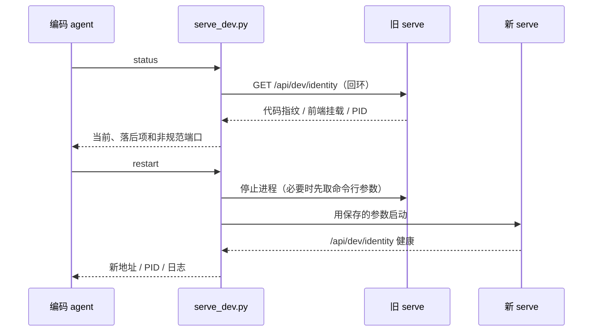

# 开发实例管理与前端热更新

## 用途与边界

本页解决开发期最容易出现的状态错位：编码 agent 改了前端或后端，又在新的端口启动一个服务；旧的 8765 还在运行旧代码，用户无法判断应该看哪个地址，最后把“没生效”误判成功能缺陷。

范围限于开发期的实例管理、实例身份和前端开发流。不改变任务状态机、采集调度、构建会话、生产启动参数或认证边界；生产面板不新增“重启服务”按钮。相关边界沿用 [系统设置页设计](42-系统设置页设计.md) 和 [ADR 0018](adr/0018-系统设置页与运行时局域网控制.md) 中“页面不触发进程重绑／重启”的决定。

## 现状与问题

- `serve` 可以在任意 `--port` 启动；同一账本有 worker 锁，但不同账本的实例可以同时存在，旧实例不会被自动发现。
- `/api/health` 只有版本、账本和队列信息，没有进程号、启动时间、代码指纹或前端构建标识；配置访问密钥后它还需要认证，脚本无法直接读取。
- 前端构建产物 `frontend/dist` 只在 `create_app` 时决定是否挂载；启动时没有 `dist`，之后构建必须重启才能访问，但启动时已有 `dist` 时重建只需刷新浏览器。
- `vite.config.ts` 原先固定代理到 `8775`，与规范入口 `8765` 不一致，容易把前端开发流引到临时实例。

## 决策

### 规范入口与脚本

- 面向用户的开发实例固定使用 `8765`；不为绕开占用而换端口。
- 新增跨平台 `scripts/serve_dev.py`，提供 `status`、`start`、`stop`、`restart`、`prune`。脚本是 agent 和人工共用的唯一入口，负责保存启动参数、日志、PID 和实例状态。
- `start` 在端口被占用时拒绝启动，并提示已有实例；`restart` 先停止规范实例，再按保存的参数启动；没有保存参数时，从现有 `serve` 进程命令行读取可复用参数。
- `prune` 只停止健康接口或命令行能确认是 `ecom-crawler` 的实例，默认预演，必须显式加 `--yes`；不清理无关服务。
- 状态和日志写入仓库根的 `.runtime/`，该目录不进入版本控制。脚本不持久化访问密钥；需要认证时使用 `ECOM_SERVE_TOKEN` 环境变量。

### 实例身份

- `/api/health` 增加 `pid`、`host`、`port`、`started_at`、`instance_id`、`code_fingerprint`、`git` 和 `frontend`。`code_fingerprint` 是 `app/src/ecom_crawler` 下 Python 源文件内容的短摘要；`frontend` 记录启动时是否挂载前端、`index.html` 的摘要和构建时间。
- 新增仅回环可用的 `GET /api/dev/identity`，返回同一组身份字段，不要求访问密钥。这样本地脚本在启用认证的实例上也能判断代码和前端是否落后；局域网客户端仍然走原有认证，不能访问该接口。
- 身份字段只用于诊断，不包含密钥、Cookie 或模型凭据；`db` 路径沿用健康接口已有的暴露范围。接口不写入任何状态。

### 前端开发流

- 日常改前端使用 Vite dev server：`npm run dev`，默认 `http://127.0.0.1:5175/`；代理目标由 `ECOM_API_TARGET` 覆盖，默认 `http://127.0.0.1:8765`。组件改动由 HMR 生效，不重启服务。
- 需要验证构建产物时执行 `npm run build`，然后刷新 `8765` 的页面。服务启动时已有 `dist` 的情况下不需要重启；启动时没有 `dist` 才由脚本 `restart` 建立挂载。
- 后端代码或启动参数变化时使用 `python scripts/serve_dev.py restart`。前端 source 变化不触发后端重启，构建产物变化也不自动重启。

### 明确不做

- 不做通用的“重启深度”框架，不新增进程内 worker 重启、自动文件监听或 uvicorn `--reload`；这些会打断在途任务或构建会话。
- 不在生产面板增加面向普通用户的重启按钮；开发入口由脚本承担。
- 不把 `/api/health` 或完整启动参数改为公网可读；本地诊断接口仅回环。

## 机制

```mermaid
flowchart LR
    A[改前端 source] --> B[Vite 5175 HMR]
    B --> C[浏览器立即更新]
    A2[改前端构建] --> D[npm run build]
    D --> E{启动时已挂载前端?}
    E -- 是 --> F[刷新 8765]
    E -- 否 --> G[serve_dev.py restart]
    A3[改后端代码或启动参数] --> G
    G --> H[停止 8765]
    H --> I[按 .runtime 参数启动]
    I --> J[/api/dev/identity]
    J --> K{代码指纹与前端身份一致?}
    K -- 否 --> G
    K -- 是 --> L[使用 8765]
```



## 命令契约

| 命令 | 作用 | 前置与副作用 |
| --- | --- | --- |
| `status` | 列出 8765、`.runtime` 中的实例和请求的端口；比较代码指纹与前端身份 | 只读；默认检查 8765，`--scan` 先读一次监听端口再探测 |
| `start` | 启动 8765，保存参数到 `.runtime` | 端口必须空闲；第一次需要 `--db` 和 `--out-root` |
| `restart` | 停止后按保存参数启动；没有保存参数时从现有命令行接管 | 会中断在途采集；构建重启后可按既有机制继续 |
| `stop` | 停止指定端口 | 默认结束整个进程树；非 ecom-crawler 进程需要 `--force` |
| `prune` | 清理非规范实例 | 默认预演；`--yes` 才执行；只处理可确认的 ecom-crawler |

`status` 的退出码：0 表示 8765 正在运行且代码指纹、前端挂载与当前工作区一致；1 表示未运行、落后或存在需要处理的情况。脚本不返回 0 来掩盖旧实例。

## 失败与回退

- `start` 失败时保留日志路径并输出末尾日志；不留下状态文件。
- 端口被非 ecom-crawler 进程占用时不终止，提示换端口或人工处理；`stop --force` 才覆盖。
- 旧实例没有本地身份接口时，`status` 显示 PID 和“可用 restart 接管”；`restart` 从进程命令行读取 `--db`、`--out-root`、`--rules-dir` 等参数，丢弃 `--access-token`，由账本已存哈希继续认证。
- Windows 下 `stop` 先用 `taskkill /T`，超时后再强制；无法保证在途任务优雅结清，因此开发重启前应先让任务结束。构建在服务停止时按既有逻辑标记中断，可在构建详情继续。
- 需要手动兜底时，按 `app/README.md` 的原始 `serve` 命令启动；脚本不修改账本或规则。

## 验收

- `status` 能同时看到 8765、旧的非规范端口和 `.runtime` 中的实例，并明确指出代码指纹或前端挂载落后。
- `start` 在 8765 已占用时拒绝启动；`restart` 后 `/api/dev/identity` 的 `code_fingerprint` 与当前源码一致。
- Vite `5175` 修改组件后 HMR 生效，不触发 `serve` 重启；`npm run build` 后刷新 8765 能加载新构建。
- 启用访问密钥时，`/api/health` 仍返回 401，`/api/dev/identity` 仅本机可读；局域网客户端不能读取。
- 旧实例清理只影响可确认的 ecom-crawler 进程；无关端口保持原状。
- 后端测试覆盖身份字段、前端启动快照和回环限制；脚本通过 `--help`、`status`、`start`、`restart`、`stop` 的正反路径演练。

## 实现与证据（2026-11-27）

- 后端全量 469 项、`ruff` 通过；前端 142 项及 `lint`／`typecheck`／`format`／`build` 通过；文档链接、示例和导出复核通过。
- 在临时 8899 实例演练 `start`、`status`、`restart`、`stop`；随后 `restart` 接管真实 8765，当前 PID 42020、代码指纹 `20602f362b8d19eb`，根路径返回 200，登录保护仍为 401。
- 入口收口（2026-11-27）：`app/frontend-v2/` 重命名为 `app/frontend/`，删除旧 Vue、旧原生静态页、`/batch`、`/legacy` 和 `ECOM_LEGACY_UI` 回退；根路径直接返回 `frontend/dist/index.html`，静态资源挂在 `/assets/`，`/next/*` 仅保留 308 兼容重定向。8765 重启后 `/` 200、`/next/` 308 到 `/`、`/assets/*` 200、`/api/health` 401、`/api/dev/identity` 200，`frontend.kind=react`、`frontend.mounted=true`。
- 工作台合并（2026-11-27）：`p1-task-workbench` 的任务树、独立任务定义、最近任务、结构化运行事件、批次批量添加、定义编辑和 `psutil` 资源采样已移植到 `app/frontend` 与 `/api/workbench/*`；8765 已加载 `/#/workbench`，8877／8879 停止，8878 保留。
- Vite 5175 启动后页面和 `/api/dev/identity` 代理正常；HMR 的实际浏览器交互未做自动化。8775、8877、8879 已停止，8878（build-pilot）仍在；工作台 worktree 账本和预览数据保留在 `p1-workbench-ui`。Windows 在途任务下的强制停止未演练；POSIX 的 `ss`／`lsof`／`ps` 分支未在 Linux 或 macOS 实测。
