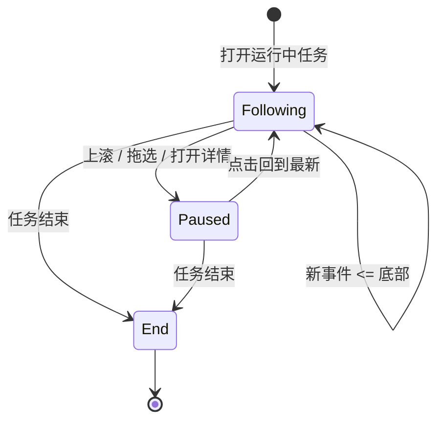

# 任务运行日志查看器设计

## 用途与边界

本页定义工作台底部运行信息区的日志查看器：把现有“运行事件”和“原始日志”合并成一个单行、可跟随、可筛选、可查看详情的日志视图。决策记录见 [ADR 0027](adr/0027-任务运行日志查看器与增量加载.md)。

本页不改变任务状态机、事件写入格式、计数口径、导出文件和构建时间线。构建 Agent 的思考／工具调用按[构建会话时间线设计](46-构建会话时间线设计.md)执行；本页只处理 `events.ndjson` 中的任务运行事件。

## 目标与成功判据

目标：

- 一条事件一行，时间精确到秒；年月日通过“显示日期”复选框可选，不在默认视图里挤占行宽。
- 运行中能稳定跟踪新事件；用户向上阅读时不被强制拉回。
- 能快速找到失败项，打开完整 JSON，复制原始行或 URL。
- 大日志不一次性加载；首屏、追加、翻页和滚动都有明确预算。
- 保留现有视觉系统和键盘／读屏可访问性，不引入终端主题或 xterm。

成功判据：

- 运行中的任务出现新事件后，跟随模式下 1 秒内可见；暂停跟随后显示新事件计数，点击“回到最新”回到底部。
- 5,015 条事件的任务首屏 500 条可读，能加载更早，不出现页面级横向溢出。
- 任意一行都能在一眼内看出时间、级别、事件类型、对象和结果；失败项不依赖颜色识别。
- 运行时追加不重排、不闪空、不清空用户已加载的历史；滚动位置在加载更早时保持稳定。
- 1280、768、390 三种宽度和键盘操作均可用；axe 0 violations。

非目标：

- 不做通用终端、ANSI 颜色、shell 输入或任意文本日志查看器。
- 不做跨任务全文检索、日志归档或第二套日志数据库。
- 不改变 `events.ndjson` 的写入格式和任务状态语义。
- 不在本页实现构建时间线；构建日志仍按 `46`。

## 用户任务与现有实现

主要任务是监控运行和排查失败：

- 盯住运行中的任务，确认进度持续、没有停滞。
- 发现失败或异常后，定位具体商品 URL、失败分类和时间。
- 对照事件顺序，判断暂停、取消、恢复是否按预期发生。
- 复制一条原始事件或 URL，交给其他人或写进反馈。

现有实现：

| 区域 | 现状 | 问题 |
| --- | --- | --- |
| 运行事件 | 3 列摘要：时间、事件名、前 5 个字段 | 时间只到分钟；字段拼成一行后仍会折行；没有级别和稳定序号；没有原文 |
| 原始日志 | 每条事件一行 JSON，带过滤和自动滚动 | `whitespace-pre-wrap break-all` 会把一条 JSON 折成多行；行号是过滤后索引；没有“加载更早” |
| 数据接口 | `/api/tasks/{id}/events/history?tail=200` | `total` 是返回条数不是总数；每次 `read_text()` 整个文件；没有 `before`／`after` 游标 |
| 历史范围 | 只返回最后 200 条 | 完整任务最多实测 5,015 条，约 96.8% 的日志在界面上不可见 |
| 跟随 | 运行事件在到达底部时滚动；原始日志有“自动滚动”复选框 | 术语和状态重复；原始日志折行后很难判断一行事件 |

实测口径（2026-11-27，证据库 `workbench/real-build-2026-11-24`）：

- 最大单任务：5,015 条事件、994,273 字节；中位单行约 197 字节，最大约 240 字节。
- 事件分布：`item_finished` 5,011 条，`task_reconciled`、`task_started`、`robots_sitemaps_probed`、`task_finished` 各 1 条。
- 证据库 139 个 `events.ndjson` 共 19,629 条；事件类型约 10 种，状态以 `DONE`／`FINAL` 和少量 `FAILED`／`EXCLUDED` 为主。

因此，最常见的行是“商品项完成”，设计必须让这类行在单行内可扫读，并让失败行可被筛选出来。

## 信息架构

工作台底部标签调整为：

| 标签 | 内容 |
| --- | --- |
| 运行日志 | 单行事件列表、跟随、筛选、搜索、详情、加载更早 |
| 实时数据 | 现有商品预览，不变 |
| 任务详情 | 现有任务事实和计数，不变 |
| 文件与导出 | 现有文件和导出，不变 |

“原始日志”不再作为并列标签；需要原文时打开行的详情弹窗，或在弹窗中切换“结构化／原始 JSON”。如果原型评审认为仍需要并排原文，可增加一个“原文”开关，但不新增第二个查询。

布局示意：

```text
┌ 运行日志  [跟随最新 ●] [全部级别 ▾] [搜索 URL/事件/错误] [ ]显示日期 [换行] [复制] ┐
│ #     时间       级别  事件            对象／URL                        结果                │
│ 5012  22:47:35  ERR   item_finished   product · bubutissus.fr/…1454852  FAILED · permanent   │
│ 5013  22:47:36  OK    item_finished   product · bubutissus.fr/…1454851  DONE                 │
│ 5014  22:47:37  INFO  task_finished   product · 5,015 条                 PARTIAL              │
└ 已加载 500 / 共 5,015 · 12 条新事件                               [回到最新] ┘
```

底部面板保持固定高度和独立滚动，不随事件数量把页面撑高；日志区内部不出现整页横向滚动。

## 单行结构

| 列 | 宽度（桌面） | 内容 | 交互 |
| --- | --- | --- | --- |
| 序号 | 48px | `seq`，来自文件行号，稳定、右对齐、弱化 | 复制行号可选 |
| 时间 | 76px；勾选“显示日期”后约 150px | 默认本地 `HH:mm:ss`；勾选后 `YYYY-MM-DD HH:mm:ss`，秒级始终保留 | `title` 始终显示完整日期、秒和原始 ISO；切换列宽不改变行高 |
| 级别 | 56px | `ERR`／`WARN`／`OK`／`INFO`，图标 + 文字 + 色块 | 点击级别可筛选同类 |
| 事件 | 132px | `item_finished`、`task_finished` 等 | 点击事件可筛选同类型 |
| 对象／URL | 自适应 | `product · 域名/路径尾段`；任务事件显示站点或任务 | 完整 URL 放 `title` 和详情 |
| 结果 | 140px | `state`、`failure_class`、`outcome`、计数等 | 失败分类可点击筛选 |

默认 `white-space: nowrap`，每格 `overflow: hidden; text-overflow: ellipsis`。长 URL 采用“域名 + `…` + 末尾路径段”的压缩显示，完整值进入 `title` 和详情；这样一条事件始终占一个视觉行。用户打开“换行”后才允许行高变化。

时间规则：

- 行内固定 `HH:mm:ss`，秒级是硬要求；不显示“刚刚”“1 分钟前”等相对时间。
- 工具栏提供“显示日期”复选框，控制是否在行内一并显示 `YYYY-MM-DD`。默认关闭，选择写入 `localStorage`（例如 `ecom.workbench.log-show-date.v1`），刷新或切换任务后保持；勾选后时间列扩到约 150px，仍保持单行。
- 关闭日期时，完整日期仍在 `title` 和详情中；不插入会改变行数和滚动位置的日期分隔行。跨天任务需要逐行日期时由用户勾选。
- 复制、导出和详情保留原始 ISO 时间，不因显示格式丢失日期或时区信息。
- 同一秒内的事件按 `seq` 稳定排序；不能用数组索引或事件内容做 key。

级别映射建议：

| 级别 | 适用事件／状态 | 视觉 |
| --- | --- | --- |
| `ERR` | `task_finished` 且 outcome 为 `FAILED`；`item_finished` 永久失败；明确的运行时错误 | 红色文字 + 图标 + `ERR` |
| `WARN` | `FAILED` 但属于 transient／blocked；`EXCLUDED`；`robots_probe_failed`；`PARTIAL`；暂停／取消中的异常状态 | 琥珀色 + 图标 + `WARN` |
| `OK` | `item_finished` 的 `DONE`；`task_finished` 的 `COMPLETED` | 绿色 + 图标 + `OK` |
| `INFO` | 任务启动、对账、sitemap 探测、暂停／恢复等生命周期事件 | 中性色 + `INFO` |

级别只是辅助；事件名、状态和失败分类仍以文字显示。未知事件显示事件名和紧凑的 `key=value` 摘要，不丢弃字段。

## 跟随与滚动



规则：

- 打开运行中任务时默认跟随；打开已结束任务时停在顶部或上次位置，不自动跳到底部。
- 只有距离底部小于 24px 才视为“在底部”；用户上滚后立即暂停，不因新事件继续拉回。
- 暂停后状态条显示“有 N 条新事件”，数字按当前筛选条件计算；点击“回到最新”恢复跟随并滚到底部。
- 打开行详情时暂停跟随；关闭详情后仍保持暂停，由用户决定是否回到最新。
- 用户拖选文本时暂停；复制完成后不自动恢复跟随。
- 浏览器标签页隐藏时继续缓冲；回到页面时如果跟随开启则合并刷新并跳到最新，如果已暂停则保留位置并更新新事件数。
- 任务结束时停止 SSE／轮询，状态改为“已结束 · 共 N 条”，保留所有已加载行和加载更早能力。
- 加载更早时记录 `scrollHeight - scrollTop`，插入后恢复相同的视口位置；不出现“加载一页跳到底部”。

## 搜索、筛选与详情

工具栏：

- “跟随最新”开关：语义是跟随，不是“自动滚动”复选框。
- “显示日期”复选框：默认关闭，勾选后行内时间显示 `YYYY-MM-DD HH:mm:ss`；选择持久化到浏览器本地偏好，秒级始终显示。
- 级别筛选：全部／问题／`ERR`／`WARN`／`OK`／`INFO`；问题包含失败、排除、transient／blocked 和探测失败。
- 事件类型筛选：`item_finished`、`task_finished`、`robots_*` 等，来自已加载窗口或服务端摘要。
- 搜索：URL、事件名、失败分类、状态、任务 ID；输入防抖 150ms，命中高亮，支持上一条／下一条。
- 换行开关：默认关闭；开启后显示完整长行，可能降低虚拟列表性能，首版限制窗口大小。
- 复制：复制当前筛选后的可见行或选中行；复制原始行时保留 JSON 字段顺序和原始时间。
- 加载更早：顶部按钮，按 500 条加载；失败时在顶部显示内联重试，不阻塞当前日志。
- 状态条：`已加载 500 / 共 5,015`、`有 12 条新事件`、`实时`／`轮询回退`／`已结束`。

搜索和筛选首版只覆盖已加载窗口。界面必须写明“仅搜索已加载 500 条”；如果用户需要全量搜索，再引入服务端 `q` 和分页结果，不能用窗口结果冒充全量。

详情弹窗：

- 显示完整 JSON，保留原始字段顺序和 ISO 时间；提供复制原始行、复制 URL、打开来源页。
- 结构化字段和原始 JSON 用同一弹窗切换，不新增查询；字段值过长时在弹窗内滚动。
- 失败事件优先展示 `state`、`failure_class`、URL、HTTP 状态（如果有）和相邻事件入口。
- 关闭后焦点回到触发行的同一位置；Esc 可关闭，焦点不丢失。

## 数据契约

### 历史接口

保留现有路径，增加 `before` 和 `limit`：

```http
GET /api/tasks/{task_id}/events/history?limit=500
GET /api/tasks/{task_id}/events/history?before=4516&limit=500
```

响应：

```json
{
  "items": [
    { "seq": 4516, "ts": "2026-11-27T14:47:35Z", "event": "item_finished" },
    { "seq": 4517, "ts": "2026-11-27T14:47:36Z", "event": "item_finished" }
  ],
  "total": 5015,
  "has_more": true,
  "oldest_seq": 4516,
  "newest_seq": 5015
}
```

语义：

- `seq` 是 `events.ndjson` 的 1-based 物理行号；文件只追加时稳定，过滤、重载和排序都不能改变它。
- `total` 是文件非空行总数；通过流式换行计数缓存，按文件大小和 mtime 失效，不能再用 `len(items)`。
- `before` 返回严格小于该 `seq` 的最后一页，按时间正序排列；`has_more` 表示更早还有。
- 保留 `tail` 参数兼容现有调用；新前端默认 `limit=500`，不再用 `tail=200` 作为完整历史语义。
- 文件被截断、重建或损坏时，返回的 `oldest_seq`／`newest_seq` 允许前端识别并重置缓存；不能静默把旧序号套到新文件。

### 增量接口

扩展现有 SSE：

```http
GET /api/tasks/{task_id}/events?after=5015
GET /api/tasks/{task_id}/events
Last-Event-ID: 5015
```

- 每个 `update` 事件的 `id` 是 `seq`，`data` 是原始 JSON 行；`snapshot` 继续传任务摘要，`end` 表示终态，心跳保持 15 秒。
- 带 `after` 时只推送 `seq > after` 的行；不带 `after` 时保持现有从文件末尾开始的行为，避免影响任务详情页。
- 断线重连带 `Last-Event-ID`；文件大小小于游标时发送重置标记并从头建立新游标。
- 前端按 `seq` 去重；历史加载和流可能重叠，重复行不能产生重复 DOM 或重复新消息计数。
- SSE 连接失败或服务端不支持时，回退到 `GET /history?after_seq=<seq>&limit=500` 轮询；终态停止。

## 大日志加载与性能

### 服务端

- tail 不读整个文件：从文件末尾反向分块读取，只解析需要的最后 N 行。
- `total` 用流式换行计数缓存；缓存键包含路径、文件大小和 mtime；文件追加时只处理新增字节或让缓存失效重建。
- `before` 分页按行号读取；当前 5,000～20,000 条规模允许顺序扫描，超过约定规模再引入字节索引或 sidecar 索引文件。
- 不新增日志数据库；`events.ndjson` 仍是唯一真源，API 只做读取和分页。

### 前端

- 首屏 500 条；历史每页 500 条；内存窗口最多 20,000 条（覆盖当前最大任务 5,015 条并留出增长余量）。
- 追加使用 append-only 缓冲，按 100–200ms 合并刷新；不使用每次轮询替换整组数组。
- 固定行高虚拟列表，只渲染可视区 + overscan；行组件按 `seq` 记忆，避免追加时重渲染全部历史。
- 换行模式改变行高，虚拟列表使用动态测量；默认保持单行，20,000 条大窗口的换行滚动性能待补测。
- 加载更早时保持滚动锚点；丢弃另一端时给出明确提示，避免用户以为日志消失。
- 搜索／筛选在已加载窗口内做，结果计数明确标注范围；服务端全量搜索作为后续能力。

性能预算（目标值，验收时记录实际）：

| 场景 | 目标 |
| --- | --- |
| 首屏 500 条 | 请求 < 150ms，渲染 < 100ms |
| 追加一批事件 | 合并刷新 < 16ms，不阻塞输入 |
| 加载更早 500 条 | 请求 < 100ms，滚动位置不跳 |
| 20,000 条窗口 | DOM 行数约 60，滚动稳定 |
| 20,000 条合成数据 | 仍可分页、跟随、筛选；不一次性渲染全部 |

规模边界：当前证据最大 5,015 条；设计目标覆盖 20,000 条。超过 50,000 条时再评估服务端索引、搜索和分析接口，不把本方案写成无限容量承诺。

## 状态矩阵

| 状态 | 界面 | 行为 |
| --- | --- | --- |
| 首次加载 | 骨架行或“正在读取运行日志…” | 不显示空态，不自动滚动到未加载内容 |
| 运行中·跟随 | 实时徽标、底部跟随 | 新事件追加并滚到底部 |
| 运行中·暂停 | “有 N 条新事件”、回到最新 | 保留位置，不自动滚动 |
| SSE 断开 | “轮询回退”警告徽标 | 保留旧行，带游标轮询补齐 |
| 任务暂停 | 状态显示暂停；日志保留 | 可继续加载历史和详情，不伪造新事件 |
| 任务结束 | “已结束 · 共 N 条” | 停止增量，保留历史与复制 |
| 空日志 | “这次运行还没有事件” | 说明任务开始后自动出现 |
| 筛选为空 | “没有匹配的事件” | 提供清除筛选，不隐藏总数 |
| 加载更早失败 | 顶部内联错误和重试 | 当前列表不消失，不跳位置 |
| 文件重置 | 提示日志文件已重建 | 清空旧游标，重新取 tail，不重复追加 |

## 响应式与无障碍

- 1280 显示完整六列；768 隐藏序号和事件类型列，事件类型进入对象列或 `title`；390 只保留时间、级别和对象／结果摘要，详情用全屏弹窗。勾选“显示日期”后时间列优先占宽，其他列继续截断；390 仍保持单行，不因日期把操作挤出视口。
- 日志区内部不产生页面级横向滚动；长 URL 截断，换行开关由用户显式开启。
- 行是原生按钮：`Tab`／`Shift+Tab` 移动到行，`Enter`／空格打开详情，`Esc` 关闭弹窗；搜索框获得焦点时不拦截输入。
- `role="log"` 用于日志容器，完整列表不设置 `aria-live`，避免读屏被高频事件淹没；新消息计数用单独的礼貌播报区域。
- 级别同时有文字、图标和颜色；对比度达到 AA；选中行、焦点行和失败行不能只靠颜色区分。
- 行高和点击目标不小于 24px；390 下不小于 44px 的触屏目标只用于操作按钮，行本身保持紧凑并提供详情入口。
- 尊重 `prefers-reduced-motion`：追加不播放入场动画，回到最新不做平滑滚动；如果使用短暂高亮，必须可关闭。

## 验收场景

- 打开 5,015 条事件的任务：首屏显示最近 500 条，底部显示准确总数；行内时间显示到秒；勾选“显示日期”后行内出现完整年月日，刷新后选择保持；加载更早后滚动位置不变。
- 运行中任务：跟随模式新事件出现；上滚后不被拉回；新事件计数正确；回到最新后恢复跟随。
- `item_finished` 失败行：单行即可看到 `ERR`、事件类型、商品 URL 尾段、`FAILED · permanent`；打开详情看到完整 JSON 和 URL。
- 搜索一个商品 URL 或失败分类：命中高亮，计数明确标注“已加载范围”；清除后恢复。
- SSE 断开：状态变为轮询回退，旧行保留，恢复后按 `seq` 去重。
- 任务结束：停止增量，显示结束状态；不再显示新消息计数。
- 文件截断／重置：不出现重复行或旧序号错位。
- 1280／768／390：无页面级横向溢出；键盘可完成跟随、筛选、打开详情和加载更早；axe 0 violations。
- 性能：用 5,000 条和 20,000 条 fixture 记录首屏、追加、翻页、DOM 数量和内存；不只看功能通过。

## 分阶段实施

1. **原型确认（本次跳过）**：原计划在 `experiments/` 下提供可运行 HTML 原型；本次按项目方要求直接实现，未单独产出原型。
2. **API 契约**：实现 `seq`／`total`／`has_more`、`before` 分页、SSE `after`／`Last-Event-ID` 和服务端 tail 读取；补 OpenAPI 快照、后端测试和性能记录。
3. **前端组件**：实现单行日志、级别映射、跟随控制器、搜索筛选、详情弹窗和虚拟列表；用独立 fixture 测试滚动锚定、去重和终态。
4. **替换与验收**：把工作台“运行事件／原始日志”替换为“运行日志”，保留旧实现到验收通过；完成 8765 走查、5k／20k 性能、1280／390、axe 和读屏检查，回写交接与设计文档。

本次按项目方“有把握可直接实现”的要求跳过了独立原型，按本规格直接落地；下面的阶段顺序保留作为后续改动和回退参考。

## 实现记录

- 前端：新增 `app/frontend/src/features/workbench/WorkbenchLogView.tsx`、`useTaskEventLog.ts`、`taskLog.ts` 和对应测试；`WorkbenchPage.tsx` 的“运行事件／原始日志”替换为“运行日志”，按任务 ID 重置跟随和筛选状态。
- 依赖：新增 `@tanstack/react-virtual`；`package.json` 和锁文件已更新。
- 后端：`/api/tasks/{task_id}/events/history` 增加 `limit`、`before`、`after`、准确 `total`、`seq` 和 `has_more`；`/api/tasks/{task_id}/events` 增加 `after`、`Last-Event-ID`、`id` 和 `reset`；OpenAPI 快照已同步。
- 验证：前端 169 项测试、lint、typecheck、format、build 通过；后端 api 组 97 项和 ruff 通过。真实 5,015 条任务首屏 500 条、total 5,015，加载更早后已加载 1,000 条且滚动位置保持，DOM 约 27 行；tail 500 约 18ms、`before` 500 约 12ms。真实运行任务验证实时追加、暂停跟随后“新事件 · 回到最新”和恢复；390 视口无页面级横向溢出，浏览器控制台无应用错误。
- 待补：20,000 条合成数据、换行模式大窗口、完整页面与读屏、长时间 SSE 重连；日志面板 axe 已为 0 violations／0 incomplete。

## 风险与回退

- **SSE 与历史重叠**：以 `seq` 去重，历史返回边界序号，流只追加更大序号；断线重连按 `Last-Event-ID`。
- **虚拟列表与换行**：默认固定行高，换行模式单独限制；不让动态测量成为主路径。
- **准确总数缓存失效**：文件追加、截断和重建都要使缓存失效；前端识别序号重置。
- **搜索范围误导**：所有客户端筛选标明“已加载范围”；全量搜索另立接口和验收。
- **内存和滚动锚定**：加载更早时记录滚动偏移，超过窗口上限时明确丢弃方向。
- **回退**：前端恢复现有两个标签即可；API 新字段和参数保持向后兼容，不需要迁移任务账本或事件文件。

## 已定与待补

已落地：

- 单个“运行日志”视图取代“运行事件／原始日志”两个标签；原始 JSON 只放在行详情弹窗。
- 首屏 500 条；历史每页 500 条；内存窗口 20,000 条；`@tanstack/react-virtual` 虚拟列表。
- 秒级时间固定；年月日由复选框控制，默认关闭并持久化。
- 搜索／筛选首版只覆盖已加载窗口，界面明确标注“已加载”范围。
- 级别在前端按 `event + state + failure_class` 派生，暂不写回 `events.ndjson`。

待补：

- 20,000 条合成数据的滚动、换行和内存实测。
- axe、读屏和长时间 SSE 重连验证。
- 全量搜索、跨任务检索和服务端索引；超过 50,000 条时再评估。

## 参考与代码入口

- 前端：`app/frontend/src/features/workbench/WorkbenchLogView.tsx`、`useTaskEventLog.ts`、`taskLog.ts`，以及 `WorkbenchPage.tsx` 的“运行日志”标签。
- 接口：`app/src/ecom_crawler/web/app.py` 的 `/api/tasks/{task_id}/events/history` 和 `/api/tasks/{task_id}/events`。
- 事件写入：`app/src/ecom_crawler/runtime/runner.py` 的 `_event` 和 `parse` 路径。
- 跟随交互参考：[构建会话时间线设计](46-构建会话时间线设计.md) 的自动跟随与“回到最新”。
- 决策记录：[ADR 0027](adr/0027-任务运行日志查看器与增量加载.md)。
