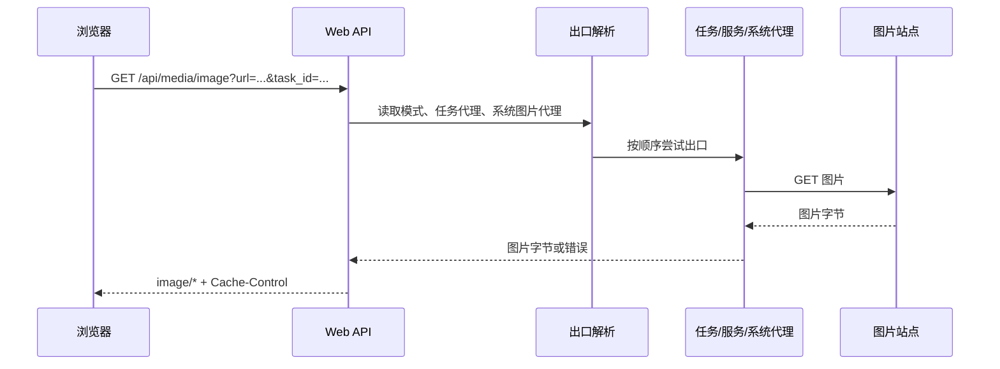

# 图片加载代理设计

## 用途与边界

商品图片目前在浏览器里直接请求原站 CDN。采集任务、站点和构建已经有代理出口，但 `` 请求不受这些配置影响；图片 CDN 按地区、IP 或来源站限制时，任务数据正常、预览却缺图。

本设计给商品图片增加一个同源的服务端取图入口：浏览器请求 `/api/media/image`，服务端按任务、服务和系统设置解析出口后代取图片。它只处理商品预览图片，不代理网页、Cookie、登录态或任意下载；采集器、构建器和任务状态机不变。决策记录见 [ADR 0028](adr/0028-图片加载代理.md)。

## 目标与成功判据

目标：

- 工作在任务详情、工作台实时数据和 CSV 主图列的缩略图、弹窗大图和缩略图轨道都走同一取图入口。
- 自动模式优先复用任务或站点已经配置的代理，其次服务默认代理和系统图片代理，最后直连。
- 指定模式只走用户填写的代理，失败时不静默直连。
- 系统设置可保存模式与代理；任务定义中的代理继续作为单任务覆盖。
- 取图有明确的安全边界：只允许公网 HTTP(S) 图片，限制大小、超时、重定向和内容类型，不回显代理或目标查询串。

非目标：

- 不做代理池、节点测速、自动轮换或 mihomo/Clash 实例管理。
- 不把浏览器 Cookie、登录态或自定义请求头转发给图片站点。
- 不做服务端图片缓存；首版只用浏览器缓存和 `Cache-Control`。
- 不支持 SVG、视频、HTML、`file:` 或内网地址。

## 现状与问题

- 任务代理写入 `task.input.proxy`，服务默认代理来自 `serve --proxy` 或 `ECOM_FETCH_PROXY`；构建和采集请求会使用它们。
- 商品图片 URL 在 `result.product_preview.primary_image_url`，前端原先直接 ``，请求由浏览器发出，无法复用任务出口。
- 跨域、地区 CDN 和防盗链都可能让浏览器拿不到图片；单纯重试前端图片不会改变出口。
- 图片地址来自采集结果，可能被恶意站点注入；服务端取图必须防止 SSRF。

## 决策

### 取图链路

前端用 `imageProxyUrl(url, taskId)` 生成同源地址。原图 URL 仍保留在 `product_preview` 中，弹窗的“复制图片 URL”“下载图片”“打开原图”继续使用原图；只有显示请求走代理。

### 模式与优先级

| 模式 | 路线 | 失败行为 |
| --- | --- | --- |
| `auto`（默认） | 任务代理 → 服务默认代理 → 系统图片代理 → 直连 | 某一路失败后继续下一路；直连失败才报错 |
| `specified` | 仅系统图片代理 | 失败直接返回错误，不静默直连 |
| `direct` | 直连 | 失败返回错误 |

- 任务代理来自 `task.input.proxy`，即任务定义或批次站点启动时记录的出口。
- 服务默认代理是 `serve --proxy`／`ECOM_FETCH_PROXY` 的进程级出口；它和任务代理同属“任务侧出口”，放在系统图片代理之前。
- 相同代理 URL 只尝试一次；`auto` 总是把直连放在最后。
- 系统设置保存模式与系统图片代理；任务定义已有代理不改写、不覆盖。

### 配置接口

| 接口 | 用途 |
| --- | --- |
| `GET /api/system/image-proxy` | 返回 `mode`、`proxy`、`service_proxy_configured` |
| `PUT /api/system/image-proxy` | 保存 `{mode, proxy}`；`specified` 必须有代理 |
| `GET /api/media/image?url=...&task_id=...` | 取图；`task_id` 可选，用于解析任务代理 |

- 代理 URL 接受 `http`、`https`、`socks5`，不接受内嵌账号或密码，最长 500 字符。
- 系统设置页新增“图片加载代理”卡片；修改后对之后加载的图片立即生效，不需要重启。
- 数据预览表头（工作台实时数据、任务详情商品卡、CSV 表格）提供“预览设置”按钮，在当前页 Dialog 内复用同一套 `ImageProxyForm`；不把用户带到系统设置页。
- CSV 描述在表头切换单行／换行；单行点击描述、两种模式下点击描述都可打开商品预览弹窗的“完整描述”标签。
- 任务或站点代理仍由现有任务定义／批次配置维护，不新增第二份站点代理表单。

### 安全边界

| 边界 | 规则 |
| --- | --- |
| 目标协议 | 只允许 `http`、`https` |
| 目标主机 | 解析结果必须全部是公网地址；拒绝回环、私网、链路本地、保留、组播和 `.local`／`.internal` |
| 凭据 | 目标 URL 和代理 URL 都不接受 userinfo |
| 重定向 | 最多 3 次，每一跳重新校验目标主机 |
| 大小 | 响应最多 8 MiB；声明 `Content-Length` 超限直接拒绝 |
| 超时 | 总 20 秒，连接 10 秒 |
| 类型 | 只返回可识别的栅格图片；拒绝 SVG、HTML 和未知类型 |
| 日志 | 只记录任务 ID、主机名和出口来源，不记录完整 URL 查询串或代理凭据 |
| 缓存 | 成功响应 `Cache-Control: public, max-age=3600`；错误不缓存 |

SSRF 校验仍存在 DNS 重绑定的理论窗口；首版按解析时地址判断，后续如需更强隔离，可把取图移到独立网络命名空间或只允许图片域名白名单。

### 失败与回退

- `auto`：每个代理失败后继续下一路；如果所有代理失败，最后直连；直连失败返回 `IMAGE_FETCH_FAILED`。
- `specified`：只尝试系统代理，失败返回 `IMAGE_FETCH_FAILED`，不回退直连。
- 目标 URL 非法（私网、非 HTTP、带凭据）返回 `INVALID_IMAGE_URL`，不因换代理重试。
- 前端缩略图加载失败显示统一占位；弹窗显示重试、打开原图和来源页入口。

## 验证

- 后端新增 `test_image_proxy.py`：配置校验、优先级、去重、指定模式不回退、私网/协议/凭据拒绝、SVG/超限/重定向校验、设置 API 和取图 API。api 组 107 项通过，ruff 通过。
- 前端新增 `media.test.ts`、`ImageProxySettings.test.tsx`、`PreviewSettingsButton.test.tsx`，并更新 CSV、工作台图片地址、描述单行／换行断言；前端 179 项测试、lint、typecheck、format、build 通过。
- 用只读临时实例连接真实账本验证：真实商品图经 `/api/media/image` 返回 200、`image/webp`、66,868 字节；私网目标返回 400；临时实例已停止。
- 8765 已重启加载新后端；重启前运行任务已 `FINISHED / BUDGET_EXHAUSTED`。真实任务 `web-b3817b78a895` 的实时数据、CSV 描述弹窗/换行和表头预览设置弹窗已走查；390 弹窗不溢出。

## 已知缺口

- 没有服务端图片缓存；浏览器缓存 1 小时，重复打开或强刷仍会重新取图。
- 不转发 Cookie、Referer 或自定义请求头；需要登录态或防盗链校验的图片仍可能失败。
- 不支持 SVG；需要矢量图的站点不适用。
- 没有按图片域名白名单、DNS 固定或独立网络隔离；当前依赖解析后的公网地址校验。
- 自动模式的直连兜底可能改变实际出口；指定模式不兜底，适合需要固定地区上下文的场景。
