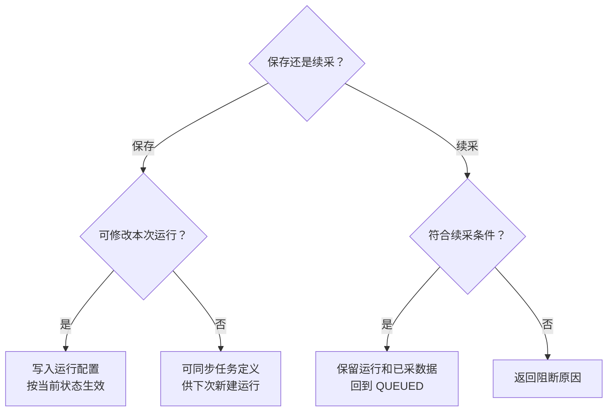

# 运行配置与预算续采设计

## 用途与边界

本设计给采集工作台增加一个按运行调整采集预算和参数的入口，并允许已因预算耗尽结束的运行在原地续采。它解决的是任务级采集限额，不是模型 token 预算、金额预算或站点速率策略本身。

入口放在采集工作台底部面板的“运行配置”页签；最近任务行或任务树节点的菜单会把选中的运行切到该页签。表单保持独立组件，后续需要时也可以复用为弹窗，但本轮不新增第二个弹窗入口。

当前任务限额在入队时写入 `tasks.limits_json`。之后修改系统“采集计划与速率”或任务定义只影响新运行；运行中的任务和已结束运行保持原限额。用户看到 `预算耗尽` 时，无法判断是商品数、时长还是 sitemap 发现上限，也无法在不新建运行、不丢失已采结果的情况下继续。

本设计保持任务状态机的主体不变，只新增一个受控例外：`FINISHED / BUDGET_EXHAUSTED` 且仍有剩余工作或发现截断的运行，可以显式续采，沿用同一 `task_id`、已采结果和账本。`CANCELLED` 仍是终态，不能续采。决策记录见 [ADR 0029](adr/0029-运行配置与预算续采.md)。

## 部分完成与后续动作

工作台里的「部分完成」表示本轮的 `outcome=PARTIAL`，生命周期为 `FINISHED`。符合续采资格的运行在最近任务、任务树和任务详情提供「续采此运行」。操作打开原运行的「运行配置」，展示停止原因和待采项，由用户选择是否「保存并继续采集」。关联任务定义的已结束运行仍可显式「新建运行」。

| 操作 | 状态变化 | 对已有数据的影响 |
| --- | --- | --- |
| 继续暂停的运行 | `PAUSED → QUEUED → RUNNING` | 沿用原 `task_id`、工作项和累计运行时长 |
| 续采此运行 | `FINISHED → QUEUED → RUNNING` | 沿用原 `task_id` 和已采数据。时长给一段新预算，商品数上限仍按该运行的累计处理数计算。发现截断时按需重新发现 |
| 新建运行 | 新 `task_id` 从 `QUEUED` 开始 | 根据任务定义发起一次独立采集，原运行仍可查看 |

2026-11-28 通过常驻工作台的只读接口核对最近列表中的四条部分完成运行。

| 运行 | 停止原因与剩余工作 | 当前操作 |
| --- | --- | --- |
| `web-b3817b78a895` · Bubutissus | 达到 3,600 秒上限；632 件有效，7 件失败，另有 4,364 件待采和 1 个导航项 | 原运行的「运行配置 → 保存并继续采集」可续采，使用新一段时长预算 |
| `web-04d8694573fe` · Gaspard et Léonie | 达到规则的 `max_sitemaps=4`；2,333 件有效，已发现商品处理完毕，发现范围仍被截断 | 在原运行调高 sitemap 上限并保留「重新发现」，再保存并继续采集 |
| `web-62d05ef69afc`、`web-0d7b9732fdc9` · Bubutissus | 记录为 `NATURAL_END`，分别有 79 件和 1 件失败，待采商品、导航项均为 0 | 先查看失败项。需要再采时可显式新建运行 |

**已落地的入口。** 最近任务对可续采的原运行显示「预算耗尽 · 可续采」和停止详情。任务详情可以直达原运行配置。有失败项且不可续采时，提供「查看失败项」，直接打开筛选后的工作项列表。暂停继续沿用原控制，最近任务菜单保留独立的「新建运行」。列表、详情和运行配置复用服务端资格判断。

2026-11-28 已对 `web-b3817b78a895` 做一次真实原地续采：仅把本次运行时长改为 90 秒、不同步任务定义，续采后仍是同一 `task_id`，有效 632→639、待采 4,364→4,357，原 632 个来源网址全部保留，`products.csv`、`products.jsonl` 和任务结果均为 639 条；运行再次以 `BUDGET_EXHAUSTED` 结束并继续保留「续采此运行」。该站每件约 12–15 秒，样本只验证连续性，不代表吞吐变化。证据在仓库外 `workbench/recovery-drill-20261128/real-resume/`。

验收覆盖时长耗尽、发现上限截断且零待采、自然结束但有失败、非预算错误、归档和取消。核对列表主操作、确认后的任务 ID 和重新排队状态。用时长和发现两类案例验证续采后的有效计数与导出内容连续，且明确是否同步到任务定义。沿用[状态审查与补齐顺序](09-任务状态与计数契约.md#状态审查与补齐顺序)补服务端判据。

## 目标与成功判据

目标：

- 采集工作台底部面板新增“运行配置”页签；最近任务行和任务树节点的菜单都把选中的运行切到该页签。
- 页签显示当前运行的限额、进度、停止原因和具体停止详情，不再只显示“预算耗尽”。
- 页签可修改商品数、时长、URL 数、重试次数、并发、每域 RPS、请求间隔、最大导航数和最大 sitemap 数。
- 正式采集预算默认不设限；用“启用有限预算”开关渐进披露具体字段，关闭时只显示当前入队限额和取消影响。
- 排队、暂停和运行中的运行保存后写入本次运行；运行中在下一个工作项边界生效，已发出的请求不中断。
- 已结束且可续采的运行提供“保存并继续采集”，保留已采结果，重置被截断的发现项后继续。
- 保存时默认同步任务定义，后续运行沿用新参数；用户可以取消同步。
- 工作台启动任务时读取系统正式采集策略和站点速率策略，不再把规则里的 1 并发当成正式任务默认值。
- 时长预算跨服务重启累计，不因重启重置。
- 停止详情写入任务摘要和工作台，能区分“时长到顶”“商品数到顶”“sitemap 子项到顶”。

成功判据：

- 续采后任务仍是同一 `task_id`，已采计数不减少，待采项被继续处理，CSV 和任务结果在结束时按完整结果重写。
- 取消、归档和正常完成的任务不会出现续采入口；所有续采都需要显式确认。
- 运行中的预算上调能在不重启服务的情况下生效；速度和并发修改明确提示需要暂停后继续。
- 前端 390 宽度页签不横向溢出，axe 无新增违规；后端和前端测试覆盖 API、状态转换、预算刷新和界面主路径。

## 非目标

- 不改变规则包的发现策略、选择器或目标覆盖门禁。
- 不提供任意规则热替换、代理热替换或将运行中的 fetcher 线程池扩容。
- 不把 `CANCELLED` 改成可续采；取消后继续仍必须新建运行。
- 不做多运行批量预算编辑、跨运行合并导出或运行子任务拆分。
- 不把正式采集的“不限制”改成强制有限值；留空仍表示不限制。
- 不改站点速率策略的存储结构和系统设置页，只读取并允许本次运行覆盖。

## 现状与问题

账本中两条正式的预算耗尽记录：

| 运行 | 入队限额 | 实际停止 | 结果 |
| --- | --- | --- | --- |
| `web-04d8694573fe` | 10,000 商品 / 3,600 秒 / 并发 1 | `sitemap index reached max_sitemaps`，规则只允许 4 个 sitemap 子项 | 2,333 有效，0 待采 |
| `web-b3817b78a895` | 10,000 商品 / 3,600 秒 / 并发 1 | `task budget exhausted`，60 分钟用完 | 632 有效，4,364 待采 |

同一站点的对照技术任务 `web-62d05ef69afc` 使用 5,200 商品 / 10,800 秒 / 并发 4，46 分钟处理 5,003 件。差异主要来自并发和时长，而不是规则本身。

已确认的缺口：

- `start_workbench_task` 用定义里的限额启动，但没有合并 `collection_policy` 的正式默认值和 `site_rate_policies`，导致正式任务沿用规则里的 1 并发、1 秒延迟。
- `_budget_exceeded` 只检查 `max_seconds` 和 `max_requests`；商品数和 URL 数主要在发现阶段限制，已入队项不会因后来降低限额而停止。
- `Runner` 的 `_started_monotonic` 在进程内初始化，服务重启或 worker 重新领取任务后时长预算重置。
- `_finalize` 用 `_counts()` 覆盖 `counters`，`discovery_limit` 标记可能在结束时丢失；工作台只展示 `stop_reason`，不展示 `stop_detail`。
- 现有“编辑任务定义”只改后续运行，不能调整当前运行，也不能续采。

## 决策

### 入口与页签

入口放在采集工作台底部面板：

- 底部页签新增“运行配置”，与运行日志、实时数据、任务详情、文件与导出并列。
- 最近任务行 `⋯` → `运行配置`：选中该运行并切到页签。
- 任务树节点 `⋯` → `运行配置`（节点存在当前或最近运行时）：选中该节点对应运行并切到页签。
- 任务详情页暂时不增加第二个入口；表单组件独立，后续可复用为弹窗。

页签分四块：

| 区域 | 内容 | 生效范围 |
| --- | --- | --- |
| 状态摘要 | 站点、运行编号、状态、已处理/总数、待采、停止原因、停止详情 | 只读 |
| 预算 | 正式采集默认不设限；勾选“启用有限预算”后才显示最大商品数、最大时长、最大 URL（发现任务）；关闭时隐藏字段并显示当前入队限额。最大尝试次数始终显示 | 本次运行可调 |
| 速度 | 并发、每域 RPS、请求间隔 | 保存后写入本次运行；运行中需暂停并继续才生效 |
| 发现 | 最大导航数、最大 sitemap 数 | 进行中的发现可生效；已截断的发现需续采或下次运行 |

底部：

- `同步到任务定义，后续运行沿用`，默认勾选；没有任务定义时隐藏。
- 已结束且可续采：`保存并继续采集`，另提供 `仅保存为下次运行`。
- 排队、运行中、暂停：`保存并应用`。
- 已结束但不可续采：`保存为下次运行`。
- 只读预览：所有输入和保存禁用，保留查看与关闭。

字段校验在提交时执行，不在输入时禁用按钮；非法值就地显示原因，保留用户已填内容。正式采集关闭“启用有限预算”时不校验隐藏字段，保存或续采写入 `null` 表示不限制；开启后按字段校验。时长以秒为单位，辅助文案给出“3600 秒 = 1 小时”。

### 运行配置的读取

`GET /api/workbench/runs/{task_id}/config` 返回：

- 运行状态、`stop_reason`、`stop_detail` 和计数。
- 本次运行实际生效的限额：`max_urls`、`max_products`、`max_seconds`、`max_attempts`、`max_navigation`、`max_sitemaps`、`concurrency`、`per_domain_rps`、`delay_ms`。
- 任务定义摘要和定义中的限额。
- 规则声明的发现上限、站点速率策略。
- `can_continue`、续采提示和 `reset_discovery` 默认值。

`stop_detail` 优先从本轮结束时的 `task-result.json` 读取。`can_continue` 检查 `FINISHED`、`BUDGET_EXHAUSTED`、未归档、非克隆数据快照，并存在待采商品／导航或发现截断。发现截断通过停止详情中的 `max_sitemaps`、`max_navigation`、`max_pages`、`max_depth`、`max_batches` 等标记或 `discovery_limit` 判断。续采事务复核停止原因。[状态审查](09-任务状态与计数契约.md#状态审查与补齐顺序)

### 保存与生效

`PATCH /api/workbench/runs/{task_id}/config` 接收部分字段：

```json
{
  "limits": {
    "max_products": 10000,
    "max_seconds": 14400,
    "max_navigation": null,
    "max_sitemaps": 100
  },
  "rate": {
    "concurrency": 4,
    "per_domain_rps": 4.0,
    "delay_ms": 0
  },
  "sync_definition": true,
  "action": "save",
  "reset_discovery": false
}
```

- 只提交用户实际修改的字段；未出现的字段保持原值。
- 预算和发现字段显式传 `null` 表示不限制／继承规则默认；`max_attempts`、`concurrency`、`per_domain_rps`、`delay_ms` 不接受 `null`。
- `limits.max_products`、`max_urls`、`max_seconds` 的范围与现有 `Limits` 模型一致；`max_products` 上限提高到 100,000，避免正式采集被旧的 10,000 上限锁死。
- `rate.concurrency` 同时写入商品和导航并发；`delay_ms` 同时写入 `limits.fetch_delay_ms` 和 `rate_policy.delay_ms`；`per_domain_rps` 写入 `input.rate_policy`。
- 任务定义同步只合并本次提交的字段，保留定义里的其他键。

状态行为：

| 运行状态 | 保存后 |
| --- | --- |
| `QUEUED` | 更新 `tasks.limits_json`／`input`；worker 领取时使用新值 |
| `RUNNING` | 更新账本；runner 在工作项边界刷新预算和发现上限；并发、RPS、请求间隔提示“暂停并继续后生效” |
| `PAUSING`／`PAUSED` | 更新账本，继续后由新 runner 使用 |
| `FINISHED` + `action=save` | 不改写历史运行的限额；只同步任务定义（如有） |
| `FINISHED` + `action=continue` | 校验可续采后，更新运行限额并转入 `QUEUED` |
| `CANCELLED` / 归档 | 拒绝续采；只允许保存任务定义，取消仍是终态 |

### 原地续采

续采在同一事务内完成：

- 允许运行已因预算结束、未归档、非克隆数据快照，且存在待采项或发现截断。
- 更新 `limits_json`、`input_json`，清除 `outcome`、`stop_reason`、`finished_at` 以及租约占用和心跳，保留递增的租约令牌。
- 清除 `counters.discovery_limit` 和 `counters.run_seconds`，写入 `counters.continued_at`。
- `reset_discovery=true` 时把全部 `navigation` 工作项重置为 `PENDING`、`attempts=0`、`failure_class=NULL`，保留其发现上下文；已完成的商品项不动。
- 从最近任务移除记录中删除该运行，让它回到最近列表。
- 状态改为 `QUEUED`，由 worker 正常领取。

runner 启动时会：

- 隔离旧的 `task-result.json` 为 `task-result.previous.json`，保留上一段结果。
- 从已接纳的工作项恢复商品明细，旧运行可用 `products.jsonl` 补齐。缺少已接纳明细时报告恢复异常。
- 对已存在的导航和商品项做归一化去重，不重复入队。
- 结束时重写完整 CSV、URL 清单和 `task-result.json`。

续采不重置 `started_at`，因此界面上的墙钟耗时包含前一段；时长预算使用 `counters.run_seconds` 的新一段计数，续采时从 0 开始。

### 预算刷新与硬上限

runner 在每次工作项边界读取最新 `tasks.limits`：

- `max_seconds` 使用 `run_seconds + 本次 runner 已用秒数`，跨重启累计。
- `max_products`／`max_urls` 增加处理数硬上限：已处理数达到限额时停止，不只限制发现阶段。
- `max_attempts` 在重试判断处读取最新值。
- `max_navigation`、`max_sitemaps` 重新计算；运行中修改只影响尚未完成的发现，已经结束的 sitemap 入口不会自动重跑。
- 并发、RPS 和请求间隔依赖 fetcher／线程池初始化，不在运行中热改；保存时返回 `resume_required=true`，界面提示暂停后继续。

运行循环每隔约 15 秒在检查点写入 `counters.run_seconds`，暂停和结束时也写入。服务重启沿用最后一次持久化的值。异常中断可能丢失这次保存之后的时间，遇到长工作项时实际间隔会超过 15 秒。

### 工作台启动策略

`POST /api/workbench/tasks/{node_id}/start` 改为与批次／任务创建一致：

- 任务定义显式提供的限额优先。
- 正式采集缺失的商品数和时长使用 `collection_policy`；`formal_unlimited=true` 时为 `null`。
- 试采缺失值仍使用 100 URL／20 件／180 秒。
- 站点速率策略按域名读取，叠加系统默认速率；定义中的 `concurrency`、`per_domain_rps`、`delay_ms` 作为显式覆盖。
- 规则发现上限只在定义显式提供 `max_navigation`／`max_sitemaps` 时覆盖。
- 生成的运行在 `input.rate_policy` 和 `limits` 中保留实际值，供运行配置页签回显。

### 机制

运行配置页使用同一个提交入口。保存配置和预算续采各按运行状态决定何时生效。



运行中修改并发、RPS 或请求间隔后，可暂停并继续以加载新值。只同步定义需要运行已关联任务定义，否则保存返回 `TASK_NOT_EDITABLE`。预算停止与重新领取见[任务状态转移图](09-任务状态与计数契约.md#状态转移)。

## API 契约

| 接口 | 用途 |
| --- | --- |
| `GET /api/workbench/runs/{task_id}/config` | 读取运行限额、定义、规则发现上限、站点速率、停止详情和续采资格 |
| `PATCH /api/workbench/runs/{task_id}/config` | 保存运行限额／速率／发现上限，或续采 |
| `PATCH /api/workbench/tasks/{node_id}` | 已有定义编辑接口；`limits` 增加并发、RPS、请求间隔、发现上限 |

错误码：

| 场景 | 状态码 | 错误码 |
| --- | --- | --- |
| 未知运行 | 404 | `NOT_FOUND` |
| 非法限额 | 422 | `INVALID_LIMITS` |
| 状态不允许保存／续采 | 409 | `TASK_NOT_EDITABLE` |
| 无可续采工作 | 409 | `TASK_NOT_CONTINUABLE` |
| 只读服务写入 | 403 | `READ_ONLY` |

## 失败、回滚与边界

- 续采在事务中完成；保存失败不改变任务状态和限额。
- 续采后 runner 若再次达到限额，仍按原口径标记 `BUDGET_EXHAUSTED`，可以再次续采；不会伪装完成。
- 续采不保证站点仍可访问、规则未过期或商品未下架；失败按正常任务失败记录。
- 运行中降低限额可能在下一个工作项边界立即停止，已发出的请求仍会完成并计费／计入请求数。
- 旧运行没有 `run_seconds` 时从 0 开始累计；续采时显式重置为 0，给用户一段新的预算。
- 回滚：停止服务，恢复账本备份；已续采的任务保持 `QUEUED` 或后续状态，不会自动回到旧结果。需要保留旧结果时使用 `task-result.previous.json` 或账本备份。
- 不支持撤销一次已开始的续采；如需停止，使用取消或暂停。

## 验证

- 后端：`test_run_config.py` 覆盖运行配置读取、部分字段合并、定义同步、预算耗尽原地续采、导航重置、拒绝取消／完成续采、工作台启动读取正式策略和站点速率、预算硬上限和跨重启累计；api 组 116 项、runtime 组 108 项、全量 492 项通过，ruff 通过。
- 前端：运行配置页签 5 项测试和页面入口测试通过；全量 192 项测试、lint、typecheck、format、build 通过；“启用有限预算”默认关闭，开启后才显示商品数、时长和 URL 字段；页签 axe 0 violations（jsdom 下关闭无法计算的 color-contrast，颜色沿用现有令牌）。
- OpenAPI：`app/schemas/openapi.json` 重新生成，api 组的快照校验通过。
- 文档：96 个文件、1,380 条链接可解析；导出 106 个文件，导出包复核通过。
- 8765：重启后加载新后端和新前端，真实账本只读打开 `web-b3817b78a895` 和 `web-04d8694573fe`：前者显示 639/5,003、4,364 待采、时长上限 3,600 秒；后者显示 2,333/2,333、`sitemap index reached max_sitemaps` 和默认勾选“重新发现”。390 视口字段按两列堆叠，无页面级横向溢出。
- 未执行：在正式账本点击“保存并继续采集”（会触发真实站点请求）；真实运行中的预算热改；正式站点续采后的 CSV 合并。上述逻辑由 API／runner 测试和临时账本覆盖，正式账本操作留给项目方验收。
