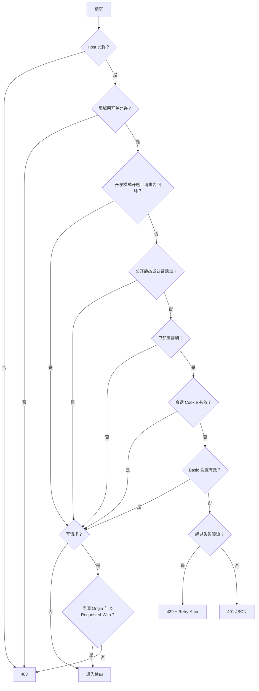
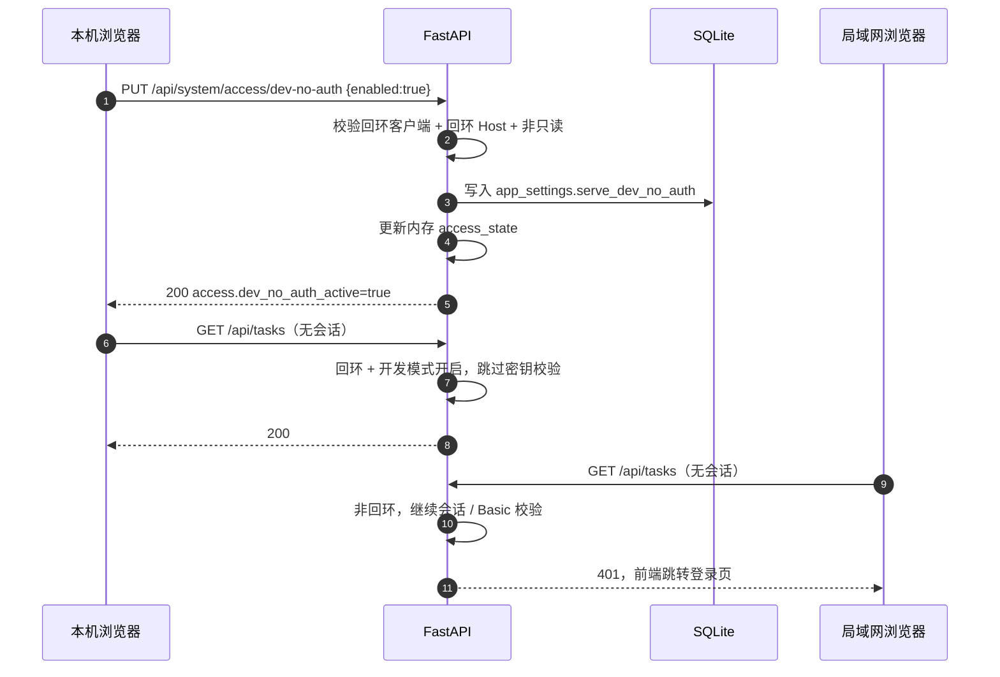
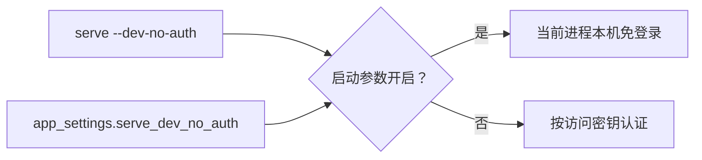

# 开发模式本机免登录设计

## 用途与边界

开发期经常需要反复重新打开页面、换浏览器 profile 或让编码 agent 直接走查接口；当前账本已保存访问密钥，而 8765 又以 `--host 0.0.0.0` 启动，所以从本机 `127.0.0.1` 打开也要先经过登录页。本设计提供一个显式的开发模式，暂时跳过本机请求的访问密钥校验，减少开发期登录操作。

它只改变**本机回环请求**的认证路径，不改变局域网访问密钥、Host 校验、同源写保护、登录页、会话和密钥存储。决策记录见 [ADR 0030](adr/0030-开发模式本机免登录.md)。

## 目标与成功判据

目标：

- `serve` 新增 `--dev-no-auth` 启动参数；`scripts/serve_dev.py` 的 `start`／`restart` 同步支持并保存该参数。
- 系统设置页“访问与认证”新增“本机开发免登录”开关；开启或关闭立即生效，不需要重启。
- 开关状态写入账本 `app_settings`，刷新、重启后保持；启动参数 `--dev-no-auth` 可对当前进程强制开启。
- 开启后，只有同时满足“TCP 对端是本机回环地址”和“Host 头是回环名称”的请求跳过访问密钥；其他请求继续走原有登录页、Basic 和会话校验。
- 页面持续显示开发模式提示，避免开发结束后忘记关闭。

成功判据：

- 开启后从 `http://127.0.0.1:8765/` 打开工作台，不经过登录页，刷新和重新打开浏览器仍然免登录。
- 从局域网地址访问同一实例，未登录仍返回 401 并进入登录页；使用访问密钥后可以正常使用。
- 只通过设置页开关也能完成开启和关闭；关闭后本机下一次请求立即恢复登录要求。
- 启动参数强制开启时，设置页开关显示为只读并说明来源，避免修改不生效造成误解。
- 只读模式不能修改开关；开发模式不写入、不删除访问密钥，关闭后原密钥和会话仍然有效。
- 后端测试覆盖本机／远程、手脚开关、设置持久化、启动参数优先和只读拒绝；前端测试覆盖开关、提示和强制状态。

## 非目标

- 不把访问密钥改成可选或删除现有密钥；账本中的 `serve_token` 保持不变。
- 不改变局域网认证、失败限流、30 天会话 Cookie、登录页和 Basic 兼容。
- 不提供公网或不可信环境下的免登录；不引入 OAuth、多用户或 TLS。
- 不新增环境变量开关；开发实例通过 `serve_dev.py --dev-no-auth` 或设置页控制，避免环境变量在不相关进程里意外生效。
- 不豁免非回环 `--host` 的启动检查：没有访问密钥或已存密钥时，`0.0.0.0` 仍拒绝启动；开发模式只跳过本机请求的密钥校验。
- 不在页面提供重启服务、改监听地址或绕过同源写保护的能力。
- 不把开发模式写进 `/api/health` 之外的公开诊断接口；`/api/system` 仍按现有认证路径保护。

## 现状与问题

当前认证行为：

- 账本里存在 `app_settings.serve_token` 时，`create_app` 会恢复密钥哈希，所有页面 API、SSE、导出都要求会话 Cookie 或 Basic。
- 8765 当前以 `--host 0.0.0.0` 启动，属于局域网可访问实例；启动脚本仍只需提供账本和输出目录，不会因为“本机访问”自动免登录。
- 设置页只能开关局域网和轮换密钥，没有临时跳过本机登录的开发入口。
- 编码 agent 没有用户的访问密钥，真实 8765 的登录后走查只能留给项目方，交接记录里已多次出现这一限制。

开发期需要的不是“删除密钥”，而是**可随时打开、可明确看到、可随时关闭的本机旁路**。删除或重置密钥会影响其他设备和脚本，也会让开发结束后的恢复多一步。

## 关键决策

| 决策 | 选择 | 理由 | 主要替代方案 |
| --- | --- | --- | --- |
| 开关形态 | 启动参数 + 设置页开关 | 命令行首次开启，页面日常切换；两种入口共用同一设置 | 只有启动参数（每次重启找不到入口）；只有页面开关（首次被登录挡住） |
| 生效范围 | 仅回环客户端且回环 Host | 开发便利与局域网安全边界分离；不把无认证面板暴露到局域网 | 所有客户端免登录（不安全）；仅回环绑定（当前 0.0.0.0 实例需改命令） |
| 回环判定 | TCP 对端 IP + Host 头同时为回环 | 防止本机反向代理把外部请求变成回环请求 | 只看 `X-Forwarded-For`（可伪造）；只看 Host（局域网可伪造） |
| 持久化 | 写入 `app_settings.serve_dev_no_auth` | 刷新和重启后保持；与现有设置页一致 | 只存在内存（重启即失效）；localStorage（后端不知道，局域网不生效） |
| 启动参数优先级 | `--dev-no-auth` 对当前进程强制开启，页面开关只读 | 显式命令优先，避免页面值与实际行为不一致 | 页面可以覆盖启动参数（来源不清晰） |
| 关闭方式 | 页面开关关闭，或去掉启动参数后重启 | 不需要删除密钥或迁移数据 | 重置访问密钥（影响所有设备） |
| 提示 | 设置页开关 + 页眉持续胶囊 | 开发模式容易遗忘；持续提示比一次性 toast 可靠 | 只在启动日志提示（页面看不到） |
| 只读模式 | 拒绝修改开关 | 只读实例的写路径统一 403 | 允许写设置（破坏只读承诺） |
| 登录／退出 | 登录页保留；本机退出登录在开发模式开启时不生效 | 关闭开发模式后仍按原会话规则工作 | 开发模式删除登录页（回滚成本高） |

## 界面与交互

### 设置页

“访问与认证”卡新增一个与局域网开关并列的“本机开发免登录”区域：

- 标题写明“仅 127.0.0.1／localhost／::1 生效；局域网设备仍需访问密钥”。
- 开关打开时显示 warning 色调提示和“开发模式已开启”徽标。
- 开关由 `PUT /api/system/access/dev-no-auth` 切换，成功后刷新 `/api/system` 缓存并提示结果。
- 当 `dev_no_auth_forced=true`（由启动参数强制）时，开关保持选中且禁用，说明“由启动参数 --dev-no-auth 强制开启；去掉参数并重启后可在这里修改”。
- 当前浏览器不是回环入口时，开关禁用并说明“只有本机浏览器可以修改此开关”。
- 只读模式禁用开关，说明写设置被只读模式禁止。
- 没有配置访问密钥时仍允许开关，但显示“当前未配置访问密钥，登录本来未启用；设置密钥后本机将继续免登录”。
- 开发模式开启时，本机“退出登录”按钮禁用并说明原因；局域网浏览器不受影响。

### 页眉提示

`AppShell` 复用现有 `/api/system` 查询，在服务状态胶囊旁显示 warning 色调的“开发免登录”胶囊：

- 仅当 `dev_no_auth_active=true` 时显示。
- 悬停或读屏文案说明“本机请求跳过访问密钥；局域网仍需登录；点击打开系统设置”。
- 点击进入 `/settings`，不新增第二个设置入口。
- 窄屏下与现有胶囊一样收敛为短文案，不挤压导航。

### 登录页

登录页结构不变。开发模式开启且从回环入口打开时，API 请求直接成功，前端不会跳转到登录页；手动打开 `/#/login` 仍可正常提交密钥，但本机请求不会因为开发模式而拒绝登录。

## 机制

### 访问判定

关键点：

- 开发模式只在原有 Host 和局域网开关都通过之后参与判定，不能绕过这两层。
- 回环判定要求请求的 TCP 对端是回环地址，并且 Host 头是 `127.0.0.1`、`localhost` 或 `::1`；不使用 `X-Forwarded-For`。
- 免登录只跳过“密钥／会话／Basic”分支；写请求仍要求同源 `Origin` 和 `X-Requested-With`。
- 登录和退出端点保持原样；开发模式下退出登录只清 Cookie，但本机下一次请求仍会通过回环旁路。

### 开关与请求时序

### 启动优先级

启动参数开启时，页面开关不可修改；启动参数关闭时，页面开关决定持久设置。重启后按“启动参数或设置值”重新计算。

## API 约定

`GET /api/system` 的 `server` 新增字段：

| 字段 | 类型 | 含义 |
| --- | --- | --- |
| `dev_no_auth_setting` | boolean | 账本中保存的开关值 |
| `dev_no_auth_active` | boolean | 当前进程是否对本机回环请求免登录 |
| `dev_no_auth_forced` | boolean | 是否由 `--dev-no-auth` 强制开启 |

`PUT /api/system/access/dev-no-auth`：

- 请求体：`{"enabled": boolean}`。
- 成功：`200 {"access": {...}}`，结构同 `PUT /api/system/access`。
- 认证：沿用会话或 Basic；开发模式开启时本机回环请求自动通过。
- 限制：仅回环客户端且回环 Host 可调用；`--dev-no-auth` 强制开启时返回 `409 DEV_MODE_FORCED`；只读模式由中间件返回 `403 READ_ONLY`。
- 非回环调用返回 `403 DEV_MODE_LOOPBACK_ONLY`。
- 不修改 `serve_token`、`serve_lan_enabled` 或会话 Cookie。

CLI：

- `serve --dev-no-auth`：当前进程对本机回环请求跳过访问密钥；与 `--host 0.0.0.0` 兼容，不影响局域网认证。
- `scripts/serve_dev.py start|restart --dev-no-auth`：把参数写入 `.runtime/serve-<port>.json`，重启时复用；`adopt` 能从现有命令行识别该参数。`--no-dev-no-auth` 清除已保存的启动参数。
- 启动输出增加 warning 行，说明本机免登录生效、局域网仍需密钥。

## 失败、安全与回滚

- **误开在本机**：只影响本机回环请求；局域网设备仍需要访问密钥。页眉胶囊和设置页徽标持续提示。
- **本机反向代理**：如果代理监听在回环地址并把外部请求转发进来，客户端 IP 会是回环地址；要求 Host 头也是回环名称，外部域名不会命中旁路。仍建议开发模式不要和不可信本机代理同时使用。
- **启动参数残留**：`serve_dev.py` 把参数保存在 `.runtime`，换任务或交付前运行 `status` 可看到；去掉参数重启即可关闭。文档和启动日志都会提示。
- **忘记访问密钥**：本机开发模式可以直接打开设置页并轮换密钥，不需要先执行 `reset-access-key`；轮换后局域网设备需要重新登录。
- **只读模式**：开关不可写，页面读到的 `dev_no_auth_setting` 仍可展示；不会因为只读而改变认证。
- **回滚**：去掉启动参数、关闭页面开关并重启即可恢复原认证路径；账本设置键可以保留，不影响旧代码。旧代码不读取该键，会话和密钥格式不变。
- **安全边界不变**：不新增公网暴露、TLS、多用户或逐设备会话撤销；开发模式不是生产认证方案。

## 验证计划

| 编号 | 场景 | 预期 | 证据 |
| --- | --- | --- | --- |
| `V-01` | 开启设置页开关后从 127.0.0.1 打开工作台 | 不经过登录页；刷新仍免登录 | 页面截图、`/api/system` 字段 |
| `V-02` | 同一实例从局域网地址访问 | 返回 401 并进入登录页；输入密钥后可进入 | 两台浏览器或本机局域网地址 |
| `V-03` | 关闭开关后本机刷新 | 下一次 API 请求返回 401，进入登录页 | 页面跳转和网络状态 |
| `V-04` | 以 `--dev-no-auth` 启动并重启 | 设置页显示强制开启且开关禁用；重启后仍生效 | 启动输出、设置页截图 |
| `V-05` | 只读实例和非回环地址调用开关接口 | 只读返回 403；非回环返回 403；不改账本 | 测试用例和 HTTP 状态 |

自动化补充：

- 后端：启动参数、设置持久化、重新创建 app 后仍生效、回环与远程客户端差异、Host 非回环不生效、强制状态 409、只读 403、密钥和局域网设置不变。
- 前端：设置页开关、禁用原因、强制提示、页眉胶囊、退出登录禁用；登录页在开发模式下不跳转。
- CLI／脚本：`--help`、`parse_serve_command` 识别、`start`／`restart` 保存与复用。
- 真实入口：8765 以 `--host 0.0.0.0` 和现有账本启动，本机免登录；局域网地址仍要求密钥；证据写入交接页。

## 实施顺序与回滚

1. 完成本设计和 [ADR 0030](adr/0030-开发模式本机免登录.md)，确认接口、字段和边界。
2. 后端：`access.py` 增加设置键与回环判定辅助；`app.py` 增加启动参数、访问旁路、开关接口和 `/api/system` 字段；`cli.py` 增加 `--dev-no-auth` 并更新启动提示。
3. 脚本：`serve_dev.py` 增加参数保存、重启复用和接管解析。
4. 前端：`api.ts` 类型与请求、设置页开关与提示、页眉胶囊、退出登录禁用。
5. 测试与文档：后端、前端、OpenAPI 快照、`app/README.md`、`docs/42`、`docs/43`、`docs/50` 和交接页。
6. 回滚：移除参数和开关值，重启服务；无数据库迁移，旧代码忽略新设置键。

## 当前实现与证据（2026-11-27）

- 后端：`serve --dev-no-auth`、`app_settings.serve_dev_no_auth`、回环客户端 + 回环 Host 判定、`PUT /api/system/access/dev-no-auth`、`/api/system` 三个字段和启动 warning 已实现；全量 495 项和 `ruff` 通过。
- 脚本：`serve_dev.py start|restart --dev-no-auth` 保存并复用参数，`--no-dev-no-auth` 清除；`parse_serve_command` 能从现有命令行接管该标志。
- 前端：设置页开关、强制/只读/非回环禁用原因、开发模式警示、页眉胶囊、开发模式下本机退出登录禁用均已实现；全量 192 项、`lint`、`typecheck`、`format`、`build` 通过。
- 临时 8899：启动参数开启时本机无会话 200、非回环 Host 401、强制开关 409；关闭启动参数后本机无会话 401，Basic 登录后开启设置开关立即 200，远程切换 403，关闭后恢复 401；账本 `serve_token` 未变化，实例已停止。
- 真实 8765：已重启加载新构建并在设置页开启开关；本机 `127.0.0.1` 的 `/api/health` 和 `/api/system` 为 200，局域网地址 `192.168.0.105:8765` 和主机名入口仍为 401；390 宽度无页面级横向溢出。证据在仓库外 `workbench/dev-no-auth-2026-11-27/`（1280／390 截图和 `verification.json`）。
- 未覆盖：真实第二台物理设备、本机反向代理、浏览器密码管理器和 TLS；这些不改变本机旁路的边界，但部署到不可信环境前仍需另做安全设计。

## 结论

开发模式应当是**可见、可回退、只影响本机入口**的旁路，而不是删除认证或放宽局域网边界。启动参数负责首次开启和脚本化重启，设置页负责日常切换；两者共用一份设置，任何一个入口都能让本机开发回到“打开即用”，同时把局域网访问密钥、Host 校验和写保护留在原位。
