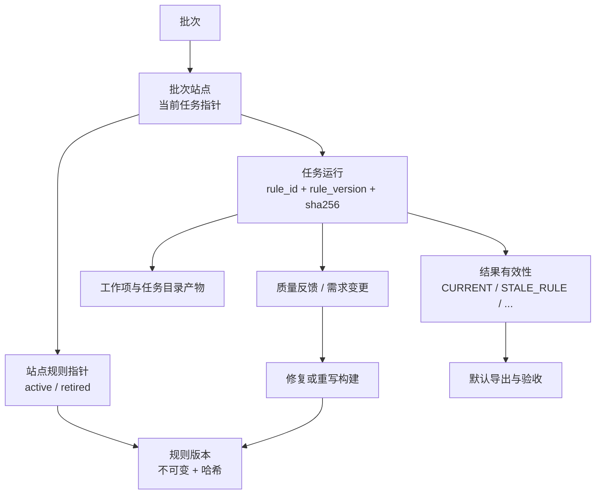
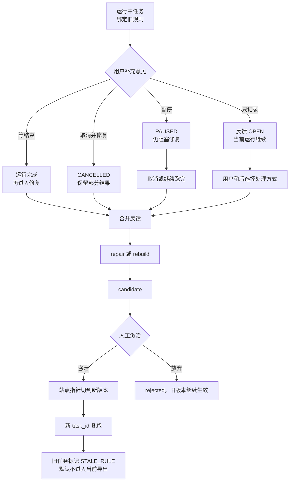
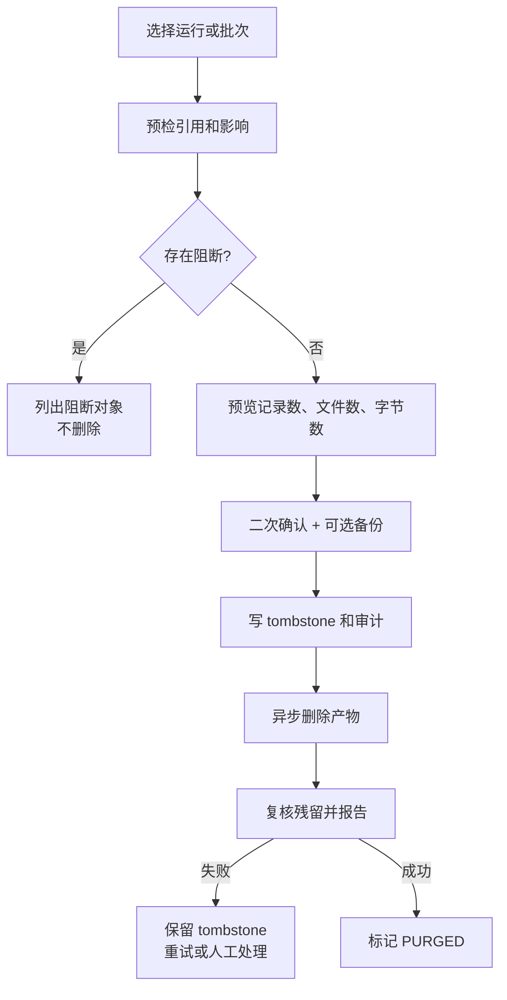

# 数据清理、规则变更与结果隔离设计

## 用途与边界

本设计补齐三个当前没有闭环的问题：

- 采集数据、任务记录和已写规则如何归档、停用和清理。
- 规则运行到一半，用户补充意见或改变要求时，如何停止当前工作、重写规则并创建新运行。
- 旧规则产生的商品和数据如何标记、隔离和保留，避免进入当前交付。

本设计不改变[任务状态与计数契约](09-任务状态与计数契约.md)的状态机和计数口径，不替代[规则修复与异常工作流](34-规则修复与异常工作流.md)的版本账本，也不把“删除全部数据”做成日常操作。默认仍是保留历史；只有独立、显式、可审计的数据清理才允许物理删除。

## 现状与问题

| 能力 | 当前状态 | 缺口 |
| --- | --- | --- |
| 任务和批次清理 | 只有归档／还原和最近列表移除 | 没有永久移除、引用检查、异步回收和审计 |
| 规则清理 | 只能拒绝候选版本；`retired` 只有枚举 | 没有退役、站点停用和未被引用版本的清理 |
| 运行中改规则 | 反馈只接受终态任务；暂停也阻塞修复和激活 | 没有“记录意见但不改变当前运行”的入口 |
| 多条意见 | 一条反馈对应一次修复 | 没有合并、追加和“本次修复未包含”的提示 |
| 从零重写 | 只有定向 `repair` | 没有 `rebuild`，已有任务的站点不能重新初始构建 |
| 候选激活 | 后端有激活／回滚 API | 站点详情退役后没有前端入口，旧链接会重定向 |
| 旧结果隔离 | 任务绑定规则版本，任务详情可标记过期 | 没有统一的结果有效性、导出白名单和默认排除 |
| 数据生命周期 | 没有保留期、用量和清理策略 | 输出目录和账本会无限累积 |

## 目标与成功判据

目标：

- 运行中的任务可以记录用户意见，但当前运行继续使用入队时锁定的规则，不被静默改变。
- 用户可以选择“记录意见，等结束”“取消并修复”或“暂停并稍后决定”；暂停本身仍不能修复，界面必须说明还要取消或跑完。
- 同一站点的多条未关闭反馈可以合并到一次修复或重写构建；构建请求一旦入队不再修改。
- 规则支持 `repair` 和 `rebuild` 两种模式；`rebuild` 只有在站点没有活跃任务和活跃构建时可用，并且激活前必须人工确认。
- 候选规则激活、回滚和放弃在工作台或构建详情内有稳定入口，不再依赖已退役的站点详情页。
- 任务结果有统一的有效性读模型；旧规则结果默认不进入当前批次导出和验收视图，但保留为历史证据。
- 数据清理分为归档和永久移除；永久移除必须先预检引用、预览影响、二次确认并写审计。
- 站点可以停用规则；停用后不能创建新任务，旧任务、旧规则和旧结果保留。
- 数据保留策略默认关闭；启用后先生成清理候选，不直接静默删除。

成功判据：

- 运行中记录意见后，任务仍按原规则完成；反馈状态为 `OPEN`，不会触发模型或改变任务状态。
- 用户取消运行后，部分结果保留；修复完成并激活后，新运行使用新 `task_id`，旧运行标记为 `STALE_RULE`，默认导出不包含旧运行。
- 同一站点的多条反馈可以合并，一次修复只产生一个候选版本；未纳入本次修复的反馈显示明确原因。
- 候选规则可以在当前前端完成激活、回滚和放弃；刷新、前进和后退不丢失入口。
- 永久移除被当前批次指针、开放反馈、活跃构建或任务定义引用时返回阻断原因，不删除任何记录。
- 预检通过后，永久移除先写 tombstone 和审计，再异步删除产物；失败时报告残留，不把部分删除当成功。
- 停用规则后新任务被拒绝，旧任务仍可查看和导出；重新激活新版本后恢复创建。

## 核心模型

### 对象与关系

约束：

- 一个任务运行只绑定一个规则版本和一个规则哈希；运行中不改绑。
- 反馈、构建和激活只改变站点指针或产生新版本，不改写已入队运行。
- 旧任务和旧规则仍是历史证据；物理删除只通过独立的数据清理操作发生。
- 批次导出继续按批次站的当前任务指针取结果，不按站点历史任务自动合并。

### 结果有效性

结果有效性是读模型，不新增第二套任务状态。建议取值：

| 值 | 含义 | 默认进入当前导出 |
| --- | --- | --- |
| `CURRENT` | 任务完成，规则版本和哈希与站点当前生效版本一致 | 是 |
| `STALE_RULE` | 任务完成，但站点已激活新版本 | 否 |
| `PARTIAL` | 任务部分完成、预算耗尽或发现截断 | 仅显式导出 |
| `CANCELLED` | 任务取消，保留部分结果 | 仅显式导出 |
| `FAILED` | 任务失败或没有有效结果 | 否 |
| `ARCHIVED` | 仅从列表收起，不改变有效性 | 按有效性判断 |
| `PURGED` | 数据和产物已移除，只保留审计占位 | 否 |

`STALE_RULE` 继续用任务记录与站点当前规则比较；没有站点指针或任务没有哈希时，显示“无法判断”，不伪造成 `CURRENT`。验收状态由反馈和业务验收投影，不写回不可变的 `task-result.json`。

### 规则版本与站点停用

保留现有 `candidate`、`active`、`superseded`、`rejected` 和 `retired` 状态，并补齐 `retired` 的实际语义：

- 退役只作用于站点当前生效版本或不再适用的历史版本。
- 站点当前版本退役后，站点进入“未配置规则”，不能创建新任务，不能发起采集；旧任务继续可读。
- 退役不是删除；规则文件、版本记录、任务引用和审计保留。
- 只有未被任何任务、构建、反馈或站点指针引用的 `candidate`／`rejected` 版本，才允许在独立清理操作中移除文件；已引用版本不允许物理删除。
- 重新启用必须激活一个候选或历史版本，不能把 `retired` 直接改回 `active` 而不留审计。

## 运行中改规则

### 反馈的创建时机

反馈分为两类，但共用现有 `quality_feedback` 记录：

- **结果反馈**：任务结束后对结果不达标提交，沿用现有流程。
- **需求变更**：任务运行中、暂停中或排队中提交，只记录意见，不改变当前运行。

需求变更允许在 `QUEUED`、`RUNNING`、`PAUSING`、`PAUSED` 和终态任务上创建。创建后状态为 `OPEN`，不启动模型、不暂停任务、不改变任务计数。这样用户不必先取消才能表达意见。

界面必须同时说明：

- 当前运行仍使用入队时锁定的规则，记录意见不会改变正在采集的结果。
- 要让意见生效，需要等当前运行结束，或取消当前运行后发起修复。
- 取消是终态，不能恢复；已接纳的部分结果会保留。

### 停止当前工作的选择

约束：

- 暂停不是“可修复”状态。站点仍有活跃任务时，修复、激活和回滚继续返回 `SITE_BUSY`。
- “取消并修复”必须在同一个确认流程里说明会丢失可恢复性，并要求用户确认；不能把取消伪装成暂停。
- 不自动在任务结束后启动修复。用户可以提前记录意见，但修复构建仍需显式提交，避免在用户不知情时产生模型费用。
- 记录意见本身不产生模型费用；只有提交修复或重写构建才进入构建队列。

### 多条意见合并

- 同一站点、同一规则版本下的多条 `OPEN`／`TRIAGED` 反馈可以合并成一次修复请求。
- 构建记录保存 `feedback_ids`；每条反馈写同一个 `repair_build_id`，但保留各自的分类、样本和期望。
- 合并时按站点和规则版本校验；跨站点或跨规则版本的反馈不能合并，提示用户分别处理。
- 构建入队后不可追加反馈。新意见保留为 `OPEN`，并显示“当前修复未包含”；用户可以在当前构建结束后再发起一次修复。
- 激活事务要把本次构建关联的所有反馈一起推进到 `AWAITING_RERUN`，不能只推进 `source_feedback_id`；未纳入的反馈保持原状态。
- 复跑仍创建一个新 `task_id`；一个构建关联多条反馈时，复跑结果用于逐条验收，不把一个任务的改善冒充所有问题已解决。

### `repair` 与 `rebuild`

现有 `repair` 保留：复制当前规则，只做定向修复，保持发现源、范围、市场和币种不变，除非问题分类明确要求并经用户确认。

新增 `rebuild`：

- 用于用户明确要求“按新意见重新写规则”，而不是在旧规则上补字段。
- 只在站点没有活跃任务、没有活跃构建时可用；不自动取消正在运行的任务。
- 从站点入口和当前范围重新分析，允许改变发现源、范围、市场和币种，但必须在请求中标记变更项并二次确认。
- 仍产生不可变的新版本，记录 `parent_version` 和 `rewrite=true`；默认同一 `rule_id`，只有站点身份或市场归属变化时才新建 `rule_id`。
- 验证仍要求候选冒烟和问题样本检查；如果范围变更导致同页回归不适用，必须显式标记 `regression.mode=none` 和原因，不能伪造已回归。
- 激活仍为人工确认；旧版本标记 `superseded`，旧任务保留并标记 `STALE_RULE`。

### 候选激活入口

站点详情页退役后，候选规则操作必须迁到仍在使用的页面：

- 构建详情的“运行状态”首屏增加候选规则卡，提供激活、回滚、放弃和查看阻断原因；验证证据仍在独立 tab 查看。
- 任务详情的反馈卡在 `AWAITING_ACTIVATION` 时链接到构建详情，不再链接已退役的站点详情路由。
- 构建完成的提示改为“候选规则已安装，可在构建详情激活”，不再要求回到站点详情。
- 工作台任务定义菜单增加“构建规则”入口；已有批次来源时复用现有批次站点构建接口，独立任务通过任务定义解析站点后调用同一构建服务。“重建规则”在 P2 作为同一入口的独立动作加入。
- 任务定义仍可选择规则版本；站点激活新版本后，定义不自动改绑，界面提示“有更新版本”，由用户显式更新定义或启动新运行。

## 数据清理

### 归档与永久移除

| 操作 | 语义 | 可恢复 | 默认入口 |
| --- | --- | --- | --- |
| 从最近列表移除 | 只隐藏最近任务记录 | 是 | 工作台最近任务 |
| 归档任务／批次 | 只改变列表可见性 | 是 | 任务、批次菜单 |
| 停用站点规则 | 阻止新任务，保留历史 | 是，激活新版本恢复 | 规则／构建详情 |
| 永久移除运行 | 删除任务记录、工作项、产物和关联隐藏记录 | 否 | 运行菜单，二次确认 |
| 永久移除批次 | 删除批次和成员关系；批次运行默认阻断，用户显式选择级联后才删除 | 否 | 批次菜单，二次确认 |

默认不提供“清空全部数据”按钮。开发或运维需要整库重置时，使用停机后的命令行工具，要求备份、显式 `--yes` 和审计输出；不在 Web 界面暴露。

### 预检与引用检查

永久移除前必须返回可读的预检结果：

- 目标对象、任务数、工作项数、产物文件数、预计释放字节数。
- 被哪些对象引用：批次当前任务指针、交付指针、开放或修复中的反馈、活跃构建、任务定义、导出文件。
- 哪些引用会阻断删除，哪些可以随目标一起级联；不静默级联。
- 是否需要先切换交付结果、取消构建、关闭反馈或解除任务定义关联。

阻断规则：

- 运行、排队、暂停或取消中的任务不能永久移除。
- 被批次站当前任务指针或交付指针引用的运行不能直接移除；必须先切换指针或明确解除引用。
- 有开放反馈、修复中反馈或复跑中的反馈不能移除；先关闭、合并或标记不处理。
- 有活跃构建或构建引用不能移除；先取消或等待结束。
- 被任务定义引用的批次不能直接移除；先解除定义来源或删除定义（定义删除另行设计）。
- 当前生效规则不能退役后立即物理删除；旧任务和旧构建仍引用其版本和哈希。

### 删除流程

要求：

- 删除请求带 `request_id`，重复提交返回同一结果。
- 先写 `purge_requests` 和软删除标记，再异步删除文件；HTTP 请求不递归删除大目录。
- 文件删除失败不回滚账本 tombstone，但必须报告残留路径和原因，允许重试。
- 审计记录操作者、时间、目标、预检摘要、确认方式、备份位置和残留。
- 共享规则、模型配置、系统设置和其他任务的数据不能被级联删除。

### 保留策略

保留策略保存在 `app_settings`，默认关闭：

- `archive_after_days`：终态运行超过天数后自动归档，只改变可见性。
- `purge_after_days`：仅对已归档、无引用、未被验收保护的运行生成清理候选。
- `keep_last_runs`：每个站点或任务定义至少保留最近若干次运行。
- `protect_accepted`：被业务验收采用的结果不进入自动清理候选。
- `protect_referenced`：被反馈、构建、任务定义或批次指针引用的结果不进入自动清理候选。

第一阶段只生成候选和预览，不自动删除；项目方确认后，再评估是否允许无人工确认的定时清理。用量和孤儿报告通过系统设置页或只读接口展示，不在任务工作台堆叠。

## API 与数据模型草案

### 规则变更

| 方法 | 路径 | 用途 |
| --- | --- | --- |
| `POST` | `/api/tasks/{task_id}/feedback` | 允许非终态创建需求变更，状态 `OPEN`，不改变任务；运行中写入 `applies_to=NEXT_RUN` |
| `PATCH` | `/api/feedback/{feedback_id}` | 仅在 `OPEN`／`TRIAGED` 补充备注和样本，不做跨版本改写（未实现） |
| `POST` | `/api/feedback/bundle` | 校验并返回可合并的反馈集合；跨站点、跨版本、错误分诊和访问／业务类反馈列入阻断 |
| `POST` | `/api/feedback/{feedback_id}/repair` | 接受 `feedback_ids`，启动一次合并修复；构建记录保存全部关联反馈 |
| `POST` | `/api/builds` | 增加 `mode=rebuild`、`feedback_ids` 和范围变更确认 |
| `POST` | `/api/rules/{rule_id}/versions/{rule_version}/retire` | 退役指定版本（未实现；首版使用站点停用接口） |
| `POST` | `/api/sites/{site_key}/rule/retire` | 停用站点当前规则，阻止新任务；活跃任务继续，活跃构建阻断 |
| `GET` | `/api/rules/{rule_id}/versions/{rule_version}/cleanup-preview` | 预检未引用版本清理；返回任务、构建、反馈、指针、任务定义和审计引用 |
| `POST` | `/api/rules/{rule_id}/versions/{rule_version}/purge` | 清理 candidate／rejected 版本；终态构建只警告，写 `rule_cleanups` 审计 |
| `GET` | `/api/sites/{site_key}/rule` | 继续返回当前、候选、过期任务和反馈摘要 |

`builds` 增加 `feedback_ids_json`；`quality_feedback` 增加 `applies_to`（`CURRENT_RUN`／`NEXT_RUN`）。合并意图由构建记录的 `feedback_ids` 表达，不新增 `bundle_id` 列。`site_rules` 增加 `retired_at` 和 `retired_by`，停用后保留原指针供审计；任务创建、批次导入、工作台启动和复跑都检查 `retired_at IS NULL`。具体迁移在实现阶段按现有 SQLite 增量迁移方式落。

### 数据清理

| 方法 | 路径 | 用途 |
| --- | --- | --- |
| `GET` | `/api/data/lifecycle` | 用量、归档数、清理候选、孤儿报告 |
| `POST` | `/api/tasks/{task_id}/purge/preview` | 预览任务移除影响和阻断项 |
| `POST` | `/api/tasks/{task_id}/purge` | 确认永久移除运行 |
| `POST` | `/api/batches/{batch_id}/purge/preview` | 预览批次移除影响 |
| `POST` | `/api/batches/{batch_id}/purge` | 确认永久移除批次 |
| `GET` | `/api/data/purge-requests/{request_id}` | 查询异步删除状态和残留 |

清理接口继续使用现有同源写保护、只读拒绝和 `request_id` 幂等；不新增“清空全部”HTTP 接口。

## 前端结构

### 任务与反馈

- 运行中的任务详情显示“记录意见”入口；提交后提示“当前运行继续使用旧规则”。
- 反馈列表显示状态和“是否包含在当前修复中”；未包含的反馈有明确说明。
- `AWAITING_ACTIVATION` 反馈链接到构建详情，而不是站点详情。
- 取消确认文案区分“暂停”“取消”和“取消后修复”，不把三者混成一个“停止”。

### 构建与规则

- 构建详情增加候选规则卡：版本、父版本、哈希、验证摘要、阻断原因、激活、回滚和放弃。
- 构建完成提示提供“查看候选规则”和“激活后创建新运行”，不再要求返回站点页。
- 工作台任务定义菜单提供“构建规则”和“重建规则”；重建规则显示范围、市场、币种可能变化的警告。
- 任务定义显示当前规则版本；站点有新版本时显示“有更新版本”，但不自动改绑。

### 数据与存储

- 系统设置增加“数据与存储”：数据库大小、输出目录大小、按任务／批次用量、归档数、清理候选和孤儿报告。
- 清理使用独立页面或抽屉，先展示预检结果，再要求输入目标名称或任务 ID 确认；危险按钮不与普通归档并排。
- 默认导出只包含 `CURRENT`；历史导出在任务菜单中单独提供，并标注规则版本和有效性。
- 批次导出的当前任务指针已经存在，界面继续显示“当前任务”；不把站点历史任务自动合并。

## 实施顺序

- **P0 修复断链**：恢复候选规则激活、回滚和放弃入口；修复反馈卡和构建详情的旧站点链接；补定向修复构建入口。`rebuild` 入口放到 P2。
- **P1 运行中意见与合并修复**：允许非终态创建反馈；增加多反馈合并、`feedback_ids` 和“本次未包含”提示；明确取消／暂停／等结束的文案。
- **P2 重写模式**：增加 `rebuild`、范围变更确认、验证报告中的 `regression.mode=none` 和激活门禁。
- **P3 数据生命周期**：增加结果有效性读模型、默认导出白名单、归档和永久移除预检；先只做单运行和单批次。
- **P4 保留策略**：增加用量、孤儿报告和保留策略；默认只生成候选，不自动删除。

P0 不改变账本结构，可以先修；P1 和 P2 需要数据库增量字段和 API 变更；P3 的物理删除在备份、引用检查和异步回收完成前不应上线。

## 验收场景

| 场景 | 通过条件 |
| --- | --- |
| 运行中记录意见 | 反馈创建成功，任务状态、计数和规则绑定不变；界面说明旧规则继续生效 |
| 暂停后改规则 | 修复和激活返回 `SITE_BUSY`；界面提示取消或等结束，不提供“暂停即修复”的误导入口 |
| 取消并修复 | 任务进入 `CANCELLED`，部分结果保留；修复候选激活后新运行使用新 `task_id` |
| 多条反馈合并 | 同一站点同一版本的反馈进入一个构建；构建记录和每条反馈都能互相追溯 |
| 新意见晚到 | 修复入队后新增反馈不被静默加入；界面显示未包含，构建结束后可再次修复 |
| 重写规则 | `rebuild` 只在站点空闲时可用；范围变更需确认；候选激活前旧规则继续生效 |
| 候选激活 | 构建详情可激活、回滚和放弃；刷新和深链接可用；旧任务显示 `STALE_RULE` |
| 默认导出 | 旧规则结果不进入当前批次导出；显式历史导出可用且标注规则版本 |
| 清理阻断 | 被当前指针、开放反馈、活跃构建或任务定义引用时，预检返回阻断且不删除 |
| 清理成功 | tombstone、异步删除、审计和残留报告齐全；共享规则和配置不受影响 |
| 规则停用 | 停用后新任务被拒绝，旧任务仍可查看；重新激活后恢复 |
| 保留策略 | 默认关闭；启用后只生成候选，不静默删除受保护结果 |

## 待确认决策

- 运行中的反馈是否默认允许创建？建议允许，但只在用户明确点击“记录意见”时创建，且不自动启动修复。
- 取消并修复是否要在同一确认流程内完成？建议是，但必须把“取消不可恢复”和“部分结果保留”写在同一屏。
- `rebuild` 是否允许改变市场和币种？建议允许，但要求用户逐项确认，并在候选卡显示范围变更；默认仍只做同范围修复。
- 永久移除是否允许级联任务和反馈？建议默认阻断，只有用户明确选择“连同引用一起移除”并完成二次确认后才级联。
- 保留策略是否允许自动物理删除？建议第一阶段只生成候选；自动删除需要项目方单独确认。
- 规则停用后站点是否允许保留“无规则”状态？建议允许，显示“未配置规则”，不自动回退到旧版本。

## 实施状态

2026-11-28 已实现 P0 的前端部分：

- 构建详情“运行状态”增加规则候选卡，支持激活、回滚和放弃；验证证据不足时就地阻断。
- 任务反馈在 `AWAITING_ACTIVATION` 时链接修复构建，不再跳已退役的站点详情。
- 构建完成提示不再要求回到站点页。

2026-11-28 已实现 P1 运行中意见与合并修复：

- `QUEUED`、`RUNNING`、`PAUSING`、`PAUSED` 和终态任务都可以创建反馈；运行中记录的意见标记 `applies_to=NEXT_RUN`，不改变任务状态、计数或规则绑定。
- 任务详情在运行中仍可打开“记录问题”，并说明当前运行继续使用入队时锁定的规则；任务未结束时禁用单条“启动修复”并说明需要等结束或取消。
- 新增 `POST /api/feedback/bundle` 校验同一站点、同一规则版本的多条未启动反馈；阻断跨站点、跨版本、不同分诊和访问／业务类反馈。
- `POST /api/feedback/{id}/repair` 接受 `feedback_ids`，一次修复构建写入 `builds.feedback_ids_json`；验证种子和问题样本检查合并所有关联反馈，激活时把所有关联反馈一起推进到 `AWAITING_RERUN`。
- 任务详情新增“合并修复…”，按站点列出未启动反馈并允许全选；修复构建入队后新建的反馈保留 `OPEN`，通过 `active_repair_build_id` 显示“当前修复未包含这条反馈”，构建结束后可再次发起修复。
- 取消确认文案区分暂停、取消和取消后修复；合并修复不新增 `bundle_id` 列，构建记录的 `feedback_ids` 作为合并事实来源。
- 构建详情新增“关联反馈”，列出本次修复的 `feedbacks`（任务、状态、期望和原反馈深链）；任一关联反馈发起复跑时，同一修复构建下所有 `AWAITING_RERUN` 反馈共用一个新运行和 `rerun_task_id`，复跑结果仍逐条采用。构建详情在激活后直接提供“创建复跑”，反馈卡显示覆盖条数。

2026-11-28 已实现 P3 的第一批：

- 任务定义删除：预检运行、活跃状态、反馈、批次指针和产物大小；无活跃运行时可删除，默认保留运行，也可显式清理运行和结果。
- 单运行永久删除：仅终态任务可用；删除任务、工作项、请求、最近隐藏记录、产物目录，并解除批次当前任务／交付指针。
- 关联反馈默认阻断；用户显式确认后才随运行或定义一起删除，构建记录中的 `feedback_id` 置空。
- 工作台任务定义菜单和最近任务菜单接入清理对话框；有阻断原因时禁用确认，并显示反馈、批次指针和产物大小。
- 后端 `test_workbench` 新增预检、活跃阻断、反馈确认、定义保留运行和定义清理运行用例；前端新增清理对话框测试。

2026-11-28 已实现规则退役与未引用版本清理：

- `site_rules` 增加 `retired_at`／`retired_by`；停用后保留原指针供审计，站点进入“未配置规则”状态。
- 停用站点规则允许活跃任务继续按锁定规则完成，但活跃构建会返回 `SITE_BUSY`，避免构建完成后自动激活绕过停用。
- 批次导入、批次启动、工作台启动、直接任务创建和反馈复跑都检查站点是否已停用；停用后返回 `SITE_RULE_RETIRED` 或把批次站点标为待接入。
- 清理只允许 `candidate`／`rejected` 版本；任务、任务定义、反馈、站点／批次指针、激活审计、子版本和进行中的构建阻断清理；已结束构建只警告并保留版本号和哈希。
- 规则清理先写 `rule_cleanups` 审计并在事务内删除版本记录，再删除哈希匹配的规则文件；文件删除失败时保留账本清理结果并报告残留路径。
- 构建详情规则候选卡增加“停用站点规则”和“清理版本…”入口；清理对话框展示引用计数、阻断原因、终态构建警告和文件大小。
- 任务克隆生成的实验规则版本现在登记到 `rule_versions`，可由清理预检识别。

仍未实现：`rebuild` 重写模式（P2）、批次级永久删除、指定历史版本的独立退役接口、自动孤儿规则文件回收、结果有效性默认导出白名单、`purge_requests` tombstone／异步文件回收、保留策略和批量清理。当前任务和运行清理仍是“先删产物，再在单事务内删除账本记录”；文件删除失败时不改账本，账本删除失败时产物可能已删除，需重试。本页其余内容仍为 Proposed。

## 相关文档

- [任务状态与计数契约](09-任务状态与计数契约.md)：归档、永久移除和取消的状态语义。
- [规则修复与异常工作流](34-规则修复与异常工作流.md)：反馈、修复、验证、激活和回滚的现有契约。
- [批次目录树管理设计](48-批次目录树管理设计.md)：软删除和物理删除风险。
- [任务树与最近任务工作台设计](49-任务树与最近任务工作台设计.md)：任务定义、最近任务移除和后续删除边界。
- [运行配置与预算续采设计](53-运行配置与预算续采设计.md)
- [任务克隆与实验副本设计](56-任务克隆与实验副本设计.md)：复制定义、实验规则版本和运行数据，解除批次关联：同一 `task_id` 续采和旧结果保留。
