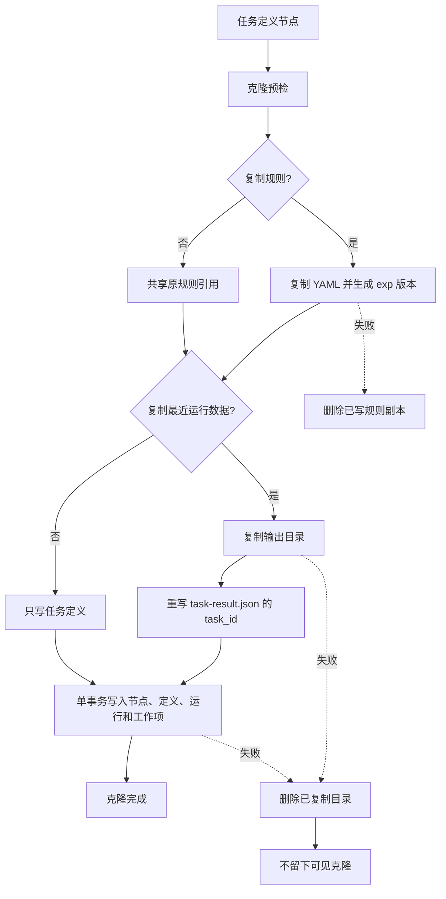

# 任务克隆与实验副本设计

## 用途与边界

本设计补齐“复制已有任务做实验”的流程。克隆用于在不改动原任务、原规则和原批次的前提下，复制任务定义、规则包和已采集数据，快速得到可独立修改和比较的实验副本。

本设计不替代[任务树与最近任务工作台设计](49-任务树与最近任务工作台设计.md)的任务定义模型，不改变[任务状态与计数契约](09-任务状态与计数契约.md)的状态机，也不提供规则编辑器。规则文件仍由构建、修复或外部编辑产生；克隆只负责生成一个可独立修改的实验版本。

## 已确认决策

| 问题 | 决策 |
| --- | --- |
| 克隆对象 | 从任务定义节点克隆；默认复制定义，最近一次已结束运行是否复制由用户勾选 |
| 规则副本 | 勾选后复制为同一 `rule_id` 的新实验版本，`rule_version` 增加 `-exp-<随机后缀>`，状态写回 `candidate`；原规则和站点指针不变 |
| 已采集数据 | 勾选后把最近一次已结束运行复制成克隆下的新历史运行；可查看和导出，不修改原任务 |
| 批次隔离 | 克隆定义和复制运行都不写 `batch_id`；启动实验任务不会改写原批次的当前任务或交付指针 |
| 克隆位置 | 默认放在源任务同目录，可在对话框中改目标目录；名称可编辑，默认生成不重复的“副本”名称 |
| 数据来源 | 默认最近一次已结束运行；接口支持显式 `copy_run_id`，前端首版不提供多运行选择 |

## 克隆内容

| 内容 | 必选 | 行为 |
| --- | --- | --- |
| 任务定义 | 是 | 复制站点、规则引用、任务类型、采集模式、国家／语言／市场／品类、限额、代理和备注；备注追加“克隆自…”来源 |
| 规则包 | 否 | 复制规则 YAML，改写 `rule_version`、`status` 和 `updated_at`；不注册激活指针，不影响原版本 |
| 已采集数据 | 否 | 复制任务行、工作项和输出目录；新历史运行引用源运行作为数据来源，不复制请求、租约、反馈、批次指针或最近列表隐藏记录 |
| 运行历史 | 否 | 首版只复制最近一次已结束运行；不复制全部运行历史 |
| 批次关系 | 否 | 始终解除；`batch_id` 不写入克隆定义或复制运行 |

## 机制

## 规则副本

- 源规则必须位于受管规则目录内，且 `rule_id`、`rule_version` 与任务定义一致；不一致时克隆阻断，避免把错误文件当成实验基线。
- 新版本示例：`2026.11.27-1-exp-a1b2c3`；文件名使用源文件名加 `-exp-<后缀>`，避免覆盖原文件。
- 只改顶层 `rule_version`、`status`、`updated_at`，保留其余 YAML 内容和注释；写入后立即用运行时加载器复验。
- 新规则文件会出现在规则目录扫描结果和“新建任务”的规则选择中，但不会自动进入 `site_rules`，也不会自动成为站点当前版本。
- 实验成功后仍按[规则修复与异常工作流](34-规则修复与异常工作流.md)的候选激活流程处理；克隆本身不伪造验证证据。

## 数据副本

- 只复制终态运行；默认选择最近一次 `FINISHED` 或 `CANCELLED` 运行，并要求输出目录、`task-result.json` 和工作项可读。
- 新运行使用新的 `task_id`，任务行保留源运行的规则版本、`plan_id`、计数和结果口径；`input.cloned_from` 记录源运行，任务结果文件同时写入 `cloned_from`、源开始／结束时间和克隆时间。
- 工作项按源任务复制，`result_json`、状态、失败分类和发现来源保持不变。
- 输出目录整体复制，再改写 `task-result.json` 的 `task_id`；CSV、JSONL、事件和导出目录保持原内容。
- 不复制 `task_requests`、`task_resources`、`quality_feedback`、`workbench_recent_dismissals` 和 `batch_sites` 指针。复制运行不会占用租约，也不会进入原批次导出。
- 首版只复制任务输出目录；构建工作区、页面存档和图片缓存不随克隆复制。
- 复制运行是数据快照，不能续采；需要继续采集时从克隆任务定义启动新运行，使用克隆定义上的规则和限额。

## 原子性与失败处理

- 规则副本和输出目录先在账本外准备；任一步失败都清理已写文件，不产生可见克隆。
- 目录复制完成后再单事务写入工作台节点、任务定义、任务行、运行映射和工作项；事务失败时删除已复制目录和规则副本。
- 进程在文件复制后、事务提交前中断时可能留下无账本引用的目录或规则文件；首版不做启动时自动回收，清理需人工或后续 tombstone 机制处理。
- 预检不创建文件；只有提交克隆才写入规则目录和输出目录。

## API 契约

| 方法与路径 | 用途 | 关键约束 |
| --- | --- | --- |
| `GET /api/workbench/tasks/{node_id}/clone-preview` | 读取克隆预检 | 返回源定义、源规则、最近终态运行、数据大小和文件数、默认名称、规则／数据阻断原因 |
| `POST /api/workbench/tasks/{node_id}/clone` | 创建克隆 | `name`、`parent_id`、`copy_rule`、`copy_data`、`copy_run_id`；规则不可用或数据不可复制时返回 409 |

返回中的 `rule` 表示实际生成的规则副本，`run` 表示实际复制的数据运行；未勾选时为 `null`。

## 界面

- 任务树任务定义菜单和最近任务菜单增加“克隆任务…”。
- 对话框显示源规则、最近运行、数据大小和文件数；规则或数据不可用时禁用对应勾选并就地显示原因。
- 默认勾选“复制规则包”，默认不勾选“复制最近运行数据”，避免无意复制大目录；不复制规则时提示会共享原规则文件。
- 确认后刷新任务树、最近任务和规则目录，并提示克隆名称、实验规则版本和复制运行 ID。

## 验收

- 只复制定义时生成新节点，原节点、原规则、运行和批次指针不变。
- 复制规则时生成同 `rule_id` 的新版本文件，原文件字节不变，新文件可通过规则加载器校验，状态为 `candidate`。
- 复制数据时新运行使用新 `task_id`，工作项和产物齐全，源运行仍可查看；新运行 `batch_id` 为空，原批次站点指针仍指向源运行。
- 阻断场景：规则文件缺失或与定义不一致、没有终态运行、输出目录或结果文件缺失；接口返回明确错误，不留下半成品。
- 窄屏对话框无页面级横向溢出；规则、数据两个勾选项在禁用时有可读原因。

## 实施状态

2026-11-28 已实现：

- 后端预检与克隆接口、规则副本、数据副本、工作项复制、批次隔离和克隆数据快照不可续采的提示。
- 工作台任务树和最近任务“克隆任务…”入口及克隆对话框。
- 后端 `test_workbench` 覆盖只复制规则、复制规则与数据、批次指针隔离和数据不可用阻断；前端新增克隆对话框测试。

未实现：指定任意历史运行、复制多条运行、规则副本登记到 `rule_versions` 账本、克隆撤销／差异比较、文件残留自动回收。

## 相关文档

- [任务树与最近任务工作台设计](49-任务树与最近任务工作台设计.md)：任务定义、树节点和最近任务。
- [数据清理、规则变更与结果隔离设计](55-数据清理与规则变更设计.md)：清理、版本变更和结果隔离。
- [规则修复与异常工作流](34-规则修复与异常工作流.md)：候选版本、验证、激活和回滚。
- [运行配置与预算续采设计](53-运行配置与预算续采设计.md)：运行限额和续采边界。
