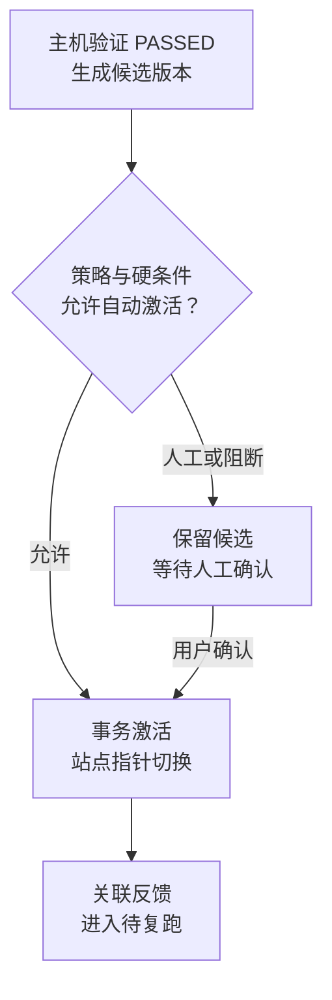

## 用途与边界

本设计回答三个问题：候选规则激活是否继续保留；如果保留，怎样让用户配置“是否要人工确认”；自动激活在什么条件下才允许发生。

**候选激活**指构建或修复产出一个 `candidate` 规则版本，用户确认后把站点的 `site_rules` 指针切到该版本。它不是“启动任务”，也不是“规则已经生效”。激活前旧规则继续服务新任务；激活后新任务使用新版本，旧任务保留原有版本绑定并标记为“基于旧规则”。

本设计不改变[规则修复与异常工作流](34-规则修复与异常工作流.md)的版本账本、验证证据、激活事务和回滚语义，也不替代[数据清理、规则变更与结果隔离设计](55-数据清理与规则变更设计.md)的候选激活入口与结果有效性模型。它只增加一层策略：**由谁确认新规则生效**。

**结论：保留候选激活，不取消；把“是否人工确认”做成可配置策略，修复默认人工，自动激活仍受硬条件约束。**

本轮只落设计，不改代码。实现状态、验证证据和默认值调整在后续阶段单独验收。

## 概念澄清

| 概念 | 含义 | 不是什么 |
| --- | --- | --- |
| 构建 | Agent 产出规则文件，主机执行静态预检和候选冒烟 | 不是采集任务运行 |
| 候选版本 | 通过候选冒烟、等待确认的不可变规则版本，状态为 `candidate` | 不是当前生效规则 |
| 站点指针 | `site_rules` 中记录站点当前使用哪个版本和哈希的指针 | 不是规则文件本身，也不改写 YAML |
| 激活 | 在一个事务内校验证据、切换站点指针、标记旧版本并写审计 | 不是启动任务，不改变已入队运行 |
| 复跑 | 激活后用新版本创建的新运行，旧运行保留 | 不是自动采用新结果，也不自动关闭反馈 |
| 任务绑定 | 每个运行记录入队时的 `rule_id`、`rule_version` 和 `sha256` | 不随站点指针变化而改写 |

因此，“关闭规则版本激活”在本文中只有一种含义：**不再要求人工点击确认，验证通过后自动切换站点指针**。它不表示删除规则版本、验证证据、激活审计或回滚能力。版本记录始终保留。

## 现状与问题

| 能力 | 当前行为 | 问题 |
| --- | --- | --- |
| 初始构建 | `mode=build` 主机验证通过后自动激活，审计记为 `actor=build` | “初始接入”和“已有规则重写”共用一条路径，边界偏粗 |
| 定向修复 | `mode=repair` 默认只产生候选，等待人工激活 | 入口集中在构建详情，任务反馈只有“等待激活”链接，用户容易找不到下一步 |
| 临时开关 | `ECOM_RULE_ACTIVATION_MODE=legacy` 可改回自动，`manual` 可强制人工 | 只能靠环境变量和重启，不是用户可配置的产品能力 |
| 审计 | `rule_activations` 记录动作、from/to、actor 和 reason | 没有记录本次采用的是哪条策略、策略来自全局还是站点 |
| 前端表达 | 构建详情有候选卡，支持激活、放弃和回滚 | 仍以“候选、版本、证据”为主，缺少“改了什么、影响哪个任务”的业务语言 |
| 复跑衔接 | 激活后再到任务反馈创建复跑 | 多一步；构建详情没有“激活并创建复跑”的主操作 |

## 讨论结论

**保留候选激活，不取消。** 当前阶段优先优化表达和操作路径，而不是移除门禁。

保留的价值：

| 价值 | 说明 |
| --- | --- |
| 验证是抽样，不是全量 | 主机验证通常只覆盖少量商品、问题样本和同页回归，不能证明整站几万件都不退化。人工门禁避免“样本通过、全量出错”的规则直接进入生产采集 |
| 规则是生产输入，错误代价高 | 坏规则会消耗采集预算、污染结果和导出，事后清理比事前确认贵得多 |
| 可追溯、可回滚 | 任务绑定规则版本和哈希，激活记录 from/to；新规则效果差可以回滚，旧结果仍能解释 |
| 支撑反馈闭环 | 反馈 → 修复构建 → 候选 → 激活 → 复跑 → 采用结果；激活是其中唯一由用户决定“是否切换生产规则”的节点 |
| 支持实验和人工判断 | 用户可以先看变更摘要和证据，再决定何时切换；这对单用户受控试点尤其重要 |

代价：

- 多一步操作；“候选、版本、激活、复跑”对普通用户偏技术化。
- 当前入口集中在构建详情，任务反馈页只有“等待激活”链接，下一步不直观。
- 对高度信任模型的场景，人工确认会显得繁琐；如果验证足够强，这一步的边际价值会下降。

**不取消的理由**：完全自动激活意味着模型产出的规则直接成为生产规则，失败只能事后回滚。在还没有默认导出白名单和全量有效性隔离的当前阶段，风险偏高。

**分层结论**：

- 初始接入：站点没有历史任务和交付数据时，`PASSED` 后自动激活风险较低，可以配置自动激活。
- 修复或已有生产数据：默认必须人工激活，因为会影响正在使用的规则和已有结果。
- 低风险变更：例如只改描述选择器，范围和币种未变，可以在验证和回归通过后提供“自动激活”选项，但默认关闭。
- 不论是否自动，都保留候选版本、验证证据、激活审计和一键回滚；自动激活不等于删除版本记录。

只有在验证覆盖、结果隔离和默认导出白名单都足够强之后，才值得讨论更大范围的自动激活。本文提供的配置是让用户按站点和场景选择风险，不是宣称当前验证已经足够支撑全自动生产。

## 目标与非目标

目标：

- 保留候选、验证、激活、回滚和反馈闭环，不因自动激活而删除任何版本或证据。
- 提供全局默认加站点覆盖的激活策略，修复默认人工。
- 策略在构建入队时锁定，后续设置变化不影响排队中和运行中的构建。
- 自动激活仍受完整验证门禁、站点忙守卫和未关联反馈检查约束。
- 用业务语言说明“改了什么、验证了哪些样本、影响哪个站点和任务”，并提供“使用新规则并复跑”的主操作。
- 所有自动激活都有可查询的 actor、reason 和策略来源，效果差时可以回滚。

非目标：

- 不删除规则版本账本、候选状态、验证证据或激活审计。
- 不允许没有通过主机验证的规则自动生效。
- 不自动创建复跑，不自动采用复跑结果，不自动关闭反馈。
- 不做多用户、独立复核人、审批流或权限模型。
- 不做规则编辑器、手工规则导入 API、定时复采或跨机调度。
- 不把模型自报的“低风险”当作自动激活依据；风险等级必须由主机根据结构化变更摘要计算。
- 不因为提供“全部自动”就降低验证覆盖、结果隔离或导出白名单的要求。

## 激活策略模型

### 四档策略

| 模式 | 首次接入 | 修复或重写 | 定位 |
| --- | --- | --- | --- |
| `manual` | 人工确认 | 人工确认 | 最严格；所有新规则都等待用户 |
| `auto_initial` | 自动激活 | 人工确认 | **默认**；保持当前首次接入体验，修复仍由人把关 |
| `auto_low_risk` | 自动激活 | 低风险自动，其余人工 | 适合规则稳定、模型可信、验证样本较充分的站点 |
| `auto_all` | 自动激活 | 自动激活 | 等价于“关闭人工激活门禁”；仅显式开启，不推荐生产默认 |

`auto_initial` 是默认值，因为当前初始构建已经是自动激活，修复已经是人工。它保持首次接入和修复的默认体验，同时把“已有生效规则的重写”从首次接入中拆出来：重写默认转人工，这是相对当前 `mode=build` 一律自动的有意收紧。

`auto_all` 只跳过人工确认，不跳过验证、站点忙守卫、哈希核对、事务和审计。它适合受控试点或高度信任的单一站点，不应作为全局默认。

### 首次接入的判定

只有同时满足以下条件，构建才算“首次接入”，才适用 `auto_initial` 或 `auto_low_risk` 的自动分支：

- 站点没有 `site_rules` 生效指针。
- 站点没有历史运行记录，包括未绑定规则的旧任务。
- 站点没有已交付的批次结果或当前交付指针。
- 不处于规则退役后重新接入的审计场景。

已有候选但从未激活、且没有历史任务和交付数据，仍可视为首次接入。任一条件不满足时，按修复或重写处理，默认人工；是否低风险由风险分类决定。这个判定宁可保守，避免把“已有生产数据的站点重写”误当成首次接入。

### 作用域与优先级

| 层级 | 存储位置 | 作用 |
| --- | --- | --- |
| 全局默认 | `app_settings.rule_activation_policy.default` | 没有站点覆盖时的默认策略 |
| 站点覆盖 | 同一份 JSON 的 `sites` 映射 | 单站点显式选择 `manual`、`auto_initial`、`auto_low_risk` 或 `auto_all` |
| 构建快照 | `builds.activation_mode` 等字段 | 入队时锁定本次实际策略，供审计和重放 |
| 环境覆盖 | `ECOM_RULE_ACTIVATION_MODE` | 进程级应急开关，映射到 `manual` 或 `auto_all` |
| 内置默认 | 代码常量 `auto_initial` | 账本没有配置时的兜底 |

优先级从高到低：

1. 进程环境覆盖。
2. 本次构建的“先不自动使用新规则”选项；它只能把策略改得更严格，不能把人工改成自动。
3. 站点覆盖。
4. 全局默认。
5. 内置默认 `auto_initial`。

策略在构建入队时写入构建记录，排队中和运行中的构建不再读取后续设置。这样用户修改全局策略不会改变已经排队的构建，也不会出现“同一批构建有的按旧策略、有的按新策略”却无法解释的情况。

环境变量只作为应急回退：`manual` 强制全部人工，`legacy` 映射为 `auto_all`，用于恢复旧行为。设置页检测到环境覆盖时显示只读提示，不允许页面值覆盖进程值；实现验收后仍保留这个 break-glass 入口。

## 自动激活的硬条件

自动激活不是“验证通过就无条件切换”。以下条件全部满足才允许自动执行；任一不满足就保留候选，回到人工确认，不做静默重试。

- 候选版本存在、状态为 `candidate`，`rule_id` 与站点当前规则一致（首次接入除外）。
- `validation.status=PASSED`，`evidence_sha256` 与构建证据和候选哈希一致。
- `candidate_smoke.executed=true`；`auto_initial` 至少 1 条有效商品，`auto_low_risk` 和 `auto_all` 至少 3 条有效商品。少于 3 条时转人工，不用不足的样本自动放行。
- 修复构建的 `regression.executed=true`、`checked>=min(3, 候选冒烟商品数)`、`regressions=[]`。
- 关联反馈的每个问题样本都有通过的主机检查。
- 同一站点、同一规则下没有其他未纳入本次构建的 `OPEN` 或 `TRIAGED` 反馈。存在时转人工，并在界面列出未纳入的反馈。
- 站点没有活跃任务或活跃构建。`SITE_BUSY` 时保留候选，等待站点空闲后由用户确认；不做延迟自动重试，避免用户离开后发生未预期的切换。
- `expected_active_version`／`expected_active_sha256` 若提供，必须与当前指针一致；冲突时返回 `409 ACTIVATION_CONFLICT`，不自动覆盖。
- 激活事务成功。事务失败时站点指针保持原值，构建记录写 `auto_failed` 和失败原因，候选保留，可人工重试。

自动激活的失败不改变构建的 `PASSED` 结论，也不把候选标成 `rejected`。构建详情同时显示“验证通过”和“自动激活未完成”，避免把两件事混成一个失败。

### 低风险变更的判定

风险等级由主机根据 `change_summary` 和构建目标计算，不读取模型自述。只有 `low` 才允许在 `auto_low_risk` 下自动激活；`high` 或 `unknown` 一律人工。

| 变更内容 | 风险 | 低风险自动 |
| --- | --- | --- |
| 只改描述提取、清洗或 `compose` 块顺序 | 低 | 允许 |
| 新增或删除发现来源、分页、入口或列表推进 | 高 | 不允许 |
| 修改 `scope.include`／`scope.exclude`、商品 URL 判型 | 高 | 不允许 |
| 修改市场、语言、币种或价格口径 | 高 | 不允许 |
| 修改名称、价格、主图、SKU、身份或变体选择器 | 高 | 不允许 |
| 修改抓取引擎、代理、浏览器模式或存档策略 | 高 | 不允许 |
| 提升 `schema_version` 或引入新字段 | 高 | 不允许 |
| 变更摘要缺少字段标记、无法归类 | 未知 | 不允许 |

实现时把分类结果写入构建记录，例如 `activation_risk=low|high|unknown` 和命中的变更标记。分类器只做保守判断：拿不准就归为 `high` 或 `unknown`，不用“看起来没问题”放行。

### 阻断与状态

| 阻断 | 结果 | 用户看到 |
| --- | --- | --- |
| 验证不完整或失败 | 候选保留，反馈停在 `AWAITING_ACTIVATION` | 缺哪段证据、需要补跑什么 |
| 站点忙 | 候选保留，不自动重试 | “站点有运行中任务或构建，空闲后可确认” |
| 存在未纳入的开放反馈 | 候选保留，转人工 | 列出未纳入的反馈和任务 |
| 风险为高或未知 | 候选保留，转人工 | 哪项变更触发了高风险 |
| 激活冲突 | 候选保留，返回 `409` | 当前规则已被其他页面改变，请刷新 |
| 激活事务失败 | 指针不变，记录失败原因 | “自动使用新规则失败，可手动重试” |



图中只有“允许自动”和“保留候选”两条主路径；站点忙、验证不足、开放反馈和高风险都归入“保留候选”，具体原因由状态表和构建详情说明，不再各画一条线。

## 交互与文案

### 系统设置

在系统设置的“规则与构建”分组增加“新规则何时生效”，而不是“规则版本激活”这样的技术标题。四个选项用业务语言说明行为、风险和默认值：

| 选项 | 文案要点 |
| --- | --- |
| 全部人工确认 | 所有新规则都等待你确认；最稳妥 |
| 首次接入自动，修复人工 | 默认；新站点验证通过后自动使用，已有站点的修复仍由你确认 |
| 低风险修复自动 | 只对描述等低风险变更自动；发现、范围、价格、币种变化仍需确认 |
| 全部自动 | 验证通过后自动使用所有新规则；不推荐，需要显式确认风险 |

`auto_all` 需要二次确认（勾选“我知道验证是抽样，自动生效可能影响整站结果”），并在保存后持续显示警示。站点覆盖用一张表展示“站点、当前策略、来源、修改”，支持“跟随系统”。

策略保存只影响新构建；页面明确写出“排队中和运行中的构建保持入队时的策略”。检测到 `ECOM_RULE_ACTIVATION_MODE` 时，选项只读并显示“当前由环境变量覆盖”。

### 构建启动

构建启动对话框显示本次生效的策略和来源。提供“本次先不自动使用新规则”复选框，默认不勾选；它只能把自动改成人工，不能在系统或站点为人工时把本次改成自动。这样可以临时收紧，不会绕过用户已经设定的门禁。

### 构建详情

候选卡先用业务语言回答三个问题：

- 改了什么：字段级变更摘要，突出范围、发现、价格、币种、描述等影响。
- 验证了哪些样本：问题样本、随机样本、回归样本、有效数和失败数。
- 影响哪个站点和任务：站点、当前规则、仍在使用旧规则的运行、关联反馈。

主操作按场景提供：

| 场景 | 主操作 | 次操作 |
| --- | --- | --- |
| 有关联反馈、人工策略 | 使用新规则并复跑 | 只使用新规则、暂不使用 |
| 无关联反馈、人工策略 | 使用新规则 | 暂不使用 |
| 自动激活成功 | 创建复跑（有反馈时） | 回滚到上一版本 |
| 自动激活被阻断 | 仍然使用（人工确认） | 暂不使用、查看阻断原因 |

“使用新规则并复跑”先激活，再为本次修复关联的反馈创建一次共享复跑，减少“激活后还要去找复跑入口”的步骤；“只使用新规则”保留给用户稍后自行选择复跑范围。自动激活不自动创建复跑，因为复跑会消耗采集预算，且范围可能需要用户选择。

### 任务反馈

| 状态 | 文案与动作 |
| --- | --- |
| 等待人工确认 | “新规则已验证，等待你确认使用”；回链构建详情 |
| 等待自动使用 | “验证通过，将按站点策略自动使用新规则” |
| 自动使用被阻断 | “验证通过，但未自动使用：站点有运行中任务／还有未纳入的反馈”；回链构建详情 |
| 已自动使用 | “新规则已自动使用（策略：低风险修复）；等待复跑”；提供创建复跑和回滚入口 |
| 已人工使用 | “新规则已使用；等待复跑”；提供创建复跑和回滚入口 |

界面主文案避免直接出现“候选、指针、哈希、evidence_sha256”；这些放进可展开的“技术详情”。但“验证样本、回归、影响范围”必须保留，不能用一句“已验证”代替。

## 数据、接口与审计

### 设置存储

沿用 `app_settings` 的 JavaScript 对象表示法(JavaScript Object Notation, JSON)设置模式，不新增站点主数据表；策略变更另写轻量审计表：

```json
{
  "default": "auto_initial",
  "sites": {
    "bennytex.fr": "manual"
  },
  "updated_at": "2026-11-28T00:00:00Z",
  "updated_by": "local-user"
}
```

键名为 `rule_activation_policy`。全局和站点覆盖放在同一份 JSON，读取时先取站点、再取默认、最后取内置值；写入用锁避免并发覆盖。策略变更写 `rule_activation_policy_events` 审计行：

| 字段 | 含义 |
| --- | --- |
| `event_id` | 事件 ID |
| `scope` | `global` 或 `site` |
| `site_key` | 站点覆盖时的站点；全局为空 |
| `from_mode` | 变更前模式 |
| `to_mode` | 变更后模式 |
| `actor` | 操作者，单用户为 `local-user` |
| `created_at` | ISO 8601 UTC |

### 构建快照

构建记录增加以下字段，入队时写入，后续不随设置变化：

| 字段 | 示例 | 用途 |
| --- | --- | --- |
| `activation_mode` | `auto_low_risk` | 本次实际策略 |
| `activation_policy_source` | `site`／`global`／`env`／`request`／`default` | 策略来源 |
| `activation_risk` | `low`／`high`／`unknown` | 主机风险分类 |
| `activation_outcome` | `auto_activated`／`manual_pending`／`auto_blocked`／`auto_failed`／`manual_activated` | 本次激活结果 |
| `activation_block_reason` | `SITE_BUSY`／`OPEN_FEEDBACK`／`RISK_HIGH`／`VALIDATION_REQUIRED`／`ACTIVATION_CONFLICT`／`ACTIVATION_FAILED` | 阻断或失败原因 |

`rule_activations.actor` 的约定：

- `local-user`：用户在页面确认。
- `build`：首次构建沿用的旧自动激活路径。
- `auto-policy`：按本设计的策略自动激活。
- `legacy-build`：环境变量 `legacy` 下的兼容路径。

`reason` 记录结构化信息，例如 `policy=auto_low_risk; source=site; risk=low; build=<id>`，便于排查“为什么这次没有等人确认”。

### 接口

| 方法 | 路径 | 用途 |
| --- | --- | --- |
| `GET`／`PUT` | `/api/system/rule-activation-policy` | 读取或保存全局默认与站点覆盖 |
| `GET`／`PUT` | `/api/sites/{site_key}/rule-activation-policy` | 读取或保存单站点覆盖；`mode=inherit` 表示跟随系统 |
| `POST` | `/api/batches/{batch_id}/sites/{site_key}/build` | 构建启动请求增加 `require_manual_activation`，只能收紧 |
| `GET` | `/api/builds/{build_id}` | 返回构建快照、风险、结果和阻断原因 |
| `POST` | `/api/sites/{site_key}/rule/activate` | 保留人工激活；自动激活复用同一事务和校验 |
| `POST` | `/api/feedback/{feedback_id}/rerun` | 保留复跑入口；自动激活不自动调用 |

`PUT` 策略接口对 `auto_all` 要求 `acknowledge_risk=true`，否则返回 `400`；站点不存在返回 `404`；只读服务返回 `403 READ_ONLY`。所有写请求继续要求同源 `Origin` 和 `X-Requested-With`。

## 分阶段落地

| 阶段 | 范围 | 退出条件 |
| --- | --- | --- |
| 本轮 | 设计文档和架构决策记录(ADR) | 用户确认策略、默认值和“首次接入”判定 |
| P1 | 后端策略存储、构建快照、`manual`／`auto_initial`、环境覆盖、审计和测试 | 首次接入和修复的默认行为与当前一致；已有生效规则的重写改为人工，属于有意收紧；策略变更不影响排队构建；所有激活仍有证据门禁 |
| P2 | 设置页、站点覆盖、构建启动收紧选项、构建详情与任务反馈文案、“使用新规则并复跑” | 用户能从构建详情完成激活和复跑；390 无页面级横向溢出；无“等待激活”死路 |
| P3 | 低风险分类器、`auto_low_risk`、自动激活指标 | 高风险和未知变更不被自动放行；分类结果可解释；回滚率可观察 |
| P4 | `auto_all` 的显式界面入口或仅 API 的高级入口 | 验证覆盖、结果隔离和默认导出白名单达到约定门槛；默认仍不是 `auto_all` |

P1 的默认值必须让现有行为不变：首次构建自动、修复人工。P2 完成前，用户只能通过 API 或设置文件配置；P3 之前不把 `auto_low_risk` 作为默认推荐。P4 是否开放界面入口，取决于前三个阶段的数据，不预先承诺。

## 验收要点

- 默认 `auto_initial`：首次接入验证通过后自动激活；修复和已有生效规则的重写仍停在候选，反馈为 `AWAITING_ACTIVATION`。
- `manual`：首次接入也停在候选；站点指针不变，审计记录人工激活。
- `auto_low_risk`：只改描述的修复在验证和回归通过后自动激活；改范围、价格、币种或发现的修复不自动激活。
- `auto_all`：所有 `PASSED` 候选自动激活；验证不完整、回归退化、哈希不一致仍被拒绝。
- 站点覆盖优先于全局；环境变量覆盖优先于页面设置；`require_manual_activation` 只能收紧，不能放宽。
- 构建入队后修改策略，排队中和运行中的构建仍按入队快照执行。
- 站点忙时自动激活被阻断，候选保留，反馈停在 `AWAITING_ACTIVATION`，不自动重试。
- 同一站点存在未纳入本次构建的开放反馈时，自动激活被阻断并列出反馈。
- 自动激活成功写 `actor=auto-policy` 和策略来源；事务失败时指针不变，构建记录可解释。
- 自动激活不自动创建复跑、不自动采用结果、不自动关闭反馈。
- 构建详情能完成“使用新规则并复跑”；任务反馈有回链；自动激活后仍可回滚。
- 设置页说明四种策略的风险和默认值；`auto_all` 有显式风险确认；只读和环境覆盖状态正确。

## 未决问题

- `auto_all` 首版是否开放界面入口，还是只保留 API／配置文件的高级入口。建议先只做高级入口，P4 再评估。
- 低风险白名单是否还要包括“只改描述字段的清洗函数”以外的变更；首版建议只允许描述提取和清洗，其他一律人工。
- 站点忙时是否要“空闲后自动继续激活”。建议不做，避免用户离开后发生未预期切换；由用户在构建详情确认。
- 自动激活是否应该顺带创建复跑。建议不自动创建，复跑涉及预算和范围选择。
- 自动激活的观察指标和降级阈值，例如 30 天内回滚率、复跑后重开反馈率；首版只记录，不自动降级。
- 是否需要市场级覆盖。当前站点级已足够，市场级会增加配置面，暂不做。

## 关联文档

- [规则修复与异常工作流](34-规则修复与异常工作流.md)：候选、验证、激活、回滚、复跑和反馈状态机。
- [数据清理、规则变更与结果隔离设计](55-数据清理与规则变更设计.md)：候选激活入口、`rebuild`、结果有效性和旧结果隔离。
- [系统设置页设计](42-系统设置页设计.md)：设置页分组、保存和只读边界。
- [开工前检查清单](21-开工前检查清单.md)：候选激活闭环的 Provisional 例外和复审条件。
- [ADR 0031：规则版本激活门禁与可配置自动激活](adr/0031-规则版本激活门禁与可配置自动激活.md)：本设计的决策记录。
