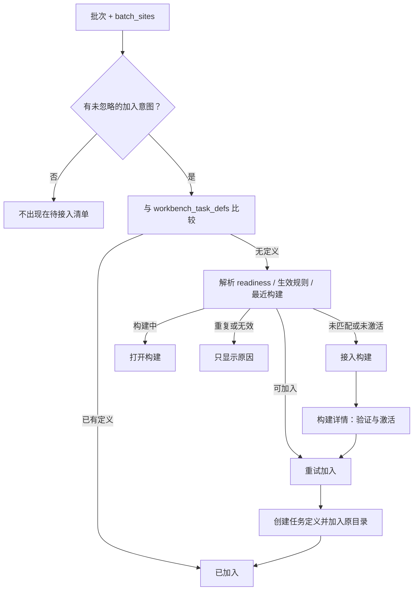
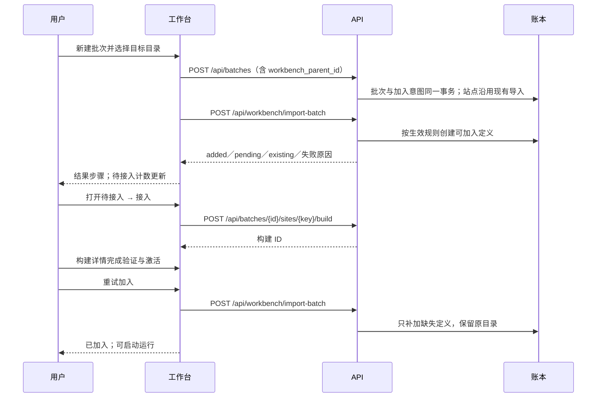

# 待接入目标与批量加入恢复设计

> 实现状态（2026-11-28）：加入意图、待接入清单、生效规则优先解析、结果步骤、构建入口和忽略已实现；后端全量 527 项（含 `test_workbench` 33 项）、前端 217 项、类型、lint、格式、构建和临时 8899 实例（1280／390）走查通过。真实 8765 已加载，待项目方验收。

## 用途与边界

本设计解决工作台批量添加的两个断点：

- 批次已经创建，但把批次站点加入任务树失败时，界面只有一条提示；刷新后没有找回和重试入口。
- 规则未匹配、市场不匹配或规则未激活的站点留在批次中成为“待接入”，工作台没有清单，也没有进入构建的入口。

设计范围是工作台的批量加入、待接入清单、构建入口和加入重试。它不改变规则构建、验证、激活、任务运行和导出语义。决策记录见 [ADR 0032](adr/0032-待接入目标与批量加入恢复.md)。

**概念。** “待接入”不是采集失败，也不是站点无效，而是：这个批次目标还没有一条工作台可用的生效规则，暂时不能建成可反复执行的任务定义。常见原因是未匹配规则、只有候选未激活、市场或目标入口不匹配、规则已停用。

## 现状与问题

改造前，工作台把批次作为批量添加动作，而不是长期页面：

| 环节 | 当前实现 | 问题 |
| --- | --- | --- |
| 新建批次 | `POST /api/batches` 创建批次并匹配站点；随后 `POST /api/workbench/import-batch` 把已匹配站点建成任务定义 | 两次请求分开；加入失败时批次已存在，但界面不保留批次 ID 和目标目录 |
| 加入任务树 | 只使用 `batch_sites.rule_id/rule_version` 查规则；已有站点、未匹配、规则不可用、规则与站点不匹配都跳过 | 跳过原因只出现在一次提示中；刷新后无法继续 |
| 待接入站点 | `batch_sites.readiness=needs_onboarding` 留在批次 | 工作台没有查询入口，构建入口随批次页面退役 |
| 构建成功 | 构建成功把站点 `readiness` 改为 `ready`，但不回填 `batch_sites.rule_id/rule_version` | 即使用户随后激活规则，再点“加入任务树”仍可能被“未匹配规则”跳过 |
| 加入失败 | 前端收到错误后关闭弹窗或只显示 toast | 没有持久化的目标目录、上次错误和重试动作 |

这些断点已在 [主路径改进建议](33-用户工作流与前端信息架构.md#主路径改进建议) 中记录；本设计用加入意图和待接入清单承载，改造前的数据模型没有对应入口。

### 规则来源：批次快照与站点生效指针

“规则来源”不是指不同站点使用不同规则文件，而是同一个站点在账本里可能有两份规则引用：

| 来源 | 存放位置 | 何时写入 | 是否随激活变化 |
| --- | --- | --- | --- |
| 批次站点快照 | `batch_sites.rule_id`／`rule_version`／`rule_path` | 批次导入时匹配到规则后写入 | 不随激活或回滚自动更新 |
| 站点生效指针 | `site_rules` | 构建验证通过或人工激活、回滚时写入 | 是，站点日常采集以它为准 |
| 候选版本 | `rule_versions` | 构建或修复产出候选时写入 | 状态由验证和激活推进 |

现状的问题是工作台加入只读批次快照。构建成功后，批次站点通常只把 `readiness` 改为 `ready`，不会回填 `rule_id`／`rule_version`；即使用户随后激活了候选，加入仍会显示“未匹配规则”。同一站点还可能出现无范围批次的域名键和带范围批次的 `domain--hash` 键，二者不是同一个字符串。

因此本设计把“规则版本选择”和“站点身份比较”分开处理：

- 规则版本：优先站点生效指针；批次站点仍为 `ready` 且规则包可用时，保留已复核批次规则作为旧数据回退。
- 站点身份：用 `(domain, target entry, market)` 规范身份比较，而不是直接比较 `site_key`。`site_key` 继续作为批次内部键保存，不迁移历史。
- 规则键解析：同一身份依次尝试批次站点原键、规范范围键 `target_key(domain, entry, market)` 和域名键，用第一个能解析出可用规则的键。这样无范围批次的 `bubutissus.fr` 也能找到带范围批次的 `bubutissus.fr--hash` 生效指针。

规范身份规则：

- `domain` 小写并去掉 `www.`。
- `entry` 用 `target_entry(input_value)`；根路径为 `None`。
- `market` 统一大写；待加入站点为空时按批次市场补全，任务定义为空时按定义市场，二者都空才视为未知。
- 同一 `(domain, entry, market)` 在任务树已有定义时，加入返回 `existing` 并带已有节点，不再创建第二个定义。

这样可以覆盖同一站点在不同批次里表现为 `bubutissus.fr`、`bubutissus.fr--7994...` 或大小写不同的情况，避免“清单说待接入、任务树其实已有”的误判。

真实账本的例子：

| 位置 | 键 | 状态 |
| --- | --- | --- |
| 无范围批次“法国纺织速率样本” | `bubutissus.fr` | `needs_onboarding`，备注“仅有未激活版本” |
| 正式带范围批次 | `bubutissus.fr--7994b273fe690121` | `ready`，有生效规则和运行 |
| 工作台任务定义 | `Bubutissus.fr` 和 `bubutissus.fr--7994...` | 同一域名的两个定义 |

改造前，按 `site_key` 比较会把无范围批次站点当成待接入，或在重试时再建一个定义。改造后，规范身份识别出它已存在，返回 `existing` 和已有节点；如果确实没有定义，再按生效规则加入。

## 目标与成功判据

目标：

- 新建批次或添加已有批次后，明确显示已加入、待接入、重复、无效和失败的目标及原因。
- 加入中途失败或部分成功后，刷新工作台仍能找到批次、目标目录和上次错误，并只补加缺失定义。
- 工作台提供“待接入”入口（存在待处理目标时显示），按批次列出未进入任务树的站点。
- 待接入站点可以从清单启动接入构建；构建、激活后回到清单，重试加入原目录。
- 加入以站点生效规则为准；构建后站点即使没有回填批次站点规则字段，也能加入。
- 重试幂等，不产生重复任务定义；已存在、市场不匹配、规则未激活或无效的站点有明确原因。

成功判据：

- 混合批次中，就绪站点先加入并可启动；待接入站点保留在清单，能进入构建。
- 模拟加入失败后刷新，待接入入口仍显示该批次；重试只补加缺失站点，重复站点数量和任务定义数量不增加。
- 构建、激活后，待接入站点可从同一入口加入原目标目录；加入后启动运行正常。
- 已存在的历史批次不会仅因为站点未加入任务树就自动出现在待接入清单。
- 390 宽度下清单可完整操作，无页面级横向溢出；读屏和键盘可完成浏览、重试、接入和忽略。

## 非目标

- 不恢复批次列表、批次详情或站点详情页面。
- 不自动构建待接入站点，不自动激活候选规则，不自动启动采集运行。
- 不改变构建预算、模型池、主机验证、激活门禁和规则修复流程。
- 不在首版提供多站点批量构建；接入仍按站点逐个确认。
- 不改变候选规则激活后的复跑、结果采用、旧运行与新旧结果标识；这些按[规则修复闭环](34-规则修复与异常工作流.md#修复闭环)另行验收。
- 不迁移历史批次。只有用户显式新建或添加过的批次才进入待接入清单。

## 决策

### 记录加入意图，而不是扫描全部批次

新增 `workbench_batch_imports`，每个批次最多一条加入意图：

- `batch_id`：批次。
- `parent_id`：首次加入选择的目标目录，可为空表示根目录。
- `requested_at`：用户第一次从工作台创建或添加该批次的时刻。
- `attempted_at`：最近一次加入尝试。
- `last_error`：最近一次加入失败的简短原因。
- `dismissed_at`：用户忽略剩余待接入项的时间。

只有存在未忽略加入意图的批次才进入待接入清单。这样不会把历史上从未打算加入任务树的批次重新翻出来。

### 待接入清单从账本派生

清单不另存站点副本，实时比较：

- `batch_sites`：批次站点、原始输入、readiness、规则绑定、最近构建。
- `workbench_task_defs`：已加入任务树的站点定义。
- `site_rules`／`rule_versions`：站点生效规则。
- `builds`：该站点最近一次构建的状态和结果。

站点状态由数据派生，不写新的“待接入状态”字段。批次站点与任务定义之间按 `(domain, target entry, market)` 规范身份对齐，不直接比较 `site_key`；同一站点已经在任意目录有定义时视为已加入，避免跨目录重复定义。



### 加入时以站点生效规则为准

`POST /api/workbench/import-batch` 不再只读取批次站点保存的 `rule_id/rule_version`，而是复用服务端现有的 `match_rule(site_key, entries)`：

- 有生效指针时，使用生效版本；已停用、文件缺失或哈希不一致时保留待接入并说明原因。
- 没有生效指针时，保持现有兼容回退：已复核批次规则、目录内已复核规则。
- 市场与批次不一致、目标入口不被规则覆盖、规则不支持任务类型时，加入失败并保留待接入。
- 加入成功后，任务定义记录本次实际使用的 `rule_id`、`rule_version`、`rule_path` 和批次来源；之后切换站点指针不自动改写已建定义。

这样，构建成功把站点改为 `ready` 后，用户不需要手工补齐 `batch_sites` 的规则字段；激活后重试即可加入。

### 待接入清单就是构建入口

清单中的待接入站点提供“接入”动作，调用现有：

`POST /api/batches/{batch_id}/sites/{site_key}/build`

首版使用构建配置的默认预算和默认模型，不复制完整构建弹窗。开始构建后：

- 清单显示“构建中”，提供“打开构建”链接。
- 构建失败或取消后回到“待接入”，显示最近构建的失败原因。
- 构建完成但规则仍是候选时，显示“待激活”；用户到构建详情完成激活。
- 激活后清单显示“可加入”，用户点“重试加入”。

构建不可用（未配置规则目录、只读模式、构建槽位关闭）时，清单返回不可用原因，按钮禁用并说明。

### 新批次和添加批次保留结果

- 新建批次弹窗不再在成功或失败后直接关闭，而是进入结果步骤：显示已加入、待接入、重复、无效和失败的数量与原因。
- 结果步骤保留批次 ID 和目标目录；加入请求失败时提供“重试加入”，不会丢失已创建的批次。
- 添加已有批次弹窗使用同一结果步骤；部分成功时只补加缺失定义。
- 结果步骤的“查看待接入”打开主清单；“完成”关闭，待接入入口仍保留数量。

### 忽略与恢复

- “忽略此批次”只写 `dismissed_at`，隐藏待接入提醒，不删除批次、站点、构建、任务定义或运行。
- 有站点正在构建时允许忽略，但确认文案说明构建会继续、可在构建记录查看。
- 再次通过“添加已有批次”或“新建批次”加入同一批次时清除 `dismissed_at`，重新进入清单。
- 所有站点都已加入或只剩无效／重复站点时，清单不再显示该批次；无效和重复只在创建结果中说明，加入意图保留用于审计。

## 数据模型

```sql
CREATE TABLE IF NOT EXISTS workbench_batch_imports (
    batch_id TEXT PRIMARY KEY,
    parent_id TEXT,
    requested_at TEXT NOT NULL,
    attempted_at TEXT,
    last_error TEXT,
    dismissed_at TEXT
);
```

规则：

- `parent_id` 为空表示根目录；有值时必须是 `workbench_nodes` 中的目录。
- `last_error` 只保存面向用户的短原因，不保存堆栈或整段服务端日志。
- 批次和加入意图在同一事务内写入；站点匹配和写入沿用现有批次导入路径，并返回逐项报告。批次或加入意图写入失败时整个创建回滚。
- 不新增 `batches` 字段；批次仍是来源和批量默认值，加入意图属于工作台。

加入尝试的更新时机：

| 时机 | 写入 |
| --- | --- |
| 工作台创建批次 | 插入 `batch_id`、`parent_id`、`requested_at` |
| 添加已有批次 | 插入或更新 `parent_id`、清除 `dismissed_at` |
| 开始加入 | 更新 `attempted_at` |
| 加入成功 | 清除 `last_error`；仍有待接入项时保留意图 |
| 加入失败 | 写入 `last_error`；已创建定义保留 |
| 忽略 | 写入 `dismissed_at` |

## API 契约

### 创建批次

`POST /api/batches` 增加可选字段：

```json
{
  "name": "202612 法国纺织",
  "market": "FR",
  "workbench_parent_id": "g-...",
  "sites": ["https://example.fr/"]
}
```

- `workbench_parent_id` 为空或省略时保持现有批次行为，不创建加入意图。
- 有值时校验目录存在且为分组；批次和加入意图在同一事务内创建，站点匹配和写入沿用现有批次导入并返回逐项报告。
- 预览请求不创建加入意图。

### 加入批次

`POST /api/workbench/import-batch` 的请求保持 `batch_id` + 可选 `parent_id`，响应扩展为：

```json
{
  "batch_id": "b-...",
  "target": {"node_id": null, "name": "根目录", "missing": false},
  "added": [
    {"node_id": "n-...", "name": "example.fr", "site_key": "example.fr", "task_id": null, "attached": false}
  ],
  "skipped": [
    {"site_key": "pending.fr", "domain": "pending.fr", "reason": "未匹配受管规则包", "category": "pending"},
    {"site_key": "dup.fr", "domain": "dup.fr", "reason": "批次内重复", "category": "duplicate"},
    {"site_key": "old.fr", "domain": "old.fr", "reason": "已在任务树", "category": "existing", "existing_node_id": "n-..."}
  ],
  "counts": {
    "total": 3,
    "added": 1,
    "pending": 1,
    "existing": 1,
    "duplicate": 0,
    "invalid": 0
  }
}
```

- `category` 固定为 `added`、`pending`、`existing`、`duplicate`、`invalid`、`failed` 之一。
- 请求提供 `parent_id` 时使用并更新加入意图；省略时沿用已保存的目标目录，没有记录时用根目录。
- 重试时已存在的站点归入 `existing`，不重复创建。
- 目标目录不存在时返回 `TARGET_NOT_FOUND`，不创建定义；清单允许用户重新选择目录并作为新的 `parent_id` 重试。
- 加入是幂等操作；同一个 `batch_id`、同一站点不会产生第二个定义。

### 待接入清单

`GET /api/workbench/pending-targets`：

```json
{
  "total_batches": 1,
  "total_pending": 2,
  "onboarding_available": true,
  "onboarding_unavailable_reason": null,
  "batches": [
    {
      "batch_id": "b-...",
      "name": "202612 法国纺织",
      "market": "FR",
      "created_at": "2026-11-28T10:00:00Z",
      "target": {"node_id": "g-...", "name": "法国纺织", "missing": false},
      "attempted_at": "2026-11-28T10:01:00Z",
      "last_error": null,
      "counts": {
        "sites": 3,
        "in_workbench": 1,
        "needs_onboarding": 1,
        "building": 0,
        "ready": 1,
        "invalid": 0,
        "duplicate": 0
      },
      "truncated": false,
      "sites": [
        {
          "site_key": "pending.fr",
          "domain": "pending.fr",
          "input_value": "https://pending.fr/",
          "identity": {"domain": "pending.fr", "entry": null, "market": "FR"},
          "readiness": "needs_onboarding",
          "in_workbench": false,
          "action": "build",
          "reason": "未匹配受管规则包",
          "active_rule": null,
          "build_id": null,
          "build_state": null
        }
      ]
    }
  ]
}
```

- `action` 为 `build`、`open_build`、`import` 或 `none`。
- `onboarding_available` 由构建管理器和只读状态决定；不可用时返回原因。
- `total_pending` 统计未加入任务树且仍可能需要动作的站点数，包含待接入、构建中和可加入；无效／重复不计入，也不单独维持批次可见。`action` 决定当前能否立即操作。
- 只返回未忽略、且至少有一个待接入、构建中或可加入站点的批次。
- 站点列表按批次内顺序；单批次最多返回 500 个站点，超出时在 `truncated` 标明并保留完整计数。
- 清单只读，不修改构建或任务状态。

### 忽略批次

`POST /api/workbench/pending-targets/{batch_id}/dismiss`：

```json
{"dismissed": true, "batch_id": "b-..."}
```

- 未知加入意图返回 404。
- 已忽略再次调用返回成功，保持幂等。
- 不取消构建、不删除任务定义、不改变批次站点。

## 界面与状态

入口放在任务树头部，与“新建”并列：

| 区域 | 内容 | 状态 |
| --- | --- | --- |
| 树头按钮 | “待接入 N”；无待接入项时隐藏 | 桌面和 390 均可操作；图标按钮带可访问名称 |
| 清单弹窗 | 按批次分组；组头显示批次名、市场、目标目录、待处理总数和上次错误 | 可滚动，不撑破视口 |
| 组头操作 | “重试加入”“忽略此批次”；有可加入站点时重试可用 | 忽略需确认；重试是批次级动作 |
| 站点行 | 域名、原始输入、状态文本、原因、最近构建 | 状态不只靠颜色表达 |
| 站点操作 | “接入”或“打开构建”；可加入站点由批次级“重试加入”处理 | 只读或构建不可用时禁用 |
| 空状态 | “没有待接入或未完成加入的目标” | 保留关闭入口 |
| 新批次结果 | 已加入、待接入、重复、无效、失败计数和原因 | 不因部分成功关闭；失败可重试 |



界面细节：

- 结果步骤默认显示计数和前 12 条原因；更多目标到待接入清单继续处理，避免大批次一次渲染数千行。
- 清单弹窗使用现有 `DialogShell`，焦点进入对话框或首个输入，Escape 关闭，操作中禁用重复提交。
- 390 宽度使用全宽弹层或抽屉；站点行纵向排列，目标目录和批次名换行显示，不出现页面级横向滚动。
- 待接入数量来自清单接口的 `total_pending`；工作台单独按 10 秒轮询，不复用最近任务查询，也不按每次树刷新重复请求。

### 用户操作路径

1. 新建批次或添加已有批次，在结果步骤查看已加入和待处理目标。
2. 有未加入目标时打开树头「待接入」，先看每个站点的原因和生效规则。
3. 站点显示「接入」时启动构建；构建完成后到构建详情验证并激活候选规则。
4. 回到待接入清单点「重试加入」，站点加入原目标目录后再启动运行。
5. 不需要继续处理时点「忽略此批次」；它只隐藏提醒，不取消构建、不删除数据。

## 失败、重试与回滚

- **部分加入失败**：已创建定义保留；待接入清单显示 `last_error` 和未加入站点；重试只补缺失。若用户删除部分定义，站点重新变为待接入。
- **批次创建失败**：不写加入意图；界面保留表单内容。
- **批次或加入意图写入失败**：如果本次请求要求工作台加入，整个创建事务回滚，不留下半成品。
- **目标目录被删除**：清单标记 `target.missing=true`，重试要求重新选择目录；不静默加入根目录。
- **规则未激活、停用或市场不匹配**：保留待接入并显示原因；不自动激活、不自动换规则。
- **构建失败或取消**：站点回到待接入；最近构建保留，清单提供打开入口。
- **只读模式**：清单可查看，接入、重试和忽略都禁用并说明只读。
- **回滚**：停用新表、接口和入口即可；批次、站点、定义、构建和运行不受影响。新加入的站点定义可由现有任务定义清理入口移除。

## 验收

后端和前端都用临时账本、合成规则和本地 fixture，不调用真实模型或真实站点。

| 场景 | 检查 |
| --- | --- |
| 混合批次 | 2 个就绪、1 个未匹配、1 个重复；创建结果和清单计数正确，就绪站点已加入 |
| 加入中断 | 模拟创建第一个定义后失败；刷新后清单显示批次、目标目录、上次错误；重试只补剩余，定义数量不增加 |
| 待接入构建 | 未匹配站点从清单启动构建；构建记录可打开；构建成功并激活后显示可加入，重试加入原目录 |
| 规则解析 | 批次站点 `rule_id` 为空但存在生效规则时可加入；只有候选、已停用、市场不匹配或目标不覆盖时保留待接入并说明原因 |
| 目标目录 | 删除目标目录后清单标记缺失；重试要求重新选择，不静默落到根目录 |
| 忽略与恢复 | 忽略后清单隐藏且不取消构建；再次添加已有批次后重新出现 |
| 并发与幂等 | 连续点击重试只创建一份定义；两个请求同时加入同一批次不会重复 |
| 只读与构建不可用 | 清单可读，操作禁用并显示原因 |
| 窄屏与可访问性 | 390 无页面级横向溢出；弹窗焦点、Escape、读屏标签和状态文本可用；axe 无新增违规 |

验证命令按[后端测试分组](23-测试策略.md#后端测试怎么跑)和[前端测试入口](23-测试策略.md#前端测试怎么跑)执行；新增接口用例放在 `test_workbench.py` 或新建分组文件，前端用例覆盖结果步骤、清单、重试、接入和忽略。

## 已确认与仍开放

以下决策已于 2026-11-28 确认，并已按此实现：

- 加入时使用站点生效规则，批次站点快照只作旧数据回退。
- 历史批次不自动进入待接入清单；只有工作台创建或显式添加过的批次才进入。
- 目标目录缺失时保留待接入，要求重新选择，不静默加入根目录。
- 待接入站点逐站确认，使用构建配置的默认预算和默认模型。
- 构建成功并激活后不自动加入任务树，由用户点“重试加入”。
- 允许在有构建进行时忽略提醒；只隐藏清单，不取消构建或删除数据。

仍开放、但不阻塞当前实现的问题：

| 问题 | 当前处理 | 后续条件 |
| --- | --- | --- |
| 同一批次内是否允许站点使用不同规则？ | 加入按每个站点的生效规则解析，允许不同规则 | 如果批次级规则约束成为业务要求，再补批次级校验 |
| 是否支持多站点批量接入？ | 首版逐站确认 | 按构建并发、预算和失败隔离另设计 |
| 是否提供历史批次的一次性扫描入口？ | 不自动扫描 | 只有明确需要清理历史待接入时才加系统设置入口 |

## 关联文档

- [用户工作流与前端信息架构](33-用户工作流与前端信息架构.md#主路径改进建议)
- [任务树与最近任务工作台设计](49-任务树与最近任务工作台设计.md#信息架构与机制)
- [规则修复与异常工作流](34-规则修复与异常工作流.md#修复闭环)
- [任务状态与计数契约](09-任务状态与计数契约.md)
- [待接入目标与批量加入恢复 ADR](adr/0032-待接入目标与批量加入恢复.md)
