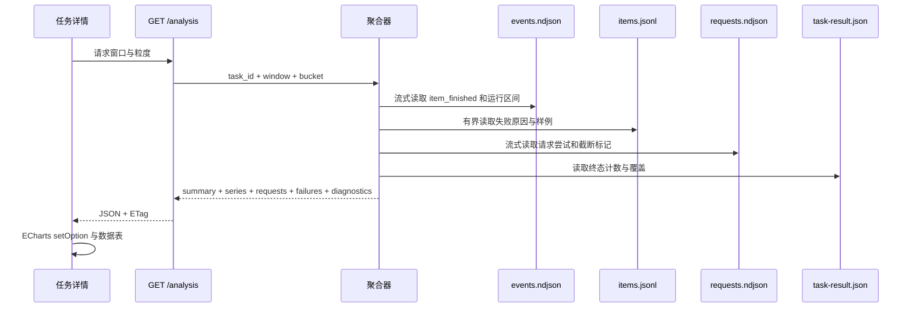

## 用途与边界

在任务详情 `/tasks/{task_id}` 增加「运行分析」Tab，用查询参数 `?view=analysis` 表达。它只分析**当前这一次运行**，回答四个问题：

- 这次运行是否在持续推进，吞吐是否稳定。
- 有效产出和失败分别有多少，失败集中在哪些时间点和原因上。
- 发现、候选、处理和覆盖之间的关系是否合理。
- 商品数、运行时长、网址数是否接近预算边界。

首版读取现有任务产物 `events.ndjson`、`items.jsonl`、`task-result.json` 和任务账本计数，并在新运行中增加独立的 `requests.ndjson` 请求尝试日志。**不建遥测表、不改数据库 schema、不接 SSE 遥测通道、不改变商品级计数口径**。请求数、重试、错误响应和 429 作为主图的可选序列，默认关闭；请求延迟、响应体积和逐请求表格仍留作后续扩展。

不在本设计范围：

- 恢复已退役的站点详情路由，或新增站点级长期分析页。
- 跨运行、跨批次、跨规则版本的趋势对比。
- AI 自动总结、异常根因推断或运营建议。
- 逐请求表格、实时每秒曲线和请求延迟图。
- 请求遥测影响商品级计数或失败分类。

[任务详情改版设计](40-任务详情改版设计.md) 已把任务详情收口为「数据明细 / 质量与验收 / 运行明细」，本设计在质量与运行明细之间加入「运行分析」。[v1 界面范围](25-v1界面范围.md) 曾把图表列为后置项；本设计是后置能力的独立切片，不静默扩大 v1 范围。

## 决策摘要

| 决策 | 采用方案 | 理由 |
| --- | --- | --- |
| 落点 | 任务详情新增「运行分析」Tab | 站点详情已退役；任务详情就是当前的单站单次运行页面 |
| 分析范围 | 仅单次运行 | 跨运行对比需要新的站点聚合和口径，单独设计 |
| 首版数据 | 现有事件、明细、终态结果，加新运行的 `requests.ndjson` | 商品分析零 schema 变更；请求尝试作为独立文件追加，旧运行明确显示“无请求记录” |
| 请求级指标 | 请求数、重试、错误响应、429；主图可选序列 | 直接回答“是否在发请求、是否在重试、是否被限速”，但不做逐请求表格和每秒曲线 |
| 请求日志 | 每次抓取尝试一条，独立文件、行/字节上限 | 不污染 `events.ndjson`，不建遥测表；超限停止写入并标记 truncated |
| 图表库 | ECharts 6.1.0，按需加载 | 旧系统已验证 Canvas 图表可行；只引入折线图、坐标轴、提示和缩放 |
| 默认图表 | 产出与失败 | 用户最关心“有没有产出、失败多不多”；请求序列默认关闭 |
| 图表布局 | 合图为主，分图可选 | 合图便于对照产出与请求；分图给请求指标独立纵轴。最多两条纵轴，不做六轴 |
| 请求延迟 | 首版不展示 | 延迟是毫秒量纲，需要单独小图和更多样本；先验证请求计数价值 |
| ETA | 不提供 | 吞吐受并发、限速和站点结构影响，首版不编造剩余时间 |
| 可访问替代 | 每张图提供数据表 | Canvas 不可读屏，表格承担等价信息 |

## 旧系统参考与取舍

旧系统在 WSL `~/ecom-crawler`，也可从 Gitee `main` 获取。相关材料：

| 材料 | 可借鉴 | 不照搬 |
| --- | --- | --- |
| `docs/UI_DESIGN_SYSTEM.md` 的实时曲线合同 | 独立纵轴、按时间桶聚合、暂停冻结时间轴、实时跟随与回到实时、窄屏单列 | 六条曲线六条纵轴、每指标独立波动、几十个图表设置 |
| `docs/CONTROL_PLANE_UI.md` 的站点详情与遥测口径 | 发送请求与完成请求分开、累计值不由近期速率反推、图表范围与执行范围一致 | 五个工作区、运行级 SSE 遥测通道、完整监控台 |
| `templates/_run_live_workspace.html` | KPI 条、图例开关、窗口选择、分图、共享滑条、空态和连接状态 | 三四十个控件、全屏图表弹窗、滚轮劫持页面滚动 |
| `static/run-live.js` | 桶聚合、平滑/原始值、图例持久化、主题重绘、ResizeObserver | 服务端遥测缓存、每秒重建、多个图表实例共享复杂状态 |
| `docs/reference/UI外观设计参考/图表与监控/Echarts图表设计案例.html` | 色彩对应、坐标轴标签、底部滑条、分图小倍数、移动端收敛 | 商业营收与采集遥测双模式、随机波动模拟、日期区间大控件 |

旧系统的核心问题是**把“分析”做成了“驾驶舱”**：能力完整，但用户要先理解十几个开关。当前系统只需要一个轻量分析面，保留它的信息节奏和图表可信度，砍掉控制数量。

## 用户任务与交互链路

| 用户任务 | 入口 | 关键步骤 | 成功 | 失败 / 恢复 |
| --- | --- | --- | --- | --- |
| 判断运行是否正常推进 | 任务详情 → 运行分析 | 看状态、运行时长、平均吞吐和最近 5 分钟吞吐 | 能说出“在推进 / 已停滞” | 无事件时显示空态和运行状态，不伪造曲线 |
| 判断产出质量 | 运行分析 | 看有效率、失败率、失败构成和失败高峰 | 能定位失败主要集中在哪些时间点和原因 | 旧运行原因不足时明确说明只到类别 |
| 判断发现是否收敛 | 运行分析 | 看发现 → 候选 → 处理 → 有效/失败漏斗 | 能判断候选是否处理完、是否还有待采 | 覆盖只代表声明来源，不冒充整站 |
| 判断预算是否接近边界 | 运行分析 | 看商品数、运行时长、网址数三条预算行 | 能判断是否快到上限 | 不设限时显示“不设限”，不画成 100% 已用 |
| 复核旧运行 | 任务详情 → 运行分析 | 看旧运行提示、总量和失败类别 | 能解释为什么缺少细粒度原因 | 不把缺失数据补成零 |

## 页面结构

Tab 顺序固定为「数据明细 / 质量与验收 / 运行分析 / 运行明细」。运行分析放在质量之后、运行明细之前，形成“结果 → 质量 → 过程 → 事实”的阅读顺序。

| 区域 | 内容 | 桌面 | 窄屏 |
| --- | --- | --- | --- |
| 分析范围条 | 本次运行、状态、数据截至时间、任务 ID、规则、数据源、时间窗口、粒度、速率/累计、刷新 | 单行，控件右对齐 | 换行，窗口和粒度整行 |
| 分析摘要 | 运行时长、平均吞吐、有效率、失败率 | 四列 | 两列；360 以下单列 |
| 诊断提示 | 最多一条确定性提示，可链接失败项或运行明细 | 整行 | 整行换行 |
| 主图 | 产出与失败，支持速率/累计、窗口、粒度、图例、数据表 | 全宽，310px 高 | 全宽，260px 高 |
| 失败构成 | 原因条、占比、样例 URL、失败高峰 | 半宽 | 单列 |
| 发现与预算 | 漏斗、覆盖、商品/时长/网址预算 | 半宽 | 单列 |

页面不复制旧系统的粘性图表工具栏。当前任务详情本身有页头和 Tab，再叠加粘性图表工具会挤压首屏；首版保持普通文档流。

### 状态矩阵

| 运行状态 | 默认窗口 | 页面内容 | 刷新 | 说明 |
| --- | --- | --- | --- | --- |
| `DRAFT` / `QUEUED` | 无 | 空态：“运行尚未开始” | 不轮询 | 不显示空图表骨架 |
| `RUNNING` | 最近 15 分钟 | 实时跟随；可冻结；显示最近 5 分钟吞吐 | 5 秒轮询，Tab 隐藏时停止 | 任务暂停后停止轮询 |
| `PAUSING` / `PAUSED` | 最近 15 分钟 | 冻结时间轴；保留最后数据 | 停止轮询 | 说明“已暂停，数据停在最后记录” |
| `FINISHED` | 全程 | 完整曲线、失败和预算 | 只读，不轮询 | 部分完成也按终态展示 |
| `CANCELLED` | 全程 | 已产生的部分数据 | 只读，不轮询 | 明确“取消后的部分结果” |
| 旧运行 | 全程 | 产出/失败仍显示；失败原因可能只有类别 | 只读 | 顶部说明数据完整度 |
| 读取失败 | 保持上次窗口 | 区块级错误和重试 | 手动重试 | 不把错误伪装成空结果 |
| 网址发现任务 | 全程 | 标签改为“处理网址 / 有效网址 / 失败网址” | 按状态 | 不显示商品质量语义 |

## 指标口径

所有时间桶按 UTC 切分，前端按浏览器本地时间显示；API 返回带时区的 ISO 时间。计数只代表当前任务边界，不合并历史运行。

| 指标 | 定义 | 来源 | 注意 |
| --- | --- | --- | --- |
| `processed` | 已完成商品级终态的商品数，按 `item_finished` 的 `ts` 入桶 | `events.ndjson` | 不等于 HTTP 请求数 |
| `valid` | `item_finished.state=DONE` 的商品数 | `events.ndjson` | 进入有效集 |
| `excluded` | `item_finished.state=EXCLUDED` 的商品数 | `events.ndjson` | 业务排除，不与失败相加 |
| `failed` | `item_finished.state=FAILED` 的商品数 | `events.ndjson` | 技术失败 |
| `yield_rate` | `valid / processed` | 聚合计算 | 分母是已处理数，不是候选数 |
| `failure_rate` | `failed / processed` | 聚合计算 | 与请求失败率分开 |
| `average_throughput` | `processed / run_seconds * 60` | 任务计数 | 使用累计运行时长，暂停不计入 |
| `recent_throughput` | 最近 5 个闭合时间桶的 `processed` 之和 / 分钟数 | 聚合计 | 不足 5 个桶时按实际桶数标注 |
| `discovered_urls` | 规范化后的任务内唯一业务网址数 | 任务计数 | 不等于商品数 |
| `product_candidates` | 按商品身份去重后的候选数 | 任务计数 | 可以大于已处理数 |
| `pending_products` | 尚未开始的候选数 | 任务计数 | 预算停止后可以大于零 |
| `coverage` | 声明来源内的处理覆盖 | `task-result.json` | 不代表整站总量 |
| `budget` | 商品数、运行时长、网址数、请求数的已用/上限 | 任务 limits + counters + 请求日志 | 不设限时显示“不设限” |
| `requests` | 每次抓取尝试一条记录，按尝试开始时间入桶 | `requests.ndjson` | 不等于商品数，也不等于并发 |
| `retries` | `attempt > 1` 的尝试数 | `requests.ndjson` | 由运行时自身重试产生 |
| `request_errors` | `status=0` 或 `status>=400` 的尝试数 | `requests.ndjson` | 包含 429；与商品失败分开 |
| `rate_limited` | `status=429` 的尝试数 | `requests.ndjson` | 是 `request_errors` 的子集，单独展示 |

**请求失败与商品失败不是同一件事。** 请求曲线只讲 HTTP 尝试，失败构成只讲商品级终态；这样不会把 404 页面、429 限流和商品字段校验失败混成一个数字。请求失败率不放进四个摘要指标，避免和商品失败率抢语义。

### 时间桶与缺口

- 商品事件按完成时间入桶；请求尝试按**开始时间**入桶。两条曲线的桶边界相同，但一个请求可能跨桶完成。
- 默认桶粒度：运行不超过 1 小时用 1 分钟；超过 1 小时用 5 分钟。用户可手动切换 1 分钟 / 5 分钟。
- 默认窗口：终态“全程”；运行中“最近 15 分钟”。窗口选项为全程、最近 30 分钟、最近 15 分钟、最近 5 分钟。
- 暂停区间用 `task_started` / `task_paused` / `task_finished` 推导。完整落在暂停区间的桶不补零；首版靠时间标签和缺口体现，不画浅灰暂停遮罩，后续可加。
- 最后一个桶可能尚未闭合。API 返回 `observed_at`，前端标注“数据截至”，不把半桶当完整分钟。
- 文件末尾损坏行跳过；跳过数量写入 `data_quality.skipped_lines`，超过阈值时显示“数据不完整”提示。

## 图表设计

### 产出与失败

这是首屏的主趋势图，默认显示三条同量纲曲线：

| 系列 | 颜色 | 线型 | 含义 |
| --- | --- | --- | --- |
| 处理 | `--accent` 深松绿 | 细线 + 7.5% 面积 | 每个时间桶内完成的商品数 |
| 有效 | `--success` 松绿 | 2.4px 实线 | 进入有效集的商品数 |
| 失败 | `--danger` 砖红 | 1.8px 虚线 | 技术失败的商品数 |

请求指标作为可选序列，默认关闭，打开后才出现：

| 系列 | 颜色 | 线型 | 含义 |
| --- | --- | --- | --- |
| 请求 | `--info` 靛蓝 | 1.8px 实线 | 每个时间桶内开始的全部抓取尝试 |
| 重试 | `--warning` 琥珀 | 1.8px 虚线 | `attempt > 1` 的尝试 |
| 错误响应 | `--danger` 砖红 | 1.8px 点线 | `status=0` 或 `status>=400` 的尝试 |
| 429 | `--danger` 砖红 | 1.8px 虚线 | 被限速的尝试，是错误响应的子集 |

设计要点：

- 默认三条产出曲线共用左纵轴，因为单位都是“件/时间桶”。请求序列打开后使用右纵轴“次/时间桶”；最多两条纵轴，不做六条曲线六条轴。
- 请求序列默认关闭，用户点图例才显示；关闭时图表保持原来的三条产出曲线。没有请求记录时图例置灰并说明原因，不伪造 0 值曲线。
- 图表布局提供“合图 / 分图”：合图把请求序列叠加在主图右轴；分图把请求序列放到主图下方共享时间轴的小图。只有至少一个请求序列打开时才显示这个开关。
- “速率”显示每个桶的实际值；“累计”显示从运行开始累计到当前桶的值。累计模式不改变后端聚合，只改变前端展示。
- 图例放在 Canvas 外，使用可聚焦按钮，显示系列名和全程总数；点击切换系列，产出组至少保留一条。图例不使用 ECharts 内置图例，保证键盘和读屏可达。
- 失败曲线默认虚线，错误响应用点线、429 用虚线，增加线型差异，避免只靠颜色。
- 峰值用页面文本标注，例如“峰值 121 件/分钟”，不把峰值做成第二张图。
- 横轴按实际绘图区只显示 4 个左右关键时间标签，手机约 2 个；首末刻度始终显示。标签不旋转。
- 纵轴从零开始，整数刻度；网格线只用浅色水平虚线，不画垂直网格。
- 超过 24 个桶且桌面宽度足够时显示底部滑条；手机上隐藏滑条，依赖窗口预设，避免拖动和页面滚动冲突。滚轮缩放默认关闭。
- 悬停提示显示时间、当前可见系列和值；请求系列带“次”单位，商品系列带“件/分钟”。不显示原始 JSON。
- 主图下方提供“数据表”开关，表格列为时间、处理、有效、排除、失败、失败率，有请求记录时追加请求、重试、错误响应和 429；最多显示当前窗口 100 行，超出部分提示“缩小窗口或切换 5 分钟粒度”。

### 失败构成

失败构成使用轻量 CSS 条形列表，不再引入第二套图表库：

- 每行显示原因、错误码、计数、占比、样例 URL 和相对条形。
- 最多展示 5 条原因，按计数降序；其余归入“其他”。
- 失败高峰从时间桶中取 `failed` 最大的 3 个桶（且至少 4 个失败），显示时间点和失败数，帮助定位批次性校验失败。
- 底部显示失败总数、处理总数、失败率，以及“原因来自 item 级终态 / 旧运行可能只到类别”的说明。
- “查看失败项”沿用现有任务详情数据明细的失败过滤入口，不新建页面。
- 没有失败时显示一行空态，不画零高条形。

### 发现与预算

该模块用原生 HTML 进度条和漏斗，不用 ECharts：

- 漏斗顺序：发现网址 → 商品候选 → 已处理 → 有效 / 失败。每条都显示绝对计数，宽度按发现网址归一。
- 失败条与有效条分开着色；有效和失败不叠加成“成功率”误导图。
- 覆盖显示 `coverage.status` 和声明来源；`PARTIAL` 时明确“不代表整站总量”。
- 预算行：商品数、运行时长、网址数；有请求记录时追加请求数。有上限时显示已用/上限和进度；无上限时显示“已用 / 不设限”，轨道为虚线空槽，不画成 100% 警告。
- 不提供 ETA。运行中只显示待采数和最近吞吐。

### 视觉规范

| 元素 | 规范 |
| --- | --- |
| 图表表面 | `--surface` 白色，1px `--line` 边框，8px 圆角；不使用渐变背景或玻璃效果 |
| 线宽 | 主系列 2.4px，辅助系列 1.8px，处理面积边界 0.8px |
| 面积 | 只给“处理”系列 7.5% 透明度；不使用彩虹渐变 |
| 坐标轴 | 轴标签 10–11px `--ink-3`；轴线 `--line-strong`；网格线 `--line` |
| 提示框 | 白底、`--line-strong` 1px 边框、8px 圆角、轻阴影；不超出视口 |
| 图例 | 28–30px 高胶囊，选中态用表面色和轻阴影；手机上命中区不低于 44px |
| 图表高度 | 主图 310px，手机 260px；分图时主图 250px、请求图 170px；失败/预算不强行等高 |
| 动效 | 首次绘制 220ms；实时更新 120ms；`prefers-reduced-motion` 下关闭 |
| 主题 | 只读 CSS 语义令牌；后续深色主题只换令牌，不在图表里写死颜色 |

不采用六轴合图、每条曲线独立纵轴、每指标平滑窗口、全屏图表弹窗、轮播式图表设置。它们属于监控台，不属于单次运行分析。请求曲线最多使用第二条纵轴，且必须由用户显式打开。

## 交互

### Tab 与深链

- `?view=analysis` 进入运行分析；无效值回到数据明细并用 `replace` 修正。
- 桌面使用 Tab 栏，方向键、Home、End 切换；窄屏使用单选控件，沿用现有任务详情模式。
- Tab 切换写入查询参数但不新增路由；浏览器后退仍回到进入任务前的页面。
- 运行分析 Tab 不显示计数；失败数已经在任务摘要和失败卡里，不在 Tab 上重复堆数字。

### 时间窗口与粒度

- 改变窗口或粒度只更新图表、表格和范围文案，不整页刷新，不改变任务状态。
- 运行中默认跟随最新；用户改变窗口或拖动滑条后进入“已冻结”，显示“N 个新时间桶”和“回到实时”。回到实时后重新跟随，不自动把用户拉回。
- Tab 隐藏、页面隐藏或任务进入终态时停止轮询；恢复可见且仍在运行时立即拉取一次。
- 刷新按钮只刷新分析数据，不触发任务控制。

### 图例与数据表

- 图例按钮使用 `aria-pressed`；不允许全部关闭，最后一条保留并给出提示。
- 数据表与图表使用同一份聚合结果；切换速率/累计时表格同步切换。
- 数据表在卡片内部横向滚动，不产生页面级横向溢出；窄屏可改为逐桶卡片或保留横向滚动，不能压缩列宽到不可读。

### 提示与诊断

首版只做确定性提示，不做 AI 推断：

| 规则 | 触发条件 | 文案方向 | 动作 |
| --- | --- | --- | --- |
| 失败集中 | 单一原因占失败数 ≥ 50% | “失败集中在商品数据校验” | 查看失败项 |
| 失败高峰 | 某桶失败数 ≥ 4 且为前 3 高 | “失败高峰在 06:47，共 11 件” | 查看失败项 |
| 运行停滞 | 运行中最近 5 个桶 `processed=0` 且 `pending>0` | “最近 5 分钟无新增商品，检查队列、限速或挑战页” | 查看运行明细 |
| 预算接近 | 有上限且已用 ≥ 90% | “商品预算已用 92%” | 查看运行配置 |
| 旧运行 | 数据完整度为 legacy | “旧运行只有任务事件，原因可能只到类别” | 查看失败项 |

最多显示一条提示，按“危险 > 警告 > 信息”取最高优先级；没有触发时不显示空提示条。

## 数据与接口

### 端点

`GET /api/tasks/{task_id}/analysis`

| 参数 | 类型 | 说明 |
| --- | --- | --- |
| `window_seconds` | integer，可选 | 观察窗口；省略时为全程。最小 60，最大不超过运行时长 |
| `bucket_seconds` | integer，可选 | 时间桶；省略时按运行时长自动选择 60 或 300 |
| `If-None-Match` | header，可选 | 基于任务更新时间、事件文件 mtime/size 的 ETag |

响应头：

- `ETag`：任务摘要版本 + 事件/明细/请求文件的 mtime/size + 聚合参数。
- `Cache-Control`：运行中 `no-store`；终态 `private, max-age=15`。
- `304 Not Modified`：ETag 未变化时返回空体，前端保留旧图。

### 响应示例

```json
{
  "task_id": "web-62d05ef69afc",
  "generated_at": "2026-11-28T10:30:00Z",
  "observed_at": "2026-11-26T22:53:15Z",
  "scope": {
    "task_type": "product",
    "state": "FINISHED",
    "started_at": "2026-11-26T22:07:09Z",
    "finished_at": "2026-11-26T22:53:15Z",
    "run_seconds": 2766,
    "window_seconds": null,
    "bucket_seconds": 60,
    "first_bucket_at": "2026-11-26T22:07:00Z",
    "last_bucket_at": "2026-11-26T22:53:00Z",
    "truncated": false
  },
  "summary": {
    "processed": 5003,
    "valid": 4924,
    "excluded": 0,
    "failed": 79,
    "yield_rate": 0.9842,
    "failure_rate": 0.0158,
    "average_throughput_per_minute": 108.53,
    "recent_throughput_per_minute": 108.4,
    "discovered_urls": 5011,
    "product_candidates": 5003,
    "pending_products": 0,
    "coverage": {
      "status": "PARTIAL",
      "label": "声明来源内 100%",
      "denominator_source": "declared-source product candidates"
    }
  },
  "series": {
    "bucket_seconds": 60,
    "points": [
      {
        "start": "2026-11-26T22:07:00Z",
        "end": "2026-11-26T22:08:00Z",
        "processed": 64,
        "valid": 63,
        "excluded": 0,
        "failed": 1,
        "cumulative_processed": 64,
        "cumulative_valid": 63,
        "cumulative_excluded": 0,
        "cumulative_failed": 1,
        "requests": {
          "total": 70,
          "retries": 2,
          "errors": 1,
          "rate_limited": 0
        },
        "cumulative_requests": {
          "total": 70,
          "retries": 2,
          "errors": 1,
          "rate_limited": 0
        }
      }
    ]
  },
  "requests": {
    "available": true,
    "reason": null,
    "truncated": false,
    "total": 5210,
    "retries": 120,
    "errors": 85,
    "rate_limited": 12,
    "status_classes": {
      "2xx": 5125,
      "3xx": 0,
      "4xx": 75,
      "5xx": 10,
      "none": 0
    },
    "average_per_minute": 113.0
  },
  "active_intervals": [
    {
      "start": "2026-11-26T22:07:09Z",
      "end": "2026-11-26T22:53:15Z"
    }
  ],
  "failures": {
    "total": 79,
    "by_class": {
      "permanent": 79,
      "transient": 0,
      "blocked": 0
    },
    "by_reason": [
      {
        "code": "validation_error",
        "label": "商品数据校验失败",
        "count": 78,
        "share": 0.9873,
        "sample_url": "https://www.example-shop.test/produit/ref-1042"
      }
    ],
    "peaks": [
      {
        "start": "2026-11-26T22:47:00Z",
        "failed": 11
      }
    ]
  },
  "budget": {
    "max_products": null,
    "max_seconds": null,
    "max_urls": null,
    "max_requests": null,
    "used_products": 5003,
    "used_seconds": 2766,
    "used_urls": 5011,
    "used_requests": 5210
  },
  "data_quality": {
    "level": "full",
    "skipped_lines": 0,
    "legacy_reasons": false
  },
  "diagnostics": [
    {
      "code": "failure_concentrated",
      "tone": "warning",
      "title": "失败集中在商品数据校验",
      "detail": "79 个失败中 78 个为商品数据校验失败。",
      "action_view": "data_failed"
    }
  ]
}
```

字段约束：

- `series.points` 最多 720 个；超出时保留最近 720 个并在 `scope.truncated` 标记。
- `window_seconds` 省略表示全程；窗口外的时间桶不返回，但 `summary` 始终是整次运行的总量；累计值保持全局累计，不从窗口起点重置。
- `failures.peaks` 最多 3 个；只在失败数 ≥ 4 的桶中取前 3。
- `data_quality.level`：`full`、`legacy`、`partial`、`empty`。`legacy` 表示旧运行缺少 item 级失败原因；不是错误。
- 旧运行没有请求级数据是预期状态：`requests.available=false`、`reason=legacy`，不返回请求数、重试和 429 的数值，避免用 0 冒充。
- 运行中最后一个桶可能未闭合，`series.points[-1].partial=true`；前端标注“数据截至”。

### 请求日志

`requests.ndjson` 与 `events.ndjson` 同目录，每次抓取尝试一行：

```json
{"ts":"2026-11-28T10:30:00.123Z","attempt":1,"engine":"static","item_type":"product","url":"https://www.example-shop.test/produit/ref-1042","status":200,"duration_ms":123.4,"bytes":45678}
```

| 字段 | 类型 | 说明 |
| --- | --- | --- |
| `ts` | string | 尝试开始时间，UTC ISO；按它入桶 |
| `attempt` | integer | 第几次尝试，从 1 开始 |
| `engine` | string | `static`、`browser` 或 `stealth` |
| `item_type` | string，可选 | 抓取时已知的工作项类型 |
| `url` | string | 请求 URL |
| `status` | integer | HTTP 状态；传输失败为 0 |
| `duration_ms` | number | 尝试耗时 |
| `bytes` | integer | 响应体字节数；失败为 0 |
| `error` | string，可选 | 传输或浏览器异常摘要，最多 300 字符 |
| `retry_after` | number，可选 | 429 响应给出的等待秒数 |

写入规则：

- 默认上限 200,000 行或 64 MiB，先到者生效；超限追加一条 `{"event":"truncated","reason":"records|bytes"}` 后停止写入。
- 采用行缓冲追加，不逐行 fsync；崩溃最多丢失最后一行，不影响抓取主流程。
- 同一任务续采时继续追加，启动时按已有行数和字节数计入上限。
- 只记录运行时抓取引擎的请求；规则构建、图片代理和归档下载不计入。
- 统计粒度是抓取引擎的一次 `get` 尝试；浏览器内部资源请求、引擎内部重试和 sitemap 预热不拆成多行。曲线回答“发了多少次抓取尝试”，不是浏览器网络面板的请求总数。

### 读取与聚合



聚合顺序：

- 先读 `task-result.json` 得到终态计数、覆盖、失败分类；缺失时退回任务账本和事件计数。
- 再流式读 `events.ndjson`，只处理 `item_finished`、`task_started`、`task_paused`、`task_finished` 和必要的运行事件。
- 商品桶按 `item_finished.ts` 入桶；导航项不进入商品曲线。
- 运行区间从 `task_started` / `task_paused` / `task_finished` 推导；暂停区间不补零。
- 失败原因从 `items.jsonl` 或 `task_items.result_json` 读取；按原因 code 聚合并限制样例数量，避免把 100k 行明细全部加载到内存。
- `requests.ndjson` 按 `ts` 入与商品相同的桶；没有请求文件时标记 `requests.available=false`，不阻断商品分析。
- 所有读取按行流式处理；最后一行损坏时跳过并计数。
- 结果按 `(task_id, file mtime_ns, file size, window, bucket)` 做进程内缓存；文件未变化时直接返回，ETag 命中时 304。

### 为什么用文件遥测而不建表

- 当前任务产物已经是事件和结果的持久真源，分析 endpoint 是只读投影，不新增第二份事实。
- 5,000 件任务的事件文件约 1MB，请求日志约 10k 行；按窗口聚合足够快（真实运行实测约 0.1 秒）。百万级任务再考虑落时间桶表。
- 请求日志独立于 `events.ndjson`，不污染运行日志，也避免为分析能力改任务表结构。
- 请求日志有明确容量上限和清理入口；任务 purge 会一并删除。
- 以后加请求延迟、逐请求表格时，响应是增量字段，前端模块可以按需加载，不需要迁移现有分析数据。

## 前端实现

### 组件拆分

| 组件 | 职责 |
| --- | --- |
| `RunAnalysisPanel.tsx` | 入口、工具栏、摘要、区块编排和空态 |
| `ThroughputChart.tsx` | 产出与失败主图、请求合图/分图、ECharts 初始化 |
| `AnalysisDataTable.tsx` | 图表的可访问数据表 |
| `FailureBreakdown.tsx` | 失败原因与失败高峰 |
| `DiscoveryBudget.tsx` | 漏斗与预算 |
| `analysis.ts` | 类型、格式化、可见性和取值 |
| `useRunAnalysis.ts` | 查询、轮询、冻结 |
| `chartRuntime.ts` | ECharts 按需加载与模块注册 |
| `chartTheme.ts` | 语义令牌到 ECharts 主题 |

`RunAnalysisPanel` 使用 `React.lazy` 按 Tab 加载；ECharts 只在分析 Tab 第一次打开时加载。任务详情只负责传入 `task` 和当前 Tab，不把分析数据提升到页面级。

### 查询与轮询

- TanStack Query key：`["task-analysis", taskId, windowSeconds, bucketSeconds]`。
- 运行中且 Tab 可见：每 5 秒请求一次；页面隐藏、Tab 切换或任务终态时停止。
- 使用 `placeholderData` 保留旧图；数据更新后调用 `setOption`，不因每次轮询重建 Canvas。
- 手动刷新触发 `refetch`；服务端支持 `ETag`/304，浏览器按 `Cache-Control` 处理条件缓存，前端不手拼 `If-None-Match`。
- 请求失败保留最后一次成功数据，显示区块级错误和重试；不要把图表清空。
- 任务状态来自现有任务查询或 SSE；分析接口只负责时间序列和诊断，不重复传任务控制状态。

### ECharts 生命周期

- 使用 `echarts/core` + `LineChart`、`GridComponent`、`TooltipComponent`、`DataZoomComponent`、`CanvasRenderer`，不引入完整 `echarts`。
- `echarts.init(node, null, { renderer: "canvas", useDirtyRect: true })`。
- `ResizeObserver` 监听容器；Tab 隐藏时只 dispose，不保留不可见实例。
- 主题色从 CSS 语义变量读取，初始化时解析为十六进制；不把 `var(--accent)` 直接传给 Canvas。
- 首次绘制 220ms；数据更新 120ms；`prefers-reduced-motion: reduce` 时 `animation: false`。
- 图例、窗口、粒度、速率/累计是 React 状态；不要写进 ECharts 内部状态，避免两套真源。

### 空态与错误

- 未开始：空态卡，说明启动后才有时间桶。
- 无商品事件：图表区显示“尚无已完成商品”，保留范围条和摘要。
- 旧运行：顶部信息提示，曲线仍显示；失败卡标注原因可能只到类别。
- 文件损坏或截断：显示“数据不完整”，图表只画已读取部分，不补零。
- 读取失败：保留旧图，显示错误和重试；不把 404 当空数据。
- 图表库加载失败：图表区显示文字说明，数据表仍可用。

## 响应式与可访问性

### 响应式

| 宽度 | 布局 |
| --- | --- |
| ≥ 1180 | 四列摘要，主图全宽，失败/预算双列 |
| 1024–1179 | 四列摘要，双列分析模块，页边距 24 |
| 768–1023 | 两列摘要，分析模块单列，隐藏侧栏，图表高度 280 |
| 640–767 | 两列摘要，Tab 改为下拉，图例换行 |
| 390–639 | 两列摘要，单列模块，图表 260，控件换行 |
| < 360 | 摘要和分析指标单列；不允许页面级横向溢出 |

- 图表宽度使用容器实测，不写死像素；`ResizeObserver` 在 Tab 显示和窗口变化时 resize。
- 数据表在卡片内部横向滚动；失败列表和预算行自然换行。
- 图例和窗口控件在手机上完整换行，不横向裁切，不压缩到不可读。

### 可访问性

- Tab 使用 `role="tablist"`、`aria-selected`、`aria-controls`、方向键、Home、End；窄屏单选控件有可见标签。
- 图表容器设置 `role="img"` 和动态 `aria-label`，例如“本次运行处理 5,003 件，有效 4,924 件，失败 79 件；峰值 121 件/分钟。”
- 每张图提供“数据表”开关；表格有 `caption`、`scope="col"`，图表不是唯一信息载体。
- 图例是按钮，不是 Canvas 内图例；`aria-pressed` 表示可见状态。
- 失败曲线同时使用虚线；状态和失败原因不使用颜色作为唯一信号。
- 文字和背景对比度按 WCAG AA：正文 ≥ 4.5:1，大字和非文本控件 ≥ 3:1。
- 键盘可完成窗口、粒度、图例、数据表和刷新；不依赖拖拽、滚轮或悬停。
- 焦点可见，Tab 切换后焦点进入面板；关闭数据表后焦点回到触发按钮。
- 手机触控目标不低于 44px；桌面按钮不低于 28px 且周围留白足够。
- `prefers-reduced-motion` 下关闭图表动画和实时脉冲。

## 性能预算

| 项 | 目标 |
| --- | --- |
| 分析 Tab 首次加载 | 本地 2.5 秒内出现首图（含 ECharts 按需 chunk） |
| ECharts chunk | gzip 后 ≤ 400KB；按需加载，不进入任务详情首屏；当前构建约 377KB |
| 5,000 事件冷聚合 | ≤ 300ms |
| 100,000 事件冷聚合 | ≤ 2s |
| 缓存命中 | ≤ 200ms |
| 图表更新 | ≤ 100ms；只更新可见系列 |
| 点数上限 | 720 个；超出保留最近 720 个并标记 `scope.truncated` |
| 数据表 | 当前窗口最多 100 行，超出提示缩小窗口或切换粒度 |

实现后用真实任务 `web-62d05ef69afc` 和一份 100k 合成事件做基准，记录冷/热耗时；不把“语法通过”当性能验证。

## 验收

### 数据一致性

- 真实任务 `web-62d05ef69afc`：摘要显示 5,003 处理、4,924 有效、79 失败；曲线求和与摘要一致。
- 失败构成 78 个 `validation_error` + 1 个 `http_404`，失败率 1.6%；失败高峰为 06:47 11 件、06:43 9 件、06:26 8 件（按本地时区展示）。
- 发现 5,011、候选 5,003、已处理 5,003、有效 4,924、失败 79；覆盖显示“声明来源内 100%”，不写成整站 100%。
- 旧运行没有 item 级原因时，显示类别和说明，不把缺失原因显示成 0。
- 旧运行没有 `requests.ndjson` 时，请求图例置灰并显示“该运行来自旧版本，没有请求记录”；商品摘要和失败构成仍正常。
- 新运行请求摘要的总数、重试数、错误响应数和 429 数与 `requests.ndjson` 行一致；请求失败不进入商品失败率。

### 交互与状态

- 终态任务默认全程；运行中默认最近 15 分钟并实时跟随。
- 改变窗口/粒度只更新分析区；图例至少保留一条产出曲线；请求序列默认关闭，打开后才出现请求轴或分图。
- 合图和分图使用同一时间桶和同一窗口；分图时主图只保留产出曲线。
- 运行中冻结后显示新桶提示，点击回到实时恢复；Tab 隐藏后停止轮询。
- 未开始、空结果、旧运行、请求日志截断、接口失败、图表库失败各有可恢复状态。
- 1280、1024、768、390、320 无页面级横向溢出；390 首屏能看到分析范围条和摘要。

### 可访问性

- 键盘可切换 Tab、窗口、粒度、图例、数据表和刷新。
- 图表有可读的 `aria-label` 和等价数据表；axe 在分析 Tab 无违规。
- 失败虚线、请求点线/虚线、状态文字和数字不依赖颜色单独表达。
- `prefers-reduced-motion` 下无动画；焦点在 Tab 切换后可见。

### 工程

- 后端聚合单元测试覆盖：空事件、单桶、跨小时、暂停区间、损坏尾行、旧运行、请求日志缺失/截断。
- 请求遥测测试覆盖：记录器行数/字节上限、续采累计、静态抓取多尝试、截断标记。
- API 测试覆盖：404、无效参数、窗口裁剪、720 点上限、ETag/304、旧运行无请求。
- 前端测试覆盖：Tab 深链、KPI、图例、窗口、速率/累计、合图/分图、数据表、空/旧/错状态。
- 现有前端 lint、typecheck、format、build、后端 ruff 和测试分组通过；真实运行只读走查。

## 实施切分

1. **请求遥测**：新增 `runtime/telemetry.py` 和 `requests.ndjson`，接入 static/browser/stealth 三类抓取尝试；设行数/字节上限和截断标记。
2. **只读聚合**：新增 `runtime/analysis.py` 纯函数和 `GET /api/tasks/{task_id}/analysis`，读事件、明细、请求和终态结果；补后端测试、ETag 和缓存。
3. **分析 Tab**：任务详情加入 `analysis` 视图、懒加载面板、范围条、四项摘要、主图、请求图例和合图/分图。
4. **失败与预算**：失败构成、失败高峰、发现漏斗、预算和请求预算；补旧运行与截断状态。
5. **适配与验收**：1280/1024/768/390/320、axe、减少动态、真实运行和 100k 合成数据性能；更新截图证据和交接记录。

本轮已按上述切分实现请求遥测、聚合接口、分析 Tab 和旧运行/截断状态；请求延迟、逐请求表格和跨运行对比仍留在后续。

## 后续扩展

如果用户明确需要回答“为什么慢、延迟多高、哪一类请求失败”，再单独设计：

- 在 `requests.ndjson` 已有字段上增加响应起始时间、最终 URL、重定向次数和更细的错误分类。
- 分析接口增加延迟 P50/P95 字段；前端新增“响应延迟”小图，仍保持单一时间窗口。
- 逐请求表格作为失败排查入口，不作为首屏分析主路径。
- 这些扩展不改变商品分析口径；请求失败与商品失败继续分开。

跨运行对比和站点长期趋势属于另一个设计切片：需要站点级聚合、规则版本对比和历史基线，不在本 Tab 范围内。

## 参考

- 当前任务详情设计：[任务详情改版设计](40-任务详情改版设计.md)
- 当前信息架构：[用户工作流与前端信息架构](33-用户工作流与前端信息架构.md)
- 当前视觉令牌：[前端设计系统与视觉方向](35-前端设计系统与视觉方向.md)
- 计数口径：[任务状态与计数契约](09-任务状态与计数契约.md)
- 运行日志：[任务运行日志查看器设计](51-任务运行日志查看器设计.md)
- 可浏览原型：`experiments/d08/run-analysis-prototype/index.html`（首版布局对照；请求曲线以生产实现为准）
- 旧系统材料（WSL `~/ecom-crawler` 或 Gitee `main`）：`docs/UI_DESIGN_SYSTEM.md`、`docs/CONTROL_PLANE_UI.md`、`templates/_run_live_workspace.html`、`static/run-live.js`、`docs/reference/UI外观设计参考/图表与监控/Echarts图表设计案例.html`
