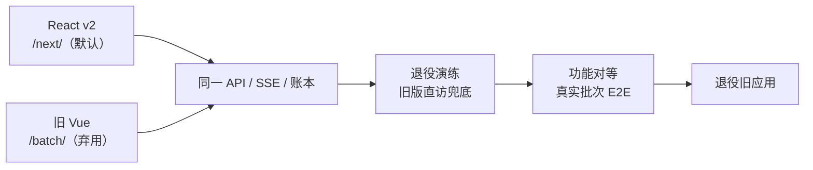

## 状态与适用范围

**Provisional（v2 已设为默认入口，退役演练未完成）**。本 ADR 把新前端（下称 **v2**）定为 React + TypeScript + Vite + Tailwind CSS v4 + 自有组件层。2026-11-23 项目方决定：**v2 设为默认入口，旧 Vue 降级为直访兜底并标注弃用**。当前 v2 覆盖批次列表、新建批次弹窗、批次详情、继续导入、站点详情、站点级构建、任务列表／详情、任务 SSE、站点任务历史和结果验收反馈；旧版 `/batch/` 只剩直访兜底和退役演练。

**2026-11-23 桌面优先范围**：v2 首轮只做桌面端，1280 为主规格、1440 检查宽屏；768、390、320、移动抽屉、窄屏操作收纳和触屏目标在前端基本定型后统一适配。本轮试点和功能对等不以窄屏为验收条件。

生效范围：

- 已生效：由本文取代 [ADR 0009](0009-批次工作台前端技术栈.md)的“Vue 3 作为批次工作台默认框架”；v2 现在是默认入口，旧 Vue 只作直访兜底和退役演练。
- 已生效：由本文修订 [ADR 0011](0011-样式层与CSS框架.md)的“继续手写原生 CSS、不引入 CSS 框架”；旧 Vue 的样式在退役前继续按 ADR 0011 执行，不再扩展新视觉。
- 不改变 [ADR 0008](0008-前端技术栈与本地Web形态.md) 的原生 `/legacy` 兜底方案，也不改变任务状态、计数、API、SSE 和账本。
- 设计基线见[前端设计系统与 v2 视觉方向](../35-前端设计系统与视觉方向.md)；业务工作流见[用户工作流与前端信息架构](../33-用户工作流与前端信息架构.md)；设计门见[D08 前端设计包与评审](../28-D08前端设计包.md)。

### 术语说明

- **v2**：新前端应用及其设计系统，不是任务运行时或业务数据的第二版本。
- **并行运行**：旧 Vue 应用和新 React 应用同时可用，共用同一 API、SSE 和账本。
- **功能对等**：v2 覆盖现有阶段 1 的页面、操作、状态和导出能力，不是“看起来差不多”。
- **Strangler 模式**：新应用默认接管，旧应用只保留直访兜底，退役演练后下线旧实现。
- **设计令牌**：颜色、字号、间距、圆角、阴影和动效的语义变量。
- **Headless 组件**：只提供交互行为和无障碍语义，不绑定视觉主题的组件。

## 背景

2026-11-23 的现状：

- `app/frontend/` 是 Vue 3 + TypeScript + Vite 应用，已通过真实批次 `b-586052683409` 的验收；批次列表、新建、批次详情、站点详情、全部任务和任务详情可用。
- 样式集中在 `app/frontend/src/style.css`：29,053 字节、1,873 行（非空 1,590 行）、31 个 CSS 变量、约 226 个顶层类选择器；11 个 `.vue` 文件没有 `<style>` 块。
- 页面主体以“页头 + 筛选面板 + KPI 卡 + 面板/表格”的纵向堆叠为主；批次详情和站点详情首屏被六张计数卡占据，下一步操作不突出。
- 组件层较薄：`.panel`、`.card`、`.badge`、`.button` 等全局类承担多种角色，缺少变体和状态契约；对话框、菜单、焦点管理等交互反复自建。
- 项目方明确希望“正经设计一版前端稿”，并接受 React 作为新版本前端、旧前端并行过渡的做法。

ADR 0011 列出的重新评估条件已经出现：

- **重复手写**：面板、指标卡、表格、徽标和按钮在 6 个视图重复，差异主要是颜色、间距和列宽。
- **类名冲突与回归**：全局作用域下有约 226 个顶层选择器；样式改动需要全站截图才能确认影响。
- **协作可读性**：`SiteDetailView.vue` 约 49 KB，新增页面和 AI 生成页面难以判断该复用哪个类；硬编码值持续增加。
- **组件行为缺口**：对话框、菜单、焦点陷阱、表单错误关联等行为反复自建，缺陷率上升。

因此，这次不是“为了换框架而换框架”，而是设计系统重建 + 前端工程层重建。框架选择必须服务于这个目标，而不是成为目标本身。

## 决策

- **v2 框架**：React 当前稳定版（实施时锁定，当前为 React 19 系列）+ TypeScript + Vite。
- **v2 样式**：Tailwind CSS v4 + `@tailwindcss/vite`，用 `@theme` 定义语义令牌；不引入 PostCSS 预处理链。
- **v2 组件**：shadcn/ui 复制进仓库的组件结构 + Radix UI 行为 + CVA 变体；视觉完全由项目令牌控制，不使用组件库默认主题。
- **数据与路由**：TanStack Query 管服务端状态；React Router 使用 hash 模式，避免迁移期改 FastAPI 路由；SSE 走现有 `/api/tasks/{id}/events`。
- **表单与表格**：React Hook Form + Zod 处理复杂表单；先自有 `DataTable`，出现排序、列可见性、选择等需求后再引入 TanStack Table。
- **测试与质量**：Vitest + React Testing Library + Playwright + axe；ESLint、Prettier、TypeScript strict；`openapi-typescript` 生成 API 类型。
- **并行方式**：v2 已作为默认入口（FastAPI 根路径 307 到 `/next/`）；旧 Vue 保留在 `/batch/`，标注弃用，只作直访兜底和退役演练。任务列表／详情、任务 SSE、站点任务历史和结果验收已迁到 v2。
- **不混装**：不在 Vue 壳里嵌 React 页面，不做微前端，不在同一页面混用两套框架、两套状态或两套视觉系统。
- **设计系统**：按[前端设计系统与 v2 视觉方向](../35-前端设计系统与视觉方向.md)执行；页面先选模板，组件只使用语义令牌。

## 为什么选 React

| 维度 | 判断 |
| --- | --- |
| 设计系统重建 | v2 的页面模板和组件层本来就要重写；React 的重写成本高于 Vue 改造，但不是从零实现业务 |
| 后台生态 | shadcn/ui、Radix、TanStack Query／Table、React Hook Form、cmdk、Sonner 等数据密集后台模式成熟 |
| 组件所有权 | shadcn/ui 复制进仓库，代码和数据都在项目内；不绑定组件库主题和升级节奏 |
| AI 协作 | React + Tailwind 的公开样本和组件模式更多，生成和复核的一致性更好 |
| 长期扩展 | 构建会话、时间线、复杂表单、图表、命令面板等后续能力有更完整的现成方案 |
| 迁移风险 | 旧 Vue 应用继续可用；桌面端试点失败可回退，不需要一次性停机 |

不选 React 的理由同样成立：它增加一次重写、双轨维护和依赖升级面；如果项目长期停留在当前 6 个页面、单用户、低变化，Vue 方案的成本更低。本文的判断前提是**页面和交互会继续增长**，且项目方接受一次有边界的前端重写。

## 为什么不是其他方案

| 备选 | 优点 | 代价 | 结论 |
| --- | --- | --- | --- |
| 保留 Vue 3 + 重做设计系统 | 不重写业务代码；现有测试和验收保留；风险最低 | 设计系统和模板仍要重写；Vue 生态的现成后台组件少于 React；项目方明确接受 React | **回退方案**；试点失败时采用 |
| Vue 3 + Tailwind + Reka UI | 设计质量可达到同等水平；改造量小于 React | 需要自己维护 Vue 侧组件模式；生态样本少于 React | 可行备选，不作为首选 |
| 继续手写原生 CSS | 依赖最少；现有页面可直接改 | 已命中 ADR 0011 的重评条件；全局类继续膨胀；组件行为和无障碍仍需自建 | 不采用 |
| React + MUI／Ant Design | 组件齐全，表格和表单现成 | 绑定组件库主题和升级节奏；与项目视觉冲突；容易形成第二套设计语言 | 不采用 |
| React + CSS Modules | 作用域清晰，依赖少 | 仍需自建设计系统和组件变体；样式与模板分离，AI 生成时容易漂移 | 不作为首选；需要强作用域时可在局部使用 |
| 微前端／页面内嵌 React | 看似可以逐页迁移 | 两套框架、构建、状态和样式边界；复杂度和回归面大于收益 | 不采用 |
| 服务端模板 | 无前端构建链 | 批量交互、局部更新、SSE 和状态收敛不自然 | 不采用 |

## 为什么是 Tailwind v4

- **令牌优先**：`@theme` 把颜色、字号、间距、圆角写成 CSS 变量并生成工具类；语义令牌是唯一入口。
- **构建简单**：`@tailwindcss/vite` 插件即可接入，不需要 PostCSS 配置链；构建只生成用到的样式。
- **一致性**：间距、字号、颜色有统一刻度，减少“每个页面各写一套值”。
- **组合性**：配合 CVA、`tailwind-merge` 和自有组件，可以把变体收在组件层，页面只做布局组合。
- **可回退**：Tailwind 是样式实现，不改变 API、路由和组件数据流；移除插件和工具类即可回到普通 CSS。

约束：

- 特性代码不得写任意值（如 `text-[13.5px]`、`bg-[#123456]`）；需要新值先补令牌。
- 页面不得直接堆长类名实现复杂组件；重复模式上移到组件或 `@utility`。
- 迁移期旧 CSS 和新 Tailwind 并存，但按页面迁移；新页面不再写旧全局类。
- 不使用带视觉的组件库主题；shadcn/ui 只提供结构和行为，视觉由令牌决定。

## 并行运行与迁移

阶段：

- **设计基线**：本 ADR + `35` 评审通过；不写生产代码。
- **默认入口（当前）**：v2 已覆盖 React 壳 + 批次列表 + 新建批次弹窗 + 批次详情 + 继续导入 + 站点详情与构建 + 任务列表／详情 + 结果验收反馈；FastAPI 根路径 307 到 `/next/`，旧 Vue 保留在 `/batch/` 并标注弃用；1280／1440、构建、类型、测试和 axe 通过；窄屏后置。
- **功能对等**：旧版退役演练、窄屏和跨浏览器；真实批次和真实任务 E2E。
- **收口**：删除 Vue 构建、旧全局 CSS 和失效路由；同步文档、CI 和部署路径。

默认入口通过条件：

- 批次列表、批次详情和站点详情在真实 API 下达到设计稿的结构和信息层级；构建启动／修复和任务控制有明确受理态。
- 根路径稳定指向 v2；旧版页面有明确的弃用标注和返回 v2 入口。
- 1280／1440 无页面级横向溢出；键盘可完成主路径；axe 无 critical 问题；768／390／320 和移动抽屉本轮不验。
- `lint`、`typecheck`、`test`、`build` 通过；首屏 JS 目标不超过 250 KB gzip。
- 开发效率和对等迁移范围可接受；没有需要大量自定义补丁的阻断问题。

试点失败条件：

- 设计稿的结构和交互在 React 下无法稳定还原。
- FastAPI 托管、路由、SSE 或构建出现阻断问题。
- 包体积或首屏性能明显超出预算，且拆分后仍不可接受。
- 对等迁移工作量明显超出约定范围，导致旧应用长期双轨。

命中任一条，回退到“Vue 3 + Tailwind + 同一设计系统”；本文标记为 Rejected，新增或修订 ADR 记录原因。设计基线 `35` 仍可复用。

## 后果与风险

收益：

- 设计系统、页面模板和组件契约一次建立，后续页面按模板扩展。
- 语义令牌和 Tailwind 刻度减少硬编码和视觉漂移。
- React 生态为后续构建会话、复杂表格、图表和命令面板提供更多现成模式。
- 旧应用并行保留，迁移可按页面验收和回退，不需要一次性停机。

代价与风险：

- **一次前端重写**：6 个视图、共享组件、API 客户端和测试需要重建；迁移期双轨维护。
- **双轨视觉**：Vue 旧界面和 React 新界面会同时存在；旧应用只修阻断缺陷，不做视觉打磨。
- **依赖升级面**：React、Tailwind、Radix、TanStack Query 等都需要锁版本和 CI。
- **Tailwind 可读性**：长类名串可能降低模板可读性；用组件层和 `@utility` 控制。
- **设计系统执行**：如果页面继续写任意值和一次性样式，换框架不会自动带来章法；评审和 lint 必须跟上。
- **验证缺口**：窄屏、移动抽屉、触屏目标、跨浏览器、读屏、深色主题和更大规模批次仍需后续验收，不能因桌面端试点通过就写成完整验收。

回退：

- 根路径切回 `/batch/`；React 应用可下线；API、账本和任务状态不受影响。
- 如果 React 试点失败，用同一设计系统在 Vue 上实现；设计文档和页面规格不废弃。
- 如果 Tailwind 试点失败，保留语义令牌和组件层，样式退回原生 CSS；不需要改 API 和路由。

## 验证记录

- 2026-11-23 静态核对：现有 Vue 应用 11 个 `.vue` 文件、`style.css` 29,053 字节 / 1,873 行 / 31 个变量 / 约 226 个顶层类选择器；页面结构和截图见 `experiments/d08/batch-workbench-e2e/`。
- 2026-11-23 资料核对：Tailwind CSS v4 官方文档确认 `@tailwindcss/vite` 插件接入方式；Vue 3.6 在 2026-09 仍为 RC，latest 为 3.5.43；shadcn-vue 与 Reka UI 作为 Vue 回退方案的组件来源。
- 2026-11-23 默认入口：v2 构建已由 FastAPI 挂载到 `/next/`，根路径 307 到 `/next/`；旧 Vue 仍在 `/batch/`，页内标注“旧版已弃用”并提供返回新版入口。Tailwind 在 FastAPI 托管下的构建已验证；旧版 `/batch/` 深链仍可用。
- 2026-11-23 桌面端试点：`app/frontend-v2/` 已落地 React 壳 + 批次列表 + 新建批次弹窗 + 批次详情 + 继续导入 + 站点详情与构建，接真实 API；`npm run lint`、`typecheck`、`test`、`build`、`format:check` 通过；1280／1440 无页面级横向溢出；筛选／搜索写入 URL；列表、详情、站点详情 axe 0 violations、0 incomplete，新建批次／启动／归档／继续导入／构建／商品预览弹窗 0 violations、2 incomplete（Radix 焦点守卫与半透明遮罩下的对比度需人工判定）；控制台和页面错误 0；桌面端表头吸附；新建批次保存/启动后留在列表并刷新；详情已验证状态带筛选、启动弹窗、继续导入、归档／恢复和导出入口；站点详情已验证结果预览、CSV、质量异常、直接启动当前站点采集（批次启动请求带 `site_keys`）、构建启动／修复请求体、任务暂停／继续／取消（路由拦截）和商品大图弹窗。构建时间线已改为 SSE 实时追加，思考默认展开、工具卡片和自动跟随；实时思考由 `ECOM_BUILD_CAPTURE_REASONING=1` 开启，默认不写入 trace（`ECOM_BUILD_PERSIST_REASONING=0`），本地 SSE 模拟验证通过；真实构建 `build-b350864915c5` 已收到实时 reasoning、工具和助手文本，但因 `bennytex.com` 是 parking page 而失败。
- 2026-11-23 任务页面与反馈：v2 新增 `/tasks` 列表、`/tasks/{id}` 详情和结果验收反馈；列表支持状态／类型／批次／站点／归档筛选和行操作，详情复用结果预览、质量异常、CSV 和商品／网址分页，并支持反馈创建与规则修复／运行／业务／重复分诊。`GET /api/tasks` 补 `batch_id`／`site_key` 过滤，OpenAPI 快照同步；前端 40 个测试和后端 `test_web`／`test_feedback` 通过。任务详情订阅 `/api/tasks/{id}/events`，hook 测试覆盖 snapshot、update、end 和断线回退；站点详情新增任务历史并支持跳到站点过滤的全部任务。真实任务 `web-5a6ef774c604` 走查列表、详情、SSE 快照／结束、站点任务历史、归档／恢复、反馈创建和分诊，写操作走预览副本账本；任务列表、任务详情和站点详情 axe 均 0 violations、0 incomplete。活动真实任务上的 SSE 增量、暂停／继续／取消、导出下载、真实批次 `b-586052683409` 对照、旧版退役演练、跨浏览器和读屏仍未执行，因此保持 Provisional。

## 关联文档

- [前端设计系统与 v2 视觉方向](../35-前端设计系统与视觉方向.md)：设计主张、令牌、组件、页面重设计和验收标准。
- [批次工作台前端技术栈](0009-批次工作台前端技术栈.md)：现有 Vue 应用的技术栈和迁移边界。
- [样式层与 CSS 框架](0011-样式层与CSS框架.md)：现有样式层决策、重评条件和回退。
- [任务控制台并入批次工作台外壳](0010-任务控制台并入批次工作台外壳.md)：现有 `/tasks` 与 `/legacy` 的结构决策。
- [前端技术栈与本地 Web 形态](0008-前端技术栈与本地Web形态.md)：原生 `/legacy` 兜底页面。
- [用户工作流与前端信息架构](../33-用户工作流与前端信息架构.md)：批次／站点／任务的对象关系和工作流。
- [D08 前端设计包与评审](../28-D08前端设计包.md)：设计门、状态矩阵和评审清单。
- [v1 界面范围](../25-v1界面范围.md)：当前必须有的页面和操作。
