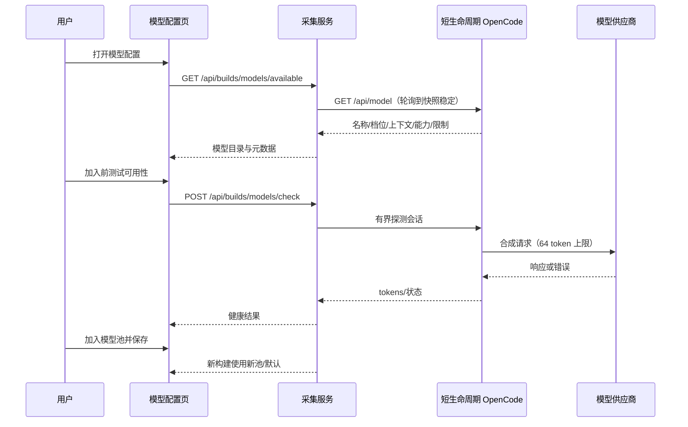

## 状态与适用范围

**Accepted**（2026-11-24）。本 ADR 扩展[构建模型池](../37-构建Agent-Harness集成与使用说明.md#构建模型池)的配置方式：模型池从只读环境变量增加为可在 WebUI 编辑、保存到本地账本，并对新构建热生效。

不改变单用户、单机 SQLite、单构建槽位和 OpenCode 凭据边界；不在页面保存 API Key，不实现多用户权限、按站点默认模型、模型成本调度或自动故障转移。2026-11-25 扩展支持全局固定默认模型，仍不等同于按站点默认模型。

## 背景

模型池最初只从 `ECOM_BUILD_MODEL_POOL` 读取。它能满足部署级固定配置，但带来两个问题：

- 用户只能在站点构建弹窗中看到已经配置的模型；模型池为空时弹窗完全不显示该区域，配置入口不可发现。
- 修改模型、默认思考等级或顺序必须改环境变量并重启服务，无法在界面内完成，也不便于确认当前生效来源。

已有 `BuildModelPool` 负责引用格式、重复模型、档位和探测校验；SQLite 账本已保存构建、规则和反馈，适合再保存一条小型运行期设置。

## 决策

- **新增通用设置表**：`app_settings(key, value, updated_at)`。本轮只使用 `build_model_pool` 一个键，值为规范化后的逗号分隔模型引用；空字符串表示“页面显式关闭模型池”，与“没有页面设置”区分。
- **优先级**：页面设置优先于 `ECOM_BUILD_MODEL_POOL`；没有页面设置时使用服务启动时读取的环境变量；两者都没有时为未配置。删除页面设置或点击“恢复环境变量配置”回到启动时环境值，不回读运行期已变化的环境。
- **保存后热生效**：保存成功后在同一把 `BuildManager` 锁内替换模型池；新入队构建立即使用新池。已排队和运行中的构建继续使用入队时写入 `builds.model_json` 的模型，不重新分派。
- **持久化与校验**：写接口先构造候选 `BuildModelPool`，校验引用格式、重复、最多 16 个模型和已知档位，再写 SQLite 并替换内存池。校验失败不改变当前池和已保存值。启动时若页面设置已损坏，记录警告并回退到环境值，避免整服务无法启动。
- **探测状态**：探测结果仍只保存在内存，按模型和档位记录；保存时只保留仍在新池中的模型和档位结果。重启后恢复为未探测。
- **页面边界**：新增 `/models`“模型配置”页，支持增删模型、调整默认思考等级、保存、恢复环境值和探测。只读服务或 `ECOM_BUILD_DISABLED=1` 时页面只读。API 写端点仍受同源写保护和只读 403 保护。
- **凭据边界**：页面只管理模型引用和档位，不读取、保存或展示供应商 API Key；凭据继续由 OpenCode 的用户级配置或环境解析。

## 2026-11-25 扩展：固定默认模型

**背景**：模型池此前只有“有池即轮转”一种分配方式。项目方需要把 CommandCode 提供的 DeepSeek V4.1 Flash 配进构建 Agent，并在页面上锚定一个默认采集模型，而不是每次新建构建都轮询。

**决策**：

- **两种分配方式并存**：不设置默认模型时保持轮转；设置后新构建和修复固定使用该模型。轮询不移动固定分配的选择。
- **默认值归属**：`default_ref` 必须是模型池中的完整引用（含档位），不能指向池外模型或同模型的未配置档位；保存时校验，非法保存不改变当前配置。
- **持久化**：新增 `app_settings.build_model_default` 键，与 `build_model_pool` 一起读取；页面恢复环境变量配置时两键一起删除。环境变量仍只定义轮转名单，不定义固定默认模型。
- **生效范围**：只影响新入队的构建和修复；已排队和运行中的构建保留入队时锁定的模型。`model_selection` 记录为 `pinned`，不进入轮转游标。
- **健康语义**：固定模型即使最近探测失败也不会自动换模型，失败体现在构建记录；轮询仍跳过标记失败的档位。本期不实现自动故障转移。
- **已知模型预设**：加入 `commandcode/deepseek/deepseek-v4.1-flash`，开放 `low`／`high`／`max`，标签为 CommandCode DeepSeek V4.1 Flash。凭据由 OpenCode 解析，页面不保存 API Key；扩展 3 后按通用有界探测处理，`low`／`max` 尚未实测。

**非目标**：按站点默认模型、按用户隔离、模型成本调度、自动故障转移和真实 commandcode 构建实测。

## 2026-11-25 扩展 2：动态模型发现

**背景**：固定默认模型解决了“选一个模型”的问题，但模型目录仍硬编码在代码里；新供应商需要改代码或手填自定义引用，面板也无法从 OpenCode 已接入的供应商中发现模型。

**决策**：

- **运行时发现**：`GET /api/builds/models/available` 初版用短生命周期 `opencode models --standalone` 读取模型 ID；扩展 3 改为读取 `/api/model` 的完整元数据，CLI 只作回退。不发送模型请求，不读取或展示密钥。结果缓存 60 秒，页面提供刷新。
- **三层结构**：页面分开“可用模型（来源目录）”“采集 Agent 模型池（活动集合）”“分配方式（轮询或固定默认）”。可用列表默认分页显示第一页（每页 20 个），支持每页 10／20／50 条、上一页／下一页、页码和跳页输入，并可按供应商、元数据状态和“未加入／已在模型池”筛选；已加入的模型保留在列表中并标为已在模型池。未知模型允许自由填写档位，并标为未验证。
- **活动池可回看与快速设默认**：可用列表提供“已在模型池”筛选和“查看模型池”入口；活动池行内直接提供“设为默认”，可用列表中已加入的条目也可直接设为默认，并显示当前默认。
- **目录降级为元数据**：`CATALOG` 只补充已知标签、档位和探测适配，不再作为准入白名单；未在目录中的模型仍可加入活动池。
- **生效边界**：刷新只更新模型列表；OpenCode 供应商配置由下一次构建读取，不需要重启采集服务。页面保存模型池/默认模型对新构建热生效；只有应用代码或环境变量变更需要重启。
- **失败回退**：发现失败时保留已保存的活动池和默认模型，页面显示错误并保留自定义引用入口，不静默清空。
- **非目标**：自动探测每个模型的真实能力、自动故障转移、按站点/用户隔离和模型成本调度。

**验证**：当前 OpenCode 环境发现 571 个模型；Chromium 1280 完成翻页、跳页、供应商／元数据／模型池归属筛选、搜索、加入、行内设为默认、固定、轮询、保存和刷新，Chromium 390、Firefox、Playwright WebKit 复验列表与布局，axe 0 violations／0 incomplete；后端全量 356 项、前端 150 项测试通过。

## 2026-11-25 扩展 3：OpenCode 能力元数据与加入前探测

**背景**：`opencode models` 只返回模型 ID，之前只有 `CATALOG` 中少数模型有名称、档位和探测适配，其他模型被标为未知；但 OpenCode 的 `/api/model` 已经返回名称、思考档位、上下文／输出限制、工具和输入模态。健康测试也被绑定在活动池，用户必须先加入并保存才能测试，工作流顺序不合理。

**决策**：

- **元数据来源**：`discover_models` 启动短生命周期 `opencode serve`，读取 `/api/model`，等待模型快照稳定后缓存 60 秒。快照未稳定或接口不可用时回退到 `opencode models --standalone` 的 ID 列表，并把条目标为缺少元数据。`CATALOG` 只作回退和覆盖，不再代表“已知模型”全集。
- **展示**：可用列表显示名称、档位、上下文／输出限制、工具和输入模态，并标出“OpenCode 元数据”；缺少元数据时才显示“缺少元数据／可手动填写档位”。
- **探测前置**：`POST /api/builds/models/check` 接受任意合法模型引用，不要求已在活动池；结果按完整引用缓存，后续加入并保存时保留仍匹配的结果。可用列表在加入前提供“测试可用性”。
- **有界探测**：只发送一次 64 token 上限的合成文本请求，不包含构建提示、规则或站点信息。已知 `max_tokens`／`max_completion_tokens` 时按已知字段发送；未知时先试 `max_tokens`，遇到 400／422 再试另一种。同一时间只允许一个探测。
- **成本与失败**：只在用户点击时请求，不做自动巡检；页面提示可能产生少量调用费用。连通性通过不等于工具、额度或构建能力已验证；失败保留错误码和最近结果。
- **工作流**：发现并查看元数据 → 加入前测试 → 加入活动池 → 设为默认或调整档位 → 保存 → 新构建使用。

**机制**：

**非目标**：自动巡检、模型成本估算、能力基准测试、自动故障转移。

**验证**：当前环境 571 个模型均从 `/api/model` 得到名称、档位、上下文和限制；`commandcode`、`opencode-go`、`yjwd` 的档位／上下文与 OpenCode 一致。后端全量 356 项、前端 150 项测试通过；临时 8879 走查 Chromium 1280／390、Firefox、WebKit，axe 0 violations／0 incomplete。本轮未发送真实模型探测请求；真实测试需用户在页面点击并承担可能的调用费用。

## 实施

- `app/src/ecom_crawler/runtime/store.py`：`app_settings` 表、`get_setting`、`set_setting`、`delete_setting`；只读账本禁止写入，旧账本缺失表时读取按无设置处理。
- `app/src/ecom_crawler/builds.py`：启动时按页面设置／环境值初始化模型池并记录来源；`update_model_pool`、`reset_model_pool` 在同一把构建锁内写账本并替换池；新增 `build_model_default` 键和固定模型选择。
- `app/src/ecom_crawler/build_models.py`：`/api/model` 元数据发现、稳定快照轮询、CLI 回退、引用规范化、默认模型校验、探测结果快照／迁移；`CATALOG` 降级为回退/覆盖；加入 CommandCode DeepSeek V4.1 Flash 预设；探测支持加入前任意引用，并按 `max_tokens`／`max_completion_tokens` 适配。
- `app/src/ecom_crawler/web/app.py`：`GET /api/builds/config` 增加来源、可编辑状态、已知模型目录和 `default_model`；`PUT`／`DELETE /api/builds/config/models` 支持 `default_ref`；新增 `GET /api/builds/models/available`；`POST /api/builds/models/check` 不再要求模型已在池中。
- 前端：`/models` 页面、侧栏入口、构建弹窗空态链接；新增「可用模型」分页列表、搜索、供应商／元数据／模型池归属筛选、跳页、OpenCode 元数据展示和加入前测试，活动池与可用列表的行内「设为默认」、「分配方式」轮询/固定控件和默认标记，已加入模型保留并标记，保存后失效 `build-config` 查询。
- 文档：`37` 补配置页、优先级和回退；`21` 更新 Provisional 例外范围。

## 后果

- 用户不必改环境变量和重启即可调整模型池；环境变量仍可作为部署默认值。
- 模型名称、档位、上下文和限制以 OpenCode 为准；发现需要短生命周期 server，首次刷新可能多等数秒，缓存后页面打开更快。
- 健康测试可在加入前执行，但会发送真实的有界请求并可能产生费用；结果只在内存，服务重启后回到未探测。
- 账本增加一条可读设置，`serve --read-only` 只能查看，不能写入。
- 页面保存只影响新构建；用户需要理解已排队／运行中构建不会改派。
- 页面不管理凭据，模型仍可能因 OpenCode 未识别供应商或缺少 Key 而探测失败；错误会显示为探测失败，而不是配置保存失败。
- 多用户场景下所有用户共享同一模型池；需要按用户或站点隔离时另立设置作用域。
- 启动时损坏的页面设置会静默回退到环境值并记录警告；页面仍显示环境来源，不保留损坏原文。需要审计时从服务日志排查。

## 验证与证据

- 后端：`app/tests/test_builds.py` 覆盖保存持久化、重启读取页面设置、新构建热生效、非法保存不改变当前池、空池回退默认模型、恢复环境值和只读 403；扩展后补固定默认模型选择、默认模型持久化、非法默认拒绝、`model_selection=pinned`、CommandCode 目录校验、`/api/model` 元数据映射与稳定快照、CLI 回退、加入前探测和 `max_tokens` 字段回退；`app/tests/test_feedback.py` 校验 OpenAPI 快照。全量 356 项和 ruff 通过。
- 前端：`ModelSettingsPage.test.tsx` 覆盖添加并保存顺序、固定默认模型、可用模型加入、未知档位自由输入、分页／跳页／每页条数、供应商／元数据／模型池归属筛选、OpenCode 元数据显示、加入前测试、活动池与可用列表行内设为默认、探测结果和只读状态；全量 150 项测试、lint／typecheck／test／format／build 通过。
- 预览：使用证据账本副本启动服务，保存两个模型、刷新后仍存在，新构建记录保留选中模型；证据在仓库外 `workbench/model-pool-config-2026-11-24/`。固定默认模型和 CommandCode 预设使用临时 8879 服务走查 Chromium 1280／390、Firefox 和 Playwright WebKit：翻页、跳页、供应商／元数据／模型池归属筛选、搜索、元数据显示、行内设为默认、保存、刷新后保留、切回轮询再恢复固定均通过，axe 0 violations／0 incomplete；证据在仓库外 `workbench/default-model-2026-11-25/`。真实 8765 服务已用元数据与加入前测试版本重启；账本当前模型池为 CommandCode、opencode-go 和 YJWD 三项，默认 CommandCode，属于项目方已保存配置，本轮保留；停掉回环只读影子实例，访问密钥未改，登录页和新前端资源（含 OpenCode 元数据/测试入口）已验证，未用密钥进入面板，也未调用真实模型。
- 未覆盖：多用户并发编辑、按站点默认模型、模型成本调度、自动故障转移、真实供应商凭据轮换、真实模型探测调用、CommandCode `low`／`max` 档位实测和真实 commandcode 构建调用；`/api/model` 元数据证明 OpenCode 看到了名称/档位/限制，不证明供应商实际可用、额度或工具调用正常。

## 替代方案

- **只读展示页**：改动小，但仍要求改环境变量并重启；用户已明确需要可编辑配置，不采用。
- **独立 JSON 配置文件**：可人工编辑，但需要额外处理原子写、路径、备份和与账本迁移的关系；SQLite 已是运行期真源，不采用。
- **环境变量优先于页面设置**：部署方可强制覆盖，但页面保存后可能看似无效，容易误判；本轮采用页面优先，回退入口明确。
- **保存时重启服务**：语义简单，但会中断构建和任务；本轮选择对新构建热生效。
- **只保留固定默认模型**：页面更简单，但会移除已有的双模型轮转能力；本轮保留两种方式，由用户选择。
- **在页面管理 API Key**：方便但扩大凭据暴露面和加密／权限需求；明确不做。
