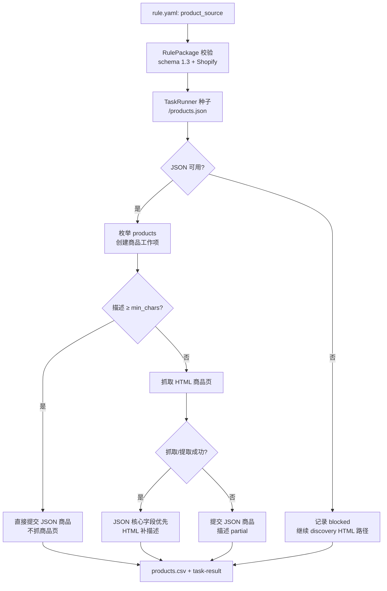

## 状态与适用范围

**Provisional**（2026-11-26）。规则层仍是声明式 YAML，商品字段的默认来源仍是 HTML 提取；本 ADR 增加一个可选的 Shopify 公开 JSON 产品源，让 `/products.json` 先提供名称、价格、币种、变体和描述，HTML／浏览器只在描述不足或 JSON 不可用时回退。实现已通过本地 fixture，尚未在真实 Shopify 店铺完成独立验收；真实站点证据补齐前保持 Provisional。

本 ADR 不改变任务状态、计数口径、价格与描述业务标准；这些仍以 `02`、`09` 和 `19` 为准。产品源不绕过登录、付费、401／403、验证码或挑战页。

## 背景

- 现有规则运行时是“规则包 → 执行计划 → 固定执行器”的声明式解释器，不是通用规则引擎；`discovery`、`fetch`、`extract` 分别负责发现、获取和字段提取。
- `discovery.sources[].type=public_json` 只能用公开 JSON 发现商品 URL，商品字段仍从 HTML 商品页提取。它不能把 JSON 条目直接当作商品记录。
- `extract.fields.*.fallbacks[].type=json_ld` 只解析页面内嵌 JSON-LD，不是 `/products.json` 的批量条目解析器；`fetch.default_engine=http_json` 只是静态 GET 的语义别名。
- 2026-11-25 未见站试点中，`babybubblestore.com` 的商品 `.json` 返回 403，静态商品页持续 429／挑战页，最终依赖 browser + HTML；这说明 JSON 优先必须有 HTML／浏览器回退，不能把 JSON 当作唯一路径。
- 业务要求是价格和币种必须匹配、库存不作为通过条件、描述不足才回退；继续把 `/products.json` 当纯发现来源会重复抓商品页，无法兑现 JSON 优先。

## 决策

### 规则契约

新增可选顶层字段 `product_source`，仅在 `schema_version: "1.3"` 且 `capabilities.product=true` 时允许：

```yaml
product_source:
  type: "shopify_json"
  url: "https://shop.example/products.json"
  product_url_template: "https://shop.example/products/{handle}"
  page_size: 250
  max_pages: 1
  currency: "EUR"
  description:
    min_chars: 200
    fallback_concurrency: 1
  variants:
    price: "min_positive"
```

- `type` 当前只支持 `shopify_json`。
- `url` 省略时由入口 URL 的 origin 推导为 `/products.json`；支持 `page`／`limit` 翻页，`page_size` 上限 250。
- `product_url_template` 省略时为 `{origin}/products/{handle}`；至少包含 `{handle}`、`{id}` 或 `{product_id}`。
- `currency` 省略时取 `site.currency`；显式提供时必须与 `site.currency` 一致，避免把店铺基础币种误写成市场展示币种。
- `description.min_chars` 默认 200；描述文本达到阈值才视为完整。
- `description.fallback_concurrency` 只能是 1 或 2；运行时用它封顶商品工作项并发，不因回退放大请求。
- `description.fallback_engine` 可选，只能与 `fetch.per_url_type.product.engine`（或默认商品引擎）一致；它不是覆盖开关，避免规则声明 browser 但实际走 static。
- `variants.price` 支持 `min_positive`（默认）、`first`、`product_price`；用于在变体价格之间选择记录价格。
- `discovery` 仍是必需的 HTML 回退来源；`product_source` 不是 `discovery` 的替代品。

### 模块边界

新增 `app/src/ecom_crawler/runtime/shopify.py`，只负责：

- 校验并持有 `product_source` 的运行时配置；
- 把 `/products.json` 条目映射为共享的 `ExtractedProduct`；
- 生成有界 `shopify_prefetch` 载荷；
- 合并 JSON 字段与 HTML 回退字段；
- 标记回退失败时的部分描述。

模块不抓页面、不拥有工作项、不写任务输出、不做任务状态或预算决策。这些仍由 `TaskRunner` 和任务账本负责，以保留重试、暂停／取消、恢复和计数语义。

### 执行流程

1. `TaskRunner._seed_sources()` 在商品任务中先加入 `/products.json` 导航工作项，再加入规则声明的 `discovery` 来源。
2. `/products.json` 成功时，逐个商品创建商品工作项，结果中带 `shopify_prefetch` 和有界的 JSON 字段；描述完整时标 `shopify_direct=true`。
3. 描述完整的商品工作项不抓商品页，直接按 JSON 字段校验并提交。
4. 描述不足的商品工作项抓取商品页：HTML 字段与 JSON 字段合并，JSON 的核心字段优先，HTML 只补描述或缺失字段。
5. `/products.json` 返回 401／403／429／挑战页／无效 JSON 时，记录 `shopify_json_unavailable`，该导航项按 `blocked` 结束，继续执行 `discovery` 的 HTML 路径。
6. 商品页回退失败（403、429、挑战、传输错误或 HTML 提取失败）时，不丢弃 JSON 商品；按部分描述提交，并记录 `shopify_description_fallback_failed` 与 `partial_reason`。
7. 任务结果 `runtime.shopify_json` 记录页数、商品数、直接提交数、回退数、跳过数和 blocked 数；`access.sources` 增加 `shopify_json`。



### 为什么不做成 `json_path` 提取器

`json_path` 只能解决“单商品 `.js`／`.json` 的字段提取”，仍然是一个商品工作项一次 JSON 请求；它不解决 `/products.json` 一次响应多商品的批量形态，也不能直接表达“描述不足才回退”的策略。当前优先做产品源模块；单商品 JSON 提取器作为后续轻量路径单独评估。

### 为什么不做成 hybrid adapter

`kind: hybrid` 的包内 adapter 当前只负责 discovery，商品仍由声明式 `fetch`／`extract` 完成。把 adapter 扩成商品记录源会改变 [ADR 0007](0007-规则层与爬虫框架边界.md) 的边界和 adapter 契约，需要单独决策；本 ADR 不这样做。

## 后果

正向：

- Shopify 店铺可以用一次 `/products.json` 请求拿到多件商品，减少商品页请求和挑战页暴露。
- 描述不足才回退，回退并发 1–2；JSON 被挡时仍走现有 discovery，不把整站判死。
- 商品工作项仍保留账本、重试、预算和恢复语义；JSON 商品不会绕过任务控制。
- 币种、价格和描述状态沿用现有校验与质量异常口径，不新增业务字段。

代价与限制：

- 规则 schema 升到 `1.3`；旧运行时遇到 `product_source` 会拒绝，需同步升级执行端。
- `/products.json` 的 `price` 不保证是市场展示币种；本实现要求 `product_source.currency` 与 `site.currency` 一致，但不做实时汇率或市场价换算。真实店铺需在构建时核对币种。
- `products.json` 的变体价格、页面默认变体和 JSON-LD 价格可能不同；`variants.price` 只是显式口径，首次真实站点验收要核对样本。
- 单商品 `.js`／`.json`、GraphQL、认证接口、库存通过条件和多币种换算仍不支持。
- `product_source` 只在 `app` runtime 的规则包生效；`RulePackage.product_plan()` 的 R06 投影不包含它，独立执行端要使用该能力需单独支持。
- 商品工作项会把短描述（小于 `min_chars`）和 JSON 字段放进账本；长描述不入账，避免 SQLite 膨胀。
- JSON 直接提交的描述只做长度阈值检查，不做渲染页 block 审计；`content_audit.products_checked` 可能为 0，block 覆盖仍需 HTML 回退或单独抽检。

## 验证

- 本地 fixture 覆盖：完整描述直接提交且不抓商品页；短描述回退 HTML 并保留 JSON 价格；`/products.json` 403 时回退 discovery；`page`／`limit` 翻页；schema 1.2 与币种不一致被拒绝。
- 真实 `babybubblestore` 探测：`/products.json?limit=2&page=1` 返回 200，价格在 `variants[].price`、无 currency 字段，按 `site.currency=EUR` 映射；2 件任务 `shopify-json-baby-2` 为 `COMPLETED`、2/2、0 失败、0 质量异常、`direct=2`、`fallback=0`，请求只有 robots、JSON 和入口页，没有抓商品页。
- 后端 runtime 分组 95 项、全量 370 项通过；ruff、文档链接和导出检查作为交付门禁。
- 仍未验收：完整构建流程、10 件通过线、真实短描述回退、blocked 回退、多币种店铺和变体价格口径；这些完成前本 ADR 保持 Provisional。

## 回滚

`product_source` 是规则级可选字段。删除该段并恢复原有 `discovery`／`extract` 即可回到纯 HTML 路径；运行时没有数据库迁移，已产出的任务结果保留 `runtime.shopify_json` 统计。若模块出现系统性问题，可先在所有规则中移除 `product_source`，再回滚代码。
