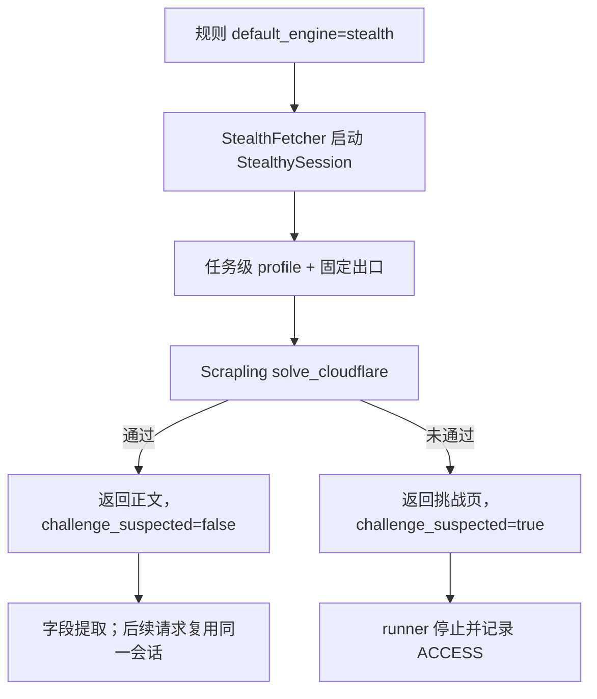

## 状态与适用范围

**Provisional**（2026-11-26）。本 ADR 给运行期增加一个可选的 `stealth` 获取引擎，用于 Cloudflare 类挑战挡住 `static` 和 `browser` 的页面。实现已通过本地单测、真实站点探测和 partsfornissans 的一次 target10 构建＋执行；仍只有一个真实站点，验收前保持 Provisional。

本 ADR 不改变任务状态、计数口径、价格与描述业务标准，也不把挑战处理扩展成登录、付费墙或验证码绕过。挑战仍是访问边界：求解失败时记录 `ACCESS` 并停止。

## 背景

- 现有 `browser` 引擎基于 Patchright，设计边界明确不求解挑战，只允许有头人工等待；`static` 引擎是 curl_cffi，也不执行挑战。
- `partsfornissans.com` 在 2026-11-19 和 2026-11-26 两次探测中都需要 Cloudflare 验证：静态请求 403，普通 Playwright／Patchright 有头样本仍被拒；Scrapling 0.5.1 的 stealth 会话可以返回 200。
- 项目已经依赖 `scrapling[fetchers]==0.5.1`，`StealthySession` 和 `solve_cloudflare` 不需要新增依赖；缺的是运行期引擎、构建简报、验证预算和清理路径。
- 构建 Agent 环境里的 `browse` relay 在 2026-11-26 复测时停在“正在进行安全验证”，不能作为无人值守的挑战样本路径；构建侧应使用同一 Scrapling 栈。
- 2026-11-26 真实探测：独立 Scrapling 会话冷启动约 157 秒，同一 profile 第二次 10.8 秒；运行期 `StealthFetcher` 冷启动 341.5 秒，紧接着的 sitemap 请求 5.6 秒。冷启动耗时波动较大，验证预算必须按最坏情况留余量。

## 决策

### 引擎契约

`fetch.default_engine` 和 `fetch.per_url_type.*.engine` 新增 `stealth`：

```yaml
fetch:
  default_engine: stealth
  concurrency: 1
  delay_ms: 1000
  retry: {max_attempts: 2, backoff_ms: 1000}
  timeout_ms: 240000
  browser:
    headless: true
    wait_selector: "h1"
    challenge_wait_ms: 180000
```

- `stealth` 复用 `fetch.browser` 的页面和启动选项，不新增独立的 `fetch.stealth` 块；`challenge_wait_ms` 在 stealth 引擎中表示挑战求解的等待上限。
- 引擎对单次请求使用至少 240 秒的超时、对挑战使用至少 180 秒的等待；规则可以调大，但不能调小到低于下限。
- `profile_name` 会加上 `stealth-` 前缀；未配置时使用 `stealth-profile`，避免和 Patchright 的 profile 混用。
- `stealth` 只支持普通页面获取；`load_more`／`infinite_scroll` 仍要求 `browser` 引擎。需要在挑战站做列表推进时，当前应改用 sitemap／listing 的 URL 分页，而不是 stealth 浏览器动作。
- `stealth` 可以用于 `product_source.description.fallback_engine`，但商品页引擎必须与 fallback 引擎一致。

### 运行期



- 一个任务一个 `StealthySession`，同一浏览器、同一 profile；请求串行，`thread_affine=true`，由 runner 内联处理。
- profile 位于 `<out-root>/<task-id>/stealth-profile`，通过 `task_resources` 注册；正常结束、取消和租约接管都会清理。worker 启动时按现有 orphan sweep 规则清理过期的 `stealth-profile`。
- 挑战页判定复用 `browser` 引擎的标题标记；未通过时写入 `challenge_suspected`，runner 按 `ACCESS_DENIED` 停止，不把 200 挑战页当内容。
- 引擎不保存整页原文、Cookie 或凭据；profile 只用于同一任务内的会话复用，任务结束即删除。

### 构建与验证

- 构建简报的引擎列表加入 `stealth`，并给出 Cloudflare 路径：静态和 Patchright 都失败后，用宿主的 Python 和 `resilient-browser-fetch` 技能的 Scrapling CLI 取一个商品页样本；样本通过才写 `default_engine: stealth`，否则记录 `ACCESS` 并停止。
- `_rule_needs_browser` 把 `stealth` 视为浏览器规则，主机验证使用 `ECOM_BUILD_BROWSER_VALIDATION_SECONDS`（默认 600 秒）而不是 120 秒。
- 构建 Agent 的样本 profile 放在 `work/stealth-profile`，复用同一会话；主机验证使用自己的任务 profile，两者不共享。
- 不在 `fetch.browser: false` 时允许 `stealth`；规则校验和 schema 引擎枚举同步更新。

### 版本边界

本次不新增 `schema_version`。`stealth` 是 `fetch` 的引擎枚举值，不改变规则结构；`schema_version` 仍按 `1.1`／`1.2`／`1.3` 的既有语义。代价是：使用 `stealth` 的规则只能在本版本及以后运行，旧版本会把引擎值判为不支持。若后续把挑战处理扩展成稳定的公共契约，再评估是否升级 schema 版本。

## 备选方案

- **Patchright + real Chrome**：2026-11-19 已实测有头真实 Chrome 仍 403；继续叠加浏览器参数只会重复失败。
- **chrome-late**：先让挑战跑完再接入，实测可通过，但需要系统 Chrome、可见窗口和额外的晚接入流程；运行期实现和无人值守成本都高于 Scrapling 会话。
- **cdp-attach 用户浏览器**：依赖用户在场和已登录的浏览器，不能作为构建／执行的可复现路径。
- **新增独立求解服务**：超出本轮范围，也引入外部依赖和费用。

## 验证

- 本地单测覆盖：引擎枚举、`fetch.browser: false` 冲突、`StealthConfig` 下限与 profile 命名、响应映射、挑战标题、listing 拒绝、会话关闭，以及 `stealth` 计入 600 秒验证预算。
- runtime 分组通过；新增 `test_stealth` 已纳入 runtime 分组。
- 真实探测：`https://www.partsfornissans.com/` 冷启动 200，标题正常；`/sitemap.xml` 200，21 个子 sitemap，前 8 个为商品 sitemap；同一会话第二次请求 5.6 秒。证据在仓库外 `workbench/partsfornissans-2026-11-26/`。
- partsfornissans target10：构建 `build-dc1bb4812cc0` 首轮 sitemap 冷启动返回挑战，自动修复改为入口页 + `/floor-mats` 列表后 6/6、USD 6、0 失败，`seconds_budget=600`，规则 `2026.11.26-1` 激活；执行 `web-7caf7a123279` 10/10、0 失败、0 质量异常、`COMPLETED / NATURAL_END`、约 612 秒，`runtime.fetch_engines=["stealth"]`。
- 首轮失败暴露了文档 URL 的冷启动问题：`.xml.gz` 不能用 `page.goto`，而上下文 request 不跑挑战求解。现已改为首次请求走 page 导航、后续文档 URL 用同一上下文 request；冷探针 `sitemap.xml` 328.2 秒、商品子图 1.9 秒、4104 个商品 URL。当前激活规则使用列表路径，sitemap 修复由探针和单测覆盖，尚待下一次构建使用。
- 后端全量 388 项、构建 130 项、runtime 104 项和 ruff 通过。

## 风险

- 冷启动挑战耗时从 157 秒到 341 秒不等；600 秒验证预算对 6 件样本通常够用，但遇到更慢的挑战或额外导航页可能不足。若真实构建验证超时，先用证据判断是挑战延迟还是规则问题，再决定是否提高预算，不静默放宽。
- `StealthySession` 的浏览器进程由 Scrapling 启动，运行期只注册 profile，不注册浏览器 PID；worker 被强杀时可能残留浏览器进程，当前依赖会话关闭和 profile sweep 兜底，尚不等同于 Patchright 的进程注册。
- Cloudflare 策略、出口信誉和 Scrapling 版本都会影响通过率；一次通过不代表长期稳定，后续复验要记录出口、客户端、时间和请求数。
- 站点 sitemap 是 21 个子图的索引；规则必须用 `sitemap_patterns` 和足够的 `max_sitemaps` 选中商品子图，不能把前 3 个非商品子图当全量。
